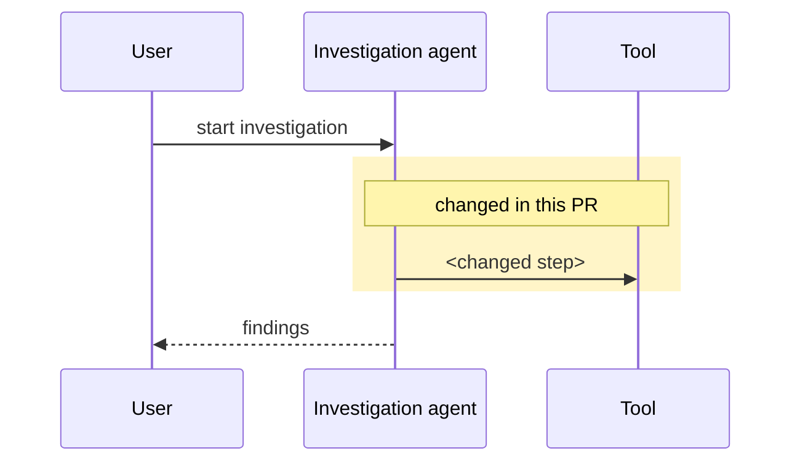
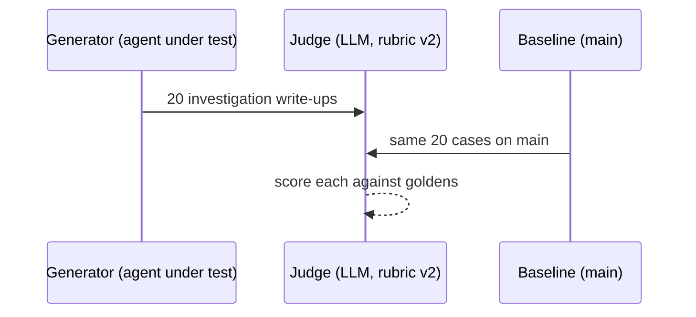

# Nightshift PR description

A reviewer should be able to understand a Nightshift PR in a couple of minutes: what was wrong, what changed, how it works now, and why we believe it. Show these things instead of describing them in paragraphs.

## Pick the tier first

The tier is the highest tier of any file the PR touches. These match the tiers in the `nightshift-review` skill. If the two ever disagree, `nightshift-review` wins.

- **High:** authorization and service accounts, the sandbox, secrets, prompts and guardrails (`**/instructions/*.md.text`, `kbn-nightshift-decision-trees`), outbound messages such as Slack, data migrations.
- **Medium:** investigation logic, agent tools, API routes, saved objects without a migration, telemetry schemas.
- **Low:** docs, copy, additive UI behind a flag, tests, dev-only evals.

## What each tier needs

| Section | Low | Medium | High |
| --- | --- | --- | --- |
| 1. The problem, shown | One sentence | Yes | Yes |
| 2. The after, shown | No | Yes | Yes |
| 3. How it works, with the change marked | No | If the flow changed | Yes |
| 4. How we evaluated it | No | If there's an eval | Yes, or say why none applies |
| 5. The results | No | If there's an eval | Yes |

Don't add sections a tier doesn't need. A diagram on a typo fix teaches people to skip diagrams.

## The sections

Keep each section to one or two sentences of prose around the visual.

1. **The problem, shown.** A screenshot of the current behavior (the chat, the investigation, the UI) with the bad parts highlighted, and a one-line caption per highlight saying why it's bad. For a server-only change, a log excerpt or API response works the same way.
2. **The after, shown.** The same view after the change, on the same case, side by side or directly below.
3. **How it works, with the change marked.** A Mermaid sequence diagram of the flow. Put the steps this PR changes in a `rect` block or mark them with a `Note`.
4. **How we evaluated it.** A Mermaid sequence diagram of the eval: what gets generated, what gets judged, who or what judges it, and against what (goldens, rubric, a baseline run). A reviewer should be able to tell at a glance whether the eval is sound.
5. **The results.** A small table or a Mermaid chart, then one plain sentence on what it shows and one on what it doesn't.

Put everything else in a collapsed `<details>` block at the end: caveats, gates, follow-ups, file lists, run IDs.

## Rules

- **Screenshots come from the running app.** Never use mockups or generated images. If you can't run the app, say so instead of faking it.
- **Prefer Mermaid** for diagrams and charts. GitHub renders it, and it stays editable as text.
- **Define eval terms the first time you use them.** A reviewer new to Nightshift won't know what a round, sample, gate or golden means. One clause each is enough.
- **Keep Kibana's PR template.** The visual map goes in `## Summary`. Keep the checklist and `### Identify risks` sections, and fill in the risks honestly for High changes.
- **Say what's missing.** If a High change has no eval, write one sentence on why, so the reviewer doesn't have to ask.

## Example skeleton (High tier)

````markdown
## Summary

<one sentence: what this PR changes and why>

**Before.** <screenshot with highlights>
<caption per highlight>

**After.** <screenshot of the same case>



**Eval.**



| Metric | main | this PR |
| --- | --- | --- |
| <metric> | <n> | <n> |

<one sentence on what it shows, one on what it doesn't>

<details>
<summary>Details</summary>

<caveats, follow-ups, run IDs, file list>

</details>
````
