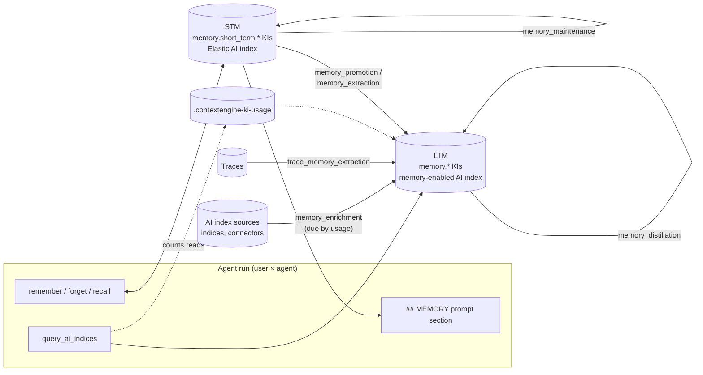

# Agent memory POC: what was built and why

**Branch:** `context-engine-memory-poc`. **Draft PR:** [elastic/kibana#300813](https://github.com/elastic/kibana/pull/300813). It is a POC, not for merge.

**State (2026-10-27):** the first round is one commit, `8fa3d9103905` (119 files), and it is pushed. Everything after it is uncommitted:
- the graph;
- Configure;
- the last-run step;
- the automations list changes;
- memory enrichment.

Everything was verified on a local stack only.

The background research (schemas, the memory scoping proposal, the options considered) is in [`agent_memory_research.md`](agent_memory_research.md). This document is the record of what exists on the branch and the decisions behind it.

---

## 1. Summary

Agents get memory in two tiers:

- **Short-term memory (STM)** is private to one user and one agent: a user-scoped document of the Elastic AI index (section 2.4), visible to its owner and administrators through the ordinary AI index APIs. An agent writes it with `remember`, passing only content. The server stamps who, which agent and which session. It lives as `memory.short_term.*` KIs in the Elastic AI index. It is injected into the agent's prompt and searchable with `recall`.
- **Long-term memory (LTM)** is shared knowledge: `memory.*` KIs in any AI index with memory enabled, readable by everyone who can read that index. Only automations write it.

Seven automation templates move and maintain memory on a schedule:
1. promote STM into LTM;
2. extract facts, entities and relationships from STM, traces or any query;
3. distill (merge and retire) LTM;
4. maintain STM (decay and dedupe);
5. enrich much-read memories from the index's sources.

That is five jobs: the second is built by three templates (structured extraction, custom extraction, trace extraction).

The templates are ordinary workflows, configurable after install. They know when they last ran.

The AI index page now has:
- a KI graph behind the overview;
- per-automation Run and Configure buttons;
- the last run of each automation.

### 1.1 How memory worked before this branch

On `main` (checked at `e24a7d002d08`), memory was one tier: shared KIs in an ordinary AI index. There was no system index and no private memory.

- **Write:** `remember` wrote a `memory.session_fact` or `memory.session` KI straight into the backing index (`ai-index-idx-<id>`) of an AI index the model named with a required `aiIndexId`. The write ran as the current user.
- **On the document:** the conversation id (`memory.session_id`), a `conversation://` reference and `tool://` provenance with the agent and run. There was no owner field.
- **Recall:** no `recall` tool and no prompt injection. A memory was just a KI, so agents read it with the generic `query_ai_indices` tool. For a memory-enabled index, `describe_ai_index` supplied a hybrid lexical and semantic recall query.
- **Revise and forget:** `remember({ id })` revised an existing memory, and `forget({ id })` soft-deleted one (a lifecycle tombstone).
- **Expiry:** 90 days after each write by default.
- **Gating:** the global `contextEngine:memoryEnabled`, plus `memory_enabled` on the AI index. The tools appeared when one of the agent's AI indices had memory enabled.

Sharing was the stated intent. The `remember` description said memory is shared with every user and agent that can access the AI index, and told the model not to store personal details or preferences. The downsides:

| # | Downside | Consequence |
| --- | --- | --- |
| 1 | No private memory: nothing records who wrote a memory | "I prefer ES\|QL" from one user becomes knowledge for everyone. Personal context can't be kept at all, and the model has to decide what is safe to share |
| 2 | Access is whatever the AI index allows: Context Engine read plus Elasticsearch `read` on the backing index | Everyone who can read the AI index reads every memory in it, including through Elasticsearch directly |
| 3 | No space isolation at the data layer: user AI index documents carry no permissions, only the Kibana query route filters by space | With Elasticsearch `read` on the backing index, memories are visible from any space |
| 4 | The model chooses the target index, and nothing checks it is one of the agent's configured indices | Any memory-enabled AI index in the space could be written to, given write access. Over MCP a caller could name any id |
| 5 | Writes run as the current user | Every user who chats with a memory-enabled agent needs write access to the AI index's backing index, which also lets them write to it directly |
| 6 | No author check on revise and forget: `remember({ id })` revises and `forget({ id })` deletes any memory of the index (only the type is checked) | Any user or agent can rewrite or delete another's memories |
| 7 | MCP clients pass their own `sessionId` | The session stamped on a memory isn't trustworthy outside Agent Builder conversations |
| 8 | Recall depends on the model running a query | Nothing guarantees relevant memory is read; there is no injection of recent memories |
| 9 | Nothing maintains memory: no dedupe, merging, contradiction handling or usage tracking | Memory grows with duplicates and stale facts. Each `remember` call writes one KI as the model phrased it |
| 10 | Expiry only hides memories, and `forget` leaves a tombstone | Expired and forgotten memories stay on disk; nothing purges them |
| 11 | Memory shares the index with other KIs | Ordinary KI retrieval must exclude `memory.*` (`EXCLUDE_MEMORY_KI_TYPES_FILTER`), and every query that forgets to do so mixes memories into its results |

How this branch addresses them:
- 1–3, 5 and 7: STM is private and server-stamped, as user-scoped documents of the permission model the Elastic AI index already uses (sections 2.1, 2.4 and 3).
- 4 and 6: agents no longer write long-term memory; only automations do (decision 6). STM tools are owner- and agent-bound.
- 8: prompt injection and `recall`.
- 9: the distillation, maintenance and extraction automations.
- 10: `purgeKis` and STM decay.

11 remains by design (decision 1). 2 and 3 still apply to long-term memory in user AI indices. Long-term memory is shared knowledge, and real user scope there depends on the `principals` work (decision 2).

---

## 2. Storage

### 2.1 Short-term memory

STM documents are ordinary KIs in the Elastic AI index (`.ai-index-idx-elastic-index`, AI index id `elastic`, the index that also holds SML data).

| Aspect | Behavior |
| --- | --- |
| Types | `memory.short_term.session` and `memory.short_term.session_fact`. The model passes `memory.session` / `memory.session_fact`, and the server adds the prefix |
| Owner and state | Kept in `attributes` (flattened, because the AI index mapping is strict): `memory.user_id`, `memory.user_name`, `memory.agent_id`, `memory.session_id`, `memory.space`, `memory.last_used_at`, `memory.promotion.{status,reason,ai_index_id,ki_id,updated_at}` (the summary shown to the owner), and `memory.decisions.<workflow id>.{status,reason,ai_index_id,ki_id,updated_at}` (each deciding automation's own decision) |
| Provenance | `governance.provenance` is `user://<id>`, with the agent and session as metadata. `references` holds `conversation://<session>` as `derived_from` |
| Lifetime | 30-day default TTL (`expires_at`), refreshed by a revision. A revision also resets promotion to `pending` and clears every automation's decision |
| Writes | Kibana's internal user only, with optimistic concurrency. The index is created on first write |
| Who sees it | Each memory is a user-scoped document (section 2.4): its permissions list only the owner's principal, `user://<stable user id>`. Through Context Engine's query API and KI routes, the owner sees their memories and an administrator sees everyone's; other users see nothing. Direct Elasticsearch queries (Discover, `execute_esql`, `_query` as a user) show none of them to anyone but superusers and explicit index grants. The agent's tools read through Agent Builder's memory client, bound to the conversation owner |
| SML | SML search and autocomplete exclude `memory.*`, so memories never show up as SML results |
| Delete | `forget` and the maintenance automation hard-delete. Deleting through the AI index KI API (the Memory page) soft-deletes: a tombstone that no memory read returns and that the next decay removes |

The user is the **conversation owner** when the run has a conversation, and the request's stable user id otherwise. That id is the profile uid, or a `realm:` fallback for basic-auth users without a profile. API-key callers without an owner profile get no STM.

### 2.2 Long-term memory

LTM documents are `memory.*` KIs in the AI index's own backing index, with the base KI schema. Every reader of the AI index can read them. "Memory enabled" on an AI index means "the memory automations may write long-term memory here".

Ids are stable, so many mentions of one thing update one KI:

| Kind | KI type | Id |
| --- | --- | --- |
| Fact | `memory.fact.<kind>` | `memory/fact/<kind>/<key>` |
| Entity | `memory.entity.<kind>` | `memory/entity/<kind>/<key>` |
| Relationship | `memory.relationship.<kind>` | `memory/relationship/<kind>/<source>/<target>`, with references to both ends |
| Custom type | `memory.<type>` | `memory/<type>/<key>` |
| Promoted fact / synthesis | `memory.session_fact`, `memory.session` | `<automation name>/<key>` |

Everything recognizes memory by the `memory.` prefix: type labels, `describe` counts, and the default exclusion `type IS NULL OR type NOT LIKE "memory.*"`.

### 2.3 Usage signals

The automations need to know which memories are used.

- **STM:** `attributes.memory.last_used_at` is stamped when `recall` returns a memory and when the prompt section shows it. It is a bulk partial update, at most hourly per memory, and fire-and-forget. `memory_maintenance` uses it to forget unused memories.
- **LTM:** a storage index, `.contextengine-ki-usage`, keeps one document per space and KI. The document id is a sha256 of the two. Its fields are `access_count`, `first_accessed_at`, `last_accessed_at`, `last_enriched_at` and `access_count_at_enrichment`. Every row the agent tool `query_ai_indices` returns with an `id` column counts one read, fire-and-forget. `memory_enrichment` uses it to pick memories.

### 2.4 User-scoped documents in the Elastic AI index

Documents of the Elastic-managed AI indices (`.ai-index-*`) carry `permissions.kibana.privileges`: per space, the Kibana actions a reader must hold. This branch adds an optional user scope to that same model, without Elasticsearch changes:

- **Stamp.** A user-scoped entry lists a user principal as its required action: `{ space, name: ["user://<stable user id>"], count: 1 }`. The stable user id is the same one Agent Builder uses: the profile uid, or `realm:[type, name, username]`. Short-term memory is stamped this way (owner and space from the memory).
- **Elasticsearch.** No role grants an action named `user://…`, so the managed index's document-level security hides user-scoped documents from every direct query. Superusers and explicit index grants are the exception.
- **Kibana (Context Engine).** Reads of managed AI indices run as the internal user under a visibility filter (`server/ai_indices/user_scope.ts`).
  - The filter mirrors SML's: a document is public, or one entry of the space is public, or it lists only actions the caller holds.
  - It adds two things. The caller's own principal counts as held. An administrator (`isAdminFromRequest`: wildcard Kibana privileges, such as `superuser`) also matches an entry whose only unmet requirement is a user principal.
- **Which paths.**
  - The KI routes (list, get, update, delete, restore) use this for any managed AI index. They use a client that runs as the internal user, adds the filter to every `search` and ES|QL query, allows only writes after such a read, and refuses other read methods.
  - The query API (`_query`, also behind `query_ai_indices`) uses it when the ES|QL reads nothing but managed AI indices, with no cross-cluster source, using only row commands (FROM, WHERE, EVAL, KEEP, DROP, RENAME, SORT, LIMIT, STATS, INLINE STATS, MV_EXPAND, DISSECT, GROK, SAMPLE). Any other query runs as the caller, as before, and sees no user-scoped documents.
- **Shared identity code.** `toStableUserId`, the API key owner lookup, `isAdminFromRequest` and the principal helpers moved to `@kbn/agent-builder-server/identity`, so Context Engine and Agent Builder derive the same id.

The real version needs Elasticsearch to know the principal rule (research section 1.2.2): a `principals` field, and `_user.profile_uid` in the document-level security filter. Then direct queries work too, and the `user://` overloading of `name` goes away.

---

## 3. What agents get

**Gating.** Memory is on when the global advanced setting `contextEngine:memoryEnabled` is on and AI indices are enabled. This is `ExperimentalFeatures.memory` in the runner. The memory tools no longer depend on the agent having a memory-enabled AI index.

**Tools** (registered by `context_engine_agent_builder`):

| Tool | Input | Does |
| --- | --- | --- |
| `platform.context_engine.remember` | `id?`, `type`, `title`, `description`, `content`, `tags?`, `expires_at?` (`sessionId` only over MCP) | Writes or revises an STM of the caller with this agent |
| `platform.context_engine.forget` | `id` | Hard-deletes one of the caller's STM with this agent |
| `platform.context_engine.recall` | `query`, `limit?` | Lexical (BM25) search over the caller's STM with this agent |

All three refuse memories of another agent. Tools get the memory client from `ToolHandlerContext.getShortTermMemoryClient`, which the runner binds to the conversation owner.

**Prompt injection.** A `## MEMORY` section lists the 10 most recent STM of the user with this agent. Content is cut to 500 characters and marked as untrusted. A missing identity or a failed read skips the section instead of failing the run.

**`describe_ai_index`.** The memory block now reads "Long-term memory". It lists the memory categories and gives entity-lookup and relationship-traversal queries (`MATCH(references.uri, ?uri)`, because `references.uri` is multi-valued). It says agents don't write here.

---

## 4. Workflow steps

All steps have server and public definitions, so they show up in the workflow editor.

**Agent Builder, short-term memory.** These are cross-user, so the workflow owner must be an admin (`isAdminFromRequest`).

| Step | Does |
| --- | --- |
| `ai.memory.short_term.list` | STM across users that this workflow hasn't decided yet, filtered by agent. Another workflow's decision doesn't hide a memory |
| `ai.memory.short_term.set_promotion` | Records this workflow's decision (promoted or rejected, with a reason) and updates the owner-facing summary, where a promotion by any workflow wins. A concurrent revision by the owner wins |
| `ai.memory.short_term.list_by_owner` | Owners (user × agent) whose STM changed within `changed_within_hours`, with their memories |
| `ai.memory.short_term.consolidate` | Within one owner: merges duplicates into a kept memory, then deletes the rest. The merged memory keeps the longest lifetime, the latest `last_used_at` and all references |
| `ai.memory.short_term.decay` | Hard-deletes expired STM, and expiring STM neither written nor used for `unused_days` |

**Context Engine.** These steps have the same feature and privilege checks as the existing KI steps.

| Step | Does |
| --- | --- |
| `context-engine.getAiIndex` | The AI index definition: `dest`, `memory_enabled`, `sources`, and `traces` with their resolved ES\|QL queries |
| `context-engine.queryAiIndex` | ES\|QL through the AI index `_query` path: current, active, unexpired KIs of the space only, row cap 1000. Outputs `columns`, `values`, `rows` |
| `context-engine.purgeKis` | Permanently deletes every revision of KIs whose current revision is deleted, expired or `verification_failed` and older than N days. Default types `memory.*` |
| `context-engine.getLastRun` | The workflow's own last completed, non-test run. Outputs `since`, `hours_since`, `first_run` and `last_success`, bounded by `default_hours` and `max_hours` |
| `context-engine.getKiUsage` | The given KIs that agents read at least `min_new_accesses` times since their last enrichment and that weren't enriched within `min_days_since_enrichment` days, most-read first, up to `limit` |
| `context-engine.recordKiEnrichment` | Marks KIs enriched now, so their reads count from zero again |
| `context-engine.updateKi` (extended) | New `add_references` and `add_attributes`, merged into the stored KI. References are deduped by uri and relation; attributes are replaced key by key |

---

## 5. Automation templates

### 5.1 What every memory template shares

- It is a YAML file in `install_automation_template/` with a renderer in `render.ts`. It is installed by `platform.context_engine.install_automation_template` into the AI index's `automations[]`. A `ce-template:<id>` tag makes reinstalling the same template and name replace it in place.
- It runs on a schedule and on a manual trigger, and never overlaps itself (`concurrency: drop`). The concurrency key is rendered from `consts.ai_index_id` when a run starts.
- The YAML holds only what was chosen. Anything that follows from other values is computed by existing workflow steps on every run (decision 38).
- **Prompt and model are consts:**
  - `consts.instructions` holds the prompt text.
  - `consts.connector_id` picks the model. Empty means the Context Engine model (Model Management feature `context_engine_prompt`). The YAML pattern `` handles both empty and missing.
- Every template renders into a definition that `WorkflowSchema` accepts and `convertToWorkflowGraph` can build. Tests check this.

### 5.2 The templates

| Template | Reads → writes | Install parameters (defaults) | Notes |
| --- | --- | --- | --- |
| `memory_promotion` | Pending STM → `memory.session_fact` LTM | `agentIds` (all), `batchSize` 50, `interval` 1h | Promote (rewritten without personal details), reject, or wait. Admin only |
| `memory_extraction` | STM or query sources → fact, entity and relationship KIs | `extraction` (required), `memorySources`, `agentIds`, `batchSize` 50, `interval` 1h | Structured alternative to promotion. Decisions are per workflow, so it can run alongside promotion or custom extraction |
| `memory_custom_extraction` | Same → `memory.<type>` KIs with typed attributes | `customExtraction` (required), plus the same as above | Free-form kinds; attributes are JSON Schema |
| `trace_memory_extraction` | The AI index's traces since the last successful run → `memory.session_fact` LTM | `lookbackHours` 24 (first run), `maxRows` 50, `interval` 1d | Never reads more than 7 days back |
| `memory_distillation` | LTM `memory.session*` → merged syntheses, retired memories, purge | `maxMemories` 200, `purgeAfterDays` 30, `interval` 1d | Soft-deletes first, so a bad run can be restored until the purge |
| `memory_maintenance` | STM → decayed, deduplicated STM | `agentIds`, `unusedDays` 14, `maxOwners` 20, `maxMemoriesPerOwner` 50, `interval` 1d | Elastic AI index only. Revisits owners changed since the last successful run (30 days on the first run). Admin only |
| `memory_enrichment` | Much-read LTM + the index's sources → enriched LTM | `memoryTypes` `memory.entity.*`, `minNewAccesses` 3, `minDaysBetweenEnrichments` 7, `maxEnrichments` 5, `enrichmentAgentId` `elastic-ai-agent`, `interval` 1d | One ephemeral `ai.agent` run per due memory, with the ES\|QL and connector tools |

**Extraction config.** `extraction` is `{ instructions?, facts[], entities[], relationships[] }`. A fact or entity has a `type`, a `description` and optional `attributes`. A relationship has a `type`, a `description`, a `source` and a `target`. `customExtraction` is `{ instructions, types[] }`, and its attributes are JSON Schemas.

The install tool validates either config. Nothing derived from it is stored. On every run, the workflow builds three pieces with existing steps, a `compile` `data.set` rendering JSON with Liquid followed by a `compiled` `data.set` using `json_parse`:
- the model's output schema, with the kinds as enums, used as `schema: "${{ steps.compiled.output.schema }}"`;
- `node_kinds` (kind → KI type and id prefix);
- `relationship_kinds` (kind → allowed ends).

A test checks that these equal what the TypeScript compiler (`compileMemoryExtractionConfig`, `buildExtractionOutputSchema`) produces for both config shapes.

**Memory sources.** `memorySources` lists 1 to 5 sources, and each costs one model call per run:
- `{ type: 'short_term_memory' }` is the default. It reads pending STM, marks it afterwards, and needs an admin.
- `{ type: 'query', query, ... }` runs any ES|QL as the workflow owner. This covers the index's own KIs and LTM, traces, or any other index.

Query sources take:
- `description`;
- `lookbackHours`;
- `idColumn` and `uriPrefix`, which say how a row is cited (`ki://`, `trace://` or `record://`);
- `excludeMemory`, on by default for AI indices;
- `maxRecords`.

`sources` stores only these choices, in snake_case. Each run applies the defaults and appends the filters per source, in the loop's `source_context` step.

**Enrichment run.** Each run:
1. Reads candidates with `type LIKE ?memory_types` (passed as a parameter, not spliced in).
2. Picks due memories with `getKiUsage`.
3. For each due memory, an agent gets:
   - the memory, the instructions and the sources;
   - the tools `execute_esql`, `get_index_mapping` and `execute_connector_sub_action`.

   It returns `{ enriched, summary, content, attributes, references }`.
4. When `enriched` is true, `updateKi` writes the merged content and adds the attributes and references.
5. Every memory the agent finished is recorded with `recordKiEnrichment`, even when nothing new turned up. A failed agent run leaves the memory due.

### 5.3 Configuring an installed automation

The **Configure** button on an automation row opens a flyout over the workflow's `consts` and schedule:
- Install-time identity (`ai_index_id`, `automation_name`) is read-only.
- `connector_id` is a picker of AI connectors.
- The schedule is editable.

On save, the flyout writes the edited consts into the YAML and saves it through the Workflows API. Comments and layout are preserved (`yaml` `parseDocument`). No template stores derived values, so there is nothing to recompile. Changing extraction kinds takes effect on the next run, and so does editing the YAML by hand.

**Field checks.** The document and unit-profile templates start with a `check_fields` ES|QL query, `KEEP <configured fields> | LIMIT 0`. A field the setup agent chose that has since been renamed or removed fails the run there, with Elasticsearch naming it ("Unknown column"). Otherwise every item inside the loop would fail, and the loop continues past failures. The index-metadata template already queries its category field first.

---

## 6. UI

**Agent Builder: `/agents/:agentId/memory`** ("Memory", experimental). It lists the STM with this agent that the caller may see, read and deleted through Context Engine's generic AI index APIs (no memory-specific routes):
- delete per row;
- "Forget all", with a confirmation;
- a promotion badge with the reason;
- for an administrator, who sees every user's memories, an Owner column, and "Forget all" disabled so one click can't delete other users' memories.

**Context Engine AI index page, Overview tab:**

- **KI graph behind the overview:**
  - Every active KI (up to 1,000, one ES|QL query through `_query`) is a bubble, colored by type family and sized by links.
  - `ki://` references link KIs. Other references (`index://`, `stm://`, `trace://`, …) become their own bubbles, so KIs citing the same thing connect.
  - The custom canvas renderer is a 3D force layout, rotating slowly. Drag orbits, scroll zooms, and there are pause and reset controls and per-layer toggles.
  - Clicking a bubble flies to it, highlights its neighbors and opens a reader flyout. The flyout shows the content, tags, references and linked nodes, and links to the KI page.
- **Layout:**
  - On a 3-column grid, the panels take the left two-thirds and the graph the right two-thirds, overlapping in the middle.
  - The graph is sticky under the page header and runs to the browser edge.
  - Below EUI's large breakpoint, the graph stacks under the panels.
- **Transparent panels:** `BackdropAwarePanel` uses EUI's `color="transparent"` while the graph is behind the panels. With no KIs there's no graph, and the panels look as before.
- **Traces panel:** shown again, but only when `contextEngine:memoryEnabled` is on and the index has memory enabled.
- **Automations list:** each row has a Run button, a Configure button and a menu (View, Open in Workflows, Delete).
  - Run turns into a spinner while a run is in progress, linked to that execution.
  - The last run shows as a status icon with a tooltip (succeeded, failed, cancelled) and a relative time linking to the execution.
  - The row polls every 3 seconds while running and every 30 seconds otherwise. Test runs don't count.
- **KI views:** memory types are labelled, for example "long-term memory (entity: service)" or "short-term memory (fact)".

---

## 7. APIs and contracts

| Surface | Addition |
| --- | --- |
| ~~`GET /internal/agent_builder/memory`, `DELETE /internal/agent_builder/memory`, `DELETE /internal/agent_builder/memory/{id}`~~ | Removed (decision 37): the Memory page uses `POST /api/context_engine/ai_index/_query` and `DELETE /internal/context_engine/ai_index/elastic/kis/{id}`. The original description follows | The caller's own STM only. 404 for others' memories, 400 without an identity |
| ~~`POST /internal/context_engine_agent_builder/automation_templates/_compile`~~ | Removed (decision 38). The original description follows | Pure YAML transform (at most 1 MB), version 1. Authorization is off with a stated reason: the save goes through the Workflows API, which checks permissions |
| `agentBuilder.memory` start contract | `getScopedClient({ request })` and `getSystemClient()`. The runner uses the service's internal `getScopedClientAsUser` to bind a run to the conversation owner |
| `@kbn/agent-builder-server` memory types | `ShortTermMemory*` types, `markUsed`, owner groups, consolidate and decay params, identity and not-found errors |
| `ToolHandlerContext` / `AgentHandlerContext` | `getShortTermMemoryClient` |
| `contextEngine` start contract | `getKiUsageService()` (`recordAccess`, `getUsage`, `recordEnrichment`) |
| `QueryAiIndicesResponse.values` | Typed `Array<Array<FieldValue \| FieldValue[]>>`, because ES\|QL returns multi-valued fields as arrays |
| `.contextengine-ki-usage` | New Kibana-managed storage index (`StorageIndexAdapter`) |

---

## 8. Decision log

Each row says who made the call: **user** (asked for or chose it) or **POC** (a default taken while building, open to change).

| # | Decision | Alternatives considered | Why | By |
| --- | --- | --- | --- | --- |
| 1 | Memory is a KI type in the existing AI index, with the same schema. No `.ai-memory-*` index | A separate memory index (Kathleen's scoping POC) | Reuses storage, query, lifecycle and automations. Extra fields go in `attributes` | user |
| 2 | User scope on managed indices is the long-term direction: `principals` on each privilege entry (research Option A). Not built | Top-level `scope_id`, overloading `name`, role filters | Covers user-scoped KIs everywhere, not just memory | user |
| 3 | Customer-owned `ai-index-*` gets no user scope; first-party paths refuse to write user-scoped items there | Kibana-side filtering | Elasticsearch can't enforce it there, so it would be false isolation | user |
| 4 | Two tiers: STM per user × agent, LTM shared | One tier with per-memory scope | Private capture, shared knowledge, and an explicit promotion step between them | user |
| 5 | `remember` takes no ids; the server stamps user, agent, session and space | Model-passed `aiIndexId`, `sessionId` | The model could write into any memory-enabled index in the space, and could claim any identity | user |
| 6 | `remember` has no direct path to LTM; only automations write LTM | An explicit "team knowledge" write | Keeps one reviewed path across the privacy boundary | POC |
| 7 | Recall works both ways: a `recall` tool and prompt injection (10 most recent, 500 characters, untrusted) | One or the other | Injection covers the common case; the tool covers search | POC |
| 8 | STM first lived in a `.chat-memory` system index (the conversations precedent); it then moved to the Elastic AI index as `memory.short_term.*` KIs | Keep the system index | It needed to be easy to inspect. Non-admins are still kept out by an unassigned privilege action and document-level security, and SML excludes `memory.*` | user (move) |
| 9 | Existing `.chat-memory` docs were copied once, keeping ids, timestamps and promotion state; the index template was deleted | In-product migration | POC with 2 local docs. The system index itself can't be deleted by a superuser | user |
| 10 | Memory identity is the conversation owner in a conversation run | The request identity only | Task Manager runs authenticate with an API key that doesn't resolve to a basic-auth owner, so `remember` failed | POC |
| 11 | STM delete is hard delete | Soft delete like KIs | A user's "forget" should remove the memory | POC |
| 12 | Cross-user STM steps are admin-only | A dedicated privilege | No privilege exists yet; admin is the safe default | POC |
| 13 | No self-referential signal exclusion | Exclude memory automation runs | Signals come only from `execute_esql` spans of agent runs, and the automations produce none | POC |
| 14 | The Traces panel is back only on memory-enabled indices with memory on globally | Show it everywhere | It was hidden upstream (#298861) because it breaks "Suggest automation" | POC |
| 15 | Structured extraction is configured by kinds, compiled into the schema and lookup tables, with stable ids | Free-form extraction only | Repeated mentions update one KI, and the model can only return configured kinds | user (config shape) |
| 16 | Extraction can read query sources (`memorySources`) | STM only | The user asked to extract from LTM, KIs, traces or other data. Named `memorySources` because `index_metadata` already has `sources`; Liquid tags are rejected because the query is placed inside a template | user |
| 17 | Distillation only merges `memory.session*`; extraction keeps its own nodes | Distill everything | Entities and relationships have stable ids that merging would break | POC |
| 18 | Maintenance installs only on `elastic`, compares memories only within one user × agent, and decays on `last_used_at` | Any index; global dedupe | That's where STM lives; memories of different users must never be compared | user (ask) / POC (scope) |
| 19 | Managed AI indices accept automations | Keep rejecting them | Maintenance needs `elastic`. The managed bootstrap only writes missing entries, so attachments survive | POC |
| 20 | Automations read their own execution history for "last run" (`getLastRun`) | A watermark KI, Task Manager state | No extra state to keep in sync. The window starts when the last run started and skips failed and test runs, so writes must be idempotent | user |
| 21 | Templates are parameterized through `consts` (`instructions`, `connector_id`, thresholds) | Fixed YAML | Change the prompt, model or thresholds without reinstalling | user |
| 22 | ~~Configure hides derived consts and recompiles them on save~~ (superseded by decision 38) | Show them, or require a reinstall | Users configure the extraction; the lookup tables are an implementation detail and went stale when edited | user |
| 23 | The graph uses a custom canvas renderer | three.js / `3d-force-graph` like secondbrainos.dev | Kibana doesn't ship those libraries, and a new dependency wasn't worth it for a POC | POC |
| 24 | The graph is a backdrop of the Overview, not its own tab; panels go transparent over it | A separate Graph tab | The user asked for the split layout and see-through panels | user |
| 25 | Automation rows show Run and Configure as buttons, and the last run as an icon plus relative time | Menu items; a status word | The user asked to drop the status word | user |
| 26 | Enrichment thresholds come from read counts in a separate usage index, counted only by the agent query tool | Counts on the KI; also counting UI and API reads | Counting on the KI would write a KI revision per read, and ES\|QL can't filter flattened attributes. UI reads and automation reads aren't agent demand | POC |
| 27 | Usage reads use `mget`, not search | Search | Search only sees refreshed documents, so back-to-back reads were lost (found live) | POC |
| 28 | Enrichment uses `ai.agent` with tools, not `ai.prompt` | One prompt with pre-fetched data | It has to decide what to look up in each source | POC |
| 29 | Connector enrichment goes through the agent's assigned connectors (`enrichmentAgentId`) | Attach connectors per run | `execute_connector_sub_action` only allows connectors assigned to the agent | POC |
| 30 | A memory is marked enriched even when nothing new turned up; a failed agent run is not marked | Mark only on success | Avoids re-researching the same memory every run, while failures retry | POC |
| 31 | `agent_memory_research.md` is committed at the repo root for reviewers | Keep it out of the PR | Reviewers need it. Remove it before review if root-level docs are unwanted | open |
| 32 | An `elastic_agent` trace source reads every span of the traces the agent ran in (`INLINE STATS … BY trace_id`). `getAiIndex` takes `traces_since_hours`, and the time filter goes right after `FROM`, so the aggregation only reads the window since the last successful run | Match `gen_ai.agent.id` only; append the window afterwards | Only the root span carries the agent id, and it holds no content, so extraction saw nothing (found in end-to-end testing). A window appended afterwards made the aggregation scan the whole trace index | POC / user (window) |
| 33 | Trace extraction reads Agent Builder traces as conversation turns: the agent's own chat spans, newest run first | Send raw spans | Raw spans are mostly host and process metadata. Long `gen_ai.input.messages` values exceed the keyword limit and read as null, so the user message (first turn) and the outputs (answers and tool calls) are what's reliably there | POC |
| 34 | A failed trace extraction retries once, then fails the run | `on-failure: continue` | A "successful" run with a failed extraction moved the next window past unread traces | POC |
| 35 | The unit profile filters a unit with `MV_CONTAINS`, and skips an empty key | `==` | `==` is null on a multi-valued key, so profiles counted only single-manufacturer orders (250 instead of 1,370), and the empty manufacturer became a profile | POC |
| 36 | STM decisions are recorded per deciding workflow (`memory.decisions.<workflow id>`), plus a summary for the owner | One shared status; a query source for custom extraction; manual-only custom extraction | Two extraction automations on `test` raced for the same pending memories, so whichever ran first starved the other. A revision clears all decisions. Memories decided before the change are seen once more by each automation | user |
| 37 | User scope is part of the managed AI index permission model: a `user://` principal as the required action, enforced by Kibana for Context Engine reads, with administrators seeing through it. Short-term memory uses it; the three memory routes are removed | Unassigned access action plus memory-only routes (the previous design); waiting for Elasticsearch `principals` | One security model for the Elastic AI index. Owners and admins use the generic APIs. No Elasticsearch change for the POC; direct queries stay closed rather than leaking | user |
| 38 | Templates store only chosen values. Derived ones (extraction kinds, relationship ends and output schema; source defaults and filters; the concurrency key) are computed at run time with existing steps: `data.set`, Liquid, `json_parse`, `${{ }}`. Agent-chosen fields are not recomputed, but checked up front with an ES\|QL `KEEP … \| LIMIT 0` | Store derived consts and recompile on Configure (decision 22); a dedicated compile step type | Hand edits and Configure can't leave anything stale, and the compile route and recompile code are gone. `ai.prompt` accepts a schema from an earlier step (verified). Agent choices stay stable, because recomputing them would cost model calls and change KI ids | user |

---

## 9. Verification

**Unit and type checks** (latest round):
- Type checks pass for `context_engine`, `context_engine_agent_builder` and `agent_builder`.
- ESLint is clean on the changed TypeScript.
- Jest:
  - `context_engine`: 170 suites, 1,898 tests;
  - `context_engine_agent_builder` server: 26 suites, 382 tests;
  - the touched `agent_builder` suites.
- Every template passes `WorkflowSchema` and `convertToWorkflowGraph`.

**Live, local stack** (`http://localhost:5601/uzx`):

| What | Result |
| --- | --- |
| `remember` in a conversation | Stored as `memory.short_term.session_fact` in the Elastic AI index with the owner's id. Listed by the Memory page and API. Not returned by SML |
| STM migration | 2 memories copied with their state |
| User scope (decision 37), with non-admin users `alice` and `bob` | Each recorded a memory through `remember`. Through `_query`, alice saw only hers, bob only his, and the `elastic` superuser all 16. KI get of bob's memory: 404 for alice, 200 for bob and `elastic`. Alice deleting bob's memory: 404. Deleting her own: 200, leaving a tombstone that keeps her principal and drops out of her list. A direct Elasticsearch query as alice found 0 memories. A `_query` that also read another index ran as alice. Existing memories were migrated to the principal shape with `_update_by_query` |
| `memory_maintenance` on `elastic` | Removed contradicted memories, merged duplicates, decayed a memory backdated 20 days. A second run found nothing changed since the first |
| `getLastRun` windows | First run after reinstall covered the 9 hours since the morning's run; the next started exactly at the previous start |
| Configure on `ecommerce-memory-extraction` | Added a `payment_method` entity and a `uses_payment` relationship; the derived consts and schema followed and the comments survived |
| Run-time derivation (decision 38), all 8 installed workflows re-saved from the new templates | Structured extraction compiled its kinds and schema in-run and wrote the Gnomehouse entity and its `sells_in` relationship. Custom extraction wrote a business insight from the same memory. KI extraction applied each source's defaults: the exclusion stayed off for the memory source, which read 155 rows. The profile pilot passed `check_fields`. `KEEP` of a missing field fails with "Unknown column" |
| Configure on `ecommerce-memory-distillation` | `max_memories` 150, every 12h |
| Automations list | Spinner on Run, then "2 seconds ago" with a success icon |
| Graph | 41 KIs on `test`; click, flyout, layers, browser-edge layout |
| `memory_enrichment` on `test` | "Elitelligence" gained orders, revenue, a price range and countries; "Women's Shoes" gained orders, revenue and leading manufacturers. Both gained dated attributes and `index://kibana_sample_data_ecommerce`. A second run found nothing due |

**Not run:** Scout/FTR suites, and connector enrichment (no Google Drive connector locally). Nor was it checked live that a non-admin can't read STM documents directly.

**End-to-end check of every workflow on `test` with synthetic data** (2026-10-27). Synthetic data seeded:
- **Supplier contracts:** `synthetic_supplier_contracts` (11 suppliers), added as a source of `test`.
- **Customer segments:** `synthetic_customer_segments` (3 segments), also added as a source.
- **Conversations:** 14 with `elastic-ai-agent`. 10 had the agent `remember` team conventions, producing STM; 4 were trace-only.
- **Session facts:** 7 backdated `memory.session_fact` memories (duplicates, stale contradictions, one unrelated fact).

The five stale installs were first re-rendered from their consts with the current templates.

| Workflow | Result |
| --- | --- |
| `ecommerce-memory-extraction` | 6 pending STM → 11 nodes and 7 allowed relationships (AOV definition, finance preference, VIP segment with GB/US and credit card, weekly question, Angeldale sells shoes). All 6 marked extracted |
| `ecommerce-memory-custom-extraction` | 4 pending STM → 5 typed memories (repeat-customer recipe with its ES\|QL, timezone and gender rules, weekly chart convention, Women's Clothing insight). All marked extracted |
| `ecommerce-trace-memory` | First extracted nothing; this exposed decisions 32–34. After the fixes: 4 memories, including a convention that existed only in a trace |
| `ecommerce-memory-distillation` | Merged 3 returns-convention memories and 2 "Friday" memories, retired both stale contradictions with the newer memory as the reason, and left the unrelated fact alone |
| `ecommerce-ki-memory-extraction` | Turned session facts into `data_caveat` facts from the current (not the retired) memory; re-affirmed 21 `sells_in` edges without duplicates |
| `ecommerce-manufacturer-profile` | Exposed decision 35. After the fix: 20 profiles, figures matching ES\|QL ground truth (Elitelligence 1,370, Angeldale 525); the empty-key profile removed |
| Per-workflow STM decisions (decision 36) | After the change, custom extraction saw all 14 STM, including the 6 structured extraction had decided, and extracted 13 typed memories from them. Structured extraction then also saw all 14. A second custom run found none pending. Every memory carries both decisions, and the owner sees `promoted` |
| `memory-enrichment` | 3 due entities enriched with exactly the seeded contract and segment values (owner, terms, lead time, renewal, carrier, contract id); Elitelligence held back by the 7-day rule |

Trace extraction needs trace content. In the default space, `agentBuilder:tracing:includeUserPrompts`, `includeLlmResponses` and `includeToolDetails` were turned on for this check. With the defaults (all off), traces carry no messages and trace extraction finds nothing.

---

## 10. Installed on the local stack

| AI index | Automations |
| --- | --- |
| `elastic` | `short-term-memory-maintenance` |
| `test` (source `FROM kibana_sample_data_ecommerce`) | `ecommerce-memory-extraction`, `ecommerce-memory-custom-extraction`, `ecommerce-ki-memory-extraction`, `ecommerce-trace-memory`, `ecommerce-memory-distillation`, `memory-enrichment` (plus the non-memory `ecommerce-manufacturer-profile`) |

**Orca customer-support data (2026-10-28).** Loaded from `gs://agent-builder-data-science-datasets`, the `elastic/orca` datasets, through application default credentials. Scripts are in `/tmp/orca/`:
- **13 indices** with orca's mappings (`configs/etl/datasets/customer_support.yml`): `users`, `projects`, `plans`, `invoice`, `invoice_item`, `project_entitlement_catalog`, `project_entitlement_access`, `plan_entitlement_access`, `project_plan_changelogs`, `requests_daily_count`, `error_rate_daily`, `support_user`, `support_ticket`. Ticket subjects and descriptions are embedded with `.jina-embeddings-v5-text-small`. The document counts match orca's catalog. All 13 are now sources of `test`.
- **`ce-eval-agent-traces`:** orca's planted agent traces (`context_engine_evals/v1.4`): 30 spans, 10 conversations, 7 real query errors. They're rendered like orca's `setup_env.py` does (project ids filled in, relative timestamps) and added as an `index` trace source of `test`.
- **19 conversations** with `elastic-ai-agent`, from orca's answerable analytical questions (customer-support rows). Trace extraction turned them into 8 memories: index schemas, which ticket statuses count as unresolved, and an ES|QL join limitation.
- The planted traces are dated 2 to 150 hours back, so a run whose window starts at the last successful run (an hour ago) reads none of them.

To try memory, turn on the global advanced setting `contextEngine:memoryEnabled`. It is also the main switch: with it off, agents get no memory tools or prompt section.

---

## 11. Known gaps and follow-ups

**Privacy and safety**
- Superusers and explicit index grants can read every user's STM.
- STM deletion is permanent, including LLM-planned removals by maintenance.
- Promotion and extraction move content across the private-to-shared boundary. Prompts strip personal data, but there is no per-user consent or "never promote" flag.
- Distillation and enrichment know nothing about principals (decision 2 isn't built).
- Enrichment rewrites `content` whole. On an index destination the old text is lost; a data-stream destination keeps it as a revision.

**Correctness**
- `last_used_at` doesn't extend `expires_at`, so a memory used daily still expires 30 days after its last write.
- Extraction query sources have no watermark; they re-read their window each run, at a token cost.
- Only the agent query tool counts LTM reads, and usage documents of deleted KIs are never cleaned up.
- `.contextengine-ki-usage` reads with `mget` through its alias, which assumes the alias points at a single index.
- STM search is lexical only.
- Recall is exact to user × agent; a user's memories with other agents aren't recalled.

**Product and platform**
- Admin-only promotion and maintenance should get a dedicated privilege.
- "Suggest automation" can still fail on indices with traces configured (search-team#16466).
- The step approval fixtures (`workflows_extensions` Scout) lack the 11 new steps. That suite is skipped upstream.
- The OAS snapshot still has the old `memory_enabled` descriptions.
- Trace extraction is limited by two upstream tracing issues: content is off by default, and long messages are unreadable in ES|QL. See section 12.
- A trace still running when the last run started can lose its later spans: its agent span falls before the window, so those spans don't group with it.
- User scope is enforced by Kibana only. Owners can't see their own memories through direct queries (Discover, `execute_esql`, ES|QL as a user), and a query mixing a managed AI index with other indices falls back to running as the caller. The full version needs Elasticsearch `principals` (section 2.4).
- The principal is written into `permissions…name`, which overloads a field meant for Kibana actions. A security admin could define an application privilege named `user://…` and grant it.
- ES|QL can't filter flattened attributes, so the Memory page filters by agent in the browser (at most 1,000 memories), and "Forget all" deletes one memory per request.
- The Memory page can't tell an administrator's own memories from others', so it disables "Forget all" whenever more than one owner is listed.
- An invalid `extraction_config` saved through Configure surfaces when the run fails, not at save time. Only the install tool validates it.
- An attribute name shared by two kinds gets the last kind's description in the run-time schema. The TypeScript compiler joins both descriptions; the install tool still rejects conflicting types.
- Everything since commit `8fa3d9103905` is uncommitted and not on the PR.

---

## 12. Tracing: issues outside this branch

End-to-end testing of trace extraction (section 9) found three problems with Agent Builder traces. Two are general Elastic and Kibana behavior that every consumer of these traces inherits. The third was a Context Engine bug already on `main`, which this branch fixed. They matter beyond memory: any feature that reads conversation content from traces with ES|QL is affected.

| Problem | Where it comes from | On `main` | Status |
| --- | --- | --- | --- |
| Long message content can't be read with ES\|QL | Elasticsearch's built-in `traces-otel@template` | Yes, for every OTel trace stream | Open, needs an upstream fix |
| Traces carry no conversation content | Agent Builder's tracing privacy settings, all off by default | Yes, by design | Documented; turned on locally for testing |
| Agent trace query matched only the root span | Context Engine `buildTraceQuery` ([#296690](https://github.com/elastic/kibana/pull/296690)) | Yes | Fixed on this branch (decision 32) |

### 12.1 Message fields are cut off at 1,024 characters

The traces data stream `traces-agent_builder.otel-<space>` uses `traces-otel@template`. Neither Kibana nor Agent Builder sets a mapping for it. Through dynamic mapping, the template maps `attributes.gen_ai.input.messages` and `attributes.gen_ai.output.messages` as `keyword` with `ignore_above: 1024`.

A value longer than 1,024 characters stays in `_source` but isn't indexed. ES|QL returns null for it, so a query cannot tell it from a missing value.

What gets lost:
- every chat input after a run's first model turn, because it repeats the history, tool results included;
- every answer longer than 1,024 characters.

On the local stack, 120 of 194 chat spans in 12 hours read as null output. Some of those predate content capture.

How upstream consumers are affected:

| Consumer | Reads through | Affected |
| --- | --- | --- |
| Agent Builder traces skill (`agent_builder_traces_skill.ts`, `traces_esql.ts`) | ES\|QL. Its sample query filters `attributes.gen_ai.input.messages IS NOT NULL`, which silently drops long turns | Yes |
| This branch's trace extraction template | ES\|QL | Yes: it sees user messages, tool calls and short answers, but no tool results or long answers |
| Evals evidence service (`evidence_service.ts`) | `_source`. A comment there notes long values are "omitted from the index past ignore_above but remain available in `_source`" | No, it works around it |
| Trace waterfall UI (`llm-trace-waterfall`) | `_source` | No |

Possible fixes:
1. **Upstream (preferred):** map both message fields as `match_only_text` or `text`. One route is a `traces-otel@custom` component template, a hook the template already lists and ignores when missing. It would only apply to new backing indices after a rollover. And because it would change every OTel trace stream, it needs agreement from Agent Builder and the Elasticsearch OTel template owners. A mapping scoped to `traces-agent_builder.otel-*` would need its own index template. This fixes the traces skill too.
2. **Branch-local:** have trace extraction find the windowed span ids with ES|QL, then fetch the spans' `_source` with a search request, as evals does. No mapping change, and the content cap becomes `max_trace_chars`. Not implemented yet.

### 12.2 Content capture is off by default

Tracing itself is on by default (`agentBuilder:tracing:enabled`). The span processor (`agent_builder/server/tracing/agent_builder_span_processor.ts`) then applies these space settings, all `false` by default:
- `agentBuilder:tracing:includeUserPrompts`
- `agentBuilder:tracing:includeLlmResponses`
- `agentBuilder:tracing:includeToolDetails`
- `agentBuilder:tracing:includeSystemPrompt`
- `agentBuilder:tracing:includeRealNames`
- `agentBuilder:tracing:includeRealIds`
- `agentBuilder:tracing:includeUserData`

With the defaults:
- chat spans record `gen_ai.input.messages` as `[]`;
- tool spans carry only the tool name, with no arguments or results;
- conversation ids are hashed.

Trace extraction therefore finds nothing in a default deployment; the first live runs extracted nothing for this reason. The settings are read-only in the UI but can be set through `POST /api/kibana/settings`.

On the local stack, all seven are now on in the default space. The first three were turned on for verification, the rest on 2026-10-28. With all of them on, new spans carry:
- the real conversation id;
- `user.id` and `user.name`;
- `gen_ai.agent.name`;
- `gen_ai.system_instructions`;
- on tool spans, `gen_ai.tool.call.arguments` and `gen_ai.tool.call.result`.

All of these are mapped as `keyword` with `ignore_above: 1024` (12.1). A short tool result is readable with ES|QL, for example a 312-character `execute_esql` result. Longer ones, and the system prompt, read as null. Trace extraction currently reads chat spans only, not tool spans. Adding the tool spans' arguments and results would give it short tool outputs.

This is intended privacy behavior, not a bug. But it means trace-based memory only works where an administrator has opted into capturing content, which deserves an explicit product decision and documentation.

### 12.3 The agent trace query matched only the root span (fixed)

On `main`, an `elastic_agent` trace source resolves to `FROM traces-agent_builder.otel-<space> | WHERE attributes.gen_ai.agent.id IN (…)`. Only the agent's `invoke_agent` span carries `gen_ai.agent.id`. The chat and tool spans that hold the content don't, so the query returned metadata only.

This branch changed the query in three ways:
- It now keeps every span of each trace the agent ran in: `INLINE STATS agent_runs = COUNT(*) WHERE attributes.gen_ai.agent.id IN (…) BY trace_id | WHERE agent_runs > 0`.
- `getAiIndex` takes `traces_since_hours`, which puts the time filter right after `FROM`, so the per-trace aggregation reads only the window.
- Trace extraction reads that window as conversation turns: the agent's chat spans, newest run first.

`INLINE STATS` and `MV_CONTAINS` exist in the local Elasticsearch 9.7. Check their availability in every version the feature targets. Upstream consumers of the old query: the setup agent through the AI index attachment, and anything reading `traces[].query`. The feedback signal generator reads traces separately and is unaffected.

## 13. Where the code is

| Area | Paths (under `x-pack/platform/`) |
| --- | --- |
| STM store, clients, routes, steps | `plugins/shared/agent_builder/server/services/memory/`, `.../server/routes/internal/memory.ts`, `.../server/workflows/steps/short_term_memory.ts`, `.../common/workflows/steps/short_term_memory.ts` |
| Memory types | `packages/shared/agent-builder/agent-builder-common/memory`, `packages/shared/agent-builder/agent-builder-server/memory` |
| Prompt section, runner binding | `plugins/shared/agent_builder/server/services/execution/run_agent/prompts/utils/memory.ts`, `.../services/execution/runner/{runner,run_agent,run_tool}.ts` |
| Memory tools, query tool | `plugins/shared/context_engine_agent_builder/server/agent_builder/tools/{remember,forget,recall,query_ai_indices}` |
| Templates, renderer, install tool | `plugins/shared/context_engine_agent_builder/server/agent_builder/tools/install_automation_template/` |
| Compile route | `plugins/shared/context_engine_agent_builder/server/routes/compile_automation_template.ts` |
| Context Engine steps | `plugins/shared/context_engine/{common,server,public}/step_types/` |
| KI usage | `plugins/shared/context_engine/server/ki_usage/` |
| KI merge on update | `plugins/shared/context_engine/server/ai_indices/ki_write.ts` |
| Graph | `plugins/shared/context_engine/public/application/components/ai_index_detail/ki_graph/`, `.../utils/ki_graph.ts`, `.../hooks/use_ki_graph.ts`, `.../hooks/use_sticky_frame.ts` |
| Overview, panels, automations list, Configure | `.../pages/ai_index_detail_page.tsx`, `.../components/panel_backdrop.tsx`, `.../components/ai_index_detail/{automation_row,automation_configure_flyout}.tsx`, `.../hooks/use_latest_workflow_execution.ts`, `.../utils/workflow_parameters.ts` |
| Memory page (UI) | `plugins/shared/agent_builder/public/application/pages/agent_memory.tsx`, `.../public/services/memory/` |
| SML exclusion | `plugins/shared/agent_builder_sml/server/services/sml/sml_service.ts` |
| Skill doc | `plugins/shared/agent_builder_platform/server/skills/ai_index_automations/ai_index_automations.skill.md.text` |
