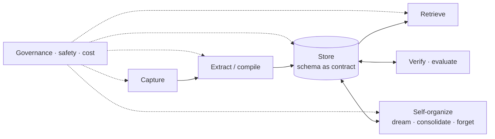

# Agent memory: one pipeline for knowledge

> Draft presentation outline. Each `---` is a slide. *Notes* are speaker notes.
> Each slide pairs the landscape (what the field does) with **ours** (Context Engine + the memory POC, [elastic/kibana#300813](https://github.com/elastic/kibana/pull/300813)). Details are in `agent_memory_research.md`.

---

## The claim

**SML, Context Engine KIs and memory are the same problem.**

Ingest data → process it → organize it → improve it over time → retrieve it well.



*Notes:* the rest of the talk walks this loop once. Every stage has the same options whether the input is a dashboard (SML), a support document (KI), or something a user told the agent (memory).

---

## Types of memory: the cognitive lens

Most agent work maps onto cognitive psychology, through CoALA (Sumers et al., 2023) and the 2025–26 surveys.

| Type | Holds | Agent example | Ours |
| --- | --- | --- | --- |
| **Working** | What is in front of the agent now | Context window, scratchpad, todos | Conversation, attachments, tool results |
| **Episodic** | Specific experiences, with time and place | "Last Tuesday this query timed out" | Traces, conversations, `memory.session` |
| **Semantic** | Facts and concepts, abstracted from episodes | "`duration_ms` is a keyword field" | KIs, `memory.session_fact`, `memory.fact.*`, `memory.entity.*` |
| **Procedural** | How to do things: skills, rules, style | "Always answer data questions with a chart" | Skills, agent instructions, automations, workflows |
| *Sensory* | Raw, unprocessed input (sometimes listed) | Screenshots, raw events | Source indices before extraction |

*Notes:* short-term vs long-term is a lifetime, not a type. Both STM and LTM in the POC hold episodic and semantic items.

---

## Types of memory: other axes that matter more in practice

- **Form**: where the memory lives.
  - Token-level or contextual: text in a store, put into the prompt.
  - Parametric: in the weights, through fine-tuning or LoRA.
  - Latent: KV cache or hidden states.
  - *Memory in the Age of AI Agents* (2025): everything we build is token-level.
- **Function**: factual vs experiential vs working memory (same survey).
- **Subject**: user-centric (personalization) vs agent-centric (the agent's own experience and skills).
- **Scope**: user · user × agent · team · space · organization · global.
  - In practice this is the hardest axis: it decides storage, access and governance.
- **Lifetime**: session · short-term (TTL) · long-term · permanent.

| | User-scoped | Shared |
| --- | --- | --- |
| **Ours** | STM: `memory.short_term.*`, per user × agent, private | LTM: `memory.*` KIs in an AI index, space and privilege scoped |

---

## Ingestion: capture modes

| Mode | When | Who decides what to keep | Trade-off |
| --- | --- | --- | --- |
| **Tool, hot path** | During the turn | The agent (`remember()`, ChatGPT's memory tool) | Immediate and visible. Adds latency and distracts the agent |
| **Hook** | Pre- or post-turn, pre-compaction | The harness | No extra agent decision. Anthropic's context editing warns the model to save before clearing |
| **Background, debounced** | After the conversation settles | A memory manager LLM (LangMem `ReflectionExecutor`) | Sees whole sessions, adds no latency. Memory lags behind |
| **Scheduled batch** | Cron or interval | A workflow / automation | Cheap at scale, reviewable, auditable. Slowest |
| **Connectors / sources** | On change or schedule | A crawler + extraction | Large, mostly impersonal knowledge |
| **Traces and telemetry** | Continuously | Extraction over agent runs | Learns from what actually happened, including failures |
| **Explicit user input** | Any time | The user (UI edit, feedback, "forget this") | Highest trust, lowest volume |
| **Import / bulk** | Once | An operator | Bootstrapping |

**Ours:**
- `remember` / `forget` / `recall` tools, with identity stamped by the server.
- Traces configured on the AI index.
- AI index sources plus automations.
- SML crawls Kibana assets.

---

## Capture: where the raw material comes from

```mermaid
flowchart LR
  subgraph Sources
    D[Indices / docs<br/>AI index sources]
    K[Kibana assets<br/>SML crawlers]
    T[Traces<br/>agent runs, ES|QL spans]
    U[Conversations]
  end
  U -- "remember()" --> STM[(STM store<br/>memory.short_term.*<br/>Elastic AI index)]
  D & K & T & STM --> X[Extraction automations]
  X --> KI[(KIs / LTM<br/>AI index)]
```

- **The STM store is a buffer, not the knowledge base.** It's cheap to write, private, and expires (30-day TTL).
- Every source becomes a *producer* that writes KIs through one schema.

---

## Extraction / compilation

Turning raw input into memory units:

1. **Select**: is this worth remembering? It should be durable, surprising or reinforced (LangMem's prompt).
2. **Extract**: an LLM with structured output; facts, entities and relationships, each with a type.
3. **Reconcile against what exists**: the write-time step that makes memory more than RAG.
   - Mem0 decides ADD / UPDATE / DELETE / NOOP for each candidate fact.
   - Stable ids (`memory/entity/service/checkout`) make re-extraction an *update*, not a duplicate.
4. **Resolve entities**: "checkout" = `checkout-service`.
5. **Attach provenance**: `derived_from` the conversation, trace or document.

**Compile once vs re-derive every time.** Karpathy's *LLM Wiki* argues for a persistent, compounding artifact over RAG that "rediscovers knowledge from scratch on every question".

**Ours:**
- `memory_extraction`, configured with `{ instructions, facts[], entities[], relationships[] }`.
- `memory_custom_extraction`, configured as prompt + types.
- Sources: STM or any ES|QL query (KIs, LTM, traces, other data).
- `memory_promotion`, which takes STM to LTM with the personal details removed.

---

## Storage representations

| Representation | Examples | Good at | Weak at |
| --- | --- | --- | --- |
| **Profile / core blocks** (always in context) | ChatGPT saved memories, Letta/MemGPT core memory | Small, high-value facts | Size; it costs tokens every turn |
| **Vector collection** | Mem0, LangGraph store | Fuzzy recall | Updates, contradictions, structure |
| **Wiki / markdown files** | Karpathy LLM Wiki, Claude memory tool (`/memories`), `CLAUDE.md` / `AGENTS.md` | Human-readable, browsable, editable | Querying at scale, access control |
| **Tags / Zettelkasten notes** | A-MEM | Emergent links between notes | Stability: it rewrites older notes |
| **Knowledge graph** | Zep / Graphiti (temporal), HippoRAG | Multi-hop questions, entities, *when* something was true | Building and maintaining it |
| **Tables / structured** | ChatDB, SQL memory | Aggregates, exact lookups | Free text |
| **Episodic log** | Conversation history, traces | Fidelity, replay | Volume; needs distilling |
| **Tiers** | MemGPT: core / recall / archival | Paging under a context budget | Complexity |
| **Parametric** | Fine-tune, LoRA, RL | Speed at inference | Updates, forgetting, provenance |

*Notes:* these are not exclusive. Most strong systems combine 2–3 of them.

---

## Schema as contract

**Agree on the unit, not the implementation.** It's an old idea:
- IDL / CORBA, WSDL / SOAP, then OpenAPI and Protobuf.
- Producers and consumers only share the contract, so everything behind it can change.

One KI document, many *views*:

```text
KI { id, type, title, description, content, tags[],
     references[{ uri, relation }],         ← graph edges
     attributes{…flattened…},               ← typed payload per KI type
     governance{ lifecycle, provenance },   ← trust and history
     permissions{ kibana.privileges[] },    ← who may read
     expires_at }                           ← lifetime
```

- **Graph view:** `references` are edges (`ki://`, `trace://`, `conversation://`, `index://`).
- **Wiki view:** one KI = one page; `type` and `id` give the hierarchy.
- **Tag view:** `tags` + `type`.
- **Profile view:** the top-N KIs injected into the prompt.

Because of this, extraction, storage backends, retrieval and organization can all be swapped independently. The POC added **no new index and no new schema**: memory is a set of KI types.

---

## Retrieval

| Mechanism | How | Examples | Ours |
| --- | --- | --- | --- |
| **Auto-injection (hook)** | The harness puts memory in the prompt each turn | ChatGPT memory, Letta core blocks | `## MEMORY` section (10 most recent, 500 characters, marked untrusted) |
| **Tool call (agentic)** | The agent decides when to look | `recall`, `search_memory` | `recall`, AI index query tools |
| **RAG: semantic / hybrid** | BM25 + vectors + rerank | Mem0 search = embed + keyword + fuse + rerank | KI search, SML search |
| **Structured query** | Filters, aggregates, joins | Text-to-SQL memory | ES\|QL over the AI index (lifecycle and space filters applied) |
| **Graph traversal** | Multi-hop from entities | HippoRAG (personalized PageRank), Graphiti | `references` + `MATCH(references.uri, …)` example queries |
| **Navigation, just-in-time** | Browse an index, then open a page | Claude memory tool (`view`), wiki `index.md` | `describe` an AI index, then fetch KIs |
| **Scoring** | recency × importance × relevance | Generative Agents | Recency-ordered STM, BM25 recall |
| **Query rewriting** | Time-aware expansion, fact-augmented keys | LongMemEval's findings | — |

*Notes:* progressive disclosure, which SML does, is retrieval as navigation. Show titles first and fetch details on demand.

---

## (Self-)organization

When memory is organized:
- **On the fly, at write time:** reconcile, link, and update neighbouring memories. A-MEM's "memory evolution" rewrites older notes.
- **In the background (sleep-time):** a separate agent or job rewrites memory between sessions. Letta's sleep-time agents, Generative Agents' *reflection*.

What it does:

| Operation | What | Ours |
| --- | --- | --- |
| Consolidate / deduplicate | Merge items that say the same thing | `memory_distillation` (LTM), `memory_maintenance` (STM) |
| Synthesize ("new pages") | Higher-level summaries and reflections from many items | Distillation *syntheses* |
| Resolve contradictions | Invalidate the older item, or keep both with validity times (Graphiti: bi-temporal edges) | Retire / remove contradicted memories |
| Link | Add edges between related items | `references` in extraction |
| Promote | Move short-term or personal memory to long-term or shared | `memory_promotion`, extraction from STM |
| Forget / decay | TTL, Ebbinghaus-style decay (MemoryBank), unused-for-N-days | `expires_at`, `ai.memory.short_term.decay`, `purgeKis` |
| Reinforce | Strengthen what is used or confirmed | `last_used_at` from recall and injection |

---

## Dreaming and reinforcement

**Dreaming = background compute over memory** (sleep-time compute, Lin et al. 2025). It is just another automation:
- consolidate and deduplicate;
- synthesize "new pages", insights and reflections;
- find contradictions and stale claims (the "lint" pass of the LLM wiki);
- re-link and re-tag;
- anticipate questions and precompute answers (the original sleep-time result: ~5× less test-time compute).

**Reinforcement signals:**
- Implicit: access counts, `last_used_at`, how often a memory is retrieved and then used in an answer.
- Explicit: a `reinforce` / "this was right" tool, user feedback, verification passing.
- Negative: "this was wrong", failed verification, being contradicted.

**Ours:**
- Every memory automation is a scheduled workflow: `concurrency: drop`, a manual trigger, and admin-only when it reads other users' memories.
- Reinforcement today is `last_used_at` only. Counters and explicit feedback are next.

---

## Maintenance and consolidation

- **Lifecycle states, not hard deletes:** `active` → `deleted` / `verification_failed`, plus `expires_at`. A restore window, then `purgeKis`.
- **Revisions:** in-place updates with optimistic concurrency (indices) or appended revisions (data streams).
- **Retention:** TTL per type; decay of unused items; purge after N days.
- **Hygiene metrics to watch:** duplicate rate, stale rate (past verification), contradiction count, orphan KIs (no references), growth rate.
- **Change-driven runs:** only revisit what changed since the last run (the `lookback` window), not the whole store.

*Notes:* STM in the POC has no soft delete yet. An LLM-planned removal can't be undone, and that is a known gap.

---

## Verification and trust

- **Provenance on every item:** `governance.provenance.created_by` / `updated_by` (`user://`, `workflow://`) and `references` (`derived_from`).
- **Verify against the source:** KIs carry runnable checks (`attributes.esql`). Verifiers re-run them and mark `verification_failed`.
- **Confidence and uncertainty:** LangMem asks the model to qualify uncertain facts. Where sources disagree, the extraction prompts keep the newer one.
- **Freshness:** `updated_at`, validity intervals, TTL.
- **Treat memory as untrusted input** in the prompt: it is data, not instructions.
- **Human in the loop:** review queues for promotion; a user can see and delete their own memory (the Memory page).
- **Cite at answer time:** answers point to the KIs and memories they used.

---

## Evaluation

**Public benchmarks:**

| Benchmark | What it measures |
| --- | --- |
| **LoCoMo** (Maharana et al., 2024) | Very long conversations: ~300 turns and ~9K tokens over up to 35 sessions |
| **LongMemEval** (Wu et al., 2024) | 5 abilities: extraction, multi-session reasoning, temporal reasoning, knowledge updates, abstention. Commercial assistants drop ~30% |
| **MemoryAgentBench** (Hu et al., 2025) | 4 competencies: accurate retrieval, test-time learning, long-range understanding, **selective forgetting** |
| **LongMemEval-V2** (2026) | Agent experience memory over long web-agent trajectories |

**What we should measure:**
- Task success with vs without memory, on the same eval suites (kbn-evals).
- Retrieval: precision@k of injected and recalled items, and how many get used.
- Write quality: extraction precision, duplicate rate, and how often contradictions are handled correctly.
- Forgetting: did a "forget" or a correction actually take effect?
- Cost and latency per turn and per automation run.

---

## Governance and safety

- **Scope and access:**
  - user / agent / space / privilege, enforced in storage (DLS), not in prompts;
  - in the POC: STM is hidden behind an access action no role is granted, and Kibana filters on the owner.
- **Privacy:**
  - STM is private, while promotion crosses into shared memory, so consent and an opt-out per user or agent are needed;
  - remove PII before promoting.
- **Right to be forgotten:** `forget`, "Forget all", purge. Deletion must reach derived memories too.
- **Memory poisoning:**
  - MINJA (Dong et al., 2025) injects malicious records *through ordinary queries*. Its follow-ups show defences: moderating input and output, trust-aware retrieval, and sanitizing memory.
- **Cross-user automations:** admin-only today; this needs a dedicated privilege.
- **Audit:** who wrote what, when, from which source; automation runs are workflow executions.
- **Explainability:** "why do you remember this?" → the provenance and the source conversation.

---

## Cost control

**Where the tokens go:**
- write-time extraction (per turn when on the hot path);
- background runs (per batch);
- injection (every turn);
- retrieval calls.

**Levers:**
- **Background over the hot path.** Debounce and batch (LangMem waits until a conversation settles; our automations run on a schedule).
- **Model tiering.** A cheap model on the hot path and a strong one for sleep-time work (Letta's recommendation).
- **Change-driven work.** Only owners or memories changed since the last run; `concurrency: drop`.
- **Hard caps per run:** batch size, max owners, max rows, max memories per prompt.
- **An injection budget:** top-N items with a length cap (POC: 10 items × 500 characters).
- **A small store retrieves cheaply.** Dedupe, decay and purge reduce both storage and prompt tokens.
- **Precompute:** sleep-time answers to likely questions trade idle compute for latency.

---

## SML = Context Engine KIs = memory

| Stage | SML | Context Engine KIs | Memory |
| --- | --- | --- | --- |
| **Ingest** | Crawlers over Kibana assets | AI index sources, automations | `remember()`, traces, conversations |
| **Process** | Summarize assets into index entries | Extract KIs with verifiable ES\|QL | Promote / extract STM → LTM |
| **Organize** | Types, discovery labels | KI types, `references`, lifecycle | Distillation, maintenance (dedupe, contradictions, decay) |
| **Improve** | Re-crawl on change | Feedback analysis, verification | Dreaming, reinforcement (`last_used_at`) |
| **Retrieve** | SML search / autocomplete | AI index query, `describe` | `## MEMORY` injection, `recall` |
| **Store** | `.ai-index-idx-elastic-index` | AI index (index or data stream) | KIs in the same AI indices |

**One schema, one store, many producers and consumers.** What differs is *who writes*, *who may read* and *how long it lives*: scope, governance and lifetime, not mechanism.

---

## Where the POC is

Built:
- STM as KIs in the Elastic AI index, private per user × agent;
- tools and prompt injection, bound to the conversation owner;
- 6 automation templates: promotion, trace extraction, distillation, structured extraction, custom extraction and STM maintenance;
- 8 new workflow steps;
- a Memory page;
- all verified on a local stack.

Open:
- user-scoped KIs everywhere (`principals`);
- consent for promotion;
- soft delete for STM;
- a sliding TTL;
- a privilege for memory automations;
- evals.

Code: [elastic/kibana#300813](https://github.com/elastic/kibana/pull/300813). Notes: `agent_memory_research.md`.

---

## References

- Sumers et al., *Cognitive Architectures for Language Agents* (CoALA), 2023, arXiv:2309.02427
- *Memory in the Age of AI Agents: A Survey — Forms, Functions and Dynamics*, 2025, arXiv:2512.13564
- Du et al., *Rethinking Memory in LLM based Agents: Representations, Operations, and Emerging Topics*, 2025, arXiv:2505.00675
- *A Survey of Agent Memory in the Second Half*, 2026, arXiv:2602.06052
- Packer et al., *MemGPT: Towards LLMs as Operating Systems*, 2023, arXiv:2310.08560
- Lin et al., *Sleep-time Compute: Beyond Inference Scaling at Test-time*, 2025, arXiv:2504.13171; Letta sleep-time agents
- Park et al., *Generative Agents* (memory stream, reflection; recency × importance × relevance), 2023, arXiv:2304.03442
- Chhikara et al., *Mem0*, 2025, arXiv:2504.19413
- Rasmussen et al., *Zep: A Temporal Knowledge Graph Architecture for Agent Memory*, 2025, arXiv:2501.13956
- Xu et al., *A-MEM: Agentic Memory for LLM Agents*, 2025, arXiv:2502.12110
- Gutiérrez et al., *HippoRAG*, 2024, arXiv:2405.14831
- Zhong et al., *MemoryBank* (Ebbinghaus forgetting curve), 2023, arXiv:2305.10250
- Maharana et al., *LoCoMo*, 2024, arXiv:2402.17753 · Wu et al., *LongMemEval*, 2024, arXiv:2410.10813 · Hu et al., *MemoryAgentBench*, 2025, arXiv:2507.05257
- Dong et al., *MINJA: Memory Injection Attacks on LLM Agents via Query-Only Interaction*, 2025, arXiv:2503.03704; *Memory Poisoning Attack and Defense*, 2026, arXiv:2601.05504
- LangMem conceptual guide (semantic / episodic / procedural; hot path vs background), langchain-ai.github.io/langmem
- Anthropic memory tool and context editing, platform.claude.com/docs
- Karpathy, *LLM Wiki* pattern, llm-wiki.md
