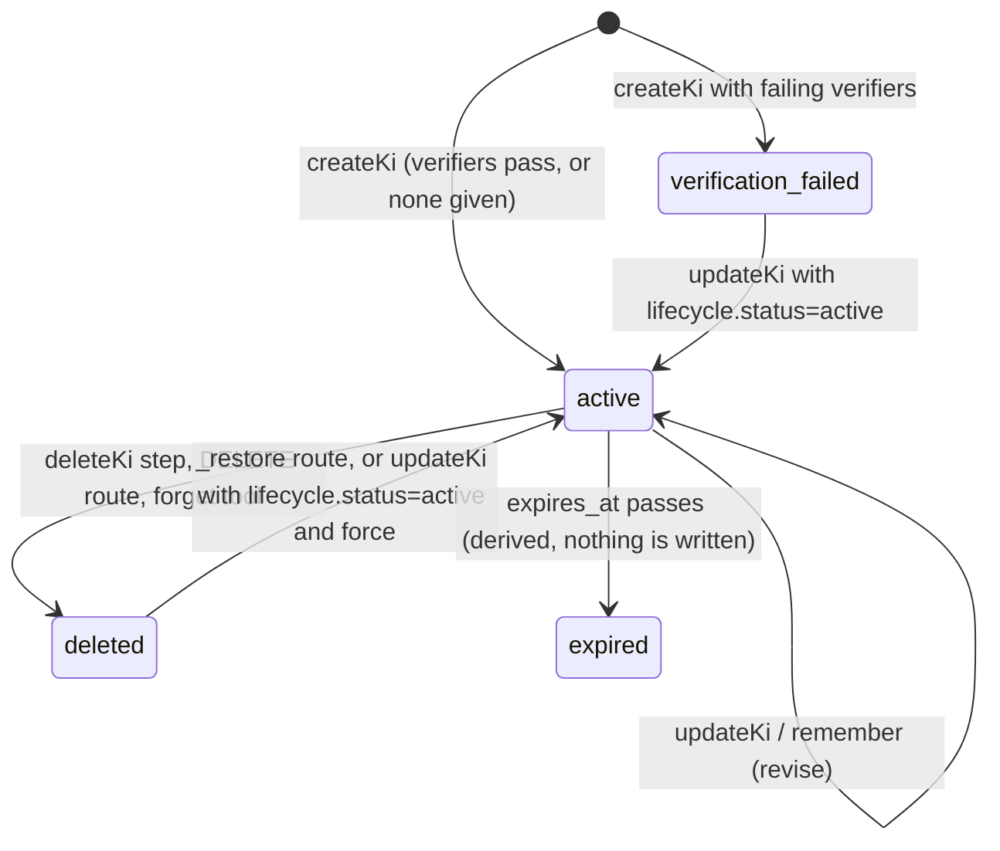
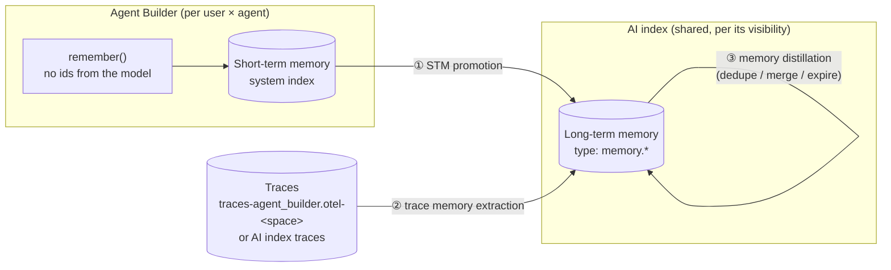

# Agent Memory Research

Working notes for designing agent memory on top of Context Engine AI indices and the Semantic Metadata Layer (SML).

- **Started:** 2026-10-26
- **Kibana code read at:** local checkout of `elastic/kibana` (this repo)
- **Elasticsearch code read at:** upstream `elastic/elasticsearch@main` via GitHub (the local `~/elastic/elasticsearch` checkout is from 2026-08-24 and predates the managed templates, so it is **stale** for this topic)

---

## TL;DR

1. **SML and AI indices share one schema.** SML is not a separate schema. Its data lives in `.ai-index-idx-elastic-index`, known as "the Elastic AI index". That index is an AI index with a dot prefix. It gets the same base mapping as every user AI index (`ai-index@mappings`) plus a small Elastic-managed overlay (`ai-index-managed@mappings`). The overlay adds two things: `dynamic: strict` and a nested `permissions.kibana.privileges` field that drives document-level security.
2. **The SML data index is dot-prefixed but not a system index.** We deal with three tiers of index:
   - **System indices**, which Elasticsearch registers through a `SystemIndexDescriptor`. In our area: `.contextengine-*` (the AI index registry) and `.chat-*` (SML crawler state).
   - **Dot-prefixed non-system indices**: `.ai-index-idx-*` and `.ai-index-ds-*`. These are Elastic-managed AI indices, including the SML index. Elasticsearch gives users implicit read access to them through a document-level security filter.
   - **User indices**: `ai-index-idx-*`, `ai-index-ds-*`, `context-engine-signals-<space>`, `context-engine-improvements`. Normal Elasticsearch RBAC governs them.
3. **A KI (knowledge indicator) is one document in an AI index.** Its lifecycle lives in `governance.lifecycle.status`, which is one of `active`, `deleted`, or `verification_failed`. An unset status reads as `active`. On top of that, `expires_at` gives a derived `expired` state. Deletes are soft (a tombstone), and reads filter out non-active and expired KIs automatically. Index-backed AI indices update KIs in place with optimistic concurrency. Data-stream-backed AI indices append a new revision for every write, and reads collapse to the newest revision.
4. **Agent memory already exists, built on KIs.** The `remember` and `forget` Agent Builder tools write KIs of type `memory.session` and `memory.session_fact` into any memory-enabled AI index. Nightshift has its own, separately designed "semantic memory" AI index. Section 4 covers both.
5. **Proposed direction for memory scoping** (Kathleen DeRusso's "POC: Memory scoping", section 5):
   - Move memory into its own managed prefix, `.ai-memory-*`.
   - Add a multi-valued `scope_id` field (`user://<profile_uid>`, …) that the server stamps.
   - Enforce scope twice: in Kibana's retrieval filter, and in a new Elasticsearch implicit-privileges filter that matches `scope_id` against a new `_user.profile_uid` template variable.
   - Write as `kibana_system` so users can't forge a scope.
   - POC PRs: [elastic/elasticsearch#162229](https://github.com/elastic/elasticsearch/pull/162229) and [elastic/kibana#298194](https://github.com/elastic/kibana/pull/298194), both open.
6. **Our direction: user-scoped KIs everywhere** (1.2.2). Add a `principals` field (`user://<profile_uid>`, …) to each `permissions.kibana.privileges` element, so the existing filter checks space ∧ actions ∧ principal in one grant, on every managed (dot-prefixed) AI index. Customer-owned `ai-index-*` indices don't get user scope.
7. **Peter's proposal for memory** (section 6):
   - No new index: memory is a KI type in the existing AI index, with the same schema.
   - User-scoped memory is left to the consumer, for example by using a managed index with `principals`.
   - "Dreaming" (offline consolidation) is a scheduled automation on the AI index, modelled on the feedback-analysis runner and Nightshift's optimizer.
8. **Design plan** (section 7). Two tiers:
   - **Short-term memory:** per user × agent, written by `remember()` with no ids from the model, and stored in an Agent Builder system index like conversations.
   - **Long-term memory:** `memory.*` KIs in the AI index.

   Three installable templates feed long-term memory: STM promotion, trace memory extraction (AI index `traces[]` already exist), and memory distillation. Memory becomes one consumer of this model, instead of the POC's separate memory-only `scope_id` and provider.

---

## 1. Schemas

### 1.1 The base KI mapping: `ai-index@mappings`

Elasticsearch owns this mapping. `AiIndexTemplateRegistry` installs it at `REGISTRY_VERSION = 4`. Source: `x-pack/plugin/core/template-resources/src/main/resources/ai-index/ai-index@mappings.json` on ES main. Recent changes:

- [elastic/elasticsearch#158757](https://github.com/elastic/elasticsearch/pull/158757) (2026-09-10) added the managed templates and lowercase normalizers.
- [elastic/elasticsearch#159233](https://github.com/elastic/elasticsearch/pull/159233) (2026-09-15) added `id`, `updated_at`, `expires_at`, `references.relation`, `references.description`, and `governance.*`.

| Field | ES type | Notes |
| --- | --- | --- |
| `@timestamp` | `date` | Creation time on index dests, revision time on data streams |
| `id` | `keyword` | Logical KI id. Matches `_id` on index dests; stays stable across revisions on data streams |
| `type` | `keyword` (lowercase normalizer) | KI type, e.g. `index_metadata`, `detection`, `dashboard`, `memory.session_fact` |
| `title` | `text` + `title.semantic` (`semantic_text`) | |
| `description` | `text` + `description.semantic` (`semantic_text`) | |
| `content` | `text` + `content.semantic` (`semantic_text`) | |
| `tags` | `keyword` (lowercase normalizer) | Multi-valued |
| `attributes` | `flattened` | Free-form key/value pairs. Leaves are keyword-searchable |
| `updated_at` | `date` | Last write |
| `expires_at` | `date` | Unset means the KI never expires |
| `references` | `object` { `uri`: keyword, `relation`: keyword, `description`: text } | `relation` is one of `derived_from`, `relates_to`, `supersedes` |
| `governance.provenance.created_by` / `updated_by` | `object` { `uri`: keyword, `metadata`: flattened } | Records who wrote the KI (see 3.2) |
| `governance.lifecycle.status` | `keyword` | `active`, `deleted`, or `verification_failed` (see 3.3) |

Things to watch:

- The lowercase normalizers only apply to indices created after the template bump. Older standard indices need a reindex. Older data streams pick it up on rollover, which leaves them with mixed mappings. ES#158757 includes reindex instructions.
- The user templates leave `dynamic` at the default (`true`). Unknown fields are therefore mapped dynamically on user AI indices but rejected on managed ones.

### 1.2 The Elastic-managed overlay: `ai-index-managed@mappings`

This applies only to dot-prefixed AI indices (`.ai-index-idx-*` and `.ai-index-ds-*`).

```json
{
  "dynamic": "strict",
  "properties": {
    "permissions": { "properties": { "kibana": { "properties": {
      "privileges": { "type": "nested", "properties": {
        "name":  { "type": "keyword" },
        "space": { "type": "keyword" },
        "count": { "type": "long" }
      }}
    }}}}
  }
}
```

Each element of `permissions.kibana.privileges` covers one space. `name` lists the Kibana actions (`ai_index:<kiType>/read`) a caller must hold in that space, and `count` is how many of them are required. A document is visible to a user who holds *all* of the listed actions *within a single space*. The check is OR across spaces and AND across actions inside one space. Two special shapes:

- `count: 0` with no `name` means the document is public within that space.
- A document with no elements at all is public everywhere. The Kibana SML indexer never writes this shape.

#### 1.2.1 Extending `permissions` with user scope (research)

**Today's model has two dimensions: space and Kibana action.** Nothing in it identifies a principal. Two enforcers evaluate the same nested shape:

- **Elasticsearch:** `ElasticAiIndexImplicitPrivilegesProvider` builds the document-level security (DLS) filter for direct queries.
- **Kibana:** for reads through Kibana, `buildVisibilityFilter` in `agent_builder_sml/server/services/sml/sml_service.ts` checks the caller's actions with `_has_privileges` and sends them as an ES|QL `filter` parameter. `buildAiIndexSpaceFilter` in `context_engine/common/space_filter.ts` applies only the space part.

Supporting "user-scoped" documents means storing a user id on the document, and having **both** enforcers compare it with the caller.

##### What every option needs

1. **A stable user id.** The Kibana user profile uid (`u_<base64(sha256(username))>_<n>`) is what Agent Builder conversations key on (`toStableUserId` in `agent_builder/server/services/utils.ts`). Usernames are not unique across realms. Users with no activated profile get a `realm:[type,name,username]` fallback in Agent Builder that Elasticsearch can't compute. API keys map to their owner's profile, and service accounts map to nothing.
2. **Elasticsearch must know the caller's uid at query time.** Filters live on roles, and roles are cached by role name, so the uid has to come in through a filter template variable. The documented variables are `_user.username`, `_user.full_name`, `_user.email`, `_user.roles`, and `_user.metadata` ([docs](https://www.elastic.co/docs/deploy-manage/users-roles/cluster-or-deployment-auth/controlling-access-at-document-field-level)). **There is no profile uid.** Adding one is an Elasticsearch change. [ES#162229](https://github.com/elastic/elasticsearch/pull/162229) adds `_user.profile_uid`, resolved lazily during authorization, and it is the hard dependency for every option below except "username". The existing provider also builds its query as a `QueryBuilder` object today. Once it refers to `_user.*`, it has to become a mustache template string, as the memory POC does.
3. **Writes must be done by the server.** Elasticsearch's filter restricts reads, not writes. A user who could write to the index could stamp any user id. So user-scoped documents must be written by `kibana_system`, or another trusted writer, with Kibana stamping the id. That is already true for SML; for KIs it changes things, since the KI steps and memory tools write as the current user today.
4. **One grant.** Filters from different grants are OR'ed. The user check has to be ANDed *inside* the same grant as the space and action checks. A second provider that only checks the user would widen access rather than narrow it.
5. **Backward compatibility.** If the user field is absent, there is no user restriction. That keeps every existing SML entry and KI visible exactly as before.
6. **A mapping bump.** `ai-index-managed@mappings` is `dynamic: strict`, so any new field must ship in the Elasticsearch template *before* Kibana writes it. For the live SML index, the existing `reconcileSmlIndex` push applies the new field, since adding a property to an existing nested mapping is allowed.

##### Option A: a `users` field on each privilege element

Add a multi-valued keyword next to `space`, `name`, and `count`:

```json
"permissions": { "kibana": { "privileges": [
  { "space": "default", "name": ["ai_index:memory/read"], "count": 1, "users": ["user://u_alice_0"] },
  { "space": "ops",     "name": ["ai_index:memory/read"], "count": 1 }
]}}
```

An element matches when **space ∧ required actions held ∧ (`users` absent ∨ `users` contains the caller)**. In the provider, the third check is one more filter inside the existing `nested` query:

```json
{ "bool": { "minimum_should_match": 1, "should": [
  { "bool": { "must_not": { "exists": { "field": "permissions.kibana.privileges.users" } } } }
  {{#_user.profile_uid}}, { "term": { "permissions.kibana.privileges.users": "user://{{_user.profile_uid}}" } }{{/_user.profile_uid}}
]}}
```

The `must_not exists` sits inside `nested`, so it's evaluated per element and is safe. The provider's comment explains why a root-level `exists` on a nested leaf would void the filter. Kibana's `buildVisibilityFilter` and `buildAiIndexSpaceFilter` need the same clause, with the uid taken from the request.

- **Pros:**
  - Scope can differ per space. "Alice only in `default`, everyone with the action in `ops`" is one document.
  - Fits the existing provider: one grant, one nested query.
  - Works on **every** managed AI index (SML, `.ai-index-*`, a future `.ai-memory-*`), not just memory.
  - Sharing means adding a uid to `users`.
- **Cons:**
  - Changes the shared overlay used by SML and every managed index.
  - ES|QL can't reference `nested` fields (noted in `sml_service.ts`), so `users` can't be shown, grouped, or counted in ES|QL. A "my memories" UI has to filter through the DSL `filter` parameter.
  - Deleting all of a user's documents needs a nested delete-by-query.
  - A document scoped to one user in several spaces repeats `users` on each element, or uses a single `space: "*"` element.

##### Option B: the user as a pseudo-action in `name` (no mapping change)

Treat the principal as one more term that `terms_set` must find:

```json
{ "space": "default", "name": ["ai_index:memory/read", "user://u_alice_0"], "count": 2 }
```

The provider appends `user://{{_user.profile_uid}}` to the list of terms the caller "holds" in the `terms_set`. Alice holds both terms, 2 of 2, so she matches. Bob holds only the action, 1 of 2, so he doesn't. A document shared with Bob gets a second element naming Bob. Elements are OR'ed, so either user matches.

- **Pros:**
  - **No mapping or template change.** It reuses the exact clause and the `count` mechanism.
  - The Kibana mirror only adds the caller's `user://` id to `authorizedActions`.
  - Safe from forgery through roles: the provider keeps only application-privilege patterns that start with `ai_index:`, so no Kibana privilege can grant a `user://` term.
- **Cons:**
  - Overloads `name`, which means "Kibana actions" everywhere else: in `SmlPermissionsInput`, in `kibanaPermissions()`, and in the comments on both sides.
  - Every reader has to know that `user://` terms are special.
  - Sharing grows the document with one element per user per space.
  - Still nested, so still invisible to ES|QL.
  - Easy to break by accident: anything that rebuilds `name` from privileges, or dedupes terms, could drop the user term and widen access.

##### Option C: a separate root-level field (the memory POC's `scope_id`)

This is the approach in section 5. A flat `scope_id` keyword lives in a memory-only template (`ai-memory@mappings`), and a memory-only provider ANDs `(scope_id absent ∨ scope_id = user://<uid>)` onto the unchanged space and action query.

- **Pros:**
  - Flat, so ES|QL can `WHERE`, `KEEP`, and `STATS` on it.
  - Simple `delete_by_query` for bulk deletion.
  - Leaves the shared overlay and SML alone.
  - The URI kind prefix leaves room for `team://` and `entity://`.
- **Cons:**
  - The user check applies to the whole document, not per space.
  - Only indices built from the memory template get it. Any other managed AI index wanting user scope needs its own template and provider, or a move to Option A.

##### Option D: customer-templated roles (no Elasticsearch change)

Customers write a role filter like `{"term": {"scope_id": "{{_user.username}}"}}`.

- **Pros:** works today.
- **Cons:**
  - Usernames aren't stable across realms and don't match Agent Builder's id.
  - It's a recipe customers have to follow, not a guarantee.
  - The ES docs list templated role queries as not using the request cache.

The same mechanism with `_user.roles` (`terms` over `{{#toJson}}_user.roles{{/toJson}}` against a `role://` field) is a possible zero-change route to **team scope**, since roles already reach Elasticsearch. Role names are cluster-level, though, not Kibana concepts.

##### Comparison

| | A: `users` per element | B: pseudo-action | C: root `scope_id` | D: customer role |
| --- | --- | --- | --- | --- |
| Elasticsearch change | Template + provider + `_user.profile_uid` | Provider + `_user.profile_uid` | New template + new provider + `_user.profile_uid` | None |
| Scope per space | Yes | Yes | No (document-wide) | n/a |
| Usable in ES|QL | No (nested) | No (nested) | Yes | Depends |
| Applies to | All managed AI indices | All managed AI indices | Memory indices only | Any index |
| Bulk delete per user | Nested delete-by-query | Nested delete-by-query | Flat delete-by-query | Flat |
| Semantics clarity | Clear | Overloaded `name` | Clear | Clear |

##### Takeaways

- The Elasticsearch work is the same in A, B, and C: `_user.profile_uid` as a template variable, plus a provider that renders a template instead of a fixed query. The real choice is **where the uid sits on the document**.
- If user scoping is only for memory, **C** is the simplest and keeps ES|QL access. That's the POC's choice.
- If we expect user-scoped KIs elsewhere, **A** generalizes the permissions model instead of forking it. Candidates: KIs derived from per-user connector sources (personal OAuth connectors), SML entries for user-private objects, per-user investigation notes. A and C can coexist: for example, the memory template maps `scope_id` for ES|QL and also stamps `users` on elements for document-level security. That duplicates data, though, and two fields can drift apart.
- **B** is the cheapest to ship but trades away clarity of the permissions contract. Only worth it as a short-lived experiment.
- Not solved by any option: documents derived from data the reader can't see still leak through their content (C3 in the memory doc). And explicit grants such as `read` on `*` or `.ai*`, and superusers, still bypass the filter.

#### 1.2.2 Direction: user-scoped KIs everywhere (Option A)

**Decision (Peter, 2026-10-26):** user scope becomes part of the general KI permissions model, not a memory-only feature. The user id lives on the privilege elements (Option A), so any KI in any managed AI index can be limited to users, alongside its space and Kibana-action limits. This section works through what that means.

##### Proposed shape

```json
"permissions": { "kibana": { "privileges": [
  { "space": "default", "name": ["ai_index:memory/read"], "count": 1,
    "principals": ["user://u_alice_0", "user://u_bob_0"] }
]}}
```

- **Field:** a new multi-valued `keyword` (no normalizer) inside each element. I'm using **`principals`** as a working name. `users` is too narrow once `team://` arrives, and reusing `scope_id` would collide with the root-level field in the memory POC.
- **Values:** URIs in the same convention as the memory POC and `references.uri`: `user://<profile_uid>` now, with `team://`, `entity://`, and so on reserved. Kinds the provider doesn't understand never match, so a document carrying only reserved kinds stays hidden. That fails closed, the same as in ES#162229.
- **Match rule for one element:** space matches ∧ caller holds all of `name` (as per `count`) ∧ (`principals` absent ∨ `principals` contains the caller). Across elements: OR, as today.
- **Sharing:** add a principal to the element. **Public within a space:** leave `principals` out. **Global:** `space: "*"`.

##### What has to change

| Area | Change |
| --- | --- |
| ES template | Add `principals` to `ai-index-managed@mappings`, bumping `REGISTRY_VERSION`. Every dot-prefixed AI index gets it, SML included. Existing documents stay valid, because absent means no user restriction |
| ES provider | `ElasticAiIndexImplicitPrivilegesProvider` adds the principal clause inside its existing `nested` query and is emitted as a mustache template over `_user.profile_uid`, as in 1.2.1. There's **one provider**. The separate `ElasticAiMemoryImplicitPrivilegesProvider` from the POC is unnecessary. If memory keeps its own prefix, add `.ai-memory-*` to the provider's index patterns |
| ES security | `_user.profile_uid` template variable with lazy, per-request resolution (from ES#162229). See the cost note below |
| ES `kibana_system` role | Write access on the managed patterns. Today it has `all` only on `.ai-index-idx-elastic-index*`, and `read` on the rest of `.ai-index-*` |
| Kibana read filters | Add the same clause to `buildVisibilityFilter` (SML) and `buildAiIndexSpaceFilter` (Context Engine `_query`, `_describe`, KI list and get), using the caller's uid. "No uid" must behave as in Elasticsearch: only documents without `principals` |
| Kibana identity | One shared resolver for the caller's profile uid, used by every read and write path (session, API key owner, Task Manager fake request, basic auth). Today that logic exists twice: `toStableUserId` in Agent Builder and `resolve_user_profile_uid.ts` in the memory POC. It belongs in a platform package |
| Kibana writers | Every write of a document with principals goes through `kibana_system`, with Kibana stamping principals from the authenticated caller (see "Who may stamp what"). Affected: KI workflow steps, the internal KI update/delete/restore routes (all `asCurrentUser` today), memory tools, and the SML indexer (already `kibana_system`) |
| SML type contract | `SmlPermissionsInput` (actions only today) gains an optional principals list, so a type with user-private objects can scope its entries. The indexer adds it to the per-space elements it already builds |

##### Who may stamp what

Elasticsearch can't enforce this, because filters don't restrict writes. Kibana has to:

- **Create:** a writer may stamp only **their own** uid by default. Example: `remember`, or a workflow step stamping the workflow owner's uid (Task Manager runs on the owner's API key, which maps to the owner's profile).
- **Share:** adding someone else's principal is an explicit "share" operation with its own privilege and confirmation, because derived content can leak (C3).
- **Revise, forget, delete:** allowed only when the caller is in `principals`, or holds an admin privilege on the AI index. The memory POC already does this for `forget` and revise.
- **System writers:** the SML crawler and solution plugins writing managed KIs can stamp principals computed by the type, such as an object's owner. They're trusted code paths.

##### User-tier AI indices (`ai-index-*`)

"Everywhere" can't include document-level security on customer-owned indices. Only dot-prefixed indices get the implicit grant. The options:

1. **Refuse** to write user-scoped KIs to `ai-index-*` in 1P. This is what the memory POC does for memory (dest must be `.ai-memory-*`). Isolation is then real wherever it exists.
2. **Allow, with Kibana-only enforcement.** That would need `permissions` (nested) added to the base `ai-index@mappings`, so the Kibana filter has a uniform shape. Direct ES|QL by anyone with `read` on the index bypasses it, which fails R3.

**Decided (Peter, 2026-10-26): option 1.** User scope is not supported on customer-owned `ai-index-*` indices. 1P writers refuse to stamp `principals` there. Those indices keep today's model: what's in them is visible to anyone with Elasticsearch `read` on them, plus the Kibana space filter. 2P developers can still adopt `principals` as a convention on their own indices and enforce it themselves, as the memory doc proposes for 2P.

##### Costs and risks to resolve

- **Profile lookups on SML reads.** With the principal clause in the main provider, every search that touches **any** managed AI index triggers the lazy uid resolution. That includes the SML index, which every Agent Builder chat reads. In the memory POC the cost was limited to memory reads. The cache's hit rate, TTL and size settings (a follow-up in the memory doc) become load-bearing.
- **Request cache.** A filter templated per user splits the shard request cache per uid, which is why the POC touches `DlsFlsRequestCacheDifferentiator`. This applies to SML reads too, not just memory.
- **ES|QL can't see `principals`,** because nested fields are excluded from ES|QL. Options: accept it, since enforcement and "my KIs" listings go through the DSL `filter` parameter anyway; or also write a flat, root-level copy (for example `scope_id`) only for display and aggregation, **never** used for enforcement, accepting that the two could drift.
- **Bulk delete per user** becomes a nested delete-by-query across `.ai-index-*` and `.ai-memory-*`, run as `kibana_system`. Decide soft vs hard delete (see 5.6).
- **Mixed versions.** The template must land in Elasticsearch before Kibana writes `principals`, because managed mappings are `dynamic: strict`. A Kibana that stamps `principals` against an older Elasticsearch gets rejected writes, not silently unscoped documents. That's the safe failure, but it needs a version or capability check.
- **Users without a profile** (the realm fallback in `toStableUserId`) can never match a principal. They see only unscoped KIs and can't create user-scoped ones.

##### What this does to the memory POC (section 5)

- Memory becomes the first *consumer* of the general model rather than its own model. Drop the root `scope_id` as the enforcement field and the separate memory provider. `remember` stamps `principals: ["user://<uid>"]` on the element it already writes, which in the POC is `{ space, name: ["ai_index:memory/read"], count: 1 }`.
- Kathleen's reasons for a separate `.ai-memory-*` prefix still stand independently of how scope is enforced: keeping memory out of `ai-index-*` globs, its own retention or ILM, and its own mappings. Whether memory needs its own prefix is now a separate question from user scope.
- The POC's Kibana pieces carry over almost unchanged: identity resolution, write as `kibana_system`, scope checks on revise and forget, and the "no profile" refusal.

### 1.3 Template matrix

All four templates sit at priority 500 and compose `ai-index@mappings`.

| Template | Pattern | Composed of | Notes |
| --- | --- | --- | --- |
| `ai-index-idx` | `ai-index-idx-*` | `ai-index@mappings`, `ai-index@custom` (optional) | User standard index |
| `ai-index-ds` | `ai-index-ds-*` | `ai-index@mappings`, `ai-index@ds-settings`, `ai-index@custom` (optional) | User data stream. **90-day data retention**, sorted by `@timestamp` descending |
| `ai-index-idx-managed` | `.ai-index-idx-*` | `ai-index@mappings`, `ai-index-managed@mappings` | Elastic-managed. No `@custom` hook, so users cannot override it |
| `ai-index-ds-managed` | `.ai-index-ds-*` | `ai-index@mappings`, `ai-index@ds-settings`, `ai-index-managed@mappings` | Elastic-managed data stream |

`ai-index@custom` is the user's escape hatch for extra mappings or settings on their own AI indices.

### 1.4 SML is the Elastic AI index

- **Index:** `.ai-index-idx-elastic-index` (`smlIndexName` in `x-pack/platform/plugins/shared/agent_builder_sml/server/services/sml/sml_storage.ts`).
- **Registered with Context Engine** as the managed AI index with id `elastic` (`agentBuilderDefaultAiIndexId`), `dest: { type: 'index' }`, and `memory_enabled: false` (`agent_builder_sml/server/plugin.ts`).
- **Mappings:** Kibana creates the index bare, and the ES `ai-index-idx-managed` template supplies the mappings. Kibana has no SML template of its own. Elasticsearch applies templates only at index creation, so `reconcileSmlIndex` pushes later template bumps onto the live index with `simulateIndexTemplate` followed by `putMapping`. It records the applied template version in `_meta.ai_index_template_version`. If that push is rejected, Kibana logs it and does **not** drop the index, because entries with `ingestion_method: 'manual'` are curated by users and cannot be rebuilt.
- **Crawler state:** stored separately in `.chat-sml-crawler-state`, a system index.

How an SML document fills the KI schema (`SmlDocument` in `agent_builder_sml/server/services/sml/types.ts`, written by `sml_indexer.ts`):

| KI field | What SML writes |
| --- | --- |
| `id` | `${type}:${originId}` |
| `type` | The SML type id, which is also the KI type: `dashboard`, `visualization`, `connector`, `workflow`, `rule`, `action_policy`, `significant_event`, … |
| `title`, `content`, `description`, `tags`, `attributes` | From the type's `getSmlEntry` hook |
| `references` | Always includes `{ uri: '<type>://<originId>', relation: 'derived_from' }`, plus any references the type adds |
| `governance.provenance.*` | `uri: 'crawler://sml'` or `'user://<id>'`. `metadata.ingestion_method` is `crawled` or `manual` |
| `governance.lifecycle` | **Not used.** SML hard-deletes stale entries instead of tombstoning them |
| `expires_at` | Not used |
| `permissions.kibana.privileges` | One element per space: `{ space, name: ['ai_index:<kiType>/read'], count }`. Types without a `getPermissions` hook get `count: 0` (public within the space) |

How SML differs from a user AI index:

- `dynamic: strict`, so SML cannot write ad-hoc fields.
- Document-level security on `permissions`.
- No lifecycle tombstones.
- Two writers: a background crawler on a Task Manager task (default every 10 minutes per type) and event-driven `indexAttachment` calls.
- Its own read API: `sml_search` / `sml_attach` tools and RRF hybrid search. It is also readable through the generic Context Engine `_query` route.

One discrepancy to fix: `context_engine/README.md` (around line 197) still calls the SML index `ai-index-idx-sml-data`. The ES#158757 description says the same. Current code and the SML README use `.ai-index-idx-elastic-index`.

### 1.5 The AI index registry record (not a KI)

The registry has its own small schema in the system index `.contextengine-ai-indices` (`context_engine/server/ai_indices/storage.ts`). There is one record per (space, AI index id):

`id`, `space`, `description`, `managed`, `memory_enabled`, `date_created`, `date_modified`, `dest { type: index|data_stream, value }`, `automations[] { type: workflow, value }`, `sources[] { type: esql|connector, value }`, `traces[] { type: elastic_agent|index|esql, value }`, `feedback_analysis { enabled, agent_id, schedule.interval, signal_time_range, signal_filter, allowed_actions }`.

User dests must be named `ai-index-idx-<id>` or `ai-index-ds-<id>`. Managed records are registered in code with `contextEngine.registerAiIndex(...)`, and their document id is `${spaceId}:${aiIndexId}`. Current managed registrations:

| Plugin | AI index id | Dest |
| --- | --- | --- |
| `agentBuilderSml` | `elastic` | `.ai-index-idx-elastic-index` |
| `alertzero` | `security-investigations` | `ai-index-idx-security-investigations` |
| `nightshiftInvestigations` | `nightshift-semantic-memory` | `ai-index-idx-nightshift-semantic-memory` |
| `nightshiftInvestigations` | `nightshift-cortex` | (not checked) |
| `nightshiftInvestigations` | `nightshift-decision-trees` | (not checked) |

---

## 2. System index, dot-prefixed index, user index

| | System index | Dot-prefixed, non-system | User index |
| --- | --- | --- | --- |
| **How Elasticsearch knows** | Registered through a `SystemIndexDescriptor` in `modules/kibana/.../KibanaPlugin.java`. Type `EXTERNAL_UNMANAGED`, allowed product origin `kibana` | Nothing special. A regular index whose name starts with `.` | Nothing special |
| **Our indices** | `.contextengine-*` (registry `.contextengine-ai-indices`), `.chat-*` (`.chat-sml-crawler-state`), plus `.kibana_*`, `.workflows*`, `.reporting-*` | `.ai-index-idx-*` and `.ai-index-ds-*`, today just `.ai-index-idx-elastic-index` | `ai-index-idx-*`, `ai-index-ds-*`, `context-engine-signals-<space>`, `context-engine-improvements` |
| **`kibana_system` grants** | `.contextengine-*`: read, write, manage (restricted). `.chat-*`: all (restricted) | `.ai-index-idx-elastic-index*`: all. `.ai-index-*`: read (for the usage collector) | `ai-index-*`: read (usage collector). `context-engine-signals-*`: all. `context-engine-improvements`: none, because the calling user creates and writes it |
| **End-user access** | None directly. Only Kibana's internal user reads or writes | Implicit, read-only, filtered by document-level security. `ElasticAiIndexImplicitPrivilegesProvider` gives `read` on `.ai-index-idx-*` and `.ai-index-ds-*` to any user whose Kibana application privileges include at least one `ai_index:` action, with a filter built from `permissions.kibana.privileges` | Normal RBAC: users need `read`, `view_index_metadata`, `write`, and so on, on the concrete index |
| **Mappings owned by** | Kibana (storage adapter) | Elasticsearch (`ai-index-*-managed` templates). Kibana pushes bumps | Elasticsearch base template, plus the optional user `ai-index@custom` |
| **Dot-prefix deprecation** | Exempt (system index) | Exempt through `cluster.indices.validate_ignored_dot_patterns` → `\.ai-index-.*`. Without that exemption, stateless/serverless would **reject** the name | n/a |
| **Space isolation** | Kibana filters on a `space` field | Document-level security, enforced by Elasticsearch | **None at the data layer** (see below) |

### The privilege chain for managed AI indices

1. A Kibana feature declares `aiIndex: { read: ['<kiType>'] }` on a privilege. This is `FeatureKibanaPrivileges` in `x-pack/platform/plugins/shared/features/common/feature_kibana_privileges.ts`.
2. Kibana expands that declaration into the action `ai_index:<kiType>/read` (`AiIndexActions` in `authorization_core/src/actions/ai_index.ts`).
3. The SML type's `getPermissions` returns the same action through `kibanaPermissions({ kiType })`. The indexer stamps it per space.
4. At search time, Elasticsearch turns the user's resolved `kibana-.kibana` application privileges into a filter (see `ElasticAiIndexImplicitPrivilegesProvider.buildDlsQuery`).

If the `kiType` on the feature side doesn't match the one on the SML type side, entries of that type become invisible to everyone. Several SML type tests pin the action string for this reason.

### User AI indices have no space isolation at the data layer

AI index *registry records* are per space. Their backing indices are not.

- The Kibana `_query` route always adds `buildAiIndexSpaceFilter(spaceId)` (`context_engine/common/space_filter.ts`). That filter treats a document with no `permissions.kibana.privileges` as public, and uses `ignore_unmapped: true`.
- `ai-index@mappings` has no `permissions` field, and the `remember` tool and KI steps never write one.

So a KI in a user AI index is visible from **any** space where the caller can `FROM ai-index-idx-x` and holds Elasticsearch `read` on it. Nightshift works around this by storing `attributes.space_id` and filtering on it itself.

**This matters directly for memory design.** I'm confident from reading the code, but haven't confirmed it with a test yet. The memory scoping proposal treats it as a known property: "non-managed AI indices are not scoped to any particular user, group or other identifier". It inherits the decision that only managed indices get document-level security, and that customers own permissions on `ai-index-*`. Open question: what happens if someone writes `permissions` into a user AI index, where dynamic mapping would map it as `object` rather than `nested`?

---

## 3. KI schema and lifecycle

### 3.1 KI input schema (Kibana side)

The Kibana-side input schema is `kiFieldsSchema` in `context_engine/common/step_types/ki.ts`. It mirrors `ai-index@mappings`.

| Field | Constraint |
| --- | --- |
| `type` | Required, 1–256 characters |
| `title` | Required, 1–512 characters |
| `description` | Optional, ≤ 2048 characters |
| `content` | Optional, ≤ 65,536 characters |
| `tags` | Optional, ≤ 100 tags of ≤ 256 characters each |
| `attributes` | Optional, ≤ 100 keys. Each value is a string (≤ 10k characters), number, boolean, or string array (≤ 100 entries). `null` drops the key |
| `references` | Optional, ≤ 100. `{ uri ≤ 2048, relation?, description? ≤ 2048 }` |
| `expires_at` | Optional ISO 8601 with an offset. On update, `null` clears it |
| KI id | ≤ 512 characters. Optional on create, where a UUID is generated |

`id`, `@timestamp`, `updated_at`, and `governance.*` are always stamped by the server. Callers never supply them.

### 3.2 Writers: `governance.provenance.*.uri`

| Writer | URI | Metadata |
| --- | --- | --- |
| Workflow step (`context-engine.createKi`, `updateKi`, `deleteKi`) | `workflow://<workflowId>` | `version`, `run_id`, `space_id` |
| Internal KI HTTP API (UI) | `api://context_engine.ki.update` / `.delete` / `.restore` | `space_id` |
| Memory tools | `tool://<toolId>` | `run_id`, `agent_id` |
| SML crawler | `crawler://sml` | `ingestion_method: crawled` |
| SML manual upsert | `user://<id>` | `ingestion_method: manual` |

### 3.3 Lifecycle states



- **Stored statuses** (`KI_LIFECYCLE_STATUSES`): `active`, `deleted`, `verification_failed`. An unset status means `active`, which covers older documents and SML.
- **Derived status:** `expired`, used only by the UI. `resolveKiStatus` in `public/application/utils/ki_expiry.ts` reports `deleted` or `verification_failed` first, then `expired` if `expires_at <= now`, otherwise `active`.
- **Soft delete is the only delete path in use.** `hardDeleteKiRevision` exists in `ki_revision.ts` but nothing calls it.
- **Deleted KIs are guarded:** `updateKi` throws `KiDeletedError` unless `force: true` is passed. The `remember` tool refuses to revise a deleted memory.
- **No-op detection:** `updateKi` compares the incoming fields and status with what is stored and returns `result: 'noop'` without writing.

### 3.4 Verification and failed KIs ([#299302](https://github.com/elastic/kibana/pull/299302), merged)

`createKi` accepts `verifiers`. These can be built-in ids (`esql-valid-syntax`, `esql-valid-runtime`) or custom workflow verifiers (`workflow:<id>`). Before #299302, a failing verifier skipped the write. Now:

- The KI is written with `governance.lifecycle.status: 'verification_failed'`, and the step returns `verification.results`.
- Failed KIs are excluded from recall, because the lifecycle filter only admits unset or `active`.
- The UI shows a "FAILED" badge and offers a status filter. Hiding failed KIs by default in the list view was out of scope for that PR.
- Trade-off: re-running a workflow with the same `ki_id` can overwrite a good KI with a failed one, and the failed one then supersedes it.

### 3.5 Storage semantics: index vs data stream

| | `dest.type: index` (`ai-index-idx-*`) | `dest.type: data_stream` (`ai-index-ds-*`) |
| --- | --- | --- |
| Create | `index` with `_id = kiId`. `op_type: create` when it must fail if the id exists | `op_type: create`, appends a document. `id` field = kiId |
| Update | Partial `update` merged in place, with `if_seq_no` / `if_primary_term`. A conflict returns `KiConflictError` (409) | Reads the newest revision, deep-merges the changes, and **appends a new document** with `@timestamp = updated_at` |
| Delete | In-place update to `lifecycle.status: deleted` | Appends a tombstone revision |
| "Current" KI | The single document | Newest `@timestamp` per `id`, with `_id` as the tie-breaker (the `LATEST_REVISION` ES|QL pipeline) |
| Retention | Forever | **90 days** (`ai-index@ds-settings`). Old revisions *and* KIs that are never rewritten disappear |

For memory, 90-day retention on data streams is a hard cap that applies on top of `expires_at`. A data-stream-backed memory index cannot hold a "non-expiring" memory unless that memory is rewritten.

### 3.6 Read path: what `_query` adds

`applyKiLifecycle` in `server/ai_indices/ki_lifecycle.ts` adds the following to any query that reads a registered dest:

1. For data streams, it collapses to the latest revision per `(target, id)` and adds `METADATA _id, _index`.
2. It adds `WHERE governance.lifecycle.status IS NULL OR == "active"`. A top-level `WHERE` on that field disables this filter.
3. It adds `WHERE expires_at IS NULL OR expires_at > NOW()`. A top-level `WHERE` on `expires_at` disables this filter.
4. It adds `DROP governance.*`, unless the query names a `governance.*` field.

Separately, the route always adds the space filter, and caps the row limit at 100 by default and 1000 at most. `_describe` returns ready-made example queries that already include this pipeline.

### 3.7 Ways to write a KI

- **Workflow steps** (tech preview): `context-engine.createKi`, `context-engine.updateKi`, `context-engine.deleteKi`, `context-engine.verifyKi`. If the AI index doesn't exist, `createKi` **creates it on the fly** with dest `ai-index-idx-<id>`. It refuses ids reserved for managed indices.
- **Internal HTTP API**, used by the UI: `GET /internal/context_engine/ai_index/{id}/kis`, `GET|PUT|DELETE .../kis/{kiId}`, and `POST .../kis/{kiId}/_restore`.
- **Agent Builder tools:** `remember` and `forget` (memory only). Retrieval goes through `list_ai_indices`, `describe_ai_index`, and `query_ai_indices`, plus the `ki-retrieval` skill.
- **SML** writes its own documents directly. It does not use KI helpers.

---

## 4. Existing memory implementations

### 4.1 Context Engine memory tools

These live in `context_engine_agent_builder/server/agent_builder/tools/{remember,forget}`.

- **KI types:** `memory.session_fact` holds a granular fact. `memory.session` holds a session synthesis covering what was tried, what worked, and what to change (`MEMORY_KI_TYPES`).
- **Gates:** the global advanced setting `contextEngine:memoryEnabled` and the per-index `memory_enabled` flag (default `true`; the SML index sets it to `false`). The dest must be a single write target, not a pattern. The caller needs Context Engine write access, and Elasticsearch writes run **as the current user**.
- **Document stamped:** `attributes['memory.session_id']`, which is the conversation id in Agent Builder or a `sessionId` for MCP clients. Also a `references` entry `conversation://<id>` with `relation: derived_from`, and provenance `tool://...` with `run_id` and `agent_id`.
- **Expiry:** 90 days from **each write** by default. `expires_at: null` makes a memory non-expiring.
- **Scope:** the tool description says memory is *shared* with every user and agent that can access the AI index. It also says not to store personal details or preferences. There is no per-user or per-agent scoping beyond provenance metadata.
- **Recall:** no dedicated tool. Agents use `query_ai_indices`, and `buildMemoryExampleQueries` (`server/ai_indices/memory_example_queries.ts`) provides a cross-session hybrid query (FORK lexical + semantic, then FUSE) over `memory.session_fact`.

**How `remember` picks the target AI index.** The model picks it. `aiIndexId` is a required tool parameter, described as "the ID from the agent AI INDICES configuration".

1. **Tool selection** (`agent_builder/.../run_agent/utils/select_tools.ts`): `remember` and `forget` are added to an agent's tools only when at least one AI index in the agent's catalog has `memoryEnabled`. Availability also requires `contextEngine:enabled` in the space and the global `contextEngine:memoryEnabled`.
2. **System prompt** (`prompts/utils/ai_indices.ts`): the AI INDICES section lists each of the agent's indices as registry id, ES|QL target, and description. It does **not** say which ones are memory-enabled, even though the catalog entry has `memoryEnabled`.
3. **Discovery:** the model learns it from `describe_ai_index`. For a memory-enabled index, when the global memory setting is on, the describe output includes a "Memory" block: "Memory writes are enabled…", the two memory types, use `remember` and `forget`, and an example recall query. Ordinary KI example queries then come with `EXCLUDE_MEMORY_KI_TYPES_FILTER`, which keeps memory out of normal KI retrieval.
4. **Server-side validation** (`getWritableMemoryAiIndex`): the global setting must be on, the index (looked up by id **in the request's space**) must have `memory_enabled`, and its dest must not be a pattern. A wrong choice comes back as a tool error, and the model can retry.

**Gap:** nothing checks that `aiIndexId` is one of the agent's configured AI indices. Any memory-enabled AI index in the space can be written to, as long as the caller has Elasticsearch write access on its backing index. In MCP calls the caller can name any id. The SML index is safe only because it sets `memory_enabled: false`.

### 4.2 Nightshift semantic memory

This is a separate design in `x-pack/solutions/observability/plugins/nightshift_investigations/server/memory/`.

- **Index:** the managed AI index `nightshift-semantic-memory`, backed by `ai-index-idx-nightshift-semantic-memory`, a user-tier index.
- **Fields beyond the base KI schema:** usefulness counters in `attributes` (`impressions`, `conversions`, `last_impression_time`), `categories`, `slug`, and `space_id`. Space isolation is implemented in the app layer through `attributes.space_id`.
- **Lifecycle:** its own archive model (`archive_reason`: `merged`, `harmful`, `manual`) rather than `governance.lifecycle.status`. An LLM optimizer extracts, merges, and labels memories.
- **Takeaway:** the two implementations already diverge in lifecycle, scoping, and ranking. Choosing one convention should be a goal of this research.

---

## 5. Memory scoping POC (Kathleen DeRusso)

Source: the Google doc "POC: Memory scoping" ([doc 18K7POjX…, tab `t.gczcy6x3q4pj`](https://docs.google.com/document/d/18K7POjXZq1bX69WpGIRL8x1EnNx3BI9YFrVXJuJvP88/edit?tab=t.gczcy6x3q4pj#heading=h.fx9wimshfys5), pasted into chat on 2026-10-26), plus the two open POC PRs:

- [elastic/elasticsearch#162229](https://github.com/elastic/elasticsearch/pull/162229): templates, privileges, and the `_user.profile_uid` template variable.
- [elastic/kibana#298194](https://github.com/elastic/kibana/pull/298194): stamping on write, the retrieval filter, and identity resolution.

### 5.1 The problem it solves

Today a memory KI is visible to everyone who can read its AI index, and nothing on the document identifies a user. Provenance records only tool, run, and agent (see 4.1). The proposal answers three questions:

- Can another user in the same space recall my memory?
- What does a 2P developer have to do to keep their users apart?
- Does the backing index have to be managed?

Out of scope: team memory, promoting user memory to team memory, and agent-level isolation. The schema leaves room for them.

### 5.2 Requirements (abridged)

| # | Requirement |
| --- | --- |
| R1 | A user's memory is invisible to other users and agents, even in the same space, unless the user shares it |
| R2 | Scope is enforced at retrieval time, not by prompt or skill |
| R3 | Querying Elasticsearch directly gives the same isolation. Exception: an explicit role on the memory index |
| R4 | In 1P the identity is the Kibana user. In 2P the developer supplies it |
| R5 | Scope covers more than users: team, per-entity, and space. One agent may need several scopes |
| R6 | Users can view and delete their own memories, and all of one user's memories can be bulk-deleted |
| R7 | Every memory records who wrote it: user, agent, session |
| R8 | Memory and KIs can be combined in one retrieval. Scope must compose with the space and lifecycle filters |
| R9 | One scoping model for 1P and 2P |

### 5.3 What it changes from today

1. **Memory leaves the general AI index.** It challenges the M3 decision to use a single AI index for memory and source KIs, for these reasons:
   - Memory has different access control.
   - Memory has different retrieval patterns.
   - Globbing `ai-index-*` would pick up memories without the scope filter.
   - Memory needs schema of its own.

   Combined search stays possible through views, globs, or skills, but you opt in.
2. **Memory is no longer shared by default.** That reverses D6 in "RFC: Memory MVP".
3. **Memory can only be written to memory indices.** Today `remember` writes to any `memory_enabled` AI index, including user-owned ones.

### 5.4 Design

**Schema.** A new component template, `ai-memory@mappings`, adds one field:

| Field | Type | Meaning |
| --- | --- | --- |
| `scope_id` | `keyword`, multi-valued, **no normalizer** | Principals allowed to read the memory. Absent or empty means shared with everyone who can read the index |

Values are URIs:
- `user://<profile_uid>`, written now.
- `team://<id>`, `entity://<id>`, and `space://<id>`, reserved. Space stays in `permissions.kibana.privileges.space`.

Keeping the kind inside the URI keeps the field flat, which ES|QL and a DLS `term` clause both need. Sharing a memory means adding values to `scope_id`. `governance.provenance.created_by.uri` gets the same `user://` value, and the tool id moves into `metadata` alongside `run_id` and `agent_id` (covers R7).

**Templates** (ES POC). There is a new dot-prefixed template `ai-memory-managed` for `.ai-memory-*`, composed of `ai-index@mappings`, `ai-index-managed@mappings`, and `ai-memory@mappings`. There is **no data-stream variant and no user-tier (undotted) memory template**. The POC also adds `.ai-memory-*` to the dot-prefix validator exemptions, which serverless needs.

**Read enforcement, two layers:**

| Layer | What it does |
| --- | --- |
| Kibana retrieval | Adds a scope clause next to the space filter, in the same ES|QL `filter` parameter: `bool.should: [ must_not exists scope_id, terms scope_id: [user://<uid>] ], minimum_should_match: 1`. It has the same shape as the space filter, so FORK pushdown keeps working |
| Elasticsearch filter | New `ElasticAiMemoryImplicitPrivilegesProvider`. It grants `read` on `.ai-memory-*` with filter = (existing AI index space/privilege query) **AND** (scope clause). The scope clause is a mustache template: `{{#_user.profile_uid}} term scope_id: user://{{_user.profile_uid}} {{/_user.profile_uid}}`. Without a resolved uid, only unscoped memories match |

The scope clause has to sit in the **same grant** as the space clause. Filters from different grants are OR'ed, so a separate scope grant would let anyone with space access see every memory in that space. The existing `.ai-index-*` provider's patterns don't match `.ai-memory-*`, so it can't OR in a wider grant either.

**How Elasticsearch learns the user's identity.** The POC adds `_user.profile_uid` as a filter template variable. Roles are cached by role name, so the uid can't be baked into the role. Instead, the uid is resolved **lazily during authorization**: only when a matched filter references `_user.profile_uid` does `AuthorizationService` call `ProfileService` and stash the uid in the thread context. API keys resolve to their owner's profile. Service accounts, run-as, internal, and anonymous users resolve to nothing. The POC also touches `DlsFlsRequestCacheDifferentiator` so the request cache can't serve one user's filtered results to another.

Alternatives the doc rejected:
- `_user.username`: not unique across realms, and not what Agent Builder keys on.
- Computing the uid from a hash of the username: the `_n` collision suffix makes that unsafe.
- An identity header from Kibana: Elasticsearch can't trust it.
- Resolving the uid at authentication: a cost on every request, plus a transport version change.

**Writes.** `remember` and `forget` write as **`kibana_system`**, which gets `all` on `.ai-memory-*`. The user's implicit grant stays read-only, because document-level security constrains reads, not writes; a user who could write could stamp any `scope_id`. Before writing a tombstone or a new revision, `forget` and revise-by-id check that the caller's uid is in `scope_id`. Memories without `scope_id` can still be forgotten by anyone with write access. Bulk delete for a user is a delete-by-query on `scope_id`. The Elasticsearch audit trail shows `kibana_system`, so `governance.provenance` is the record of who wrote what.

**1P identity (Kibana POC).** The memory id comes from the same identity as Agent Builder conversations: the profile uid.

| Caller | How the Kibana POC gets the uid |
| --- | --- |
| Browser session, and enriched Task Manager requests | `profile_uid` on the current user |
| API key, and Task Manager requests reusing a key | `GET _security/api_key?with_profile_uid=true` |
| Basic auth | `kibana_system` calls `_security/profile/_suggest`, matched on username and realm |

No uid means no user memory: `Cannot store user memory without a user profile.` The Context Engine feature declares `aiIndex: { read: ['memory'] }`, which grants `ai_index:memory/read`. That action is what turns on the implicit grant. The default memory AI index is `.ai-memory-elastic`, registered as AI index id `memory` and attached to every chat agent.

**2P (direct API).**
- A new KI CRUD API. Its query API takes `scope_ids` and applies the same filter clause. Its write API requires `scope_id` on memory indices.
- Kibana can't verify 2P scope ids (the same model as Mem0's `user_id` and Supermemory's container tags), so developers must derive them from their authenticated session and never from the model.
- 2P memory lives in a **developer-owned index**. The Elasticsearch filter can't match non-Elasticsearch principals, so the developer manages privileges.

**Does the index have to be managed?** Yes, for 1P user memory. A retrieval filter alone fails R3: anyone with `read` on a customer index can run ES|QL directly. Customer patterns like `ai-index-*` don't match a leading dot, so for most users the only grant on `.ai-memory-*` is the filtered implicit one. Explicit grants such as `read` on `*` or `.ai*`, and superusers, bypass the filter. That trade-off was accepted earlier for AI indices.

### 5.5 How this lines up with what we found (sections 1 to 4)

- **Schema reuse holds up.** Memory stays a KI (same `ai-index@mappings`) and picks up the managed overlay. The overlay's `dynamic: strict` is why `scope_id` needs its own component template rather than being written ad hoc.
- **Today's memory tools write as the current user** (`esClient.asCurrentUser` in `remember` and `forget`). The POC makes memory the first KI type written as `kibana_system`. That departs from Context Engine's "acts as the user" stance, but only for writes. Reads still run as the user, which is why R8 (one query, one identity, across `ai-index-*` and `.ai-memory-*`) still works: KIs carry no `scope_id`, so they pass the scope clause.
- **`kibana_system` today** has `all` only on `.ai-index-idx-elastic-index*` and `read` on the other AI index patterns (section 2). The ES POC adds `all` on `.ai-memory-*`.
- **Identity mismatch for users without a profile.** `toStableUserId` (`agent_builder/server/services/utils.ts`) returns `undefined` only for API keys whose owner has no profile. A basic-auth user without a profile gets a **realm fallback id** (`realm:[type,name,username]`), and their conversations work with it. The Elasticsearch filter keys only on `profile_uid`, so those users get conversations but no user memory. That's consistent with "refuse", but the claim that memories and conversations share an identity only holds when a profile exists.
- **Retention.** Memory indices are standard-index only, so the data stream's 90-day retention (section 3.5) doesn't apply. `expires_at` is a filter at query time, so expired memories stay on disk until something deletes them. The "aggressive ILM policy" the doc mentions would need rollover or a cleanup task, since ILM delete doesn't work on a single non-rollover index.

### 5.6 Review notes and gaps to chase

1. **Kibana read paths beyond `_query`.** The Kibana POC adds the scope clause in `data_read_service.ts` and `query.ts`. It does *not* touch `ki_list.ts` or `ki_get.ts`, which back the internal KI list and view routes in the AI index UI. For normal users the Elasticsearch filter still protects those routes. For superusers, and for roles with explicit `.ai-memory-*` or `*` grants, the UI could list other users' memories. Need to check whether that's intended ("admin sees all") or a gap.
2. **The UI needs a new write path for R6.** The internal KI update, delete, and restore routes run as the current user, so on `.ai-memory-*` they will be refused, since users only have read. "View and delete my memories" and admin bulk delete need routes that write as `kibana_system` and apply the same scope check as `forget`.
3. **Soft vs hard delete.** `forget` writes a tombstone (`lifecycle.status: deleted`), so the content stays on disk. Bulk user delete is described as delete-by-query, which is a hard delete. Privacy requests ("forget everything about me") probably need hard delete for *all* paths, or a purge job for tombstones. Decide explicitly.
4. **Global (unscoped) memories** can be forgotten by anyone with write access, and only `kibana_system` writes. So who can create a global memory through the 1P tools? The POC always stamps `scope_id`, so global memories would only come from 2P or other plugins. Worth stating.
5. **Sharing.** "Add values to `scope_id`" needs an API that runs as `kibana_system` with a confirmation step, because derived content can leak (C3). There's nothing for it yet.
6. **Matching basic auth by `_suggest`.** `_security/profile/_suggest` is a search API. Check that the POC filters to an exact username and realm match, and how it behaves with multiple domains.
7. **Per-node profile lookups.** Lazy resolution runs on every data node a search touches, and nodes can briefly disagree (bounded by the cache TTL). The doc already lists making the cache TTL and size node settings, plus a clear-cache API, as follow-ups.
8. **`memory_enabled` semantics.** Product open question: does `memory_enabled` become "this is a memory AI index", given writes are restricted to `.ai-memory-*`? If so, the current `getWritableMemoryAiIndex` checks (global setting, per-index flag, single write target) gain a fourth check, "dest starts with `.ai-memory-`", which the Kibana POC already adds.
9. **Nightshift.** Nightshift's semantic memory (4.2) sits on a user-tier `ai-index-idx-*` index and scopes by `attributes.space_id`. Under this proposal it would either move to `.ai-memory-*`, or stay as a solution-owned "2P-style" index whose isolation it manages itself.
10. **Superseded in part by 1.2.2.** With user scope generalized to all managed AI indices, the root `scope_id` field and the separate memory provider are replaced by `principals` on privilege elements and the single AI index provider. Notes 1–9 still apply; they concern the Kibana paths, not where the field lives.

---

## 6. Proposal: memory is a KI type in the existing AI index (Peter, 2026-10-26)

### 6.1 The proposal

1. **No new index.** Memory lives in the Context Engine AI index it belongs to, as another `type` of KI (`memory.session`, `memory.session_fact`, …), using the same `ai-index@mappings` schema. No `.ai-memory-*` prefix, and no memory component template.
2. **User-scoped memory is the consumer's problem.** The platform doesn't build per-user isolation into memory. A consumer that needs it chooses a backing store that provides it: a dot-prefixed managed AI index (using `principals` from 1.2.2 once it exists), or a developer-owned index with its own filtering (2P).
3. **Dreaming is just another automation on the AI index.** Offline consolidation of memories is a workflow in the index's `automations[]`, built from the same KI steps as every other automation. It is not a separate memory subsystem.

### 6.2 How close this is to today

This is close to the current code, so most of the proposal formalizes what exists:

- `remember` and `forget` already write `memory.*` KIs into **any** `memory_enabled` AI index, with the base schema. Memory-specific data goes in `attributes` (`memory.session_id`) and `references` (`conversation://…`).
- Recall already filters by type: the cross-session example query starts with `WHERE type == "memory.session_fact"`.
- `_describe` already reports type counts, so an agent sees memory types next to other KI types.
- Lifecycle, expiry, the space filter, and provenance all apply unchanged.

The proposal **rejects** these parts of Kathleen's POC (section 5): the separate `.ai-memory-*` prefix and template, and making the memory feature responsible for user scope. It **keeps** the conclusion that 1P user memory needs a managed (dot-prefixed) index to be safe; it just leaves that choice to the consumer.

### 6.3 Fit with 1.2.2 (user-scoped KIs on managed indices)

The two fit together. 1.2.2 becomes the platform **capability** that consumers opt into, and memory is no longer the feature that forces it:

| Consumer | Backing index | Memory visibility |
| --- | --- | --- |
| Shared team or space memory, e.g. an ops runbook agent | User `ai-index-idx-*` | Everyone with ES `read` on the index (plus the Kibana space filter) |
| Space- and privilege-gated memory | Managed `.ai-index-idx-*` | Space and Kibana action, through DLS |
| Per-user memory, e.g. Agent Builder chat preferences | Managed `.ai-index-idx-*` with `principals` | Space, action, and user, through DLS |
| 2P harness | Developer-owned index | Whatever the developer enforces |

Still true: **someone** has to build the per-user path, because the Memory PRD marks strict scope isolation (M4) as P0, and the most obvious consumer is Agent Builder's own default chat memory. The proposal moves *ownership* of user scoping to the consumer. It doesn't make it unnecessary. Without the shared capability in 1.2.2, each consumer would reinvent it, as Nightshift already did with `attributes.space_id`.

### 6.4 Dreaming as an automation

There's no "dreaming" code in Kibana today. The closest existing pieces:

- **Per-index automations:** `automations[]` on the AI index record holds workflow ids. They're deleted with the index when `delete_automations: true`.
- **A precedent for a scheduled, managed, per-index workflow:** the feedback-analysis runner (`system-context-engine-feedback-analysis`, see the Context Engine README). It's installed per AI index and space, runs on a schedule with a `concurrency` guard (`strategy: drop`) so runs never overlap, and runs as the user who enabled it.
- **Automation templates** that the Context Engine agent installs (`install_automation_template`): `document`, `index_metadata`, `unit_profile`, `targeted_ki_writer`. A `memory_consolidation` (dreaming) template would be one more.
- **Consolidation logic to port:** Nightshift's optimizer (`nightshift_investigations/server/memory/optimize.ts`) has prompts for extracting, labelling, synthesizing a group of memories, and compacting an over-long one, plus usefulness ranking (`ranking.ts`).

A dreaming workflow, using only steps that exist today:

```yaml
triggers:
  - type: scheduled           # e.g. every 24h, like feedback analysis
concurrency: { key: "{{ consts.ai_index_id }}", strategy: drop }
steps:
  - name: read_recent         # ES|QL as the workflow owner: memory.* KIs since the last run
  - name: consolidate         # ai.agent / ai.prompt with a structured output schema:
                              #   merge, dedupe, promote session_fact -> durable fact, expire, keep
  - name: apply               # foreach proposal:
                              #   context-engine.createKi (synthesis, references: supersedes / derived_from)
                              #   context-engine.updateKi (revise, extend expires_at)
                              #   context-engine.deleteKi (soft-delete merged sources)
```

Things to settle for dreaming:

- **Scoped memories in a shared index.** In a shared index, dreaming sees and merges everything, which is fine. On a managed index with `principals`, a run is limited by its owner's DLS, and merging across users could leak. Rule: a synthesized memory gets the **intersection** of its sources' principals, and memories with different principals are never merged. Writing `principals` also has to go through `kibana_system` (1.2.2), but today's KI steps write as the workflow owner. So per-user dreaming needs a system-level apply step. Shared-index dreaming doesn't.
- **Self-referential signals.** A dreaming run reads and writes its own AI index through an agent, so its traces would feed the feedback loop. It needs the same exclusion the feedback analysis gets: mark the round, for example through a loaded skill, or exclude by workflow tag.
- **Physical cleanup.** Dreaming is the natural place to hard-delete expired and long-tombstoned memories. That closes the gap that `expires_at` only hides memories (5.6, note 3). The KI layer has no hard-delete step yet; `hardDeleteKiRevision` exists but isn't exposed.
- **Provenance.** Synthesized memories should carry `references` to their sources (`supersedes` / `derived_from`), and `governance.provenance.created_by.uri: workflow://<dreaming workflow>`, which the steps already stamp.

### 6.5 Objections from the memory scoping doc that this needs to answer

| Objection (section 5.3) | Answer under this proposal |
| --- | --- |
| Globbing `ai-index-*` returns memories mixed with other KIs and can hurt relevance | Already partly done: `_describe` example queries on memory-enabled indices append `EXCLUDE_MEMORY_KI_TYPES_FILTER` (`server/ai_indices/example_queries.ts`), and its Memory block tells the agent to exclude memory from ordinary KI retrieval. Recall opts in with the memory example query. Raw globs still see them, which is accepted the same way any KI type is. **Worth measuring:** relevance with and without memory in a mixed index |
| Memory needs its own schema | Use `attributes` (flattened). **Limitation:** flattened leaves are keywords, so numeric memory metadata, such as Nightshift's `impressions` and `conversions` counters, can't be range-filtered or sorted numerically. Whether ES|QL can read flattened subfields at all needs **verifying**. If ranking signals matter, they may need first-class mapped fields in `ai-index@mappings` |
| Memory needs different retention or ILM | Per-KI `expires_at`, plus dreaming's physical cleanup. A data-stream-backed index still has the 90-day retention cap (3.5) |
| Memory can be written to any AI index, including non-managed ones | Intended: the index decides visibility. `memory_enabled` stays the opt-in per index |
| R1 and R3 (strict per-user isolation, also for direct ES access) | Not a platform guarantee. A consumer that needs it uses a managed index with `principals`. **Needs PRD alignment**, because M4 is P0 |

---

## 7. Design plan: short-term and long-term memory (Peter, 2026-10-26)

This builds on section 6: long-term memory is a KI type in the AI index, and user scope is the consumer's problem. It adds a **short-term**, per-user tier owned by Agent Builder, and three automation templates that turn short-term memory and traces into long-term memory.



### 7.1 Two tiers

| | Short-term memory (STM) | Long-term memory (LTM) |
| --- | --- | --- |
| What | Facts and preferences captured during a session | Durable knowledge worth sharing with everyone who uses the AI index |
| Scope | **Per user × agent**, tagged with its session | Whatever the AI index allows (section 6.3) |
| Written by | `remember()`, with identity stamped by the server | Automations only: promotion, extraction, distillation (and possibly an explicit admin path, see 7.7) |
| Stored in | A new Agent Builder system index (7.2) | The AI index's backing index, as `memory.*` KIs (base schema) |
| Lifetime | Short TTL. Promoted or expired | `expires_at`, plus distillation cleanup |

### 7.2 STM storage

The right precedent is **Agent Builder conversations**, not AI indices. Conversations are per user, live in a `.chat-*` system index (`chatSystemIndex('conversations')`), are read and written by Kibana as the internal user, and are filtered in Kibana by stable owner id. That's the model in `access_control/query.ts`, keyed on `toStableUserId`.

| Option | For | Against |
| --- | --- | --- |
| **`.chat-memory` system index, Kibana-side owner filter** (recommended) | No Elasticsearch change: `.chat-*` is already a Kibana system index that `kibana_system` has `all` on. Users can't query it directly, so isolation is real, which satisfies R1 and R3 for STM. Same identity as conversations, including the realm fallback for users without a profile | Not ES|QL-queryable by users or agents. Reads go through a Kibana service or tool. Breaks "AI index queries run as the user", but STM isn't an AI index |
| Managed `.ai-index-*` with `principals` (1.2.2) | ES|QL-queryable. Same model as KIs | Needs the full Elasticsearch work in 1.2.2 (`_user.profile_uid`, provider changes) before STM can ship |

STM document: reuse the KI field names, so promotion is a near-copy, and add owner fields:

| Field | Type | Source |
| --- | --- | --- |
| `type`, `title`, `description`, `content`, `tags`, `attributes`, `references`, `expires_at`, `updated_at`, `@timestamp` | As in `ai-index@mappings` | From the tool input, or stamped by the server |
| `owner.user_id` | keyword | `toStableUserId` (profile uid, or `realm:` fallback). **Refuse** when undefined (API key with no owner profile) |
| `owner.agent_id` | keyword | `getAgentFromRunContext(runContext).agentId` |
| `session_id` | keyword | Conversation id. For MCP: a server-generated id, returned and passed back on later calls (as today) |
| `space` | keyword | Request space |
| `promotion` | object { `status`: `pending`/`promoted`/`rejected`, `ki_id`, `ai_index_id`, `at`, `reason` } | Written by the promotion automation |
| `governance.provenance`, `governance.lifecycle` | As in KIs | Server |

Recall: STM for the **current user and agent** is read by Kibana and either injected into the prompt (recent N items) or exposed through a `recall` tool that takes only a query. The model never passes identity.

### 7.3 `remember` / `forget` changes

Today: `remember({ aiIndexId, id?, sessionId?, type, title, description, content, tags?, expires_at? })`, writing LTM straight into a model-chosen AI index (4.1).

Proposed:

```ts
remember({ id?, type, title, description, content, tags?, expires_at? })
// writes STM; server stamps owner.user_id, owner.agent_id, session_id, space, provenance
forget({ id })
// soft-deletes an STM item; only if owner.user_id and owner.agent_id match the caller
```

- **Removed** from the input: `aiIndexId` and `sessionId`, except `sessionId` for MCP, where there's no conversation.
- **Availability:** no longer depends on a memory-enabled AI index in the agent's catalog (`select_tools.ts`). It depends on the memory setting and a resolvable user id.
- **`memory_enabled` on an AI index** changes meaning to "this AI index accepts long-term memory from the memory automations". That also closes the gap in 4.1 where the model could write into any memory-enabled index in the space.
- **`describe_ai_index`'s Memory block** stops telling the agent to call `remember` to write to the index. It keeps the LTM recall query and the `EXCLUDE_MEMORY_KI_TYPES_FILTER` guidance.

### 7.4 Traces on the AI index

**The data model exists.** The AI index record has `traces[]` (schema in `common/ai_index_schemas.ts`), editable through the API. The UI (`TracesPanel` and `trace_selector`; they edit `elastic_agent` and `index`, and `esql` is API-only) was **hidden on 2026-10-21** by [#298861](https://github.com/elastic/kibana/pull/298861): a configured trace breaks "Suggest automation", because the setup agent tries to load the `agent-builder-traces` skill, which it doesn't have ([search-team#16466](https://github.com/elastic/search-team/issues/16466)). The POC brings the panel back only on memory-enabled AI indices (8.1). Each entry turns into a query (`server/ai_indices/trace_queries.ts`):

| `type` | Query |
| --- | --- |
| `elastic_agent` (agent id) | `FROM traces-agent_builder.otel-<space> \| WHERE attributes.gen_ai.agent.id IN (<id>, <exported id>)` |
| `index` | `FROM <value>` (up to N comma-separated expressions) |
| `esql` | The query as given |

The read service returns these queries (`AiIndexTraceWithQuery`), and the `ai_index` attachment lists them for the agent. What's missing for memory:

- **A step to read them.** Templates shouldn't bake trace queries in at install time, or they'd go stale when traces change. Add a step `context-engine.getAiIndex` (or `getTraces`) that returns the resolved `traces[].query`, the dest, and the memory config.
- **A watermark.** The signal generator keeps its watermark in Task Manager state. A workflow has no persistent state, so extraction needs one, for example a `memory.extraction_watermark` KI per AI index, or an attribute on the last extracted memory.
- **Privileges.** Extraction runs as the workflow owner, who needs `read` on `traces-agent_builder.otel-*` (and on any custom trace indices).
- **Privacy.** Traces contain other users' conversations. Anything extracted into LTM becomes visible to every reader of the AI index (C3, derived-content leakage). The extraction prompt has to exclude personal data, and enabling extraction has to be an explicit, documented choice on the AI index.

### 7.5 Memory automation templates

All three follow the existing template pattern:

- a `*_template.yaml.text` file in `install_automation_template/`,
- a renderer in `render.ts`,
- a `ce-template:<id>` tag in `AUTOMATION_TEMPLATE_TAGS`,
- a branch in the `InstallAutomationTemplateParams` union,
- documentation in the `ai_index_automations` skill.

They're installed on an AI index into `automations[]`, scheduled, with `concurrency: { key: <ai_index_id>, strategy: drop }`, like the feedback-analysis runner.

**① `memory_promotion` (STM → LTM).**

| | |
| --- | --- |
| Trigger | Schedule (for example hourly), plus optional on session end |
| Reads | `pending` STM items for the agents feeding this AI index. Which agents? Reuse the index's `elastic_agent` traces, or a new `memory.source_agents` setting |
| Decides | Per item: promote (generalizable, not personal), reject (personal or ephemeral), or wait (not enough evidence yet, for example a fact seen in only one session) |
| Writes | `createKi` `memory.session_fact` with `references: [stm://<id> derived_from, conversation://<session>]`, and stable `ki_id = hash(normalized fact)` so re-runs revise rather than duplicate. Marks the STM item `promotion.status` |
| Needs | A **system step** to read STM across users, because STM is per user and read by `kibana_system`. Regular workflow steps run as the owner and can't see it. Also a policy decision that STM may leave the user's scope at all (7.7) |

**② `trace_memory_extraction` (traces → LTM).**

| | |
| --- | --- |
| Trigger | Schedule (for example daily) |
| Reads | `getAiIndex` → `traces[].query`, windowed from the watermark. Rounds grouped by `trace_id` or conversation |
| Decides | Durable facts the traces support, such as environment facts, working queries, and failure workarounds. Port Nightshift's `MEMORY_EXTRACT_SYSTEM_PROMPT` and guidelines ("only facts a tool result shows", up to N per conversation) |
| Writes | `createKi` `memory.session_fact` with `references: trace://…, conversation://…`. `verifiers` when the memory carries ES|QL. Then advances the watermark |
| Overlap | Close to the feedback loop's signal generation (traces → signals → improvements). Extraction writes memories, while improvements change the KI pipeline. Both need the self-referential exclusion |

**③ `memory_distillation` ("dreaming", LTM → LTM).** This is section 6.4.

| | |
| --- | --- |
| Trigger | Schedule (for example daily or weekly) |
| Reads | Current `memory.*` KIs (lifecycle pipeline applied), grouped by tag, type, and similarity |
| Decides | Merge duplicates, synthesize `memory.session` summaries from related facts, compact over-long ones, expire stale ones. Nightshift has prompts for each: `createLlmSynthesizeMemoryGroup`, `MEMORY_COMPACT_SYSTEM_PROMPT`, critique |
| Writes | `createKi` for syntheses (`references: supersedes` for each source), `deleteKi` (soft) for merged sources, `updateKi` to extend `expires_at`. Hard-deletes expired and old tombstones |
| Rules | Never merge memories with different `principals` on managed indices, and a synthesis gets the intersection of its sources' principals (6.4) |

Common to all three:
- They run as the workflow owner, who needs write on the AI index.
- Each has an allowed-actions guard, as `feedback_analysis.allowed_actions` does, so an index can be observe-only.
- Provenance: `workflow://<id>`.
- They need the self-referential signal exclusion.
- Telemetry goes through `withKiWriteTelemetry`.

### 7.6 Building blocks to add

| # | Piece | Where |
| --- | --- | --- |
| 1 | STM system index + service: write, list for owner, search, soft delete, delete-all-for-user (R6) | `agent_builder` (next to conversations) or `context_engine_agent_builder` |
| 2 | `remember` / `forget` rework, plus `recall` or prompt injection | `context_engine_agent_builder/server/agent_builder/tools/*` |
| 3 | Step `context-engine.getAiIndex` (dest, resolved trace queries, memory config) | `context_engine/server/step_types` |
| 4 | System step to list and mark STM for promotion, scoped by agent ids, running as `kibana_system` | New step type. Needs a privilege model for who may install it |
| 5 | Step `context-engine.queryAiIndex`: ES|QL through the `_query` path with the lifecycle and space filters | `context_engine/server/step_types` (a generic ES|QL step would skip the lifecycle filter) |
| 6 | Hard-delete KI step, or a distillation-only purge | `context_engine/server/step_types` (`hardDeleteKiRevision` exists) |
| 7 | Three templates + renderers + install-tool params + skill docs | `install_automation_template/`, `ai_index_automations` skill |
| 8 | Self-referential exclusion for memory automation rounds | `context_engine/server/tasks/generate_signals.ts` / `self_referential.ts` |
| 9 | UI: STM view and delete for the user, and an LTM filter in the KI list | Agent Builder settings, AI index detail page |

### 7.7 Open questions for this plan

- **Promotion crosses a privacy boundary.** STM is private to one user and LTM is shared. Do we need user consent, an opt-out per user or agent, or a "never promote" flag on `remember`?
- **Does `remember` keep a direct path to LTM?** An agent explicitly writing "team knowledge" now, rather than waiting for promotion. If so, the `aiIndexId` problem from 4.1 returns, so it should be limited to AI indices in the agent's catalog.
- **STM recall:** automatic injection or a tool? How many items, and how are they ranked?
- **STM TTL and size limits** per user and agent.
- **Which agents feed which AI index:** reuse `elastic_agent` traces, or add an explicit `memory.source_agents`?
- **Where watermarks live** for workflow-based extraction.
- **STM for API-key callers** without a profile: refuse, which is consistent with the memory POC, or use the realm fallback like conversations do?

---

## 8. POC implementation (branch `context-engine-memory-poc`, 2026-10-26)

This implements section 7 with these decisions:
- STM first lived in a `.chat-memory` system index. It now lives in the Elastic AI index as `memory.short_term.*` KIs (8.6).
- Recall works both through a `recall` tool and through prompt injection.
- `remember` has no direct path to LTM.
- UI is included.

The work is uncommitted on the branch.

### 8.1 What was built

| Piece | Where | Notes |
| --- | --- | --- |
| Shared types and limits | `agent-builder-common/memory` | `ShortTermMemory`, `SHORT_TERM_MEMORY_TYPES` (= the LTM KI types), limits that match the KI limits, 30-day default TTL |
| Server contract | `agent-builder-server/memory` | `MemoryStart` with `getScopedClient({ request })` and `getSystemClient()`. Errors: `ShortTermMemoryIdentityError`, `ShortTermMemoryNotFoundError` |
| STM store | `agent_builder/server/services/memory/` | `memory.short_term.*` KIs in `.ai-index-idx-elastic-index` (8.6), read and written as the internal user. The scoped client filters every read and write on `space` + `user_id`. The user is the conversation owner in a conversation run, otherwise the stable id from `getUserFromRequest`. Hard delete. A revision resets `promotion` to `pending` and refreshes the TTL. BM25 search over title, description, content, tags |
| Start contract | `agentBuilder.memory` | Mocked in `agent_builder/server/mocks.ts` |
| Run gating | `ExperimentalFeatures.memory` = `aiIndices` ∧ global `contextEngine:memoryEnabled` (`runner.ts`) | Memory tools are selected by this flag alone, no longer by "the agent has a memory-enabled AI index" (`select_tools.ts`) |
| Prompt injection | `prompts/utils/memory.ts`, `utils/load_short_term_memories.ts` | `## MEMORY` section with the 10 most recent memories for user × agent. Content is truncated to 500 characters and marked untrusted. A missing identity or a read failure skips the section rather than failing the run |
| Tools | `context_engine_agent_builder/.../tools/{remember,forget,recall}` | `remember({ id?, type, title, description, content, tags?, expires_at? })`: identity, agent, and session are stamped by the server, and `sessionId` is accepted only over MCP. `forget({ id })` hard-deletes. `recall({ query, limit? })`. All three refuse memories of another agent. `get_writable_memory_ai_index.ts` and `memory_document.ts` were removed |
| Internal routes | `GET/DELETE /internal/agent_builder/memory`, `DELETE /internal/agent_builder/memory/{id}` | Own memories only. 404 for others' memories, 400 without an identity |
| STM workflow steps | `ai.memory.short_term.list`, `ai.memory.short_term.set_promotion` (`agent_builder/server/workflows/steps/short_term_memory.ts`) | Cross-user, so the workflow owner must be an admin (`isAdminFromRequest`). `set_promotion` uses `if_seq_no`/`if_primary_term`, so an owner's concurrent revision wins |
| CE workflow steps | `context-engine.getAiIndex`, `context-engine.queryAiIndex`, `context-engine.purgeKis` | `queryAiIndex` goes through the `_query` path (lifecycle + space filter, row cap) with the workflow's space. `purgeKis` finds KIs whose current revision is deleted, expired, or `verification_failed` and older than N days, and deletes every revision (defaults: memory types, 30 days, ≤ 10k per run, space-filtered) |
| `describe` | `context_engine/server/ai_indices/describe.ts` | The memory block becomes "Long-term memory": agents don't write here, `remember` writes STM |
| Templates | `install_automation_template/{memory_promotion,trace_memory_extraction,memory_distillation}_template.yaml.text` + `render.ts` + install tool params | Scheduled, with a manual trigger, `concurrency: drop`, `ai.prompt` with `connector-id-by-feature: context_engine_prompt`. All three pass `WorkflowSchema` + `convertToWorkflowGraph` in `render.test.ts` |
| Skill docs | `ai_index_automations.skill.md.text` | "Memory automations" section, including the three new step contracts |
| UI | Agent Builder: `/agents/:agentId/memory` ("Memory", experimental) | Table of the user's memories with this agent, per-row delete, "Forget all" with confirmation, promotion badge with the reason |
| UI | Context Engine | Memory KI types labelled "long-term memory (fact/session)" in the KI type filter and views. Memory panel copy updated. The **Traces panel is shown again on the Overview tab**, but only when the memory feature is on and the AI index has memory enabled (it was hidden by #298861). On those indices "Suggest automation" can still hit the missing-skill problem once traces are set |

Self-referential signal exclusion (7.6, item 8) turned out to be unnecessary. Signals come only from `platform.core.execute_esql` spans of agent runs (`traces_repository.ts`). The memory automations use `ai.prompt` and workflow steps, so they produce none.

### 8.2 How to try it

1. Enable `contextEngine:enabled` (space), `agentBuilder:experimentalFeatures` (space), and the global `contextEngine:memoryEnabled`.
2. Chat with any agent: "Remember that I always want ES|QL instead of DSL." The `remember` call carries no ids, and the memory shows under the agent's **Memory** page and in the next conversation's `## MEMORY` prompt section.
3. Log in as another user: their Memory page and `recall` see nothing.
4. As an admin, attach a memory-enabled AI index to a conversation with the Context Engine agent and ask it to install `memory_promotion` (optionally `agentIds`), `trace_memory_extraction` (after configuring traces on the index), and `memory_distillation`. Run each once with the manual trigger.

### 8.3 Verification

- Type checks pass for `context_engine_agent_builder` (which builds `agent_builder` and `context_engine`) and `agent_builder_platform`.
- Jest passes for the touched suites: `agent_builder` (memory client, prompt section, runner, select_tools, workflow steps, public step types, routes, public plugin), `context_engine` (step types incl. purge query builder, describe, KI UI), and `context_engine_agent_builder` (all 24 suites incl. template schema validation).
- `eslint --fix` is clean apart from warnings matching existing code (`require_lazy_zod_schema` on step schemas). `i18n_check` passes.
- **Not run:** Scout/FTR, and any end-to-end run against a live stack. The context_engine Scout spec `ai_index_describe.spec.ts` was updated for the new describe text but not executed.

### 8.4 Known gaps and follow-ups

- **OAS snapshot:** `oas_docs/output/kibana*.yaml` still has the old `memory_enabled` descriptions. Regenerate with the OAS capture script or let CI update it.
- **Step approval fixtures:** `workflows_extensions/test/scout/api/fixtures/approved_step_definitions/` has no files for the five new steps. The suite is currently skipped (#265012), and the hashes come from a running Kibana.
- **Admin-only promotion:** the cross-user STM steps require an admin, so `memory_promotion` must be installed and enabled by one. A dedicated privilege would be better.
- **Trace extraction:**
  - It uses a fixed `lookback_hours` window rather than a watermark, and overlaps are de-duplicated by `key`.
  - It sends the raw trace rows, truncated, to the model.
  - Trace privacy settings that redact messages make it extract less.
- **Distillation** merges without any notion of principals (1.2.2 isn't built). Merged sources are soft-deleted first, so a bad run can be restored until `purgeKis` removes them.
- **STM search** is lexical only, with no `semantic_text` on the system index.
- **Recall** is exact to user × agent. There is no cross-agent recall of a user's own memories.
- **Users without a profile:** in a conversation run, memory belongs to the conversation owner, so every user who can own a conversation also gets STM (8.6). Outside a conversation, API-key callers without an owner profile get no STM (`ShortTermMemoryIdentityError`). Basic-auth users without a profile use the `realm:` fallback id, as conversations do.

### 8.5 Structured memory extraction (2026-10-27)

There are two more templates. They are alternatives to `memory_promotion` and read the same pending STM (install one per AI index):

- **`memory_extraction`**: configured with `{ instructions?, facts[], entities[], relationships[] }`. Facts and entities have a `type`, a `description`, and optional `attributes` (name → meaning). Relationships have a `type`, a `description`, a `source`, and a `target`.
- **`memory_custom_extraction`**: the generalized form, configured with `{ instructions, types[] }`, where each type has a `description` and `attributes` (name → JSON Schema: string, number, boolean, or array of strings).

Both render the same YAML (`memory_extraction_template.yaml.text`). The renderer (`memory_extraction.ts`) validates the config and compiles it into three things:

- the `ai.prompt` output schema, with node kinds and relationship kinds as enums and the attributes as properties;
- `consts.node_kinds` (kind → KI type and id prefix);
- `consts.relationship_kinds` (kind → allowed source and target).

Each run:
1. Lists pending STM.
2. Reads the existing facts and entities.
3. Makes one `ai.prompt` call returning `{ nodes, relationships, decisions }`.
4. Writes:
   - **Nodes** go to stable ids shared by every memory automation: `memory/fact/<kind>/<key>`, `memory/entity/<kind>/<key>`, or `memory/<custom>/<key>`. KI types are `memory.fact.<kind>`, `memory.entity.<kind>`, and `memory.<custom>`. References point to the mentioned nodes (`ki://…`, `relates_to`) and the source STM (`stm://…`, `derived_from`). Repeated mentions update one KI, because the model writes the merged node.
   - **Relationships** go to `memory/relationship/<kind>/<source>/<target>`, with type `memory.relationship.<kind>`. Their references point at both ends, and edges between kinds the config doesn't allow are dropped by a step-level `if`.
   - **STM decisions** are marked `promoted` (extracted) or `rejected`, and `wait` stays pending.

Supporting changes:

- Memory is now recognized by the `memory.` prefix everywhere:
  - `isMemoryKiType`, and `EXCLUDE_MEMORY_KI_TYPES_CONDITION` = `type IS NULL OR type NOT LIKE "memory.*"`;
  - `describe` type counts, plus a memory section that lists the categories and gives entity-lookup and relationship-traversal queries (`MATCH(references.uri, ?uri)`, since `references.uri` is multi-valued);
  - KI type labels ("long-term memory (entity: service)").
- `purgeKis` accepts a trailing `*` (the default is `memory.*`).
- Distillation now only merges `memory.session*` KIs.

Tests: config compilation and validation, schema generation, both variants accepted by `WorkflowSchema` + `convertToWorkflowGraph`, Liquid rendering of node ids, references, and the relationship guard, and the install tool params. Type check, lint, and i18n pass.

**Configurable sources (`memorySources`).** Both extraction templates read from a list of sources (1–5), one `ai.prompt` call per source per run, processed in a `foreach`:

- `{ type: 'short_term_memory' }` (the default): pending STM, marked `promoted`/`rejected` afterwards. Requires an admin owner.
- `{ type: 'query', query, description?, lookbackHours?, idColumn?, uriPrefix?, excludeMemory?, maxRecords? }`: the ES|QL runs through `context-engine.queryAiIndex` as the workflow owner, so registered AI indices yield only current, active, unexpired KIs of the space. That covers this index's KIs and LTM, traces, or any readable index. No admin is needed.
  - Install time builds the final query (`normalizeExtractionSources`): `excludeMemory` appends `type NOT LIKE "memory.*"` (on by default when the query reads an AI index), and `lookbackHours` appends a `@timestamp` window.
  - Defaults per target: `id` + `ki://` for AI indices, `trace_id` + `trace://` for traces, `id` + `record://` otherwise. `idColumn` and `uriPrefix` turn a row into the node's `derived_from` reference.
  - Queries containing Liquid tags are rejected.
  - Nothing marks a query row as read. Each run re-reads the window, and stable node ids make a re-read rewrite rather than duplicate (at a token cost).

Limits:
- Changing kinds means reinstalling, because the schema enums are baked in. `extraction_config` (the instructions and descriptions) can be edited in place.
- Attributes are text (or the JSON types for custom), and the model merges them. Nothing at write time merges attribute by attribute.
- Every node or relationship write is a separate `createKi`. There's no batch write.

### 8.6 STM moved into the Elastic AI index (2026-10-27)

STM used to live in `.chat-memory`, which nobody can query directly, so it was hard to inspect. It is now a set of ordinary KIs in the Elastic AI index (`.ai-index-idx-elastic-index`, AI index id `elastic`, the same index that holds SML data).

| Aspect | Behavior |
| --- | --- |
| Type | `memory.short_term.session` and `memory.short_term.session_fact`. The model still passes `memory.session` / `memory.session_fact`, and the prefix is added server-side |
| Owner fields | `attributes` (flattened, because the AI index mapping is `dynamic: strict`): `memory.user_id`, `memory.user_name`, `memory.agent_id`, `memory.session_id`, `memory.space`, `memory.promotion.{status,reason,ai_index_id,ki_id,updated_at}`. `governance.provenance` is `user://<id>` with agent and session metadata. `references` holds `conversation://<session>` as `derived_from` |
| Writes | Kibana's internal user only. The index is created on first write if it doesn't exist yet. Revisions use OCC (`if_seq_no`/`if_primary_term`) |
| Agent Builder access | Every scoped read and write filters on type prefix + `memory.space` + `memory.user_id` (+ agent), so each user sees only their own memories |
| Direct access | `permissions.kibana.privileges` is `[{ space, name: ['ai_index:short_term_memory/read'], count: 1 }]`. No Kibana role grants that action, so the implicit DLS (`ElasticAiIndexImplicitPrivilegesProvider`) hides these docs from non-admins. Superusers and explicit index grants bypass DLS and can inspect every user's memories, e.g. `FROM .ai-index-idx-elastic-index \| WHERE type LIKE "memory.short_term.*"` |
| SML | SML search and autocomplete exclude `memory.*` (`sml_service.ts`: an ES\|QL `WHERE type IS NULL OR type NOT LIKE "memory.*"` right after `FROM`, and a `must_not` prefix on `memory.` for autocomplete). Memories never show up as SML results, even for superusers |
| Context Engine UI | Labelled "short-term memory (fact/session)" (`ki_display.ts`) when the Elastic AI index is browsed |
| Promotion steps | `ai.memory.short_term.list` / `set_promotion` read and mark the same KIs through the system client. Distillation stays LTM-only: it reads `memory.session*` KIs of the target index, never `memory.short_term.*` |

**Identity in Task Manager runs.** Agent Builder runs conversations on Task Manager with a fake request that authenticates with an API key. For a basic-auth caller without a user profile, that key doesn't resolve to the conversation owner, so `remember` first failed with `ShortTermMemoryIdentityError`. Memory is now bound the way conversations are (`getScopedClientAsUser`):

- The runner builds one memory client per run (`CreateScopedRunnerDeps.getShortTermMemoryClient`). It uses `conversation.user` when the run has a conversation owner, and the request's identity otherwise.
- That client is exposed to agents (`AgentHandlerContext.getShortTermMemoryClient`) and tools (`ToolHandlerContext.getShortTermMemoryClient`).
- `remember`, `forget`, and `recall` use only this client. The `agentBuilder.memory` start dependency was dropped from `context_engine_agent_builder`.
- MCP tool calls also go through `runner.runTool`, so they get the caller-bound client.

**Verified live** (local stack, `elastic` basic auth): a `converse` call made the agent call `remember`. The memory was stored as `memory.short_term.session_fact` in `.ai-index-idx-elastic-index`, with `memory.user_id` = `realm:["reserved","reserved","elastic"]` and the access action above. `GET /internal/agent_builder/memory` lists it, and SML `_search` and `_autocomplete` for its words return no `memory.*` results. Not checked live: that a non-admin can't read the documents directly.

**Migration (local stack, one-off):** the 2 memories in `.chat-memory` (both `test_user`, both already `rejected`) were copied into `.ai-index-idx-elastic-index` with a `_bulk` `create`. Each copy keeps its id, `@timestamp` = old `created_at`, `updated_at`, and promotion status, reason, and timestamp, so they won't be offered for promotion again. Neither had an `expires_at`, so both stay non-expiring. Both match the scoped client's owner filter (type prefix + space + user id + agent). The `.chat-memory` index template was deleted. The index itself can't be deleted by `superuser` (restricted system index; it needs `kibana_system` or a wipe), but no code reads or writes it. There's no in-product migration: other deployments of this POC branch would need the same one-off copy.

### 8.7 Short-term memory maintenance automation (2026-10-27)

A new template, `memory_maintenance`, keeps short-term memory small and correct. It installs only on the Elastic AI index (`elastic`), where short-term memories live; the handler refuses any other index.

**Usage signal.** "Unused" needs one, and STM had none. It now records `attributes.memory.last_used_at`:
- It is stamped when `recall` returns a memory and when the `## MEMORY` prompt section shows it.
- The stamp is a bulk partial update with `retry_on_conflict`. It runs at most hourly per memory, and fire-and-forget, so recall and runs never wait on it or fail because of it.
- `updated_at` and the promotion decision are untouched.

**New admin-only workflow steps** (`agent_builder`, the same admin check as the promotion steps):

| Step | Does |
| --- | --- |
| `ai.memory.short_term.decay` (`unused_days`, `agent_ids?`) | Hard-deletes expired memories, then expiring memories whose `updated_at` and `last_used_at` are both older than the cutoff. Memories written without an expiry are kept |
| `ai.memory.short_term.list_by_owner` (`changed_within_hours?`, `max_owners`, `max_memories`, `agent_ids?`) | A composite aggregation over user × agent among owners with a recent write, then one `msearch` for each owner's unexpired memories, newest first |
| `ai.memory.short_term.consolidate` (`user_id`, `agent_id`, `merges[]`, `remove[]`) | Reads only that owner's memories. Each merge rewrites `keep_id`, then deletes its sources. Removals delete. Every write and delete uses OCC, so an owner's concurrent revision wins and that merge's sources stay. A memory can be used in only one merge, and a merged memory is never removed |

A merged memory keeps:
- the longest lifetime of its sources (no expiry if any source has none);
- their latest `last_used_at`;
- all their references.

It goes back to `pending` promotion, and `updated_by` becomes `workflow://<id>`.

**Template.** Each run:
1. Decays memories.
2. Lists owners that changed within twice the interval.
3. For every owner with ≥ 2 memories, makes one `ai.prompt` call that returns `merges` and `remove`, then consolidates.

A failure for one owner doesn't stop the others. Install defaults: `unusedDays` 14, `maxOwners` 20, `maxMemoriesPerOwner` 50, `interval` `1d`, and optional `agentIds`.

**Managed AI indices accept automations.** `assertAiIndexAcceptsAutomation` no longer rejects managed entries. This follows the precedent of `setFeedbackAnalysis`: which automations maintain an index is operator preference, and the managed bootstrap only writes missing entries, so attached automations survive it. The UI lists them read-only on managed indices.

**Verified live** (local stack). The Context Engine agent installed the template on `elastic`, with the AI index attached, through `install_automation_template` (`saved_and_attached`). Then:

| Run | Input | Result |
| --- | --- | --- |
| Scheduled (on install) | `elastic`: "favorite dashboard SRE Golden Signals", a duplicate, and a newer "now Latency Overview". `test_user`: 2 unrelated memories | The two older dashboard memories were removed as contradicted. `test_user` was untouched |
| Manual | Two ES\|QL-preference duplicates, plus a memory backdated 20 days | Decay: `unused: 1`. One merge: `merged: 1, deleted: 1`, the merged memory carrying both conversation references |

**Caveats and follow-ups:**
- Deletion is permanent, because STM has no soft delete. An LLM-planned removal can't be undone.
- `last_used_at` doesn't extend `expires_at`. A memory used every day still expires 30 days after its last write. A sliding TTL would need to tell a default TTL from an explicit `expires_at`.
- Dedupe revisits only owners with a write within the lookback. Duplicates older than that are seen only after that owner's next write.
- The step approval fixtures (`workflows_extensions` Scout) still lack the three new steps.

---

## 9. Open questions and next steps

- [x] **Design plan in section 7:** implemented as a POC (section 8). Follow-ups are in 8.4, and the product questions are still in 7.7.
- [ ] **Align on section 6 vs section 5:** memory as a KI type in the existing AI index, with user scope as the consumer's problem, versus the separate `.ai-memory-*` index. Needs the PRD owner's input on whether R1 and R3 (M4, P0) can be met per consumer rather than by the platform.
- [ ] Decide who builds per-user memory for Agent Builder's default chat (the first consumer that needs it), and on which managed index.
- [ ] Dreaming: write a `memory_consolidation` automation template, porting Nightshift's optimizer prompts. Define the merge rule for principals, the exclusion from self-referential signals, and a hard-delete step for cleanup.
- [ ] Verify ES|QL support for `attributes.*` (flattened) subfields, and decide whether memory ranking signals need mapped fields.
- [ ] Measure retrieval relevance when memory and other KIs share one index.

- [ ] **Confirm the space-isolation gap** on user AI indices with a test: write a memory in space A, then query the same backing index from space B. The memory scoping proposal accepts this as how user AI indices work.
- [ ] **Where should agent memory live?** The proposal answers: in `.ai-memory-*` (managed, filtered by `scope_id`). The options considered were:
  - A user AI index: what memory tools use today. Shared, with no data-layer isolation. Fails R1 and R3.
  - A dot-prefixed managed AI index (`.ai-index-idx-<something>`): globbing `.ai-index-*` would mix memory with KIs.
  - A system index (`.contextengine-*` or `.chat-*`), queried as `kibana_system` with a Kibana-side filter, as Agent Builder conversations work today. Breaks "AI index queries run as the user" and R8.
  - **`.ai-memory-*`**, the proposal's choice.
- [ ] Per-user or per-agent memory: user scope is answered by `principals: user://…` on privilege elements (1.2.2). Agent-level isolation and team scope are reserved, not designed yet.
- [ ] **Align with the Context Engine team on 1.2.2:**
  - Generalize the POC to the `principals` field on all managed AI indices.
  - Settle the field name.
  - Decide whether memory still gets its own `.ai-memory-*` prefix.
  - Get the Elasticsearch security team's view on uid lookups on every managed AI index read, the SML index included.
- [x] User-tier behaviour: no user scope on customer-owned `ai-index-*`. 1P refuses user-scoped writes there (1.2.2).
- [ ] Design the "share" operation: who may add principals, and with what confirmation.
- [ ] Decide whether to add a flat, display-only copy of principals for ES|QL.
- [ ] Go through the review notes in 5.6 with the Context Engine team. The top items are the UI read and write paths, soft vs hard delete, and how users without a profile behave.
- [ ] Decide how memory retention works on a standard index. `expires_at` only hides memories; something has to physically delete them.
- [ ] Fix the stale `ai-index-idx-sml-data` reference in `context_engine/README.md`.
- [ ] Older AI indices created before template v4 lack `id`, `expires_at`, `governance.*`, and the normalizers. Check how the lifecycle pipeline behaves on them, since those fields are unmapped there.

---

## Sources

**Kibana** (paths are relative to the repo root)

- `x-pack/platform/plugins/shared/context_engine/README.md`
- `x-pack/platform/plugins/shared/context_engine/common/step_types/{ki,create_ki,update_ki,delete_ki}.ts`
- `x-pack/platform/plugins/shared/context_engine/common/{ai_index_schemas,ai_index_dest,space_filter,memory,ki_lifecycle_status,ki_verification}.ts`
- `x-pack/platform/plugins/shared/context_engine/server/ai_indices/{storage,ki_revision,ki_write,ki_lifecycle,memory_example_queries}.ts`
- `x-pack/platform/plugins/shared/context_engine/server/step_types/{create_ki,delete_ki,helpers}.ts`
- `x-pack/platform/plugins/shared/context_engine/public/application/utils/ki_expiry.ts`
- `x-pack/platform/plugins/shared/context_engine_agent_builder/server/agent_builder/tools/{remember,forget,memory_document}*`
- `x-pack/platform/plugins/shared/agent_builder_sml/README.md`
- `x-pack/platform/plugins/shared/agent_builder_sml/server/{plugin.ts,services/sml/{sml_storage,sml_indexer,types}.ts}`
- `x-pack/platform/packages/private/security/authorization_core/src/actions/ai_index.ts`
- `x-pack/platform/plugins/shared/features/common/feature_kibana_privileges.ts`
- `x-pack/solutions/observability/plugins/nightshift_investigations/{common,server}/memory/*`
- `x-pack/platform/plugins/shared/agent_builder/server/services/utils.ts` (`toStableUserId`, `getUserFromRequest`)

**Elasticsearch** (`main`)

- `x-pack/plugin/core/template-resources/src/main/resources/ai-index/*.json`
- `x-pack/plugin/stack/src/main/java/org/elasticsearch/xpack/stack/AiIndexTemplateRegistry.java`
- `x-pack/plugin/kibana/src/main/java/org/elasticsearch/xpack/kibana/ElasticAiIndexImplicitPrivilegesProvider.java`
- `modules/kibana/src/main/java/org/elasticsearch/kibana/KibanaPlugin.java` (system index descriptors)
- `x-pack/plugin/core/src/main/java/org/elasticsearch/xpack/core/security/authz/store/KibanaOwnedReservedRoleDescriptors.java` (`kibana_system` grants)
- `modules/dot-prefix-validation/src/main/java/org/elasticsearch/validation/DotPrefixValidator.java`

**Pull requests**

- [elastic/kibana#299302](https://github.com/elastic/kibana/pull/299302): `createKi` writes failed-verification KIs instead of skipping them
- [elastic/elasticsearch#158757](https://github.com/elastic/elasticsearch/pull/158757): managed AI index templates, normalizers, implicit privileges for all `.ai-index-*`
- [elastic/elasticsearch#159233](https://github.com/elastic/elasticsearch/pull/159233): `id`, `updated_at`, `expires_at`, references, and governance fields
- [elastic/elasticsearch#162229](https://github.com/elastic/elasticsearch/pull/162229) (POC, open): `.ai-memory-*` templates, `ElasticAiMemoryImplicitPrivilegesProvider`, `_user.profile_uid` template variable
- [elastic/kibana#298194](https://github.com/elastic/kibana/pull/298194) (POC, open): user-scoped memory in Context Engine and Agent Builder

**Design docs**

- "POC: Memory scoping" by Kathleen DeRusso ([Google doc](https://docs.google.com/document/d/18K7POjXZq1bX69WpGIRL8x1EnNx3BI9YFrVXJuJvP88/edit?tab=t.gczcy6x3q4pj#heading=h.fx9wimshfys5))
- Referenced from it, not yet read: Memory PRD, RFC: Memory MVP, Kibana Integration RFC, Secure space-aware AI indices RFC, KI Schema/Lifecycle/Verification RFC, KI Lifecycle Schema Proposal, Memory Design Decisions
