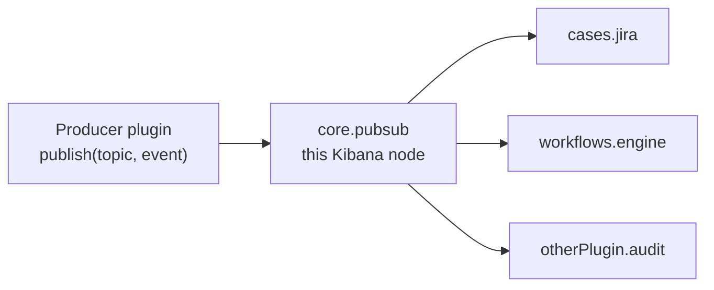

# In-process event bus

The event bus separates event production from consumer processing. Producers publish to shared, typed topics without calling consumers or waiting for their handlers. Consumers subscribe independently; adding one does not require changing the producer.

Delivery currently uses memory on one {{kib}} node. Durability is planned to allow consumers to recover events after downtime or restart. **That recovery is not available today.**

## What pub/sub provides

Use the bus to publish facts that other plugins may react to, rather than to request a specific plugin operation. Producers can include webhook ingress, saved-object updates, and timers.

- **Independent consumers:** the producer knows the topic, not its subscribers. Each named consumer has a separate subscription.
- **Asynchronous processing:** publish does not wait for handlers. Handler failures do not reject publish. Handlers still share process resources with the publisher and other consumers.
- **Planned availability independence:** durable delivery would let consumers process accepted events after recovering from downtime.

The topic's meaning, data, and event identity remain a shared contract.

## When to choose the event bus

Choose pub/sub when the producer should not call or await its consumers, or when several consumers need separate reactions to the same fact. For example, webhook ingress could publish an issue update for both Case synchronization and a Workflow trigger.

A requirement to recover events after downtime is also a reason to adopt this model. Discuss such integrations in `#kibana-event-bus` to establish the required acceptance, retry, recovery, and retention guarantees. If acknowledging a webhook must guarantee recovery after a restart, today's publish alone cannot satisfy that requirement.

- **Plugin API:** request an operation and receive its result.
- **Event bus:** publish a fact for independent consumers to react to.
- **Task Manager:** schedule and execute background work, potentially triggered by a consumer.

## Plugin availability and shared contracts

Shared topic types replace direct plugin API calls, not {{kib}}'s plugin dependency graph.

Plugin dependencies and event subscriptions serve different purposes. A dependency declares which plugins must be available for a feature to work. A subscription declares which events a consumer handles. Although pub/sub removes the need to call the producer's plugin API, the consumer may still require that producer to be enabled.

If a consumer requires a particular producer, declare that producer in `requiredPlugins` in `kibana.jsonc`. For example, a plugin dedicated to synchronizing Jira updates cannot function without its event source. A general-purpose consumer can remain useful without every source: Workflows might handle Case events when Cases is enabled without requiring Cases for its other functionality.

The producer does not need to depend on its consumers to publish events. A consumer may still declare a required or optional dependency on the producer while receiving events through the bus rather than calling the producer's API.

Share the topic type from a small types-only package. Each plugin imports the type and calls `defineTopic` independently; consumers should not import the producer's runtime token.

Creating a token does not register the topic. Exactly one plugin can register each topic name on a node. For a single-producer topic, register it in the producer's setup so publication does not depend on a consumer being enabled. Registration does not restrict who can publish.

## Delivery today and the durable direction

The planned behavior below is not a released contract or a commitment to a particular release.

| Concern | Current implementation | Planned durable delivery |
| --- | --- | --- |
| Publish completion | Validated and accepted in memory; no proof that a handler ran | Durable acceptance, separate from processing completion |
| Consumer failure | Handler failure is logged; the bus does not retry | Recoverable delivery with retry |
| Consumer downtime or restart | Queued events are not recoverable | Recovery of pending accepted events within retention |
| Node placement | Delivery only on the publishing node | Recovery and delivery independent of the publishing process |
| Long-running execution | Consumer-owned handoff to an execution service such as Task Manager | Still separate from event delivery |

### Current fan-out and loss boundaries

Delivery is best effort and at-most-once per publication and consumer: zero or one handler invocation, never a bus retry.



A resolved publish does not guarantee delivery. A consumer's copy is dropped when its queue has 1000 pending events. Overflow is logged on the first drop and with a count when the queue drains. A failed handler is logged; processing continues with the next event. Subscriptions process serially and can run concurrently with each other.

Other nodes never receive the publication. Queued events are lost at shutdown; absent consumers have no history to recover. A producer running on every node, such as a timer, publishes separately on each node. If the resulting work must run once across the cluster, coordinate it separately; pub/sub does not elect one consumer.

At start, subscriptions to unregistered topics generate a warning and receive no events. Publishing to an unregistered topic rejects.

## Consumer responsibilities

Keep handlers short. Obtain the execution identity and authorization needed for the reaction. The bus does not forward the publisher's request or permissions: user, space, and session async stores are detached before dispatch. A `spaceId` in event data is not built-in namespace filtering or authorization.

Use stable, source-derived event IDs. Publishing the same `id` twice creates two publications; the current bus does not deduplicate. Make repeated effects safe where sources retry. For durable adoption, account for concurrent and out-of-order redelivery; do not rely on today's serial dispatch. For state synchronization, prevent older updates from overwriting newer state; event identity does not establish source order.

Core starts dispatch before plugin start lifecycles run. A handler can run before its plugin's `start()`. Obtain required start services through `core.getStartServices()`.

## Current API reference

### Topic types

```ts
import type { Topic } from '@kbn/core-pubsub-server';

export interface CaseUpdatedData {
  caseId: string;
  spaceId: string;
}

export type CaseUpdatedTopic = Topic<CaseUpdatedData, 'cases.updated'>;
```

Each participating plugin creates its token from the shared type:

```ts
import { defineTopic } from '@kbn/core/server';
import type { CaseUpdatedTopic } from '@kbn/cases-updated-topic';

const caseUpdated = defineTopic<CaseUpdatedTopic>('cases.updated');
```

`defineTopic` requires a type argument and checks the name against it. `Topic` data defaults to `never`, so a name-only topic (`Topic<never, 'orders'>`) cannot be published on. `registerTopic` and `subscribe` also validate the name at runtime.

### Setup and publication

`CoreSetup.pubsub` exposes `registerTopic` and `subscribe`. Both are setup-only. In the registering plugin's setup:

```ts
core.pubsub.registerTopic(caseUpdated);
```

In each consumer's setup:

```ts
core.pubsub.subscribe(caseUpdated, {
  consumer: 'jira',
  handler: async (event) => {
    // event: { id, data, topic, acceptedAt }
  },
});
```

`CoreStart.pubsub` exposes `publish`. Await publication in an async operation and handle rejection through that operation's error handling:

```ts
const { id, acceptedAt } = await core.pubsub.publish(caseUpdated, {
  id: 'case:abc:rev-3',
  data: { caseId: 'abc', spaceId: 'default' },
});
```

The producer supplies `{ id, data }`. Publish resolves with `{ id, acceptedAt }`; handlers receive `{ id, data, topic, acceptedAt }`. IDs must be source-derived and unique within the topic for distinct events. Reuse the ID when retrying the same logical delivery.

Consumer names are plugin-local suffixes. Core scopes them as `${pluginId}.${consumer}`, so two plugins can both use `engine`. A second subscription with the same scoped name **on the same topic** throws; the suffix can be reused on another topic.

### Validation and lifecycle limits

| Rule | Value |
| --- | --- |
| Topic name | 1–256 characters; dot-separated segments, each beginning with a letter followed by `[A-Za-z0-9_-]*` |
| Topic registration | One registration per topic name on a node |
| Consumer suffix | 1–128 characters; a letter followed by `[A-Za-z0-9_-]*`; no dots or plugin prefix |
| Event `id` | Non-empty string, at most 256 characters |
| Event `data` | At most 256 KiB of UTF-8 JSON |
| Pending events per subscription | 1000, excluding the event in flight; further copies are dropped |
| Delivery | Best effort, at-most-once per publication and subscription, this node only |
| Deduplication | None |

Each consumer receives its own `JSON.parse(JSON.stringify(data))` copy. One handler cannot mutate another consumer's data. Use plain objects, arrays, strings, finite numbers, booleans, and `null`; object properties with `undefined` values are dropped in both modes. In development, publish rejects data that does not survive a JSON round trip and names the path (`Date`, `Map`, `Set`, class instances, `NaN`, `undefined` array items, functions). Production delivers the JSON result; data that cannot be serialized at all is rejected in either mode.

Registration and subscription close at the end of setup. Publishing before the bus starts rejects. `Server.stop()` stops dispatch after `http.stop()` and before `plugins.stop()`. It does not wait for in-flight handlers to finish. A publish after stop still validates the event, then resolves and logs at debug without queueing it.

## Example and adoption

A working example lives in `examples/pubsub_example`. Start {{kib}} with `yarn start --run-examples` to load it. The example registers `pubsubExample.ping` and two consumers, `echo` and `length`; its shared topic type lives in `@kbn/pubsub-example-topic`. `POST /internal/pubsub_example/publish` publishes an event, and a timer publishes every 30 seconds. See the example's README for request details.

Discuss adoption and required delivery guarantees in `#kibana-event-bus`.
