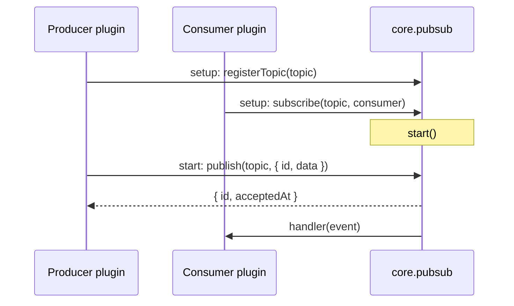
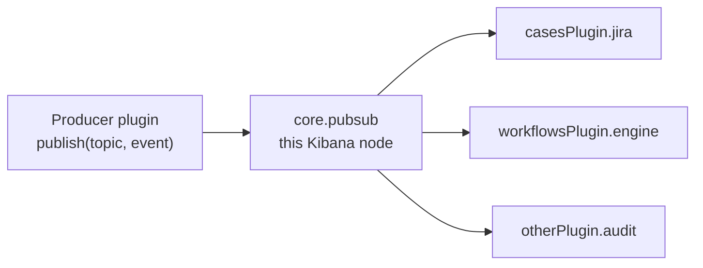
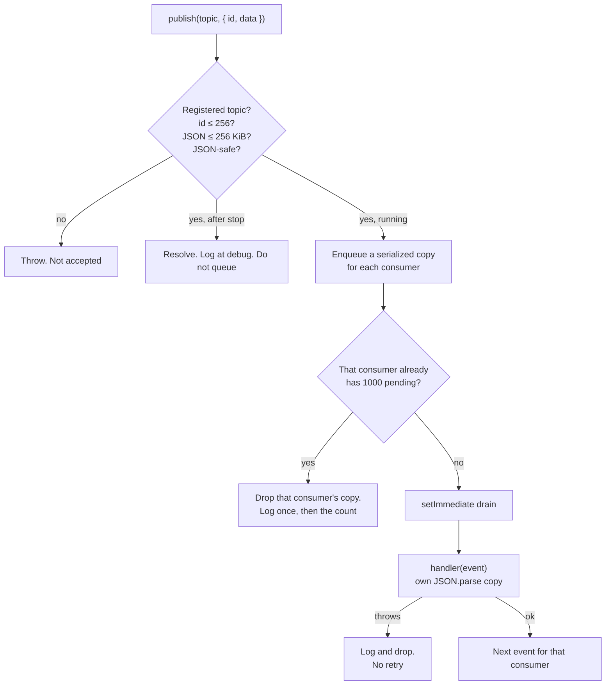

# In-process event bus

The in-process event bus lets one plugin publish a domain event and another plugin react, without the two importing each other.

Phase 1 is an in-memory bus on a single {{kib}} node. It is the first slice of a longer event-bus plan. Delivery is best effort and at-most-once: the bus does not retry, does not persist events, and does not deliver to other nodes.

A working example lives in `examples/pubsub_example`. Start {{kib}} with `yarn start --run-examples` to load it.

## Goals

- Decouple producers from consumers. A webhook handler, a saved-object update, or a timer can publish. Workflows, Cases, or any other plugin can subscribe without a private bridge.
- Fan out to every named consumer on the topic. Two plugins that care about the same event both receive it.
- Keep the publisher fast. `publish` resolves when the event is accepted into memory, not when handlers finish.
- Keep the node safe. Each consumer has a bounded queue. A slow consumer drops only its own copies.

This is not a work queue, not Task Manager, and not a cluster-wide broadcast. A subscriber that needs single-winner or durable work should schedule that work itself.

## How it fits the plugin lifecycle

`CoreSetup.pubsub` exposes `registerTopic` and `subscribe`. Both are setup-only.

`CoreStart.pubsub` exposes `publish`.



Registration and subscribe close at the end of setup. A subscription whose topic no plugin registered is logged at `start` and receives no events. `publish` to an unregistered topic throws. `publish` before start throws.

`Server.stop()` stops the dispatcher after `http.stop()` and before `plugins.stop()`. Events still queued at shutdown are discarded. `publish` after stop still validates the event, then resolves and logs at debug without queueing.

## Fan-out on one node

Every named consumer on the topic receives every event published on that node. The bus copies the payload for each consumer. One handler cannot mutate another consumer's data.



Consumer names are plugin-local. Core stores them as `${pluginId}.${consumer}`, so two plugins can both use `engine`. A second subscribe under the same scoped name throws.

Consumers on other nodes never see the event. If you need one winner across the cluster, do not wait for the bus to become a competing-consumer queue. Schedule a Task Manager task, or make the handler idempotent and accept duplicates when a producer retries.

## Delivery and drops

The bus is at-most-once for each accepted event and each consumer: zero or one delivery, never a retry.



`publish` resolving means the event was accepted, not that any handler ran. A thrown handler does not reject `publish` and does not block other consumers.

In development, `publish` rejects data that does not survive a JSON round trip and names the path (`Date`, `Map`, `Set`, class instances, `NaN`, `undefined` array items, functions). Production delivers what `JSON.parse(JSON.stringify(data))` produced.

Handlers run with the consumer's own identity. The publisher's request is not forwarded. Request-scoped async stores (user, space, session) are detached before the handler runs.

## API contract

### Define a topic type

Share a `Topic<TData, 'name'>` type from a small types-only package. Producers and consumers both depend on that package, not on each other. `defineTopic` requires the type argument. A typo in the name fails to compile.

```ts
import type { Topic } from '@kbn/core-pubsub-server';

export interface CaseUpdatedData {
  caseId: string;
  spaceId: string;
}

export type CaseUpdatedTopic = Topic<CaseUpdatedData, 'cases.updated'>;
```

```ts
import { defineTopic } from '@kbn/core/server';
import type { CaseUpdatedTopic } from '@kbn/cases-updated-topic';

const caseUpdated = defineTopic<CaseUpdatedTopic>('cases.updated');
```

`Topic` data defaults to `never`. A name-only topic (`Topic<never, 'orders'>`) cannot be published on.

Topic names are unique across {{kib}}. They are at most 256 characters, and must be dot-separated segments that each start with a letter. A second registration of the same name throws and names the first registrant. Topics have no owner: the plugin id is used for diagnostics only. Anyone who has the token can publish.

A cast can skip `defineTopic`. `registerTopic` and `subscribe` still run `assertTopicName` on `topic.name`.

### Setup

```ts
public setup(core: CoreSetup) {
  core.pubsub.registerTopic(caseUpdated);

  core.pubsub.subscribe(caseUpdated, {
    consumer: 'jira',
    handler: async (event) => {
      // event: { id, data, topic, acceptedAt }
    },
  });
}
```

### Start

```ts
public start(core: CoreStart) {
  void core.pubsub.publish(caseUpdated, {
    id: 'case:abc:rev-3',
    data: { caseId: 'abc', spaceId: 'default' },
  });
}
```

The producer writes `{ id, data }`. `id` is required, source-derived, unique within the topic, and at most 256 characters. Phase 1 does not deduplicate: publishing the same `id` twice delivers twice. Reuse the same `id` when retrying a logical delivery so a later durable bus can recognize the duplicate.

`publish` resolves with `{ id, acceptedAt }`. The delivered event is that input plus `topic` and `acceptedAt`.

## Limits

| Rule | Value |
| --- | --- |
| Topic name | ≤ 256 characters, `letter` then `[A-Za-z0-9_-]*`, dot-separated |
| Event `id` | ≤ 256 characters |
| Event `data` | ≤ 256 KiB of JSON |
| Pending events per consumer | 1000; further copies for that consumer are dropped |
| Delivery | At-most-once, this node only |
| Dedup | None in phase 1 |

## Example

`examples/pubsub_example` registers `pubsubExample.ping` and two consumers, `echo` and `length`. The topic type lives in `@kbn/pubsub-example-topic`. `POST /internal/pubsub_example/publish` publishes one event. A timer publishes another every 30 seconds.

Questions about adopting the bus, or about later phases (durability, identity, cross-node delivery), belong in `#kibana-event-bus`.
