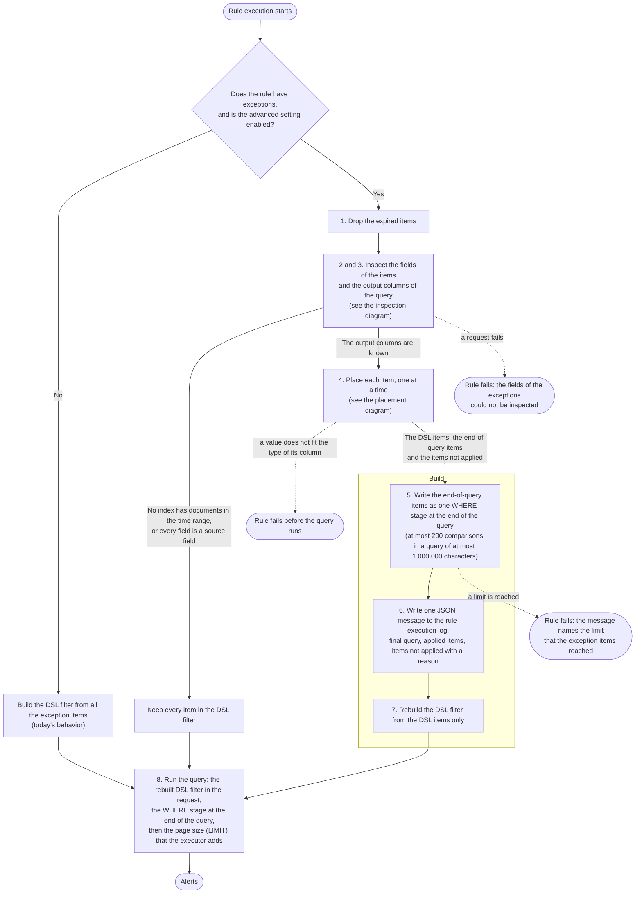
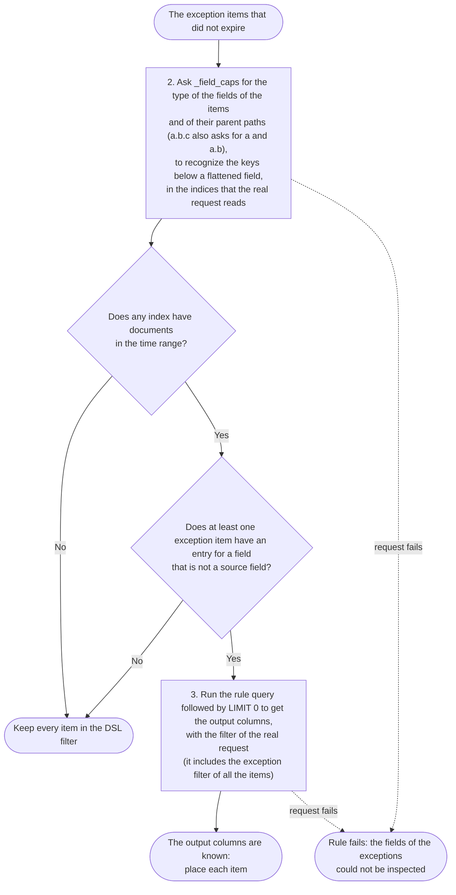
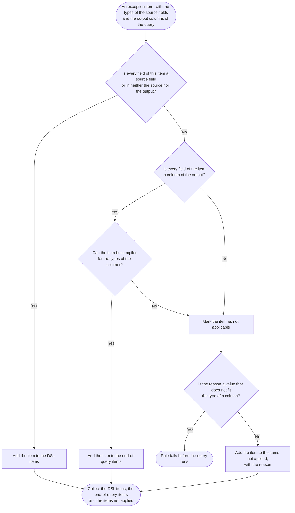

# Exceptions for computed fields in ES|QL rules 


## Summary

An ES|QL rule applies exceptions today as a DSL filter attached to the `_query` request. The filter runs on the source documents before the rule's pipeline. That works for exceptions on source fields. It cannot work for an exception on a column the pipeline computes (a `STATS` output, an `EVAL` value, a renamed column), because the column does not exist when the filter runs.

This proposal keeps the DSL filter for source fields and adds exceptions on computed output columns, which are compiled into one ES|QL `WHERE` stage appended at the end of the rule query, where those columns exist.

- Exceptions on source fields and on fields that exist nowhere (neither in the source indices nor in the output of the query) stay in the DSL filter and behave as they do today (see [Fields that exist nowhere](#fields-that-exist-nowhere)).
- Exceptions on computed columns are appended as one `| WHERE ...` stage at the end of the query. The entry types `match`, `match_any`, `wildcard` and `exists` are supported there. Value lists (`list`) and `nested` entries are not.
- An item that has a computed column and cannot be evaluated at the end of the query is not applied. It is recorded in the rule execution log and adds no warning to the rule, because an exception whose field or type cannot be matched does not warn today either (see [Items that are not applied](#items-that-are-not-applied)).
- A value that the stage cannot write for the type of its column (`bogus` for an `ip`, `1e3` on a `long`) fails the rule before the query runs (see [Values that the stage cannot write](#values-that-the-stage-cannot-write)).

Inlining source-field exceptions right after `FROM` was evaluated and rejected as too big a risk for this delivery. The DSL filter and the same exception written in ES|QL do not behave the same for every field type and operator, and the differences either change the alerts of existing rules without any error or fail the rule (see [Why source-field exceptions stay in the DSL filter](#why-source-field-exceptions-stay-in-the-dsl-filter)).

## How exceptions apply to ES|QL rules today

An exception tells a detection rule to ignore results that an analyst has reviewed and accepts. Exceptions are kept in **exception lists**: a rule has its own list, and a **shared exception list** can be attached to many rules. A list holds **exception items**, and an item holds one or more **entries**, each a condition made of a field, an operator and a value. The entries of an item are joined with AND, and the items of a list are joined with OR. An item applies only when all of its entries hold, and an alert is excluded when any item applies.

Operators are **inclusive** (`is`, `is one of`, `matches` with a wildcard pattern, and `exists`) or **exclusive** (`is not`, `is not one of`, `does not match` and `does not exist`). An exclusive operator holds for a document that lacks the field, because the field does not have the value. For example, `host.name is not dc-01` excludes the alerts of every host except `dc-01`, and of the documents without a `host.name`.

Today an ES|QL rule applies all of its exceptions in one place, a DSL filter that is sent together with the query. The rule type wrapper (`create_security_rule_type_wrapper.ts`) calls `buildExceptionFilter`, which turns the items of the lists of the rule into one DSL `exceptionFilter`, and passes it to the ES|QL rule executor. `buildEsqlSearchRequest` puts it in the `filter` field of the `_query` request, where each exception item becomes a `must_not` clause. Elasticsearch applies the filter to the source documents of the indices, and the ES|QL pipeline only sees the documents that survive it. Three consequences matter here:

1. Exceptions are always added to the filter, even when the field they reference is not present in the source indices.
2. Exceptions with operators like `is not` exclude every document that lacks the field, because a document without the field is part of the complement of the match.
3. The results of an aggregating rule are computed from the surviving documents. An exception on a source field therefore changes the aggregates (event-level exclusion). This behavior remains unchanged in this proposal.

## Solution Design

This solution is behind the advanced setting `securitySolution:enableEsqlRuleComputedFieldExceptions`, which is off by default. With the setting off, a rule runs as it does today. With it on, a rule that has exceptions runs the stages below each time it executes, and the stages after the first check are new.

An item is placed whole, in one place: in the DSL filter, at the end of the query, or nowhere when it cannot be applied. Stage 4 gives the rules, and [Items that are not applied](#items-that-are-not-applied) and [Error handling](#error-handling) describe what happens to an item that is not applied.

**The whole flow**



**Inspection (stages 2 and 3)**



**Placement of each item (stage 4)**



### Stages

The stages below run only when the advanced setting is enabled and the rule has exceptions. Otherwise the DSL filter is built from all the exception items, as today.

**1. Drop the expired items.** We remove every item whose `expire_time` is before the start of the run, which is the time that the DSL filter uses today, whatever the end of the time range of the rule is.

**2. Ask `_field_caps` for the source fields.** We call `_field_caps` on the source indices of the rule for the fields of the exception items and for the parent paths of dotted names (`a.b.c` also asks for `a` and `a.b`). The request carries the time range, the data tiers and the namespaces of the real request as an `index_filter`, without the exception filter and the excluded documents, to read the same indices as the rule query. A field that is mapped only in an index outside that filter is not a source field of the rule. When no index has documents in that time range, we do not apply the exceptions at the end of the query and the rule runs as it does today. An ungrouped aggregation still returns a row for an empty range, and an exception on a column of that row is not applied in that run.

A field is a source field when `_field_caps` lists it with a type that holds values, or when it sits under a `flattened` field that it lists. An `object` that it lists for the parent path of a dotted name (`host` for `host.name`) is not a source field: it holds no value, and an exception on that name can only refer to a column that the query creates with the same name (`BY host = host.name`). A `nested` path is listed only when a field below it is requested too, which is why we also ask for the paths below a nested entry (`nested_user.name`). A `nested` path counts as a source field, because the DSL filter searches it with a `nested` query, and a nested item stays in the DSL filter even when the query creates a column with the name of its path.

When every field of every exception item is a source field, we keep all the items in the DSL filter and go to stage 8. Otherwise we continue with stage 3. If this request fails, the rule fails.

**3. Run the rule query with `| LIMIT 0` to get the output columns.** We send the query of the rule with `| LIMIT 0` at the end to the `_query` API, with the filter of the real request: the time range, the rule filters, the data tiers and namespaces, the exception filter built from all the items, and the excluded documents. The response has no rows and lists the names and the ES|QL types of the output columns. When the request fails, the rule fails.

**4. Place each item.** An item is placed whole, in one place, because its entries are joined with AND: an item excludes an alert only when all of its entries match. For each item, the first of these cases that applies decides what we do:

1. **Every field of the item is a source field or exists nowhere** (it is neither a source field nor a column of the output). We put the item in the DSL filter, as today. This holds even when the query outputs a column with the same name: a field that the query redefines (`EVAL host.name = TO_UPPER(host.name)`) is still a source field, and the exception compares the source value. A field that exists nowhere is left to the DSL, and Elasticsearch decides what the item matches (see [Fields that exist nowhere](#fields-that-exist-nowhere)).
2. **The item has a computed column, every field of it is a column that the query returns, and the item is supported at the end of the query**. We put the item at the end of the query. An entry with a negative operator on a field that exists nowhere does not need a column. Because it is true for every row, as it is in the DSL filter, we leave it out of the stage.
3. **Otherwise,** the item has a computed column and an entry that the end of the query cannot use: an entry that is not negative on a field that exists nowhere (it never matches), or an entry on a source field that the query does not output. We do not apply the item and we record the reason (see [Items that are not applied](#items-that-are-not-applied)). When the reason is a value that the stage cannot write, the rule fails before the query runs (see [Error handling](#error-handling)).

**5. Write the end-of-query items as one `WHERE` stage.** We compile each item to an expression and join the expressions with `AND` in one `| WHERE` stage at the end of the query (see [How the items become a WHERE stage](#how-the-items-become-a-where-stage)). When the stage needs more than 200 comparisons, or the final query would be longer than 1,000,000 characters, the rule fails and the message names the limit and the items to reduce (see [Limits](#limits)).

**6. Write the log message.** We write one JSON message to the rule execution log with the final query, the items applied at the end of the query and the items not applied with their reasons (see [Items that are not applied](#items-that-are-not-applied)).

**7. Rebuild the DSL filter.** We build it again from the DSL items only. The items at the end of the query and the items not applied no longer appear in it.

**8. Run the query.** The request carries the rebuilt DSL filter. The query has the `WHERE` stage at the end, followed by the page size (`LIMIT`) that the executor adds.

### Worked examples

A rule flags hosts reached by many distinct users:

```esql
FROM logs-*
| STATS user_count = COUNT_DISTINCT(user.name) BY host.name
| WHERE user_count > 50
| RENAME host.name AS target_host
```

**An exception that goes in the DSL filter: `user.name is vuln-scanner-svc`.** `user.name` is a field in the source indices. The item goes in the DSL filter and the query does not change. Because the scanner events are excluded before `COUNT_DISTINCT`, they do not inflate any distinct-user count.

**An exception that goes at the end of the query: `target_host is dc-01`.** `target_host` is not in the source indices, and it is a `keyword` column of the query output. The item is therefore supported at the end of the query, and the query becomes:

```esql
FROM logs-*
| STATS user_count = COUNT_DISTINCT(user.name) BY host.name
| WHERE user_count > 50
| RENAME host.name AS target_host
| WHERE NOT (MV_CONTAINS(target_host, "dc-01"))
```

Only the alert row of `dc-01` is excluded.

**An exception on a field that exists nowhere: `winlog.event_id is 4624`.** `winlog.event_id` is neither in the source indices nor a column of the query output, as happens with a list shared by rules over other indices. The item stays in the DSL filter and the query does not change. Elasticsearch decides what it matches, as it does today, and nothing is logged. When the item also has a computed column, the entries on that field are read as [Fields that exist nowhere](#fields-that-exist-nowhere) describes.

### What each position means

Since the DSL filter excludes source events before the pipeline, it changes the aggregates of an aggregating rule. The end-of-query stage excludes alert rows after the pipeline and changes no other row. Both are intended: an exception authored on a source field means "ignore these events", and an exception authored on a computed column means "ignore this result".

### Fields that exist nowhere

A shared exception list may hold items for fields that some indices do not have. For a field that exists nowhere, the DSL filter gives these results, which are not changed:

- A positive operator (`is`, `is one of`, `matches`, `exists`) matches no document and the item excludes nothing.
- A negative operator (`is not`, `is not one of`, `does not match`, `does not exist`) matches every document, because no document has the value. An item such as `process.name is not ping AND host.name is web-1` on an index without `process.name` excludes every `web-1` event. This is how exceptions behave today.

The Elastic Security documentation does not describe this case. It only warns that an exception on an unmapped field can "prevent it from working as expected". We keep the behavior that users already have: the item stays in the DSL filter, and the setting does not change which alerts such a rule creates.

An item that also has a computed column cannot stay in the DSL filter, because the DSL filter cannot evaluate the computed column. For that item we read the field that exists nowhere as the DSL filter reads it:

| Entry on a field that exists nowhere | Meaning | At the end of the query |
|---|---|---|
| `is not`, `is not one of`, `does not exist`, `does not match` | True for every row | Left out of the stage. The other entries decide. |
| `is`, `is one of`, `exists`, `matches` | Never matches, so the item excludes nothing | The item is not applied. It is recorded in the rule execution log with the code `field_not_found`. |
| A `nested` entry | The DSL filter fails the query for a nested path that is not mapped (`[nested] failed to find nested object under path`), with either operator. Without a computed column the item stays in the DSL filter and the rule fails, as it does today | The item is not applied, with the same code, and the rule runs. |

### The stage goes after any LIMIT

The `| WHERE` stage with the exceptions on computed columns always goes at the very end of the rule query, after any `LIMIT` that the rule author wrote. We do not insert it before the last `LIMIT`, because a `LIMIT` can appear anywhere in a query and more than once, so that placement would need rules of its own. The consequence is that an exception at the end of the query removes rows from the rows that the query already returned, and no further rows take their place.

### How the items become a WHERE stage

We append the exception items that go at the end of the query as one `| WHERE` stage. The rows that remain after the stage, the ones that none of its items excludes, are the alerts.

An item excludes a row only when all of its entries match. An item compiles to an expression that joins its entries with `AND` and negates the result. An entry with an excluding operator (`is not`, `is not one of`, `does not match`, `does not exist`) is negated inside the item, and in an item with a single entry the two negations cancel and the stage has no `NOT`:

| Exception item | Stage |
|---|---|
| `risk is low` | `\| WHERE NOT (MV_CONTAINS(risk, "low"))` |
| `risk is low` AND `count exists` | `\| WHERE NOT ((MV_CONTAINS(risk, "low")) AND (count IS NOT NULL))` |
| `risk is not low` | `\| WHERE MV_CONTAINS(risk, "low")` |
| `risk is not low` AND `count exists` | `\| WHERE NOT ((NOT (MV_CONTAINS(risk, "low"))) AND (count IS NOT NULL))` |

The comparisons use functions that return a real boolean for null and multi-valued inputs (`MV_CONTAINS`, `IS NULL`, `IS NOT NULL`), and the two that can be null (`MV_LIKE` and `MV_IN_RANGE`) are wrapped in `COALESCE(..., false)`. This reproduces the any-element matching of the DSL filter: a null column keeps the row for a positive operator and excludes it for a negative one.

The stage joins the expressions of all the items with `AND`, because `NOT A AND NOT B` excludes what `A OR B` would. Take these three exception items, on the `keyword` columns `c_tier`, `c_keyword` and `c_opt` and the `ip` column `c_ip`:

- `a`: `c_tier is gold`
- `b`: `c_keyword matches kw-z*` AND `c_opt exists`
- `c`: `c_ip is one of 10.0.0.0/24, 10.0.1.0/24`

The stage that we append is the following (the compiler writes it on one line, and it is split here for reading):

```
| WHERE
  (NOT (MV_CONTAINS(c_tier, "gold")))                                              // a
  AND (NOT (                                                                       // b
    (COALESCE(MV_LIKE(c_keyword, "kw-z*"), false))
    AND (c_opt IS NOT NULL)
  ))
  AND (NOT (                                                                       // c
    COALESCE(MV_IN_RANGE(c_ip, "10.0.0.0"::ip, "10.0.0.255"::ip), false)
    OR COALESCE(MV_IN_RANGE(c_ip, "10.0.1.0"::ip, "10.0.1.255"::ip), false)
  ))
```

The stage has 5 comparisons: one for `a`, one for each entry of `b`, and one for each CIDR value of `c`. The stage is limited to 200 comparisons and 1,000,000 characters, and the `WHERE` expressions of the rule query count against the clause limit of Elasticsearch together with ours (see [Limits](#limits)).

## Types supported at the end of the query

The entry types `match`, `match_any`, `wildcard` and `exists` are supported at the end of the query. An exception can be tested on 11 ES|QL column types: `keyword`, `text`, `integer`, `long`, `unsigned_long`, `double`, `boolean`, `ip`, `version`, `date` and `date_nanos`. A `text` column is compared as a `keyword` column is, on the whole value and respecting case (see [Text columns](#text-columns)). A `double` column supports only `exists` (see [Types not supported](#types-not-supported-at-the-end-of-the-query)). The type is the ES|QL type of the output column, not the mapping of a source field.

`col` stands for the column name, backquoted per dotted segment when the segment is not a plain identifier (`` `host-name` ``) or is a word that ES|QL does not accept as a column name (for example `first`, `in` or `where`). When a segment is empty, the whole name is one quoted identifier (`` `a..b` ``). The table shows what the implementation generates for one item each. With several items the clauses are joined with `AND` in the same stage, as in [How the items become a WHERE stage](#how-the-items-become-a-where-stage).

| Column type | `is` | `is one of` | `matches` | `exists` |
|---|---|---|---|---|
| `keyword` | `\| WHERE NOT (MV_CONTAINS(col, "good.com"))` | `\| WHERE NOT (MV_INTERSECTS(col, ["good.com", "bad.com"]))` | `\| WHERE NOT (COALESCE(MV_LIKE(col, "good*"), false))` | `\| WHERE NOT (col IS NOT NULL)` |
| `text` | `\| WHERE NOT (MV_CONTAINS(col, "good.com"))` | `\| WHERE NOT (MV_INTERSECTS(col, ["good.com", "bad.com"]))` | `\| WHERE NOT (COALESCE(MV_LIKE(col, "good*"), false))` | `\| WHERE NOT (col IS NOT NULL)` |
| `integer` | `\| WHERE NOT (MV_CONTAINS(col, 42::integer))` | `\| WHERE NOT (MV_INTERSECTS(col, TO_INTEGER(["42", "7"])))` | not supported | `\| WHERE NOT (col IS NOT NULL)` |
| `long` | `\| WHERE NOT (MV_CONTAINS(col, 42::long))` | `\| WHERE NOT (MV_INTERSECTS(col, TO_LONG(["42", "7"])))` | not supported | `\| WHERE NOT (col IS NOT NULL)` |
| `unsigned_long` | `\| WHERE NOT (MV_CONTAINS(col, 1000::unsigned_long))` | `\| WHERE NOT (MV_INTERSECTS(col, TO_UNSIGNED_LONG(["1000", "7"])))` | not supported | `\| WHERE NOT (col IS NOT NULL)` |
| `double` | not supported | not supported | not supported | `\| WHERE NOT (col IS NOT NULL)` |
| `boolean` | `\| WHERE NOT (MV_CONTAINS(col, true))` | `\| WHERE NOT (MV_INTERSECTS(col, [true, false]))` | not supported | `\| WHERE NOT (col IS NOT NULL)` |
| `ip` | `\| WHERE NOT (MV_CONTAINS(col, "10.0.0.1"::ip))` | `\| WHERE NOT (MV_INTERSECTS(col, TO_IP(["10.0.0.1", "10.0.0.2"])))` | not supported | `\| WHERE NOT (col IS NOT NULL)` |
| `version` | `\| WHERE NOT (MV_CONTAINS(col, "1.2.3"::version))` | `\| WHERE NOT (MV_INTERSECTS(col, TO_VERSION(["1.2.3", "2.0.0"])))` | not supported | `\| WHERE NOT (col IS NOT NULL)` |
| `date` (day value) | `\| WHERE NOT (COALESCE(MV_IN_RANGE(col, "2026-09-30T00:00:00.000Z"::date, "2026-09-30T23:59:59.999Z"::date), false))` | `\| WHERE NOT (COALESCE(MV_IN_RANGE(col, "2026-09-30T00:00:00.000Z"::date, "2026-09-30T23:59:59.999Z"::date), false) OR COALESCE(MV_IN_RANGE(col, "2026-08-01T00:00:00.000Z"::date, "2026-08-01T23:59:59.999Z"::date), false))` | not supported | `\| WHERE NOT (col IS NOT NULL)` |
| `date_nanos` (day value) | `\| WHERE NOT (COALESCE(MV_IN_RANGE(col, "2026-09-30T00:00:00.000Z"::date_nanos, "2026-09-30T23:59:59.999999999Z"::date_nanos), false))` | the same range, one per value, joined with `OR` | not supported | `\| WHERE NOT (col IS NOT NULL)` |

### Negative operators

Every supported type uses the same pattern. Shown for `keyword`:

| Operator | Stage |
|---|---|
| is not | `\| WHERE MV_CONTAINS(col, "good.com")` |
| is not one of | `\| WHERE MV_INTERSECTS(col, ["good.com", "bad.com"])` |
| does not match | `\| WHERE COALESCE(MV_LIKE(col, "good*"), false)` |
| does not exist | `\| WHERE col IS NOT NULL` |

The exceptions documentation does not describe what a negative operator does with a row that has no value. In the DSL filter, "is not low" is true for a document without the field. The exception matches it and its alert is excluded. The stage gives the same result: it keeps only the rows where `MV_CONTAINS(col, "low")` is true, and that is false for a null column, therefore the row is removed.

### Value rules

A value that cannot be cast to the type of the column is not included in the ES|QL: a failed cast yields `null`, `MV_CONTAINS(col, null)` is true, and the stage would exclude every row. The compiler therefore checks every value before it writes the stage, and a value that it cannot write fails the rule (see [Values that the stage cannot write](#values-that-the-stage-cannot-write)).

| Column type | Accepted values | The rule fails when the value is |
|---|---|---|
| `keyword`, `text` | Any string. Quotes, backslashes, `\n`, `\r` and `\t` are escaped in the literal. A `text` column is compared on the whole value and respecting case, as a `keyword` column is. | Never for `is` and `is one of` |
| `integer`, `long`, `unsigned_long` | Integers within the range of the type. `42` is written `42::long`. | Not a plain integer that the type can hold: `many`, `0x10`, `42.5`, `1e3`, an empty value, `2147483648` on `integer`, `-1` on `unsigned_long` |
| `double` | Only `exists` is supported. `is` and `is one of` are not applied, whatever the value (see [Types not supported at the end of the query](#types-not-supported-at-the-end-of-the-query)). | Never |
| `boolean` | `true` or `false`, in lowercase, as the DSL filter accepts. | `TRUE`, `1`, `yes`, an empty value |
| `ip` | An address (IPv4 or IPv6), or a range in CIDR notation (`10.0.0.0/24`, `2001:db8::/32`). A CIDR value is written as `COALESCE(MV_IN_RANGE(col, first, last), false)`, which matches on any value of a multi-valued column, as the DSL does (`CIDR_MATCH` returns `null` on those). The address bits after the prefix are ignored, as in Elasticsearch. | Not an address and not a CIDR with a valid prefix: `bogus`, `10.0.0.256`, `10.0.0`, `010.0.0.1`, `10.0.0.0/33`, an empty value. Also a CIDR that the compiler does not write: `::/0`, IPv4-mapped IPv6 prefixes and an address with a zone (`fe80::1%eth0/64`) |
| `version` | A semantic version, for example `1.2.3` or `1.2.3-beta`, with at most 9 digits in each number. A number above 2147483647 fails the whole query in ES\|QL instead of casting to `null`, and the compiler stops at 9 digits. | A string that is not a semantic version, or a number of more than 9 digits |
| `date`, `date_nanos` | See [Date values](#date-values). | A format that the compiler does not write (see [Date values](#date-values)) |
| `matches` (any type) | Only `keyword` and `text` columns. The pattern keeps `*` and `?` as wildcards, keeps `\*`, `\?` and `\\` as literals, and drops other backslashes. | A pattern that ends with a lone backslash |

An `is one of` list must have at least one value. Its values are written as one call, `MV_INTERSECTS(col, [...])`, which is true when any element of the column is in the list, is false for a null column, and counts as one comparison whatever its length. The types that need a conversion convert the whole list (`TO_INTEGER`, `TO_LONG`, `TO_UNSIGNED_LONG`, `TO_IP` and `TO_VERSION`), for example `MV_INTERSECTS(col, TO_IP([...]))`. The values that are compared in another way stay one comparison each, joined with `OR`: the ranges of CIDR values and of rounded date values. A list that mixes addresses and CIDR values on an `ip` column is `MV_INTERSECTS(col, TO_IP([...])) OR COALESCE(MV_IN_RANGE(...), false)`. Every value is validated before the list is written, because a value that fails a conversion is dropped from the list silently.

### Date values

A date value covers the unit that it names, a day, an hour, a minute or a second. The stage writes that unit as a range.

| Value | Compiled as |
|---|---|
| Day, hour, minute or second (`2026-09-30`, `2026-09-30T14`, `2026-09-30T14:05`, `2026-09-30T14:05:09`; on `date_nanos` an hour or a minute without seconds fails the rule, see the last row) | `COALESCE(MV_IN_RANGE(col, "first instant"::date, "last instant"::date), false)` covering the whole unit, in UTC. For `date_nanos` the last instant ends in `.999999999Z`. |
| A value with a time that ends in `Z` or in an offset (`2026-09-30T14:05:09Z`, `2026-09-30T16:05:09+02:00`, `+0200`, `+02`) | The offset is applied to the value first, and the unit is written in UTC: `2026-09-30T16:05:09+02:00` covers the second `14:05:09` UTC. |
| Year or month (`2026`, `2026-09`) | The first day only, which is what the DSL filter matches. |
| Value with a fraction (`2026-09-30T14:00:00.123Z`) | An exact instant: `MV_CONTAINS(col, "2026-09-30T14:00:00.123Z"::date)`, written in UTC when the value has an offset. Up to 3 fraction digits on `date`, up to 9 on `date_nanos`. |
| An offset that the DSL does not accept (outside `-18:00` to `+18:00`, minutes above 59, or an hour with one digit such as `+2:00`), an offset on a value with no time (`2026-09-30+02:00`), epoch milliseconds, a fraction with more digits than the type takes (above 3 on `date`, above 9 on `date_nanos`), other formats, years before 1000, impossible dates | The rule fails, because the compiler does not write the value. |
| A zone with no time (`2026-10-01Z`, `2026Z`), and on `date_nanos` an hour or a minute with no seconds (`2026-10-01T08`, `2026-10-01T08:00`) | The rule fails. The DSL filter also fails on these values for the default date format. |

A multi-valued date column matches when any of its values is in the range, as in the DSL filter.

### Text columns

A column has the type `text` only when the query passes a `text` source field through unchanged: `RENAME message AS msg`, `EVAL msg = message`, or a `STATS ... BY msg = message` key. Every ES|QL function that takes a `text` value returns a `keyword` (`COALESCE`, `CASE`, `CONCAT`, `TO_LOWER`, `SUBSTRING` and others).

A `text` column behaves as the exceptions documentation describes: `is` is an exact match, `matches` takes the wildcards `?` and `*` on `keyword`, `text` and `wildcard` fields, and rule exceptions are case-sensitive. It is compared like a `keyword` column, on the whole value and respecting case, with `MV_CONTAINS` for `is`, `MV_INTERSECTS` for `is one of` and `MV_LIKE` for `matches`. The DSL filter does not do that on a `text` source field: it compares analyzed tokens. With them, `is` ignores the case and finds the value inside a longer one, and `matches` compares each lowercase token with the pattern as written. The table shows the same exceptions on a `text` source field, in the DSL filter, and on a computed `text` column created with `EVAL m = message`, for documents that differ in case and in the position of the phrase.

| Exception | On the source field `message` | On the computed column `m` |
|---|---|---|
| `is` `good.com` | `Connection to good.com failed`, `Good.com`, `GOOD.COM` and `good.com` | `good.com` |
| `is` `GOOD.COM` | `Connection to good.com failed`, `Good.com`, `GOOD.COM` and `good.com` | `GOOD.COM` |
| `matches` `good*` | `Connection to good.com failed`, `GOOD morning`, `Good.com`, `GOOD.COM` and `good.com` | `good.com` |
| `matches` `GOOD*` | none, because the pattern is not lowercased and the tokens are | `GOOD morning` and `GOOD.COM` |

The DSL behavior is not changed by this proposal. A shared exception can therefore exclude different documents on a source `text` field and on a computed `text` column.

### Types not supported at the end of the query

A type is supported only when ES|QL has a predicate that keeps the same rows as the DSL filter for every operator, including null and multi-valued columns and the negative forms. For the other types the comparison is impossible (the column is `unsupported` or accepts no comparison) or it has different semantics. An approximation would raise no error and would silently exclude or keep the wrong alerts. An item that has a computed column of one of these types is not applied, and the skip reason is logged. A type can be added once its comparison is shown to match the DSL. The last three rows are names that have no column.

| Type | Why |
|---|---|
| `search_as_you_type`, `completion`, `join`, `binary`, `long_range`, `integer_range`, `float_range`, `ip_range`, `sparse_vector`, `rank_*`, `percolator` | They surface in ES\|QL as `unsupported`, so no predicate can reference the column. |
| `geo_*`, `cartesian_*`, `dense_vector`, `double_range`, `date_range`, `flattened` root, histogram family, `aggregate_metric_double` | The column exists but accepts no value comparison. The `exists` operator could be supported on these in a later iteration. |
| `double` for `is` and `is one of` | A `double` column can come from a `float` or `half_float` field, and the column type does not say which. ES\|QL reads a `float` holding 0.1 as `0.10000000149011612`, which is not the `double` 0.1 that the stage compares it with, and an equality can miss the value. `exists` is supported. |
| `nested` sub-fields, `flattened` sub-keys, `passthrough` parents | ES\|QL has no column for them. The DSL filter handles them when they are source fields. |
| Object parents (`host` for `host.name`) | An object holds no value, so it is not a source field and has no column. An exception on that name can only mean a column that the query creates with the same name. |
| Fields that exist nowhere | No column exists. The item stays in the DSL filter (see [Fields that exist nowhere](#fields-that-exist-nowhere)). |

### Values that the stage cannot write

An exception can carry a value that the stage cannot write for the type of its column. The value can be not valid for the type (`bogus` for an `ip`, `maybe` for a `boolean`), which nothing prevents when the exception is created because the lists API stores values as strings. It can also be valid and written in a notation that the compiler does not support, such as `1e3` on a `long` or a date in a format that the compiler does not read. The table in [Value rules](#value-rules) lists the values that fail.

When an item that is placed at the end of the query has such a value, the executor fails the rule before it sends the query:

```text
The rule did not run because exception items have a value that cannot be used for the type of the field: "src_ip is one of" (list "my-list", item "my-item"): value "bogus" cannot be written for a column of type ip at the end of the query, in the field "src_ip". Fix or delete these exception items.
```

The message names up to 5 values that cannot be written, each with its item and its field, and counts the others. An item with several such values is named once for each value, which shows every value to fix in a single run. The rule creates no alerts and the failure is a user error. No `esql_exceptions` message is written for that run, because the rule status carries the reason.

**Why fail.** A failed run is easier to notice and to fix than a run that applies some of the exceptions of a rule. An item that is silently skipped creates the alerts that the analyst already excluded, and alert noise is a main problem for customers. The items at the end of the query are on columns that the query computes, which the DSL filter has never applied, and no rule depended on them before the setting.

**What failing costs.** A failed run creates no alerts at all, where a skipped item only creates the alerts that the item would have excluded. Anyone who can edit a shared list can make every ES|QL rule that uses it fail with a bad value, and the same value can be valid for a field in one rule and not valid in another. The DSL filter already has this property for source fields, and the end of the query makes the surface wider. This is one reason the feature is experimental and off by default.

An item whose fields are all source fields or exist nowhere never fails the rule for a value: it stays in the DSL filter, and Elasticsearch decides. An item skipped before its values are checked does not fail the rule either: an item skipped because of its fields (an entry that is not negative on a field that exists nowhere, or a source field that the query does not output), or because it is restricted to some operating systems (`os_types`). In an item that is checked, an invalid value fails the rule even when another entry would be skipped for another reason.

### Differences from the DSL filter

An exception on a computed column is compared with the values that the query holds at the end, and the DSL filter is compared with the source documents. Two differences follow, besides the types that are not supported and the behavior of `text` columns (see [Text columns](#text-columns)).

- **Keyword fields with a normalizer.** The DSL filter applies the normalizer of the field to the value of the exception, while a computed column holds the already normalized value. With a lowercase normalizer, `k` stores `ABC` and "k is ABC" excludes it. After `STATS c = COUNT(*) BY x = k`, `x` holds `abc`: "x is ABC" excludes nothing and "x is abc" excludes it. After a `RENAME` or an `EVAL` alias, Elasticsearch can push the `WHERE` down to the field, which applies the normalizer, and the result then depends on the query. The executor cannot know which fields have a normalizer.
- **`MV_EXPAND` and other commands that make rows.** The DSL filter works on documents and the end stage works on the rows that the query returns. A document has `t = ["x", "bad.com"]` and the query is `MV_EXPAND t`. The exception "t is bad.com" on the source field `t` stays in the DSL filter and excludes the whole document, and neither row alerts. The same exception on a computed column, for example `EVAL c = t` after the `MV_EXPAND`, excludes only the row with `bad.com`, and the row with `x` still creates an alert.

## Items that are not applied

An item that is not applied excludes no alert. It is not written at the end of the query, and it is removed from the DSL filter too, because the source documents do not have the column that it refers to. It never adds a warning to the rule: today an exception that cannot be applied does not warn, and a warning on every run would be noise for rules with shared lists. The warning for value lists that are too large to process is unchanged. The reason is written to the rule execution log instead, as one JSON message per run, for a UI to use later. An item with a value that the stage cannot write is not in this section, because the rule fails (see [Values that the stage cannot write](#values-that-the-stage-cannot-write)).

The message is written with `ruleExecutionLogger.info` when at least one item is applied at the end of the query or not applied. It reaches the event log (`.kibana-event-log-*`, provider `securitySolution.ruleExecution`, action `message`) only when the experimental feature `extendedRuleExecutionLoggingEnabled` is on and the minimum level in the advanced settings is Info or lower. Otherwise it is written only to the Kibana server log, at `debug` level. Rule preview does not store `info` messages, and that is unchanged. The text of the `message` field is this JSON object:

```json
{
  "type": "esql_exceptions",
  "version": 1,
  "query": "FROM logs-* | STATS ... | WHERE NOT (MV_CONTAINS(c_tier, \"gold\"))",
  "queryTruncated": false,
  "dslItemCount": 12,
  "appliedAtEndOfQuery": [{ "list_id": "my-list", "item_id": "tier-gold" }],
  "notApplied": [
    {
      "list_id": "my-list",
      "item_id": "geo",
      "name": "geo",
      "code": "column_type_not_supported",
      "reason": "column \"c_geo\" has type \"geo_point\", which cannot be tested at the end of the query",
      "fields": ["c_geo"]
    }
  ],
  "notAppliedCount": 1,
  "truncated": false
}
```

- `query` is the final query of the rule, with the stage of the items applied at the end of the query and without the page size that the executor adds. The final query is otherwise logged only at `trace` level. It is cut at 20,000 characters, and `queryTruncated` says so.
- `dslItemCount` is the number of items in the DSL filter.
- `notApplied` has one entry for each item and reason. An item with two reasons appears twice, each time with its own `code`, `reason` and `fields`. It lists at most 200 entries; `notAppliedCount` is the total and `truncated` says that the list was cut.
- `code` is stable and meant for the UI. `reason` is an English explanation. `fields` names the fields that cause the reason, when they are known.

| `code` | Meaning |
|---|---|
| `field_not_found` | An item that has a computed column and an entry that is not negative on a field that is in neither the source nor the output, which never matches. A negative entry on such a field is left out of the stage, and an item with no computed column stays in the DSL filter and is not recorded. |
| `source_field_not_output` | A field of the source indices that the query does not output, in an item that also has a computed column. |
| `entry_type_not_supported` | A `list` or `nested` entry on a computed column. |
| `column_type_not_supported` | The type of the column cannot be compared at the end of the query (see [Types not supported at the end of the query](#types-not-supported-at-the-end-of-the-query)). |
| `operator_not_supported_on_type` | `matches` on a column that is not `keyword` or `text`, and `is` or `is one of` on a `double` column. |
| `os_types_not_supported` | The item has `os_types`, and it would be placed at the end of the query. The DSL filter turns `os_types` into conditions on `host.os.type` and `host.os.name.caseless`, which the end of the query does not compile. |
| `list_size_not_supported` | An "is one of" entry with no value. |
| `item_has_no_entries` | The item has no entries. |

## Limits

The items that are applied at the end of the query are written as one `WHERE` stage within these limits. When a limit is reached, the rule fails before the query runs, as a user error, and the message of the rule names the limit and the items to reduce: the three items with the most comparisons, or the item that makes the query too long. No item is dropped silently, because a rule that runs with only some of its exceptions creates alerts that the exceptions were meant to exclude. None of these limits exists today in the schema, the UI or the API.

| Limit | Value | Reason |
|---|---|---|
| Comparisons in the stage | 200 | Our own limit. A comparison is one test on a column (see [How the items become a WHERE stage](#how-the-items-become-a-where-stage)). The `WHERE` expressions of the rule query count against the clause limit of Elasticsearch together with ours, and we cannot bound them (see [Clauses of the query](#clauses-of-the-query)). The comparisons stay under the depth limit of ES\|QL, which is 300 levels (see [Why 200 comparisons stay under the depth limit](#why-200-comparisons-stay-under-the-depth-limit)). All the items are counted together, which means that splitting an item into several items does not change the count. |
| Length of the final query | 1,000,000 characters | ES\|QL rejects a statement of more than 1,000,000 characters (`ESQL statement is too large [N characters > 1000000]`; added in [#117898](https://github.com/elastic/elasticsearch/pull/117898), not on the limitations page). The rule query counts, and a few characters are kept for the page size that the executor adds. A long `is one of` list counts as one comparison, and the length of the query is what limits it. |

The message of the comparison limit looks like this:

```text
The rule did not run because its exceptions do not fit in the query: the exceptions on the columns of the query need 350 comparisons, and at most 200 are allowed (a comparison is one test on a column: an entry, or one CIDR value or date of an "is one of" entry). The items with the most comparisons are: the item "blocked ranges" (list "my-list", item "blocked-ranges") has 300, the item "scanners" (list "my-list", item "scanners") has 40, the item "vpn" (list "my-list", item "vpn") has 10. Remove values from those items, or remove the items that this rule does not need. Splitting an item into several items does not help, because all the items are counted together.
```

### Why 200 comparisons stay under the depth limit

ES|QL rejects a statement with an expression nested deeper than 300 levels (`ES|QL statement exceeded the maximum expression depth allowed (300)`), and it counts the depth for each stage. Our stage is one `WHERE` expression, which means that its depth must stay below that.

Every comparison adds at most one level, whether it is a new item (one more `AND`), a new entry (one more `AND`) or a new range of a CIDR or date value (one more `OR`). The levels that no comparison pays for are fixed ones around the deepest piece: the `NOT`s, the parentheses and the range test. The deepest form that the compiler writes is a first item with several entries, whose deepest entry is negated and made of ranges. For `n` items, `m` entries in the first item and `w` ranges in its deepest entry, the depth is `n + m + w + 12`, and the stage has at least `n + m + w - 2` comparisons. The depth is therefore at most the number of comparisons plus 14. With at most 200 comparisons the depth is at most **214**, a margin of 86 levels. [How the depth of the stage is counted](#how-the-depth-of-the-stage-is-counted) gives the derivation.

We checked the formulas on Elasticsearch by finding the largest stage that runs for each shape. Every breakpoint matched:

| Shape | Largest stage that runs | Depth at that size |
|---|---|---|
| Items `is` | 293 items | n + 7 = 300 |
| First item with a positive entry of ranges (m = 2, w = 10) | 279 items | n + m + w + 9 = 300 |
| First item with a negated entry of ranges (m = 2, w = 10) | 276 items | n + m + w + 12 = 300 |
| A single entry of ranges (w = 10) | 282 items | n + w + 8 = 300 |

A worst-case stage of 200 comparisons ran: a first item with a negated entry of 100 ranges and one more entry, then 99 simple items, 214 levels. The bound assumes that the compiler keeps writing these forms. A new predicate with more than 4 levels, or a new way of wrapping an entry, needs the constants to be measured again. Elasticsearch has also lowered this limit before (500, then 400, then 300), and a limit below about 215 would leave no room.

### How the depth of the stage is counted

The depth of an expression is the largest number of levels that surround one innermost piece. The derivation below gives the depth of the stage that the compiler writes.

**What counts.** In `NOT (a AND b)`, `a` is inside the `AND`, which is inside the parentheses, which are inside the `NOT`. Each piece adds levels like this:

| Construct | Levels |
|---|---|
| The expression of the `WHERE` itself | 1 |
| Each `AND` / `OR`, nested from the left, so `a AND b AND c` is `((a AND b) AND c)` | 1 |
| `NOT` | 1 |
| Parentheses | 2 |
| A column, a literal or a function call used as an operand or a function argument | 1 |
| `IS [NOT] NULL` | 2 |
| A cast like `"x"::ip` | 1 |
| The function call itself | 0, only its deepest argument counts |

**The highest depth that our stage can reach.** Consider the following example: a rule has three exception items on columns of its query. `src_ip` is an `ip` column, and `user`, `host` and `tier` are `keyword` columns:

1. "external backup": `src_ip` is not one of `10.0.0.0/8`, `192.168.0.0/16` **and** `user` is `svc-backup`
2. "scanner": `host` is `scanner-01`
3. "gold": `tier` is `gold`

The stage that we write for them is the following (the compiler writes it on one line, and the comments are added here). Each CIDR value is written as the range from its first address to its last.

```text
| WHERE
  (NOT (                                                                                      // item 1
    (NOT (COALESCE(MV_IN_RANGE(src_ip, "10.0.0.0"::ip, "10.255.255.255"::ip), false)          // entry 1, range 1
          OR COALESCE(MV_IN_RANGE(src_ip, "192.168.0.0"::ip, "192.168.255.255"::ip), false))) // entry 1, range 2
    AND (MV_CONTAINS(user, "svc-backup"))                                                     // entry 2
  ))
  AND (NOT (MV_CONTAINS(host, "scanner-01")))                                                 // item 2
  AND (NOT (MV_CONTAINS(tier, "gold")))                                                       // item 3
```

The depth is measured along one path, from the top of the stage to its innermost piece. The stage joins its items with `AND`, an item joins its entries with `AND`, and an entry joins its ranges with `OR`. Because they are nested from the left, the path to the first item, entry and range crosses all the `AND`s and `OR`s of its level, and the items on the other branches add nothing. Let `n` be the number of items of the stage (3 here), `m` the number of entries of its first item (2) and `w` the number of ranges of the deepest entry (2). The first item is the worst position for the heaviest item, and the deepest form that the compiler writes for it is a negated entry made of ranges, as in the example. The path to the literal `"10.0.0.0"` adds up like this:

| Part of the path | Levels | In the example |
|---|---|---|
| The expression of the `WHERE` | 1 | 1 |
| The `AND`s that join the items | n - 1 | 2 |
| The parentheses around the item (2) and its `NOT` (1) | 3 | 3 |
| The parentheses inside the `NOT`, around the entries | 2 | 2 |
| The `AND`s that join the entries | m - 1 | 1 |
| The parentheses around the entry | 2 | 2 |
| The `NOT` and the parentheses of the negated entry | 3 | 3 |
| The `OR`s that join the ranges | w - 1 | 1 |
| The range test, `COALESCE(MV_IN_RANGE(col, "a"::ip, "b"::ip), false)`: `COALESCE` as an operand, `MV_IN_RANGE` as its argument, the cast and the literal | 4 | 4 |
| **Depth of the stage** | **n + m + w + 12** | **19** |

Every other form that the compiler writes is lower for the same number of comparisons. A stage whose heaviest item is a single `is` entry has a depth of n + 7, one whose deepest entry is not negated has n + m + w + 9, and one whose heaviest item is a single entry of `w` ranges has n + w + 8. The last one has at least `w + n - 1` comparisons, which bounds its depth at the comparisons plus 9. A second entry costs one more comparison and adds the levels of the `AND`, the parentheses and the `NOT` of the entries, which is why the item with several entries is the deepest for its number of comparisons.

### Clauses of the query

Elasticsearch fails a query that has too many clauses (a clause is one test inside the search that Elasticsearch builds for the query). The limit depends on the node: it is 4,468 on one test node and 65,536 on a cloud node with a 4 GB heap, and never below 1,024. The `WHERE` expressions of the rule query and our stage count together. The DSL filter is a separate search with its own count.

Only the comparisons that Elasticsearch can run against the source index cost clauses: `is`, `is one of` with plain values and `exists`, on a column that is a source field, a copy of one (`EVAL c = host`) or a rename (`RENAME host AS c`). Every other comparison costs none: `matches`, CIDR values, dates, and columns that the query computes. An item costs one clause for each of its comparisons and one more for the item, because the item is negated. The 200 comparisons are divided among at most 200 items, which gives at most 400 clauses for the stage, below the smallest limit. The stage never exhausts the clauses on its own.

The `WHERE` expressions of the rule query count against the same limit, and we do not control them. A rule whose own conditions already use most of the clauses can fail once our stage is added, although it respects the 200 comparisons. Elasticsearch then rejects the query with `too many nested clauses`, and the rule fails with a message that says that the `WHERE` expressions of the rule query and the exceptions on columns that rename or copy a source field are counted together. The message includes the Elasticsearch reason and tells what to reduce.

We checked this on Elasticsearch. In stages of 200 items on distinct fields, 2,200 items in total ran and 2,400 failed with `too many nested clauses; maxClauseCount is set to 4468`, for `is`, `is one of` and `exists` alike. A rule query with 2,100 comparisons ran alone and failed once a stage of 200 `is` comparisons on a source field followed it. If Elasticsearch rejects the final query for another reason (for example a function that an older cluster or a remote cluster does not have), the rule run fails with that error, as it does for any invalid ES|QL query.

## Error handling

Everything in this proposal runs only when the advanced setting `securitySolution:enableEsqlRuleComputedFieldExceptions` is enabled. With the setting disabled the executor does no lookup and no validation, and it builds the same request as today. None of the failures below can happen.

With the setting enabled, the rule fails before the query runs, instead of running with only some of its exceptions, in four cases. No alerts are created.

| Case | The message | User error |
|---|---|---|
| A value cannot be written for its column (see [Values that the stage cannot write](#values-that-the-stage-cannot-write)) | Names the values that cannot be written, each with its item and field | Yes |
| The exceptions do not fit in the query: more than 200 comparisons, or a query longer than 1,000,000 characters (see [Limits](#limits)) | Names the limit and the items with the most comparisons | Yes |
| Elasticsearch rejects the final query with `too many nested clauses` and exceptions were added at the end (see [Clauses of the query](#clauses-of-the-query)) | Explains that the `WHERE` expressions of the rule query and the exceptions on columns that rename or copy a source field are counted together. Without exceptions at the end, the error of Elasticsearch is shown as it is | Yes |
| The `_field_caps` call or the `LIMIT 0` request fails | `The rule did not run because the fields of its exceptions could not be inspected to apply them: <reason of the failed request>` | As the failed request is: a failure that is a user error today (for example a missing privilege) stays one |

When the fields cannot be inspected, the executor cannot tell which exceptions are on computed columns. Running the rule anyway would leave the computed-column exceptions out silently and create alerts that they were meant to exclude. A rule whose query is invalid fails the `LIMIT 0` request, and it now fails with this message and the Elasticsearch reason, instead of with the bare Elasticsearch error of the main query.

The feature adds two lightweight requests per run (one is skipped when no item needs the output columns) and no row data.

## Why source-field exceptions stay in the DSL filter

To decide whether source-field exceptions could be applied in the query, every exception that the DSL filter supports was written as a `WHERE` right after `FROM`, with the translations that this proposal uses at the end of the query. Most give the same alerts as the DSL filter. The others either give other alerts and show no error, or have no safe ES|QL form and fail the rule:

| Exception | In the DSL filter | As a `WHERE` in ES\|QL |
|---|---|---|
| `f matches AB*` on a `keyword` field with a `lowercase` normalizer | Excludes `ABC`, `abc` and `Abc`, because the DSL lowercases the pattern | `WHERE NOT (COALESCE(MV_LIKE(f, "AB*"), false))` compares the stored lowercase values with `AB*` as written and excludes none of them (other alerts) |
| `message matches GOOD*` on a `text` field | Excludes nothing: Elasticsearch splits the value into lowercase words, and the DSL compares the pattern as written with each word | Compares the whole value and excludes `GOOD morning` (other alerts) |
| `labels.domain is evil.com`, a key of a `flattened` field | Excludes the documents that hold it | Fails with `Unknown column`, because only the root of a `flattened` field is a column |
| An entry on a `nested` path (`nested_user.name`) | A `nested` query on the path | Fails with `Unknown column`, and there is no way to write it |
| `f is 10.0.0.5` on an `ip_range` field | Excludes the documents whose range contains the address | Fails with `Cannot use field [f] with unsupported type [ip_range]` |
| A field mapped as `keyword` in an old index and as `long` in a recent one | Works, because the DSL filter runs on both indices | Fails with `Cannot use field [f] due to ambiguities being mapped as [2] incompatible types` |

The exceptions documentation says that `matches` takes wildcards on `text` fields and that exceptions are case-sensitive, and it does not mention the words. That leads an analyst who reads it to expect the ES|QL result of the second row. Because we do not know whether users rely on the DSL behavior, this proposal does not change it. A computed column has nothing to preserve, and it uses the whole-value comparison that the documentation describes (see [Text columns](#text-columns)).

## Out of scope

- **Value lists.** `list` entries are not compiled at the end of the query. They are still applied through the DSL filter on source fields, with today's limits and the existing unprocessed-exceptions warning for lists that are too large. A list exception on a computed column is not applied and is recorded in the rule execution log. A later iteration stores each list in a lookup index and applies it with `LOOKUP JOIN`, which covers computed columns as well.
- **In-memory filtering of large value lists.** The ES|QL executor does not do it today, and it would interact with the paging that uses `excludedDocuments`.
- **Source-field exceptions in the query.** They stay in the DSL filter (see [Why source-field exceptions stay in the DSL filter](#why-source-field-exceptions-stay-in-the-dsl-filter)).
- **`nested` entries at the end of the query.** They have no ES|QL representation.

## Verification

These steps run the branch of [the pull request](https://github.com/elastic/kibana/pull/295143) on a local stack and check the behavior with a script that creates its own data.

1. **Check out the latest changes of the pull request.**

   ```bash
   gh pr checkout 295143
   node scripts/kbn bootstrap
   ```

2. **Run Elasticsearch.**

   ```bash
   node scripts/es snapshot --license trial
   ```

3. **Run Kibana** from the same checkout, in another terminal.

   ```bash
   node scripts/kibana --dev --no-base-path
   ```

   To let the script read the `esql_exceptions` log message, add `xpack.securitySolution.enableExperimental: ['extendedRuleExecutionLoggingEnabled']` to `config/kibana.dev.yml` before you start Kibana. The Advanced setting "Extended rule execution logging: min level" must be Info or lower. The script tells you when the message is missing.

4. **Enable the advanced setting.** Open Stack Management, Advanced Settings, Security Solution, and turn on "Enable exceptions on computed fields in ES|QL rules" (`securitySolution:enableEsqlRuleComputedFieldExceptions`). The script also sets it at the start of each run, to enabled by default or to disabled with `--setting=off`.

5. **Run the try script** from the root of the checkout.

   ```bash
   KBN_URL=http://localhost:5601 node esql_exceptions_try.mjs
   ```

   The script signs in as `elastic` with the password `changeme` and reads Elasticsearch at `http://localhost:9200`. The variables `ES_USER`, `ES_PASS` and `ES_URL` change these.

The script asks which exceptions you want to try: for each one, where the field lives (`source`, `computed`, `redefined` or `missing`), its type, the operator, and whether to use a value that is not valid for the type. It then creates the index (one document for each exception, which only that exception excludes, and one that no exception excludes), the exception list with its items and an ES|QL rule, runs the rule, and prints what to look for: where each exception goes (the DSL filter, the end of the query, or not applied with the reason), the documents that should alert, and, after the run, the alerts that were created with "This matches what to expect" or "This DIFFERS from what to expect". When the log message is available, it also prints the final query and the items not applied. A new run deletes what the previous run created, and the rule stays enabled afterwards. Delete it when you finish.

The script accepts the first letters of an answer, and the answers below use the names that it prints. When it asks about a value that is not valid for the type, answer `no` unless the scenario says otherwise. The five scenarios go from the simplest to the most complex.

| # | Scenario and answers | Look for |
|---|---|---|
| 1 | One exception on a computed column: `computed`, `keyword`, `is`, then no more items and no more exceptions | The final query ends in `\| WHERE NOT (MV_CONTAINS(c1, "good.com"))`, and only `survivor` alerts |
| 2 | The same exception with the setting disabled: run `node esql_exceptions_try.mjs --setting=off` with the same answers | `survivor` and `target-1` alert. The exception excludes nothing, and no `esql_exceptions` message is written |
| 3 | One exception with two entries: `source`, `keyword`, `is`, another item, `computed`, `integer`, `is`, then no more items and no more exceptions | Both entries in one `NOT ((…) AND (…))` expression at the end of the query. Only `survivor` alerts, and `target-1` is excluded because both entries match it |
| 4 | A list of three exceptions: exception 1 is `source`, `keyword`, `is`. Exception 2 is `computed`, `ip`, `is_one_of`. Exception 3 is `computed`, `double`, `is`. Add another exception after the first two | Exception 1 stays in the DSL filter, exception 2 is applied at the end of the query, and exception 3 is not applied, with the code `operator_not_supported_on_type` (a `double` column does not support `is`). `survivor` and `target-3` alert |
| 5 | Values that cannot be written: one exception with two items, `computed`, `ip`, `is` with the invalid value (`yes`), then `computed`, `integer`, `is` with the invalid value (`yes`) | The rule ends as failed with no alerts, and the status message names both values (`"bogus"` and `"many"`), each with its item and field. No `esql_exceptions` message is written |
