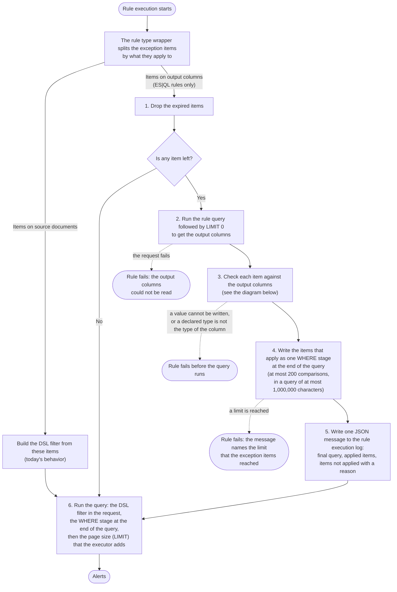
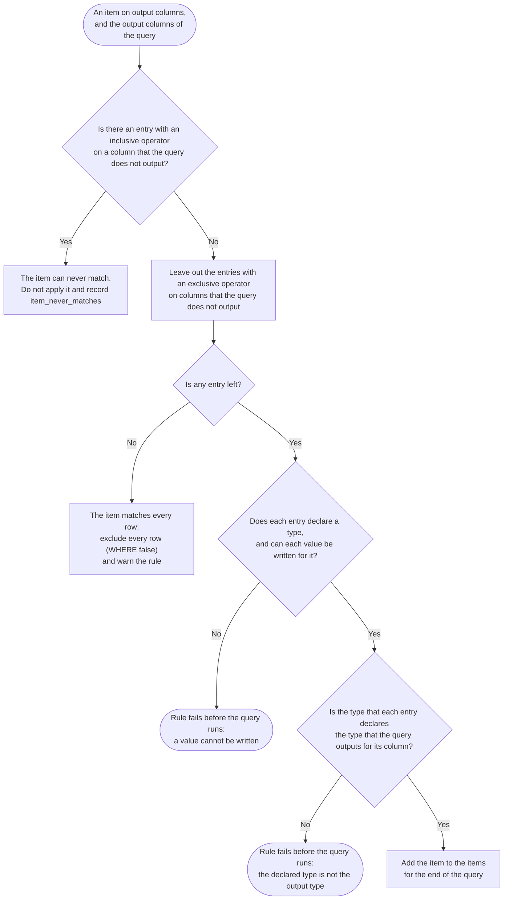

# Exceptions for computed fields in ES|QL rules 


## Summary

An ES|QL rule applies exceptions today as a DSL filter attached to the `_query` request. The filter runs on the source documents before the rule's pipeline. That works for exceptions on source fields. It cannot work for an exception on a column the pipeline computes (a `STATS` output, an `EVAL` value, a renamed column), because the column does not exist when the filter runs. 

This proposal keeps the DSL filter for exceptions on source fields and adds a new type of exceptions that are applied to the output columns of an ES|QL query.

In order to achieve this, each exception item states where it should be applied via the new property `applies_to`, which can either be `source_documents` or `esql_output_columns`.

An exception item that does not have this new property is treated as `applies_to: source_documents`.

Entries of items with `applies_to: esql_output_columns` additionally carry a `column_type` property which specifies the type of the `value` of the item. They also only support the operators `is`, `is one of`, `matches` and `exists`, and their exclusive forms. 

The ES|QL rule type executor sends a probe by executing the query as it does today but with a `| LIMIT 0` appended at the end in order to determine the output columns and their types. With this information, it compiles the exceptions that have `applies_to: esql_output_columns`, and that match the output of the probe, into a single `| WHERE` stage that is appended at the end of the query.

Note: from this point onwards we won't be referring to the non supported operators: `nested` and `list` in this proposal. Support for `list` is planned once we migrate value lists to lookup indices.

## How exceptions apply to ES|QL rules today

Exceptions are kept in **exception lists**: a rule has its own list, and a **shared exception list** can be attached to many rules. A list holds **exception items**, and an item holds one or more **entries**, each a condition made of a field, an operator and a value. The entries of an item are joined with AND, and the items of a list are joined with OR. An item matches only when all of its entries match, and an alert is excluded when it matches any item.

Operators are **inclusive** (`is`, `is one of`, `matches` with a wildcard pattern, and `exists`) or **exclusive** (`is not`, `is not one of`, `does not match` and `does not exist`). An exclusive operator holds for a document that lacks the field, because the field does not have the value. For example, `host.name is not dc-01` excludes the alerts of every host except `dc-01`, and of the documents without a `host.name`.

Today an ES|QL rule applies all of its exceptions in one place, a DSL filter (where each exception item becomes a `must_not` clause) that is sent together with the query. The rule type wrapper (`create_security_rule_type_wrapper.ts`) calls `buildExceptionFilter`, which turns the items of the lists of the rule into one DSL `exceptionFilter`, and passes it to the ES|QL rule executor. `buildEsqlSearchRequest` puts it in the `filter` field of the `_query` request. Elasticsearch applies the filter to the source documents of the indices, and the ES|QL pipeline only sees the documents that survive it. Three consequences matter here:

1. Exceptions are always added to the filter, even when the field they reference is not present in the source indices.
2. Exceptions with exclusive operators like `is not` exclude every document that lacks the field, because a document without the field is part of the complement of the match.
3. The results of an aggregating rule are computed from the surviving documents. An exception on a source field therefore changes the aggregates (event-level exclusion). This behavior remains unchanged in this proposal.

## Solution Design

Each exception item says what it applies to, and that decides where the item goes. The property `applies_to` has two values:

- `source_documents`, which is also what an item without the property means. The item is part of the DSL filter and behaves as it does today.
- `esql_output_columns`. The item tests the columns that the rule query outputs, and it is written at the end of the query. Each entry of such an item declares the `column_type` of its column (`keyword`, `ip`, `long`, ...). These items only apply to ES|QL rules, and ignored otherwise.

The lists API checks the type, the operator and the value of each entry when an item is written (see [Types supported at the end of the query](#types-supported-at-the-end-of-the-query)). These checks live in the exceptions package (`@kbn/securitysolution-exceptions-common`), which the browser and the server share.

An item cannot change what it applies to after it is created.

### ES|QL rule execution

**The whole flow**



**Check of each item (stage 3)**



### Stages

**1. Drop the expired items.** We remove every item on output columns whose `expire_time` is before the start of the run, which is the time that the DSL filter uses for the items on source documents, whatever the end of the time range of the rule is. When no item is left, the rule has nothing to apply at the end of the query and stages 2 to 5 do not run.

**2. Run the rule query with `| LIMIT 0` to get the output columns.** We send the query of the rule with `| LIMIT 0` at the end to the `_query` API, with the filter of the real request: the time range, the rule filters, the data tiers and namespaces, the DSL filter built from the items on source documents, and the excluded documents. The response has no rows and lists the names and the ES|QL types of the output columns. When the request fails, the rule fails. This is the only extra request that a run makes, and a rule without items on output columns makes none.

**3. Check each item.** An item is applied whole or not at all, because its entries are joined with AND: an item excludes an alert only when all of its entries match. We check the entries of an item in this order:

1. **An entry with an inclusive operator on a column that the query does not output.** The column has no values, or has the ES|QL type `null` (`EVAL x = NULL`). An entry with an inclusive operator on it (`is`, `is one of`, `matches`, `exists`) can never match. Therefore an item with such entry would exclude nothing, so we drop it and record the reason (see [The rule execution log message](#the-rule-execution-log-message)).

2. **An entry with an exclusive operator on a column that the query does not output.** An entry with an exclusive operator on it (`is not`, `is not one of`, `does not match`, `does not exist`) is true for every row, as it is in the DSL filter. We exclude these entries. If no entry is left after this, then the item is true for every row and excludes every row of the rule. In this case the item is written as `| WHERE false`, the rule creates no alerts, and the rule shows a warning that says so (see [Fields that exist nowhere](#fields-that-exist-nowhere)).

3. **A value that cannot be written** for the declared type, or an entry with no declared type, fails the rule (see [Value rules](#value-rules)). We check the entries that are left after the previous step. The API rejects both when the item is written. This only happens for an item that was stored without those checks.

4. **A column of another type than the entry declares.** The rule fails before the query runs, with a message that names the item, the column and both types (see [Error handling](#error-handling)). The declared type has to be the output type exactly.

**4. Write the items as one `WHERE` stage.** We compile each item to an expression, with each entry written for the type that it declares, and join the expressions with `AND` in one `| WHERE` stage at the end of the query (see [How the items become a WHERE stage](#how-the-items-become-a-where-stage)). If the resulting comparison count in the `| WHERE` stage goes above 200, or the final query is longer than 1,000,000 characters, the rule fails and the message names the limit and the items to reduce (see [Limits](#limits)).

**5. Write the log message.** We write one JSON message to the rule execution log with the final query, the items applied at the end of the query and the items not applied with their reasons (see [The rule execution log message](#the-rule-execution-log-message)).

**6. Run the query.** The request carries the DSL filter, which has the items on source documents only. The query has the `WHERE` stage at the end, followed by the page size (`LIMIT`) that the executor adds.

### Worked examples

A rule flags hosts reached by many distinct users:

```esql
FROM logs-*
| STATS user_count = COUNT_DISTINCT(user.name) BY host.name
| WHERE user_count > 50
| RENAME host.name AS target_host
```

**An exception on source documents: `user.name is vuln-scanner-svc`.** The item applies to source documents. It goes in the DSL filter and the query does not change. Because the scanner events are excluded before `COUNT_DISTINCT`, they do not inflate any distinct-user count.

**An exception on an output column: `target_host is dc-01`.** The item applies to the output columns and declares `target_host` as a `keyword`. The query outputs `target_host` as a `keyword`, and the query becomes:

```esql
FROM logs-*
| STATS user_count = COUNT_DISTINCT(user.name) BY host.name
| WHERE user_count > 50
| RENAME host.name AS target_host
| WHERE NOT (MV_CONTAINS(target_host, "dc-01"))
```

Only the alert row of `dc-01` is excluded.

**A name that the query redefines: `host.name is dc-01`.** With `EVAL host.name = TO_UPPER(host.name)` in the query, the name exists in the source documents and in the output, and the item says which one it means. An item on source documents compares the source value before the pipeline (`dc-01`). An item on output columns compares the column after the pipeline (`DC-01`).

**An exception on a field that exists nowhere: `winlog.event_id is 4624`.** `winlog.event_id` is neither in the source indices nor a column of the query output, as happens with a list shared by rules over other indices. As an item on source documents, it stays in the DSL filter and the query does not change. Elasticsearch decides what it matches, as it does today, and nothing is logged. As an item on output columns, the entry is on a column that the query does not output, and [Fields that exist nowhere](#fields-that-exist-nowhere) describes how it is read.

**A column of another type: `user_count is 50` declared as `keyword`.** The query outputs `user_count` as a `long`. The rule fails before the query runs and the message names the item, the column and both types. The type of the entry has to be `long`.

### What each position means

Since the DSL filter excludes source events before the pipeline, it changes the aggregates of an aggregating rule. The end-of-query stage excludes alert rows after the pipeline and changes no other row. Both are intended: an exception authored on a source field means "ignore these events", and an exception authored on a computed column means "ignore this result".

### Fields that exist nowhere

An exception list may hold items for fields that some indices do not have (e.g shared exception lists). For a field that exists nowhere, the DSL filter gives these results, which are not changed:

- An inclusive operator (`is`, `is one of`, `matches`, `exists`) matches no document and the item excludes nothing.
- An exclusive operator (`is not`, `is not one of`, `does not match`, `does not exist`) matches every document, because no document has the value. An item such as `process.name is not ping AND host.name is web-1` on an index without `process.name` excludes every `web-1` event. This is how exceptions behave today.

The Elastic Security documentation does not describe this case. It only warns that an exception on an unmapped field can "prevent it from working as expected". We keep the behavior that users already have: an item on source documents stays in the DSL filter, and the end of the query does not change which alerts such a rule creates.

Exceptions on computed columns read a column that the query does not output the same way:

| Entry on a column that the query does not output | Meaning | Result |
|---|---|---|
| Exclusive operator | True for every row | The entry is left out of the stage. The other entries decide. |
| Inclusive operator | Never matches | The item is not applied. The code `item_never_matches` is recorded in the rule execution log. |

When every entry of an item has an exclusive operator, nothing is left to test. The item excludes every row of the rule (`| WHERE false`), as it does in the DSL filter today. The difference is a warning: the rule shows the status "partial failure", with a message that names the items and says that the rule creates no alerts because of them. The warning repeats on every run, for every rule that uses the list.

### The stage goes after any LIMIT

The `| WHERE` stage with the exceptions on computed columns always goes at the very end of the rule query, after any `LIMIT` that the rule author wrote. We do not insert it before the last `LIMIT`, because a `LIMIT` can appear anywhere in a query and more than once. That placement would need rules of its own. The consequence is that an exception at the end of the query removes rows from the rows that the query already returned, and no further rows take their place.

### How the items become a WHERE stage

We append the exception items that go at the end of the query as one `| WHERE` stage. The rows that remain after the stage, the ones that none of its items excludes, are the alerts.

An item excludes a row only when all of its entries match. An item compiles to an expression that joins its entries with `AND` and negates the result. An entry with an excluding operator (`is not`, `is not one of`, `does not match`, `does not exist`) is negated inside the item, and in an item with a single entry the two negations cancel and the stage has no `NOT`:

| Exception item | Stage |
|---|---|
| `risk is low` | `\| WHERE NOT (MV_CONTAINS(risk, "low"))` |
| `risk is low` AND `count exists` | `\| WHERE NOT ((MV_CONTAINS(risk, "low")) AND (count IS NOT NULL))` |
| `risk is not low` | `\| WHERE MV_CONTAINS(risk, "low")` |
| `risk is not low` AND `count exists` | `\| WHERE NOT ((NOT (MV_CONTAINS(risk, "low"))) AND (count IS NOT NULL))` |

The comparisons use functions that return a real boolean for null and multi-valued inputs (`MV_CONTAINS`, `IS NULL`, `IS NOT NULL`), and the two that can be null (`MV_LIKE` and `MV_IN_RANGE`) are wrapped in `COALESCE(..., false)`. This reproduces the any-element matching of the DSL filter: a null column keeps the row for an inclusive operator and excludes it for an exclusive one.

Each exception item becomes an expression that is true when a row matches the item. The stage negates each expression and chains the results with `AND`. A row stays only when no item matches it. Take these three exception items, on the `keyword` columns `c_tier`, `c_keyword` and `c_opt` and the `ip` column `c_ip`:

- `a`: `c_tier is gold`
- `b`: `c_keyword matches kw-z*` AND `c_opt exists`
- `c`: `c_ip is one of 10.0.0.0/24, 10.0.1.0/24`

The stage that we append is the following (the compiler writes it on one line, and it is split here for reading):

```
| WHERE
  (NOT (MV_CONTAINS(c_tier, "gold")))                                              // a
  AND (NOT (                                                                       // b
    (COALESCE(MV_LIKE(c_keyword, "kw-z*"), false))
    AND (c_opt IS NOT NULL)
  ))
  AND (NOT (                                                                       // c
    COALESCE(MV_IN_RANGE(c_ip, "10.0.0.0"::ip, "10.0.0.255"::ip), false)
    OR COALESCE(MV_IN_RANGE(c_ip, "10.0.1.0"::ip, "10.0.1.255"::ip), false)
  ))
```

The stage has 5 comparisons: one for `a`, one for each entry of `b`, and one for each CIDR value of `c`. The stage is limited to 200 comparisons and 1,000,000 characters. To understand why we impose these limits (see [Limits](#limits)).

#### Lists of values

An `is one of` list must have at least one value. Its values are written as one call, `MV_INTERSECTS(col, [...])`, which is true when any element of the column is in the list and false for a null column. The types that need a conversion convert the whole list (`TO_INTEGER`, `TO_LONG`, `TO_UNSIGNED_LONG`, `TO_IP` and `TO_VERSION`), for example `MV_INTERSECTS(col, TO_IP([...]))`. The values that are compared in another way stay one comparison each, joined with `OR`: the ranges of CIDR values and of rounded date values. A list that mixes addresses and CIDR values on an `ip` column is `MV_INTERSECTS(col, TO_IP([...])) OR COALESCE(MV_IN_RANGE(...), false)`. Every value is validated before the list is written, because a value that fails a conversion is dropped from the list silently.

#### Column names

The user types the name of the column in the exception, and the stage writes that name into the ES|QL query. In some cases ES|QL does not accept the name as it was typed, so the stage needs to escape it with backquotes. A name such as `my-host.name` is escaped part by part, and only the parts that need it. The table shows each case.

| Column name | Why ES\|QL does not accept it as typed | Written in the stage |
|---|---|---|
| `host.name` | It is accepted | `host.name` |
| `my-host.name` | `my-host` contains a `-`, which ES\|QL reads as a subtraction | `` `my-host`.name `` |
| `first.name` | `first` is a reserved word | `` `first`.name `` |
| `in.name` | `in` is a reserved word | `` `in`.name `` |
| `where.name` | `where` is a reserved word | `` `where`.name `` |
| `1abc.name` | `1abc` starts with a digit | `` `1abc`.name `` |
| `a b.c` | `a b` contains a space | `` `a b`.c `` |
| `_.name` | `_` alone is not a valid name | `` `_`.name `` |
| `@.name` | `@` alone is not a valid name | `` `@`.name `` |
| `a..b` | The name has an empty part | `` `a..b` `` (the whole name is escaped as one) |

### The rule execution log message

Each run writes the reasons that items are not applied to the rule execution log, as one JSON message, for a UI to use later.

The message is written with `ruleExecutionLogger.info` when at least one item is applied at the end of the query or not applied. It reaches the event log (`.kibana-event-log-*`, provider `securitySolution.ruleExecution`, action `message`) only when the experimental feature `extendedRuleExecutionLoggingEnabled` is on and the minimum level in the advanced settings is Info or lower. Otherwise it is written only to the Kibana server log, at `debug` level. Rule preview does not store `info` messages, and that is unchanged. The text of the `message` field is this JSON object:

```json
{
  "type": "esql_exceptions",
  "version": 1,
  "query": "FROM logs-* | STATS ... | WHERE NOT (MV_CONTAINS(c_tier, \"gold\"))",
  "queryTruncated": false,
  "appliedAtEndOfQuery": [{ "list_id": "my-list", "item_id": "tier-gold" }],
  "notApplied": [
    {
      "list_id": "my-list",
      "item_id": "region",
      "name": "region",
      "code": "item_never_matches",
      "reason": "\"c_region\" is not in the output of the query",
      "fields": ["c_region"]
    }
  ],
  "notAppliedCount": 1,
  "truncated": false
}
```

- `query` is the final query of the rule, with the stage of the items applied at the end of the query and without the page size that the executor adds. The final query is otherwise logged only at `trace` level. It is cut at 20,000 characters, and `queryTruncated` says so.
- `notApplied` has one entry for each item and reason. An item with two reasons appears twice, each time with its own `code`, `reason` and `fields`. It lists at most 200 entries; `notAppliedCount` is the total and `truncated` says that the list was cut.
- `code` is stable and meant for the UI. `reason` is an English explanation. `fields` names the fields that cause the reason, when they are known.

| `code` | Meaning |
|---|---|
| `item_never_matches` | An item with an entry that has an inclusive operator on a column that the query does not output (or outputs with the type `null`), which never matches. An entry with an exclusive operator on such a column is left out of the stage. |
| `item_has_no_entries` | The item has no entries at all. The API rejects such an item. This only appears for an item stored without that check. |
| `entry_type_not_supported` | A `list` or `nested` entry. The API rejects them in an item on output columns. This only appears for an item stored without that check. |
| `operator_not_supported_on_type` | `matches` on a column that is not `keyword` or `text`, and `is` or `is one of` on a `double` column. The API rejects them too. |
| `os_types_not_supported` | The item has `os_types`, which the end of the query does not compile. The API rejects it too. |
| `entry_has_no_values` | An "is one of" entry with no value. |

## User interface

The exception flyouts (add and edit) let the user choose what an item applies to, and they check the values before the user saves.

- **Choosing what the item applies to.** The Conditions section has an "Applies to" control with the choices "Source fields" and "Computed columns". The control is offered when the user adds an exception from any place except an Endpoint exception: a single rule of any type, a bulk action on several rules, and a shared list. An item that applies to computed columns has only entries of that kind. The choice belongs to the item and not to the entry. When the user edits an existing item, the flyout shows the choice and does not let the user change it, because the API does not accept that either.
- **Warnings next to the control.** An item on computed columns shows a callout, "This exception only applies to ES|QL rules", with the sentence that it excludes the rows that the query returns by the columns that the query computes. When the rules that the item is added to are all of other types, the callout says "This exception has no effect on the selected rules" and that it takes effect on the ES|QL rules that use the list that holds it. A shared list has no rule yet, and it shows the first callout.
- **The entries.** An entry has four parts:
  - **Field.** The user types it. There is no list of fields to suggest, because the columns belong to a query that the form does not run.
  - **Operator.** The user picks it first, because it decides which column types are possible.
  - **Column type.** The form offers the column types that the chosen operator supports. Changing the operator clears a column type that the new operator does not support.
  - **Value.** An "is one of" entry takes several values, and "exists" takes none.

- **Checking the values.** The form runs the same checks as the API, which live in the exceptions package that the browser and the server share. A value that does not fit the column type is shown under the Value field while the user types, with the value in the message, and the save button stays disabled until the user fixes it. An entry that is not complete yet, without a field or a column type, shows no error and is not saved.
- **Closing alerts.** The options to close alerts work as for any other item. "Close this alert" closes the alert by its id. "Close all alerts that match this exception" finds the alerts by the entries, which an alert stores in its `_source` even though the alerts index does not map a computed column. The close request gives each computed column as a runtime field that reads the value from `_source`, and the runtime type follows the `column_type` of the entry, because neither the alerts index nor the source indices know the column.

  Dates need one more step. A date in an exception can name a unit, such as `2026-09-30` for the whole day, but a runtime field matches a date only at the exact instant. A `date` or `date_nanos` column is therefore read as a `date` runtime field. The entry is tested as a range from its value to itself. The range covers the whole unit, as the stage does at the end of the query.

  Bulk close has these limits:

  - A `date_nanos` value with a fraction of a second also matches the alerts with other nanoseconds in the same millisecond, because the runtime field keeps milliseconds.
  - An integer above 2^53 on a `long` or `unsigned_long` column is compared with the rounded number that the alert stores.
  - It does not compare the declared type with the type that the query outputs.
  - An item whose entries all have an exclusive operator on columns that the query does not output closes every open alert of the rule, as the stage excludes every row.

  The flyout shows its warning that the exception uses runtime or non-ECS fields.
- **In the list of exceptions.** The card of an item that applies to computed columns has a "Computed columns" badge, with a tooltip that says that the item excludes rows by the columns that an ES|QL rule query computes and only applies to ES|QL rules.

## Types supported at the end of the query

The operators `is`, `is one of`, `matches` and `exists` are supported at the end of the query, together with their exclusive forms (`is not`, `is not one of`, `does not match`, `does not exist`). An exception can be tested on 11 ES|QL column types: `keyword`, `text`, `integer`, `long`, `unsigned_long`, `double`, `boolean`, `ip`, `version`, `date` and `date_nanos`. Each entry declares its type in `column_type`, which has to match the ES|QL type of the output column.

`col` stands for the column name. The table shows what the implementation generates for one item each.

| Column type | `is` | `is one of` | `matches` | `exists` |
|---|---|---|---|---|
| `keyword` | `\| WHERE NOT (MV_CONTAINS(col, "good.com"))` | `\| WHERE NOT (MV_INTERSECTS(col, ["good.com", "bad.com"]))` | `\| WHERE NOT (COALESCE(MV_LIKE(col, "good*"), false))` | `\| WHERE NOT (col IS NOT NULL)` |
| `text` | `\| WHERE NOT (MV_CONTAINS(col, "good.com"))` | `\| WHERE NOT (MV_INTERSECTS(col, ["good.com", "bad.com"]))` | `\| WHERE NOT (COALESCE(MV_LIKE(col, "good*"), false))` | `\| WHERE NOT (col IS NOT NULL)` |
| `integer` | `\| WHERE NOT (MV_CONTAINS(col, 42::integer))` | `\| WHERE NOT (MV_INTERSECTS(col, TO_INTEGER(["42", "7"])))` | not supported | `\| WHERE NOT (col IS NOT NULL)` |
| `long` | `\| WHERE NOT (MV_CONTAINS(col, 42::long))` | `\| WHERE NOT (MV_INTERSECTS(col, TO_LONG(["42", "7"])))` | not supported | `\| WHERE NOT (col IS NOT NULL)` |
| `unsigned_long` | `\| WHERE NOT (MV_CONTAINS(col, 1000::unsigned_long))` | `\| WHERE NOT (MV_INTERSECTS(col, TO_UNSIGNED_LONG(["1000", "7"])))` | not supported | `\| WHERE NOT (col IS NOT NULL)` |
| `double` | not supported | not supported | not supported | `\| WHERE NOT (col IS NOT NULL)` |
| `boolean` | `\| WHERE NOT (MV_CONTAINS(col, true))` | `\| WHERE NOT (MV_INTERSECTS(col, [true, false]))` | not supported | `\| WHERE NOT (col IS NOT NULL)` |
| `ip` | `\| WHERE NOT (MV_CONTAINS(col, "10.0.0.1"::ip))` | `\| WHERE NOT (MV_INTERSECTS(col, TO_IP(["10.0.0.1", "10.0.0.2"])))` | not supported | `\| WHERE NOT (col IS NOT NULL)` |
| `version` | `\| WHERE NOT (MV_CONTAINS(col, "1.2.3"::version))` | `\| WHERE NOT (MV_INTERSECTS(col, TO_VERSION(["1.2.3", "2.0.0"])))` | not supported | `\| WHERE NOT (col IS NOT NULL)` |
| `date` (day value) | `\| WHERE NOT (COALESCE(MV_IN_RANGE(col, "2026-09-30T00:00:00.000Z"::date, "2026-09-30T23:59:59.999Z"::date), false))` | `\| WHERE NOT (COALESCE(MV_IN_RANGE(col, "2026-09-30T00:00:00.000Z"::date, "2026-09-30T23:59:59.999Z"::date), false) OR COALESCE(MV_IN_RANGE(col, "2026-08-01T00:00:00.000Z"::date, "2026-08-01T23:59:59.999Z"::date), false))` | not supported | `\| WHERE NOT (col IS NOT NULL)` |
| `date_nanos` (day value) | `\| WHERE NOT (COALESCE(MV_IN_RANGE(col, "2026-09-30T00:00:00.000Z"::date_nanos, "2026-09-30T23:59:59.999999999Z"::date_nanos), false))` | the same range, one per value, joined with `OR` | not supported | `\| WHERE NOT (col IS NOT NULL)` |

### Value rules

When an exception is created or edited, both the frontend and the API check that each value matches the type that the user set for the entry.

At rule runtime, before the executor translates the exceptions to ES|QL, it checks again that each value is valid for its type. The rule fails when a value is not valid.

The table shows the accepted values for each supported type.

| Column type | Accepted values | The rule fails when the value is |
|---|---|---|
| `keyword`, `text` | Any string. Quotes, backslashes, `\n`, `\r` and `\t` are escaped automatically when the stage is written. A `text` column is compared on the whole value and respecting case, as a `keyword` column is. | - |
| `integer`, `long`, `unsigned_long` | Integers within the range of the type. `42` is written `42::long`. | Not a plain integer that the type can hold: `many`, `0x10`, `42.5`, `1e3`, an empty value, `2147483648` on `integer`, `-1` on `unsigned_long` |
| `double` | Only `exists` is supported. The lists API rejects `is` and `is one of`, whatever the value (see [Types not supported at the end of the query](#types-not-supported-at-the-end-of-the-query)). | - |
| `boolean` | `true` or `false`, in lowercase, as the DSL filter accepts. | `TRUE`, `1`, `yes`, an empty value |
| `ip` | An address (IPv4 or IPv6), or a range in CIDR notation (`10.0.0.0/24`, `2001:db8::/32`). A CIDR value is written as `COALESCE(MV_IN_RANGE(col, first, last), false)`, which matches on any value of a multi-valued column, as the DSL does (`CIDR_MATCH` returns `null` on those). The address bits after the prefix are ignored, as in Elasticsearch. | Not an address and not a CIDR with a valid prefix: `bogus`, `10.0.0.256`, `10.0.0`, `010.0.0.1`, `10.0.0.0/33`, an empty value. Also a CIDR that the compiler does not write: `::/0`, IPv4-mapped IPv6 prefixes and an address with a zone (`fe80::1%eth0/64`) |
| `version` | A semantic version, for example `1.2.3` or `1.2.3-beta`, with at most 9 digits in each number. A number above 2147483647 fails the whole query in ES\|QL instead of casting to `null`, and the compiler stops at 9 digits. | A string that is not a semantic version, or a number of more than 9 digits |
| `date`, `date_nanos` | See [Date values](#date-values). | A format that the compiler does not write (see [Date values](#date-values)) |

The `matches` and `does not match` operators take a pattern, and is only supported for `keyword` and `text` columns. The pattern keeps `*` and `?` as wildcards, keeps `\*`, `\?` and `\\` as literals, and drops other backslashes. A pattern that ends with a lone backslash is not valid, and neither is one longer than 1,000 characters.

### Date values

A date value covers the unit that it names, a day, an hour, a minute or a second. The stage writes that unit as a range.

| Value | Compiled as |
|---|---|
| Day, hour, minute or second (`2026-09-30`, `2026-09-30T14`, `2026-09-30T14:05`, `2026-09-30T14:05:09`; on `date_nanos` an hour or a minute without seconds fails the rule, see the last row) | `COALESCE(MV_IN_RANGE(col, "first instant"::date, "last instant"::date), false)` covering the whole unit, in UTC. For `date_nanos` the last instant ends in `.999999999Z`. |
| A value with a time that ends in `Z` or in an offset (`2026-09-30T14:05:09Z`, `2026-09-30T16:05:09+02:00`, `+0200`, `+02`) | The offset is applied to the value first, and the unit is written in UTC: `2026-09-30T16:05:09+02:00` covers the second `14:05:09` UTC. |
| Year or month (`2026`, `2026-09`) | The first day only, which is what the DSL filter matches. |
| Value with a fraction (`2026-09-30T14:00:00.123Z`) | An exact instant: `MV_CONTAINS(col, "2026-09-30T14:00:00.123Z"::date)`, written in UTC when the value has an offset. Up to 3 fraction digits on `date`, up to 9 on `date_nanos`. |
| An offset that the DSL does not accept (outside `-18:00` to `+18:00`, minutes above 59, or an hour with one digit such as `+2:00`), an offset on a value with no time (`2026-09-30+02:00`), epoch milliseconds, a fraction with more digits than the type takes (above 3 on `date`, above 9 on `date_nanos`), other formats, years before 1000, impossible dates | The rule fails, because the compiler does not write the value. |
| A zone with no time (`2026-10-01Z`, `2026Z`), and on `date_nanos` an hour or a minute with no seconds (`2026-10-01T08`, `2026-10-01T08:00`) | The rule fails. The DSL filter also fails on these values for the default date format. |

A multi-valued date column matches when any of its values is in the range, as in the DSL filter.

### Text columns

A column has the type `text` only when the query passes a `text` source field through unchanged: `RENAME message AS msg`, `EVAL msg = message`, or a `STATS ... BY msg = message` key. Every ES|QL function that takes a `text` value returns a `keyword` (`COALESCE`, `CASE`, `CONCAT`, `TO_LOWER`, `SUBSTRING` and others).

A `text` column behaves as the exceptions documentation describes: `is` is an exact match, `matches` takes the wildcards `?` and `*` on `keyword`, `text` and `wildcard` fields, and rule exceptions are case-sensitive. It is compared like a `keyword` column, on the whole value and respecting case, with `MV_CONTAINS` for `is`, `MV_INTERSECTS` for `is one of` and `MV_LIKE` for `matches`. The DSL filter does not do that on a `text` source field: it compares analyzed tokens. With them, `is` ignores the case and finds the value inside a longer one, and `matches` compares each lowercase token with the pattern as written. The table shows the same exceptions on a `text` source field, in the DSL filter, and on a computed `text` column created with `EVAL m = message`, for documents that differ in case and in the position of the phrase.

| Exception | On the source field `message` | On the computed column `m` |
|---|---|---|
| `is` `good.com` | `Connection to good.com failed`, `Good.com`, `GOOD.COM` and `good.com` | `good.com` |
| `is` `GOOD.COM` | `Connection to good.com failed`, `Good.com`, `GOOD.COM` and `good.com` | `GOOD.COM` |
| `matches` `good*` | `Connection to good.com failed`, `GOOD morning`, `Good.com`, `GOOD.COM` and `good.com` | `good.com` |
| `matches` `GOOD*` | none, because the pattern is not lowercased and the tokens are | `GOOD morning` and `GOOD.COM` |

The DSL behavior is not changed by this proposal. A shared exception can therefore exclude different documents on a source `text` field and on a computed `text` column.

### Types not supported at the end of the query

A type is supported only when ES|QL has a predicate that keeps the same rows as the DSL filter for every operator, including null and multi-valued columns and the exclusive operators. For the other types the comparison is impossible (the column is `unsupported` or accepts no comparison) or it has different semantics.

| Type | Why |
|---|---|
| `search_as_you_type`, `completion`, `join`, `binary`, `long_range`, `integer_range`, `float_range`, `ip_range`, `sparse_vector`, `rank_*`, `percolator` | They surface in ES\|QL as `unsupported`. No predicate can reference the column. |
| `geo_*`, `cartesian_*`, `dense_vector`, `double_range`, `date_range`, `flattened` root, histogram family, `aggregate_metric_double` | The column exists but accepts no value comparison. The `exists` operator could be supported on these in a later iteration. |
| `double` for `is` and `is one of` | Only `exists` is supported. ES\|QL reports `float` and `half_float` fields as `double` too, and it reads a `float` holding 0.1 as `0.10000000149011612`, which is not the `double` 0.1 that the stage compares it with. The stage cannot tell the two apart, and an equality can miss the value. |
| `nested` sub-fields, `flattened` sub-keys, `passthrough` parents | ES\|QL has no column for them. The DSL filter handles them when they are source fields. |
| Object parents (`host` for `host.name`) | An object holds no value. It is not a source field and has no column. An exception on that name can only mean a column that the query creates with the same name. |

### Differences from the DSL filter

An exception on a computed column is compared with the values that the query holds at the end, and the DSL filter is compared with the source documents. Two differences follow, besides the types that are not supported and the behavior of `text` columns (see [Text columns](#text-columns)).

- **Keyword fields with a normalizer.** The DSL filter applies the normalizer of the field to the value of the exception, while a computed column holds the already normalized value. With a lowercase normalizer, `k` stores `ABC` and "k is ABC" excludes it. After `STATS c = COUNT(*) BY x = k`, `x` holds `abc`: "x is ABC" excludes nothing and "x is abc" excludes it. After a `RENAME` or an `EVAL` alias, Elasticsearch can push the `WHERE` down to the field, which applies the normalizer, and the result then depends on the query. The executor cannot know which fields have a normalizer.
- **`MV_EXPAND` and other commands that make rows.** The DSL filter works on documents and the end stage works on the rows that the query returns. A document has `t = ["x", "bad.com"]` and the query is `MV_EXPAND t`. The exception "t is bad.com" on the source field `t` stays in the DSL filter and excludes the whole document, and neither row alerts. The same exception on a computed column, for example `EVAL c = t` after the `MV_EXPAND`, excludes only the row with `bad.com`, and the row with `x` still creates an alert.

## Limits

The items that are applied at the end of the query are written as one `WHERE` stage within these limits. When a limit is reached, the rule fails before the query runs, as a user error, and the message of the rule names the limit and the items to reduce: the top three items with the most comparisons, or the item that makes the query too long. No item is dropped silently, because a rule that runs with only some of its exceptions creates alerts that the exceptions were meant to exclude. None of these limits exists today in the schema, the UI or the API.

| Limit | Value | Reason |
|---|---|---|
| Comparisons in the stage | 200 | A comparison is one test on a column (see [How the items become a WHERE stage](#how-the-items-become-a-where-stage)). The `WHERE` expressions of the rule query count against the clause limit of Elasticsearch together with ours, and we cannot bound them (see [Clauses of the query](#clauses-of-the-query)). The comparisons stay under the depth limit of ES\|QL, which is 300 levels (see [Appendix: Why 200 comparisons stay under the depth limit](#appendix-why-200-comparisons-stay-under-the-depth-limit)). All the items are counted together, which means that splitting an item into several items does not change the count. |
| Length of the final query | 1,000,000 characters | ES\|QL rejects a statement of more than 1,000,000 characters (`ESQL statement is too large [N characters > 1000000]`; added in [#117898](https://github.com/elastic/elasticsearch/pull/117898), not on the limitations page). |

The message of the comparison limit looks like this:

```text
The rule did not run because its exceptions do not fit in the query: the exceptions on the columns of the query need 350 comparisons, and at most 200 are allowed (a comparison is one test on a column: an entry, or one CIDR value or date of an "is one of" entry). The items with the most comparisons are: the item "blocked ranges" (list "my-list", item "blocked-ranges") has 300, the item "scanners" (list "my-list", item "scanners") has 40, the item "vpn" (list "my-list", item "vpn") has 10. Remove values from those items, or remove the items that this rule does not need. Splitting an item into several items does not help, because all the items are counted together.
```

### Clauses of the query

Elasticsearch fails a query that has too many clauses (a clause is one test inside the search that Elasticsearch builds for the query). The limit depends on the node and is never below 1,024. The `WHERE` expressions of the rule query and our stage count together.

Our stage never exhausts the clauses on its own. Only `is`, `is one of` with plain values and `exists` cost clauses, and only on a column that is a source field, a copy of one (`EVAL c = host`) or a rename (`RENAME host AS c`). Every other comparison costs none. An item costs one clause for each of its comparisons and one more because the item is negated, which gives at most 400 clauses for 200 comparisons, below the smallest limit.

The `WHERE` expressions of the rule query count against the same limit, and we do not control them. A rule whose own conditions already use most of the clauses can fail once our stage is added, although it respects the 200 comparisons. The rule then fails with a message that says that the `WHERE` expressions of the rule query and the exceptions on the output columns are counted together, and it includes the Elasticsearch reason. If Elasticsearch rejects the final query for another reason (for example a function that an older cluster or a remote cluster does not have), the rule fails with that error, as for any invalid ES|QL query.

## Error handling

A rule that has exception items on output columns fails before the query runs, instead of running with only some of its exceptions, in five cases. No alerts are created.

| Case | The message | User error |
|---|---|---|
| A value cannot be written for its column, or an entry has no declared type (see [Value rules](#value-rules)) | Names the values that cannot be written, each with its item and field | Yes |
| An entry declares another type than the column that the query outputs (see [Check each item](#stages)) | `The rule did not run because exception items declare a column type that is not the type that the query outputs: "<item>" (list "<list>", item "<id>") declares the column "<column>" as <declared>, and the query outputs it as <actual>. Fix the type in these exception items, or remove them from this rule.` It names up to 5 items and counts the others | Yes |
| The exceptions do not fit in the query: more than 200 comparisons, or a query longer than 1,000,000 characters (see [Limits](#limits)) | Names the limit and the items with the most comparisons | Yes |
| Elasticsearch rejects the final query with `too many nested clauses` and exceptions were added at the end (see [Clauses of the query](#clauses-of-the-query)) | Explains that the `WHERE` expressions of the rule query and the exceptions on the output columns are counted together. Without exceptions at the end, the error of Elasticsearch is shown as it is | Yes |
| The `LIMIT 0` request fails | `The rule did not run because the output columns of its query could not be read to apply its exceptions on them: <reason of the failed request>` | As the failed request is: a failure that is a user error today (for example a missing privilege) stays one |

## Out of scope

- **Value lists.** `list` entries are not compiled at the end of the query. They are still applied through the DSL filter on source fields, with today's limits and the existing unprocessed-exceptions warning for lists that are too large. The lists API rejects a `list` entry in an item on output columns. A later iteration stores each list in a lookup index and applies it with `LOOKUP JOIN`, which covers computed columns as well.
- **In-memory filtering of large value lists.** The ES|QL executor does not do it today, and it would interact with the paging that uses `excludedDocuments`.
- **Source-field exceptions in the query.** They stay in the DSL filter.
- **`nested` entries at the end of the query.** They have no ES|QL representation.

## Verification

These steps run the branch of [the pull request](https://github.com/elastic/kibana/pull/295143) on a local stack and check the behavior with a script that creates its own data.

1. **Check out the latest changes of the pull request.**

   ```bash
   gh pr checkout 295143
   node scripts/kbn bootstrap
   ```

2. **Run Elasticsearch.**

   ```bash
   node scripts/es snapshot --license trial
   ```

3. **Run Kibana** from the same checkout, in another terminal.

   ```bash
   node scripts/kibana --dev --no-base-path
   ```

   To let the script read the `esql_exceptions` log message, add `xpack.securitySolution.enableExperimental: ['extendedRuleExecutionLoggingEnabled']` to `config/kibana.dev.yml` before you start Kibana. The Advanced setting "Extended rule execution logging: min level" must be Info or lower. The script tells you when the message is missing.

4. **Run the try script** from the root of the checkout.

   ```bash
   KBN_URL=http://localhost:5601 node esql_exceptions_try.mjs
   ```

   The script signs in as `elastic` with the password `changeme` and reads Elasticsearch at `http://localhost:9200`. The variables `ES_USER`, `ES_PASS` and `ES_URL` change these.

The script asks which exceptions you want to try. For each one, it asks where the field lives and what the exception applies to (`source`, `redefined` and `missing` are items on source documents, which go to the DSL filter; `computed`, `output_redefined`, `output_missing` and `wrong_type` are items on output columns, which go to the end of the query), its type, the operator, and whether to use a value that is not valid for the type. The items of one exception must apply to the same thing. After the first item the script offers only the kinds of the same group. For `wrong_type` it asks one more question, the column type that the item declares, which is not the real type of the column. The script then creates the index (one document for each exception, which only that exception excludes, and one that no exception excludes), the exception list with its items and an ES|QL rule, runs the rule, and prints what to look for: what each exception does (stays in the DSL filter, goes to the end of the query, is not applied with the reason, is rejected by the lists API when it is created, or fails the rule), the documents that should alert, and, after the run, the alerts that were created with "This matches what to expect" or "This DIFFERS from what to expect". When the log message is available, it also prints the final query and the items not applied, and compares them with what it expects. A new run deletes what the previous run created, and the rule stays enabled afterwards. Delete it when you finish.

The script accepts the first letters of an answer, and the answers below use the names that it prints. When it asks about a value that is not valid for the type, answer `no` unless the scenario says otherwise. The six scenarios go from the simplest to the most complex.

| # | Scenario and answers | Look for |
|---|---|---|
| 1 | One exception on an output column: `computed`, `keyword`, `is`, then no more items and no more exceptions | The final query ends in `\| WHERE NOT (MV_CONTAINS(c1, "good.com"))`, and only `survivor` alerts |
| 2 | One exception with two entries on output columns: `computed`, `keyword`, `is`, another item, `computed`, `integer`, `is`, then no more items and no more exceptions | Both entries in one `NOT ((…) AND (…))` expression at the end of the query. Only `survivor` alerts, and `target-1` is excluded because both entries match it |
| 3 | A list of three exceptions: exception 1 is `source`, `keyword`, `is`. Exception 2 is `computed`, `ip`, `is_one_of`. Exception 3 is `output_missing`, `keyword`, `is`. Add another exception after the first two | Exception 1 stays in the DSL filter, exception 2 is applied at the end of the query, and exception 3 is not applied, with the code `item_never_matches` (the query does not output its column). `survivor` and `target-3` alert |
| 4 | A declared type that is not the type of the column: `wrong_type`, `integer`, then `keyword` as the declared type, `is`, then no more items and no more exceptions | The rule ends as failed with no alerts, and the status message names the item, the column and both types (declared `keyword`, output `integer`). No `esql_exceptions` message is written |
| 5 | An entry that the lists API rejects: `computed`, `double`, `is`, then no more items and no more exceptions | The script reports that the API rejects the item when it is created and creates no rule. A `double` column supports only `exists` |
| 6 | An exception with nothing left to test: `output_missing`, `keyword`, `is_not`, then no more items and no more exceptions | The final query ends in `\| WHERE false`, no document alerts, and the rule ends as "partial failure" with a message that names the item and says that the rule creates no alerts because exceptions exclude every row. The log message lists the item as applied |

## Appendix: Why 200 comparisons stay under the depth limit

ES|QL rejects a statement with an expression nested deeper than 300 levels (`ES|QL statement exceeded the maximum expression depth allowed (300)`). In the worst case, a stage with 200 comparisons has at most 214 levels.

### The worst case

Take these exceptions, which use all the 200 comparisons:

- Exception 1 has two entries: `source.ip` is not one of a list of 100 CIDR ranges (`10.0.0.0/24`, `10.0.1.0/24`, ..., `10.0.99.0/24`), and `user.name` is `svc-backup`. It has 101 comparisons.
- Exceptions 2 to 100 are 99 exceptions with one entry each: `host.name` is `host-0`, `host.name` is `host-1`, and so on up to `host-98`. They have 99 comparisons.

### The stage that they become

The compiler writes the stage on one line. It is split here, with comments, and the repeated parts are abbreviated:

```text
| WHERE
  (NOT (                                                                                   // exception 1
    (NOT (COALESCE(MV_IN_RANGE(source.ip, "10.0.0.0"::ip, "10.0.0.255"::ip), false)         // entry 1, range 1
          OR COALESCE(MV_IN_RANGE(source.ip, "10.0.1.0"::ip, "10.0.1.255"::ip), false)      // range 2
          OR ...                                                                            // ranges 3 to 99
          OR COALESCE(MV_IN_RANGE(source.ip, "10.0.99.0"::ip, "10.0.99.255"::ip), false)))  // range 100
    AND (MV_CONTAINS(user.name, "svc-backup"))                                              // entry 2
  ))
  AND (NOT (MV_CONTAINS(host.name, "host-0")))                                              // exception 2
  AND (NOT (MV_CONTAINS(host.name, "host-1")))                                              // exception 3
  AND ...                                                                                   // exceptions 4 to 99
  AND (NOT (MV_CONTAINS(host.name, "host-98")))                                             // exception 100
```

Elasticsearch groups the `AND`s and the `OR`s from the left. The first exception and the first range are therefore the innermost pieces, below all the `AND`s and `OR`s of their level:

```text
WHERE (((e1 AND e2) AND e3) ... AND e100)             99 nested ANDs, with e1 inside all of them
  e1      = NOT ((entry 1) AND (entry 2))
  entry 1 = NOT (((r1 OR r2) OR r3) ... OR r100)      99 nested ORs, with r1 inside all of them
  r1      = COALESCE(MV_IN_RANGE(source.ip, "10.0.0.0"::ip, "10.0.0.255"::ip), false)
```

### Why no other stage is deeper

The path from the `WHERE` to the first range crosses 214 levels, which the table in [How Elasticsearch counts the depth](#how-elasticsearch-counts-the-depth) lists one by one. This is the number of comparisons (200) plus 14, and the following lines show where the 14 comes from. Let `exceptions` be the number of exceptions (100), `entries` the number of entries of the first one (2) and `ranges` the number of ranges of its first entry (100):

- The levels that depend on the stage are the `AND`s that join the exceptions (`exceptions - 1`), the `AND`s that join the entries (`entries - 1`) and the `OR`s that join the ranges (`ranges - 1`). Together they are `exceptions + entries + ranges - 3` levels.
- The other levels are fixed, which means that they are the same for any number of exceptions, entries and ranges: the eight rows of the kind "fixed" in the table of [How Elasticsearch counts the depth](#how-elasticsearch-counts-the-depth). They are the `WHERE`, the parentheses and the `NOT`s around the exception and around the entry, and the range test, and they sum to **15**.
- The comparisons are the `exceptions - 1` other exceptions, the `entries - 1` other entries of the first exception and the ranges (`ranges`), which is `comparisons = exceptions + entries + ranges - 2`.

The depth is therefore `(exceptions + entries + ranges - 3) + 15 = (comparisons - 1) + 15 = comparisons + 14`. The **14** is the 15 fixed levels minus 1, because the ranges are joined by only `ranges - 1` `OR`s, which makes the levels that depend on the stage one fewer than the comparisons. With the numbers of the worst case, `comparisons = 200` and the depth is 214.

A comparison adds one level wherever it goes: another exception adds an `AND` at the top, another entry adds an `AND` inside the exception, and another range adds an `OR` inside the entry.

If we wanted to make this stage deeper we would add a range to exception 1, but the budget of 200 is spent, therefore the comparison has to come from another place, for example from removing exception 100. That removes one `AND` at the top and the new `OR` replaces it, which still leaves the depth at 214. Moving a comparison from one place to another never changes the depth. Only the fixed levels can, and this form has the most of them.

### How Elasticsearch counts the depth

Elasticsearch checks the depth twice, against the same limit of 300 ([`MAX_EXPRESSION_DEPTH`](https://github.com/elastic/elasticsearch/blob/dff80b95fa15d152772be93804c9a134e8aab7dc/x-pack/plugin/esql/src/main/java/org/elasticsearch/xpack/esql/parser/ExpressionBuilder.java#L129)). The first check reads the tokens before the parser runs and counts the open parentheses plus any run of consecutive `NOT`s ([`EsqlParser`](https://github.com/elastic/elasticsearch/blob/dff80b95fa15d152772be93804c9a134e8aab7dc/x-pack/plugin/esql/src/main/java/org/elasticsearch/xpack/esql/parser/EsqlParser.java#L212-L227)). The worst case reaches 6 there. The second check is the one that binds. While the parser builds the expression, [`expression()`](https://github.com/elastic/elasticsearch/blob/dff80b95fa15d152772be93804c9a134e8aab7dc/x-pack/plugin/esql/src/main/java/org/elasticsearch/xpack/esql/parser/ExpressionBuilder.java#L191-L205) adds one level each time it visits an expression nested inside another, and fails above 300. These are the levels that the pieces of our stage add:

| Construct | Levels |
|---|---|
| The expression of the `WHERE` itself | 1 |
| Each `AND` / `OR`, nested from the left (`a AND b AND c` is `((a AND b) AND c)`) | 1 |
| `NOT` | 1 |
| Parentheses (the parenthesized expression, then the expression inside it) | 2 |
| A column, a literal or a function call used as an operand or a function argument | 1 |
| `IS [NOT] NULL` | 2 |
| A cast like `"x"::ip` | 1 |
| The function call itself | 0, only its deepest argument counts |

With these levels, we can follow the path from the `WHERE` to the first literal of the worst case, `"10.0.0.0"`. The example below keeps only the pieces that the path crosses and writes `...` for the rest, with 3 exceptions instead of 100. This is how the compiler writes the stage:

```text
| WHERE (NOT ((NOT (COALESCE(MV_IN_RANGE(source.ip, "10.0.0.0"::ip, ...), false) OR ...)) AND (...))) AND (...) AND (...)
```

Elasticsearch groups the `AND`s and the `OR`s from the left. The same stage is nested like this, with the grouping written as square brackets:

```text
| WHERE [[(NOT ((NOT (COALESCE(MV_IN_RANGE(source.ip, "10.0.0.0"::ip, ...), false) OR ...)) AND (...))) AND (...)] AND (...)]
```

The first exception is inside both `AND`s, although they are written after it. The same holds for the `AND` between the two entries and the `OR`s between the ranges: each one is written after its left operand and encloses it. In the worst case there are 99 bracket pairs around the first exception and 99 `OR`s around the first range. The path crosses these pieces, in the order of the nesting and not of the text:

| Piece that the path enters | Levels | Kind | Depth so far |
|---|---|---|---|
| The expression of the `WHERE` | 1 | fixed | 1 |
| The 99 `AND`s that join the 100 exceptions, nested from the left | 99 | `exceptions - 1` | 100 |
| The parentheses written around exception 1 | 2 | fixed | 102 |
| The `NOT` of exception 1 | 1 | fixed | 103 |
| The parentheses after that `NOT`, which hold the entries | 2 | fixed | 105 |
| The `AND` that joins the 2 entries | 1 | `entries - 1` | 106 |
| The parentheses written around entry 1 | 2 | fixed | 108 |
| The `NOT` of entry 1 (it is "is not one of") | 1 | fixed | 109 |
| The parentheses after that `NOT`, which hold the ranges | 2 | fixed | 111 |
| The 99 `OR`s that join the 100 ranges, nested from the left | 99 | `ranges - 1` | 210 |
| The range test: `COALESCE` as an operand (1), `MV_IN_RANGE` as its argument (1), the cast `::ip` (1) and the literal (1) | 4 | fixed | **214** |

The parentheses that are written around exceptions 2 to 100 enclose only their own exception and sit beside exception 1. They are not on the path.

The eight rows of the kind "fixed" are the same for any number of exceptions, entries and ranges, and they sum to 1 + 2 + 1 + 2 + 2 + 1 + 2 + 4 = 15. The three other rows sum to `exceptions + entries + ranges - 3 = 199`. In general, the depth is `exceptions + entries + ranges + 12`, which is the number of comparisons plus 14. This is below the limit of 300 by 86 levels, for every stage of at most 200 comparisons.

### What we checked on Elasticsearch

The worst-case stage above, written by the compiler, ran. The same shape with 186 exceptions (286 comparisons, 300 levels) ran and with 187 it failed, which confirms that the stage of 100 exceptions has 214 levels. We also found the largest stage that runs for each shape, and every breakpoint matched its formula:

| Shape | Largest stage that runs | Depth at that size |
|---|---|---|
| Items `is` | 293 items | exceptions + 7 = 300 |
| First item with an entry of ranges that has an inclusive operator (entries = 2, ranges = 10) | 279 items | exceptions + entries + ranges + 9 = 300 |
| First item with an entry of ranges that has an exclusive operator (entries = 2, ranges = 10) | 276 items | exceptions + entries + ranges + 12 = 300 |
| A single entry of ranges (ranges = 10) | 282 items | exceptions + ranges + 8 = 300 |

The bound assumes that the compiler keeps writing these forms. A new predicate with more than 4 levels, or a new way of wrapping an entry, needs the constants to be measured again. Elasticsearch has also lowered this limit before (500, then 400, then 300), and a limit below about 215 would leave no room.
