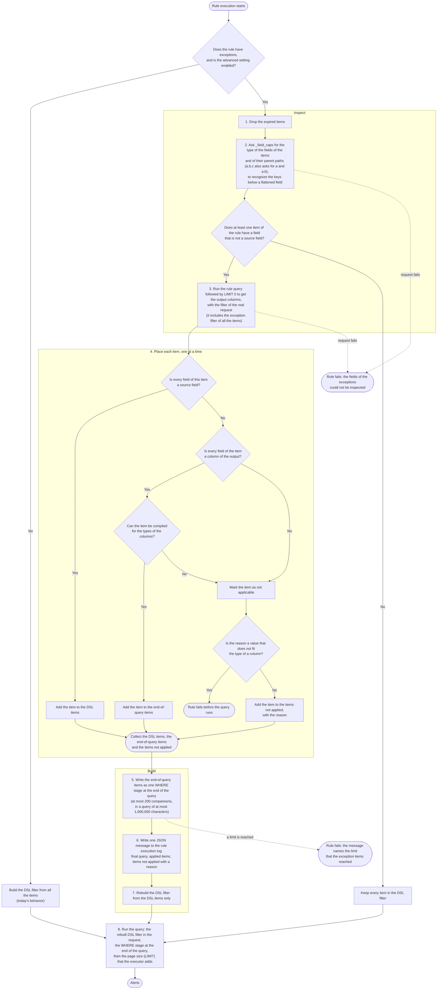

# Native exceptions for ES|QL rules

Status: proposal with a working implementation behind an advanced setting that is off by default. Scope: the ES|QL rule type (`siem.esqlRule`) in the current detection engine. Value lists stay as they are today (see [Out of scope](#out-of-scope)).

## Summary

An ES|QL rule applies exceptions today as a DSL filter attached to the `_query` request. The filter runs on the source documents before the rule's pipeline. That works for exceptions on source fields. It cannot work for an exception on a column the pipeline computes (a `STATS` output, an `EVAL` value, a renamed column), because the column does not exist when the filter runs.

This proposal keeps the DSL filter for source fields and adds one thing: exceptions on computed output columns are compiled into one ES|QL `WHERE` stage appended at the end of the rule query, where those columns exist.

- Exceptions on source fields: unchanged. They stay in the DSL filter, with the behavior analysts already know.
- Exceptions on computed columns: appended as one `| WHERE ...` stage at the end of the query.
- Anything that can be evaluated in neither place is not applied. It is recorded in the rule execution log (see [Items that are not applied](#items-that-are-not-applied)). It never adds a warning to the rule, because today an exception whose field or type cannot be matched does not warn either. The existing warning for value lists that are too large stays as it is.
- An exception value that does not belong to the type of its column (e.g `bogus` for an `ip`) fails the rule before the query runs, as the DSL filter already does for source fields (see [Values that are not valid for the column](#values-that-are-not-valid-for-the-column)).

Inlining source-field exceptions right after `FROM` was evaluated and rejected: it is too big a risk for this delivery. The DSL filter and the same exception written in ES|QL do not behave the same for every field type and operator, and the differences either change the alerts of existing rules without any error, or fail the rule. Alerts are the product, and a rule author cannot see that an exception stopped excluding the documents it excluded, or started excluding more, so we cannot guarantee feature parity.

The differences are described with examples, one for each kind of problem, in the section [Why source-field exceptions stay in the DSL filter](#why-source-field-exceptions-stay-in-the-dsl-filter).

## How exceptions apply to ES|QL rules today

An exception tells a detection rule to ignore results that an analyst has reviewed and accepts, so that the rule does not create alerts for them. Exceptions are kept in **exception lists**. A rule has its own list, and a **shared exception list** can be attached to many rules. A list holds **exception items**, which this document also calls items. An item holds one or more **entries**, and each entry is a condition consisting of a field, an operator and a value. The entries of an item are joined with AND, so the item applies only when all of them hold. The items of a list are joined with OR, therefore an alert is excluded when any item applies.

Operators come in two kinds. **Inclusive** operators hold when the field has the value: `is`, `is one of`, `matches` (a wildcard pattern) and `exists`. **Exclusive** operators are their negations: `is not`, `is not one of`, `does not match` and `does not exist`. An exclusive operator holds for a document that lacks the field, because the field does not have the value.

- The item `process.name is svchost.exe` AND `host.name is siem-kibana` excludes the alerts of the `svchost.exe` process on that host. The same process on another host still creates alerts.
- The item `user.name is one of svc-scan, svc-backup` excludes the alerts of two service accounts, and a second item in the same list, `host.name matches dc-*`, excludes the alerts of the hosts whose name starts with `dc-`.
- The item `host.name is not dc-01` excludes the alerts of every host except `dc-01`, and of the documents without a `host.name`.

Today an ES|QL rule applies all of its exceptions in one place, a DSL filter that is sent together with the query. The rule type wrapper (`create_security_rule_type_wrapper.ts`) calls `buildExceptionFilter`, which turns the items of the lists of the rule into one DSL `exceptionFilter`, and passes it to the ES|QL rule executor. `buildEsqlSearchRequest` puts it in the `filter` field of the `_query` request, where each exception item becomes a `must_not` clause. Elasticsearch applies the filter to the source documents of the indices, so the ES|QL pipeline only sees the documents that survive it.

Implications:

1. Exceptions are always appended in the filter even when the field they reference is not present in the source indices.
2. Negated exceptions with operators like `is not` exclude every document, because the negative operators exclude the complement of the match, and a document without the field is part of that complement.
3. The query results of an aggregating rule are computed from the surviving documents. An exception on a source field therefore changes the aggregates (event-level exclusion). This is behavior remains unchanged in this proposal.

The behavior of each entry type and operator on each field type is documented in `esql_exceptions_v1_inventory.md`.

## Design

An ES|QL rule runs these stages each time it executes. The stages after the first check are new, and they run only when the advanced setting is enabled and the rule has exceptions. An item is placed whole, in one place. It goes to the DSL filter when every field of it is a field in the source indices. It goes to the end of the query when every field of it is a column that the query returns and the item is supported at the end of the query. An item is supported when every entry of it has an entry type and an operator that we can write for the type of its column (see [Types supported at the end of the query](#types-supported-at-the-end-of-the-query)) and the values of its entries are valid for that type. Any other item is not applied. The sections below describe the inputs of the stages and how an item is placed, and [Items that are not applied](#items-that-are-not-applied) and [Failure handling](#failure-handling) describe what happens to the items that are not applied.



### Stages

**Check.** The stages below run only when the advanced setting is enabled and the rule has exceptions. Otherwise the DSL filter is built from all the items, as today.

**1. Drop the expired items.** We remove every item whose `expire_time` is before the start of the run.

**2. Ask `_field_caps` for the source fields.** We call `_field_caps` on the source indices of the rule for the fields of the items and for the parent paths of dotted names (`a.b.c` also asks for `a` and `a.b`). A field is in the source indices when `_field_caps` lists it, or when it sits under a `flattened` field that it lists. When every field of every item is in the source indices, we keep all the items in the DSL filter and go to stage 8. When the request fails, the rule fails.

**3. Run the rule query with `| LIMIT 0` to get the output columns.** We send the query of the rule with `| LIMIT 0` at the end to the `_query` API, with the filter of the real request: the time range, the rule filters, the data tiers and namespaces, the exception filter built from all the items, and the excluded documents. The response has no rows and lists the names and the ES|QL types of the output columns (`OutputColumns` in the code). When the request fails, the rule fails.

**4. Place each item.** An item is placed whole, in one place, because its entries are joined with AND: an item excludes an alert only when all of its entries match. For each item, the first of these cases that applies decides what we do:

1. **Every field of the item is a field in the source indices.** We put the item in the DSL filter, as today. This holds even when the query outputs a column with the same name: a field that the query redefines (`EVAL host.name = TO_UPPER(host.name)`) is still a field in the source indices, so the exception compares the source value, and the author of the query writes the value as the source holds it.
2. **Every field of the item is a column that the query returns, and the item is supported at the end of the query**. We put the item at the end of the query.
3. **Otherwise,** we do not apply the item and we record the reason (see [Items that are not applied](#items-that-are-not-applied)). When the reason is a value that the DSL filter would also reject, the rule fails before the query runs (see [Failure handling](#failure-handling)).

**5. Write the end-of-query items as one `WHERE` stage.** We compile each item to an expression and join the expressions with `AND` in one `| WHERE` stage at the end of the query (see [How the items become a WHERE stage](#how-the-items-become-a-where-stage)). The stage has at most 200 comparisons, and the final query at most 1,000,000 characters. When a limit is reached, the rule fails and the message names the limit and the items to reduce (see [Limits](#limits)).

**6. Write the log message.** We write one JSON message to the rule execution log with the final query, the items applied at the end of the query and the items not applied with their reasons (see [Items that are not applied](#items-that-are-not-applied)).

**7. Rebuild the DSL filter.** We build it again from the DSL items only. The items at the end of the query and the items not applied no longer appear in it.

**8. Run the query.** The request carries the rebuilt DSL filter. The query has the `WHERE` stage at the end, followed by the page size (`LIMIT`) that the executor adds.

### Worked examples

A rule flags hosts reached by many distinct users:

```esql
FROM logs-*
| STATS user_count = COUNT_DISTINCT(user.name) BY host.name
| WHERE user_count > 50
| RENAME host.name AS target_host
```

**An exception that goes in the DSL filter: `user.name is vuln-scanner-svc`.** `user.name` is a field in the source indices, so the item goes in the DSL filter and the query does not change. The scanner events are excluded before `COUNT_DISTINCT`, so they do not inflate any distinct-user count.

**An exception that goes at the end of the query: `target_host is dc-01`.** `target_host` is not in the source indices, and it is a `keyword` column of the query output, so the item is supported at the end of the query and the query becomes:

```esql
FROM logs-*
| STATS user_count = COUNT_DISTINCT(user.name) BY host.name
| WHERE user_count > 50
| RENAME host.name AS target_host
| WHERE NOT (MV_CONTAINS(target_host, "dc-01"))
```

Only the alert row of `dc-01` is excluded.

**An exception that we skip: `winlog.event_id is 4624`.** `winlog.event_id` is neither in the source indices nor a column of the query output, as happens with a list shared by rules over other indices. We do not apply the item and we record it in the rule execution log with the code `field_not_found`.

### What each position means

The DSL filter excludes source events before the pipeline, so for an aggregating rule it changes the aggregates. The end-of-query stage excludes alert rows after the pipeline and changes no other row. Both are intended: an exception authored on a source field means "ignore these events", and an exception authored on a computed column means "ignore this result". For a non-aggregating rule that passes its fields through unchanged, the two positions produce the same alerts.

### Rule queries with a LIMIT stage

The exceptions appended at the end in a `WHERE` stage go after any `LIMIT` that the rule author wrote, This means that an exception at the end of the query excludes rows from the rows the query already returned and does not bring in the next ones. For a rule with `SORT failures DESC | LIMIT 5`, an exception on the top host as a renamed or computed column leaves 4 alerts, while an exception on the source field `host` is in the DSL filter, runs before the `LIMIT` and leaves 5. A rule that needs "the top N after exceptions" should not rely on `LIMIT` to bound its result: the maximum alerts per run already bounds it, and the executor reads further pages when the query has no `LIMIT`.

### How the items become a WHERE stage

We append the exception items that go at the end of the query as one `| WHERE` stage. The stage keeps the rows that none of its items excludes, so the rows that remain are the alerts.

An item excludes a row only when all of its entries match. An item compiles to an expression that joins its entries with `AND` and negates the result. An entry with an excluding operator (`is not`, `is not one of`, `does not match`, `does not exist`) is negated inside the item, and in an item with a single entry the two negations cancel and the stage has no `NOT`:

| Exception item | Stage |
|---|---|
| `risk is low` | `\| WHERE NOT (MV_CONTAINS(risk, "low"))` |
| `risk is low` AND `count exists` | `\| WHERE NOT ((MV_CONTAINS(risk, "low")) AND (count IS NOT NULL))` |
| `risk is not low` | `\| WHERE MV_CONTAINS(risk, "low")` |
| `risk is not low` AND `count exists` | `\| WHERE NOT ((NOT (MV_CONTAINS(risk, "low"))) AND (count IS NOT NULL))` |

The comparisons use functions that return a real boolean for null and multi-valued inputs (`MV_CONTAINS`, `IS NULL`, `IS NOT NULL`), and the two that can be null (`MV_LIKE` and `MV_IN_RANGE`) are wrapped in `COALESCE(..., false)`. This reproduces the any-element matching of the DSL filter: a null column keeps the row for a positive operator and excludes it for a negative one.

The stage joins the expressions of all the items with `AND`, because `NOT A AND NOT B` excludes what `A OR B` would. Take these three exception items, on the `keyword` columns `c_tier`, `c_keyword` and `c_opt` and the `ip` column `c_ip`:

- `a`: `c_tier is gold`
- `b`: `c_keyword matches kw-z*` AND `c_opt exists`
- `c`: `c_ip is one of 10.0.0.0/24, 10.0.1.0/24`

The stage joins them with `AND`:

```
| WHERE a AND b AND c
```

and each item compiles to:

| Item | Compiles to |
|---|---|
| `a` | `NOT (MV_CONTAINS(c_tier, "gold"))` |
| `b` | `NOT ((COALESCE(MV_LIKE(c_keyword, "kw-z*"), false)) AND (c_opt IS NOT NULL))` |
| `c` | `NOT (COALESCE(MV_IN_RANGE(c_ip, "10.0.0.0"::ip, "10.0.0.255"::ip), false) OR COALESCE(MV_IN_RANGE(c_ip, "10.0.1.0"::ip, "10.0.1.255"::ip), false))` |

Replacing `a`, `b` and `c` gives the stage that we append:

```
| WHERE (NOT (MV_CONTAINS(c_tier, "gold"))) AND (NOT ((COALESCE(MV_LIKE(c_keyword, "kw-z*"), false)) AND (c_opt IS NOT NULL))) AND (NOT (COALESCE(MV_IN_RANGE(c_ip, "10.0.0.0"::ip, "10.0.0.255"::ip), false) OR COALESCE(MV_IN_RANGE(c_ip, "10.0.1.0"::ip, "10.0.1.255"::ip), false)))
```

The stage has 5 comparisons: one for `a`, one for each entry of `b`, and one for each CIDR value of `c`.

ES|QL limits the size of a query, so the exceptions at the end of it stay within two limits. The first limit is the length of the query: ES|QL rejects a query of more than 1,000,000 characters. The second limit is the number of comparisons in the stage, which is at most 200 for all the items together. A comparison is one test on a column. Each entry counts as one comparison, except an `is one of` entry: the list of plain values counts as one comparison whatever its length, and each CIDR value or date of the list counts as one more, because each is written as its own range test. The count is for all the items together, so splitting an item into several items does not change it.

The 200 keeps the stage under two limits of Elasticsearch. ES|QL fails a condition nested 300 levels deep, and every comparison adds at most one level to it, plus about ten levels around the comparisons. Elasticsearch also limits the number of clauses of the query that it builds from the `WHERE` stages, and the documented minimum is 1024. A comparison uses clauses only on a column that renames or copies a source field, where an `is` item adds about two clauses. On a column that the query computes (`EVAL c = TO_UPPER(host)`, a `STATS` output), 5,000 comparisons used none. When we tested, the clause limit allowed 4468, and a stage of 200 comparisons stayed under 300 levels, so we could set a higher limit. We choose to be conservative, so that a rule behaves the same on any cluster. When a limit is reached, the rule fails and the message names the limit and the items to reduce (see [Limits](#limits)).

## Types supported at the end of the query

An exception can be tested at the end of the query on 11 ES|QL column types: `keyword`, `text`, `integer`, `long`, `unsigned_long`, `double`, `boolean`, `ip`, `version`, `date` and `date_nanos`. A `text` column is compared as a `keyword` column is, on the whole value and respecting case (see [Text columns](#text-columns)). A `double` column supports only `exists` (see [Types not supported](#types-not-supported-at-the-end-of-the-query)). The type is the ES|QL type of the output column reported in the output columns, not the mapping of a source field.

`col` stands for the column name, backquoted per dotted segment when a segment is not a plain identifier (`` `host-name` ``, `` a.`b-c` ``) or is a word that ES|QL does not accept as a column name (`and`, `asc`, `by`, `desc`, `false`, `first`, `in`, `is`, `last`, `like`, `not`, `null`, `nulls`, `on`, `or`, `rlike`, `true`, `where`, `with`), for example `` `first` ``. The clauses below are the stages the implementation generates for one item each, for the `is`, `is one of`, `matches` and `exists` operators. With several items they are joined with `AND` in the same stage, as in [How the items become a WHERE stage](#how-the-items-become-a-where-stage).

| Column type | `is` (`match`) | `is one of` (`match_any`) | `matches` (`wildcard`) | `exists` |
|---|---|---|---|---|
| `keyword` | `\| WHERE NOT (MV_CONTAINS(col, "good.com"))` | `\| WHERE NOT (MV_INTERSECTS(col, ["good.com", "bad.com"]))` | `\| WHERE NOT (COALESCE(MV_LIKE(col, "good*"), false))` | `\| WHERE NOT (col IS NOT NULL)` |
| `text` | `\| WHERE NOT (MV_CONTAINS(col, "good.com"))` | `\| WHERE NOT (MV_INTERSECTS(col, ["good.com", "bad.com"]))` | `\| WHERE NOT (COALESCE(MV_LIKE(col, "good*"), false))` | `\| WHERE NOT (col IS NOT NULL)` |
| `integer` | `\| WHERE NOT (MV_CONTAINS(col, 42::integer))` | `\| WHERE NOT (MV_INTERSECTS(col, TO_INTEGER(["42", "7"])))` | not supported | `\| WHERE NOT (col IS NOT NULL)` |
| `long` | `\| WHERE NOT (MV_CONTAINS(col, 42::long))` | `\| WHERE NOT (MV_INTERSECTS(col, TO_LONG(["42", "7"])))` | not supported | `\| WHERE NOT (col IS NOT NULL)` |
| `unsigned_long` | `\| WHERE NOT (MV_CONTAINS(col, 1000::unsigned_long))` | `\| WHERE NOT (MV_INTERSECTS(col, TO_UNSIGNED_LONG(["1000", "7"])))` | not supported | `\| WHERE NOT (col IS NOT NULL)` |
| `double` | not supported | not supported | not supported | `\| WHERE NOT (col IS NOT NULL)` |
| `boolean` | `\| WHERE NOT (MV_CONTAINS(col, true))` | `\| WHERE NOT (MV_INTERSECTS(col, [true, false]))` | not supported | `\| WHERE NOT (col IS NOT NULL)` |
| `ip` | `\| WHERE NOT (MV_CONTAINS(col, "10.0.0.1"::ip))` | `\| WHERE NOT (MV_INTERSECTS(col, TO_IP(["10.0.0.1", "10.0.0.2"])))` | not supported | `\| WHERE NOT (col IS NOT NULL)` |
| `version` | `\| WHERE NOT (MV_CONTAINS(col, "1.2.3"::version))` | `\| WHERE NOT (MV_INTERSECTS(col, TO_VERSION(["1.2.3", "2.0.0"])))` | not supported | `\| WHERE NOT (col IS NOT NULL)` |
| `date` (day value) | `\| WHERE NOT (COALESCE(MV_IN_RANGE(col, "2026-09-30T00:00:00.000Z"::date, "2026-09-30T23:59:59.999Z"::date), false))` | `\| WHERE NOT (COALESCE(MV_IN_RANGE(col, "2026-09-30T00:00:00.000Z"::date, "2026-09-30T23:59:59.999Z"::date), false) OR COALESCE(MV_IN_RANGE(col, "2026-08-01T00:00:00.000Z"::date, "2026-08-01T23:59:59.999Z"::date), false))` | not supported | `\| WHERE NOT (col IS NOT NULL)` |
| `date_nanos` (day value) | `\| WHERE NOT (COALESCE(MV_IN_RANGE(col, "2026-09-30T00:00:00.000Z"::date_nanos, "2026-09-30T23:59:59.999999999Z"::date_nanos), false))` | the same range, one per value, joined with `OR` | not supported | `\| WHERE NOT (col IS NOT NULL)` |

### Negative operators

Every supported type uses the same pattern. Shown for `keyword`:

| Operator | Stage |
|---|---|
| is not | `\| WHERE MV_CONTAINS(col, "good.com")` |
| is not one of | `\| WHERE MV_INTERSECTS(col, ["good.com", "bad.com"])` |
| does not match | `\| WHERE COALESCE(MV_LIKE(col, "good*"), false)` |
| does not exist | `\| WHERE col IS NOT NULL` |

A row with a null column fails these conditions, so it is excluded. The DSL filter treats a document without the field the same way.

### Value rules

A value that cannot be cast to the column type is never compiled. A failed cast yields `null`, `MV_CONTAINS(col, null)` is true, and the stage would then exclude every row. Whether the item is only not applied or the rule fails depends on the value: see [Values that are not valid for the column](#values-that-are-not-valid-for-the-column).

| Column type | Accepted values |
|---|---|
| `keyword` | Any string. Quotes, backslashes, `\n`, `\r` and `\t` are escaped in the literal. |
| `text` | Any string, compared on the whole value and respecting case, as a `keyword` column is. |
| `integer`, `long`, `unsigned_long` | Integers within the range of the type. `42` is written `42::long`. |
| `double` | Only `exists` is supported. A value of `is` or `is one of` that is not a number still fails the rule. |
| `boolean` | `true` or `false`, in lowercase, as the DSL filter accepts. Any other value (`TRUE`, `1`, `yes`) fails the rule. |
| `ip` | An address (IPv4 or IPv6), or a range in CIDR notation (`10.0.0.0/24`, `2001:db8::/32`). A CIDR value is written as `COALESCE(MV_IN_RANGE(col, first, last), false)`, which matches on any value of a multi-valued column, as the DSL does (`CIDR_MATCH` returns `null` on those). The address bits after the prefix are ignored, as in Elasticsearch. `/0` of IPv6, IPv4-mapped IPv6 prefixes and an address with a zone (`fe80::1%eth0/64`) are not applied, because Elasticsearch handles them as IPv4 or ES|QL has no range for them. |
| `version` | A semantic version, for example `1.2.3` or `1.2.3-beta`, with at most 9 digits in each number: a larger number fails the whole query in ES\|QL instead of casting to `null`. |
| `date`, `date_nanos` | See [Date values](#date-values). |
| `matches` (any type) | Only `keyword` and `text` columns. The pattern keeps `*` and `?` as wildcards, keeps `\*`, `\?` and `\\` as literals, and drops other backslashes. A pattern that ends with a lone backslash is rejected. |

An `is one of` list must have at least one value, and there is no limit on the number of values besides the length of the query. The comparisons of all the items together are limited (see [Limits](#limits)). The values of one entry are written as one list, `MV_INTERSECTS(col, [...])`, which is true when any element of the column is in the list, is false for a null column, and counts as one comparison whatever its length. A list of 60,000 values ran in one call. The list literal of ES|QL does not accept casts, so the types that need a conversion convert the whole list: `TO_INTEGER`, `TO_LONG`, `TO_UNSIGNED_LONG`, `TO_DOUBLE`, `TO_IP` and `TO_VERSION` of a list of strings. `keyword`, `text` and `boolean` take the list as it is. The values that are compared in another way stay one comparison each, joined with `OR`: the ranges of CIDR values and the rounded ranges of date values. A list that mixes addresses and CIDR values on an `ip` column is `MV_INTERSECTS(col, TO_IP([...])) OR COALESCE(MV_IN_RANGE(...), false)`. The values are validated before the list is written, because a value that fails the conversion is dropped from the list silently.

### Date values

The DSL `match_phrase` on a date rounds to the unit of the value, and the end-of-query stage reproduces that.

| Value | Compiled as |
|---|---|
| Day, hour, minute or second (`2026-09-30`, `2026-09-30T14`, `2026-09-30T14:05`, `2026-09-30T14:05:09`, with optional `Z`, or with an offset when the value has a time: `2026-09-30T16:05:09+02:00`, `+0200`, `+02`) | `COALESCE(MV_IN_RANGE(col, "first instant"::date, "last instant"::date), false)` covering the whole unit, in UTC: the offset is applied to the value first, so `2026-09-30T16:05:09+02:00` covers the second `14:05:09` UTC. For `date_nanos` the last instant ends in `.999999999Z`. |
| Year or month (`2026`, `2026-09`) | The first day only, which is what the DSL filter matches. |
| Value with a fraction (`2026-09-30T14:00:00.123Z`) | An exact instant: `MV_CONTAINS(col, "2026-09-30T14:00:00.123Z"::date)`, written in UTC when the value has an offset. Up to 3 fraction digits on `date`, up to 9 on `date_nanos`. |
| An offset that the DSL does not accept (more than `+18:00`, minutes above 59, `+2:00`), an offset on a value with no time (`2026-09-30+02:00`), epoch milliseconds, other formats, years before 1000, impossible dates | Not applied, with the code `value_not_supported`. A date value never fails the rule, because the formats of a date field depend on its mapping. |
| A zone with no time (`2026-10-01Z`, `2026Z`), and on `date_nanos` an hour or a minute with no seconds (`2026-10-01T08`, `2026-10-01T08:00`) | Not applied, with the code `value_not_supported`. The DSL filter fails on these values for the default date format, so the end of the query does not write them either. |

`MV_IN_RANGE` has inclusive bounds and any-element semantics, so a multi-valued date column is handled like the DSL filter.

### Text columns

A `text` column reaches the end of the query only when the query passes a `text` source field through unchanged: `RENAME message AS msg`, `EVAL msg = message`, or a `STATS ... BY msg = message` key. Every function that takes a `text` value returns a `keyword` (`COALESCE`, `CASE`, `MV_FIRST`, `CONCAT`, `TRIM`, `TO_LOWER`, `SUBSTRING`, `REPLACE`, `MV_DEDUPE`, `VALUES`, `MAX`), so the type `text` in the output columns identifies an alias of a source field. A `text` source field that the query passes through under its own name is a source field and stays in the DSL filter.

**A `text` column behaves as the exceptions documentation describes.** The documentation says that `is` must be an exact match, that `matches` takes the wildcards `?` and `*` on `keyword`, `text` and `wildcard` fields, and that rule exceptions are case-sensitive. So a `text` column is compared as a `keyword` column is: on the whole value, respecting case, with `MV_CONTAINS` for `is`, `MV_INTERSECTS` for `is one of` and `MV_LIKE` for `matches`. These are plain comparisons and not full-text functions, so they run after any command, `STATS`, `LIMIT` and `MV_EXPAND` included, and they do not depend on how Elasticsearch plans a query.

A rule ran with the query `FROM esql_case_try METADATA _id | EVAL m = message`, where `message` is `text`, and an exception on the computed column `m`. For the documents `Connection to good.com failed`, `GOOD morning`, `Good.com`, `other thing`, `GOOD.COM` and `good.com`, the exceptions excluded:

| Exception on `m` | Excluded documents |
|---|---|
| `is` `good.com` | `good.com` |
| `is` `GOOD.COM` | `GOOD.COM` |
| `matches` `good*` | `good.com` |
| `matches` `GOOD*` | `GOOD morning` and `GOOD.COM` |

This is what the same exceptions exclude on a `keyword` field in the DSL filter.

**The same exception on a `text` source field behaves differently, and that is not new.** A source field stays in the DSL filter, where `match_phrase` and `wildcard` compare the analyzed tokens. The same rule with the exception on the source field `message` excluded `Connection to good.com failed`, `Good.com`, `GOOD.COM` and `good.com` for both `is good.com` and `is GOOD.COM` (the case is ignored and a phrase matches inside the value), and for `matches` it excluded nothing for `GOOD*`, because the pattern is not lowercased and the tokens are. The exceptions documentation describes the `keyword` behavior and says that exceptions are case-sensitive, so a shared exception can exclude different documents on a source `text` field and on a computed `text` column. This proposal does not change the DSL behavior. The user documentation should describe it (see [Differences from the DSL filter](#differences-from-the-dsl-filter)).

Alternatives considered and rejected for a `text` column:

1. **Reproduce the DSL with `MATCH_PHRASE`.** It matches the phrase after analysis, as `match_phrase` does, but Elasticsearch rejects a full-text function after `LIMIT`, `STATS` and `MV_EXPAND` when the column traces back to an indexed field, and decides that from how the column was built. Allowing only the shapes that were checked leaves most queries out, and the documentation marks `MATCH_PHRASE` on an expression as Planned for the Elastic Stack, so a rule could fail on a version that does not accept it.
2. **Reproduce the wildcard of the DSL.** `QSTR` and `KQL` lowercase the pattern, but Elasticsearch rejects them after `EVAL`, `RENAME` and `STATS`, `MATCH` reads `*` as a literal, and no function applies the analyzer of a `text` field to a column.

### Types not supported at the end of the query

**Why the support is limited to some types.** A type is supported only when ES|QL has a predicate that keeps the same rows as the DSL filter for every operator on that type, including null and multi-valued columns and the negative forms. The 11 supported types were checked this way against the DSL. For the other types the comparison is impossible (the column is `unsupported` in ES|QL or accepts no comparison) or it has different semantics (a `float` widens to `double`, so equality with `0.1` fails). Applying an approximation would not raise an error: it would exclude alerts that the analyst meant to keep, or create alerts that were meant to be excluded. So an item that cannot be compared with the same result is not applied and the reason is logged. A type can be added later, once its comparison is shown to match the DSL.

An item with a field of one of these types is not applied, and the skip reason is logged.

| Type | Why |
|---|---|
| `search_as_you_type`, `completion`, `join`, `binary`, `long_range`, `integer_range`, `float_range`, `ip_range`, `sparse_vector`, `rank_*`, `percolator` | They surface in ES\|QL as `unsupported`, so no predicate can reference the column. |
| `geo_*`, `cartesian_*`, `dense_vector`, `double_range`, `date_range`, `flattened` root, histogram family, `aggregate_metric_double` | The column exists but accepts no value comparison. The `exists` operator could be supported on these in a later iteration. |
| `double` for `is` and `is one of` | ES\|QL reports `float`, `half_float` and `scaled_float` fields as `double` with the precision of the original type, and the output type cannot say which field a column comes from. After a `STATS`, or any command that stops Elasticsearch from pushing the filter down to the field, a `float` holding 0.1 is `0.10000000149011612`: "is 0.1" does not exclude the row, and "is not 0.1" would exclude every row. `exists` is supported. |
| `nested` sub-fields, object parents, `flattened` sub-keys, `passthrough` parents | ES\|QL has no column for them. The DSL filter handles them when they are source fields. |
| Fields that are not mapped anywhere | No column exists. |

Entry types other than `match`, `match_any`, `wildcard` and `exists` are not supported at the end of the query: `list` (value lists) and `nested`.

### Values that are not valid for the column

An exception can carry a value that does not belong to the type of its field, such as `bogus` for an `ip` field or `maybe` for a `boolean`. Nothing prevents it when the exception is created: the lists API stores the value as a string and does not know the type of the field.

Today the DSL filter fails the whole request for such a value on a source field. A rule with the exception "`f` is one of `10.0.0.9`, `bogus`" on an `ip` field ends with the status `failed` and the message `'bogus' is not an IP string literal`, and it creates no alerts.

The end of the query behaves the same way. When an item that is placed at the end of the query has a value that the DSL filter would also fail on, the executor fails the rule before it sends the query:

```text
The rule did not run because exception items have a value that is not valid for the type of the field: "src_ip is one of" (list "my-list", item "my-item"): value "bogus" is not a valid ip, in the field "src_ip". Fix or delete these exception items.
```

The message names up to 5 items and counts the others. The rule creates no alerts and the failure is a user error, as it is for the DSL filter. No `esql_exceptions` message is written for that run, because the rule status carries the reason.

**Why fail.** A failed run is easier to notice and to fix than a run that applies some of the exceptions of a rule. An item that is silently skipped lets through the alerts that the analyst already excluded, and alert noise is a main problem for customers. It also keeps the two places consistent for the values listed below: the same value fails the rule whether the field is a source field or a computed column. A value that only the DSL filter rejects, such as a date format that is not valid for the default format, a number with a leading space or a trailing unit (`1d`), is not applied here and the rule runs.

**What failing costs.** A failed run creates no alerts at all, where a skipped item only lets through the alerts that the item would have excluded. Anyone who can edit a shared list can make every ES|QL rule that uses it fail with a bad value, and the same value can be valid for a field in one rule and not valid in another. The DSL filter already has this property for source fields, and the end of the query makes the surface wider. This is one reason the feature is experimental and off by default: a user can enable it, try it on their rules and disable it again if the result is not what they want.

**Only when the DSL would fail.** The check answers yes only for values that the DSL filter fails on. A rule never fails for a value that the DSL accepts, even when the end of the query cannot compare it. Those items are only not applied, with the code `value_not_supported`.

| Column type | Fails the rule (`value_not_valid`) | Not applied, the rule runs (`value_not_supported`) |
|---|---|---|
| `ip` | Not an address and not a CIDR with a valid prefix: `bogus`, `10.0.0.256`, `10.0.0`, `010.0.0.1`, `10.0.0.0/33`, an empty value | A CIDR that the end of the query cannot write: `::/0`, IPv4-mapped IPv6 prefixes |
| `integer`, `long`, `unsigned_long` | Does not read as a number: `many`, `0x10`, an empty value | A number the type cannot hold or the compiler does not write: `2147483648`, `42.5`, `1e3`, `-1` on `unsigned_long` |
| `double` | Does not read as a number: `many`, `0x10`, an empty value | Any number, because `is` and `is one of` are not supported on `double` columns |
| `boolean` | Anything other than `true` and `false` in lowercase: `TRUE`, `1`, `yes`, an empty value | None |
| `version` | None: the DSL filter accepts any string | A string that is not a semantic version |
| `date`, `date_nanos` | None: the formats depend on the mapping, which the executor does not know | A value in a format the compiler does not support |
| `keyword`, `text` | None: any string is valid | None |

Two cases never fail the rule:

- An item whose field is in neither the source nor the output of the query. The DSL filter does not check the value of an unmapped field, and the item is recorded as `field_not_found`.
- An item that stays in the DSL filter. It is sent to Elasticsearch as today, and Elasticsearch decides.

An item that has an invalid value and another entry that would be skipped still fails the rule, because the invalid value is reported first.

### Differences from the DSL filter

An exception on a computed column is compared with the values that the query holds at the end, and the DSL filter is compared with the source documents. Two results follow, besides the types that are not supported.

- **Keyword fields with a normalizer.** The DSL `match_phrase` applies the normalizer of the field to the value of the exception, and the column holds the normalized value. Example: a `keyword` field with a lowercase normalizer stores `ABC`. The exception "k is ABC" excludes it in the DSL filter. After `STATS c = COUNT(*) BY x = k` the column `x` holds `abc`, so "x is ABC" excludes nothing and the alert stays, and "x is abc" would exclude it. Directly after a `RENAME` or an `EVAL` alias Elasticsearch can push the `WHERE` down to the field, which applies the normalizer, so the result depends on the query. The executor cannot know which fields have a normalizer.
- **`text` fields.** The DSL filter compares a `text` source field after analysis: `is` ignores the case and finds the value inside a longer one, and `matches` compares each lowercase token with the pattern as written. A computed `text` column is compared on the whole value and respecting case, as the exceptions documentation describes for exceptions in general, so the same exception can exclude different documents on a source field and on a computed column. Example: with the documents `Connection to good.com failed` and `good.com`, "is good.com" excludes both on the source field `message` and only `good.com` on `EVAL m = message`. The DSL behavior is not changed by this proposal (see [Text columns](#text-columns)).
- **`MV_EXPAND` and other commands that make rows.** The DSL filter works on documents and the end stage works on the rows that the query returns. Example: a document has `t = ["x", "bad.com"]` and the query is `MV_EXPAND t`. The exception "t is bad.com" on the source field `t` stays in the DSL filter and excludes the whole document, so neither row alerts. The same exception on a computed column, for example `EVAL c = t` after the `MV_EXPAND`, excludes only the row with `bad.com`, and the row with `x` still creates an alert.

## Items that are not applied

An item that is not applied is removed from the DSL filter, so it excludes nothing and the alerts it would have excluded are still created. This is never shown as a warning of the rule: today an exception that cannot be applied (a field that does not exist, an unsupported type) does not warn, and a warning on every run would be noise for rules with shared lists. The one existing warning is the one for value lists that are too large to process, and it keeps working for the items that stay in the DSL filter. The information is written to the rule execution log instead, as one JSON message per run, so that a UI can be built on it later.

The message is written when at least one item is applied at the end of the query or not applied. It is written at `info` level to the same event log as the other rule execution messages (`.kibana-event-log-*`, provider `securitySolution.ruleExecution`, action `message`), so it needs the extended rule execution logging (the experimental feature `extendedRuleExecutionLoggingEnabled`, and a minimum level of Info or lower in the advanced settings). The text of the `message` field is this JSON object:

```json
{
  "type": "esql_exceptions",
  "version": 1,
  "query": "FROM logs-* | STATS ... | WHERE NOT (MV_CONTAINS(c_tier, \"gold\"))",
  "queryTruncated": false,
  "dslItemCount": 12,
  "appliedAtEndOfQuery": [{ "list_id": "my-list", "item_id": "tier-gold" }],
  "notApplied": [
    {
      "list_id": "my-list",
      "item_id": "geo",
      "name": "geo",
      "code": "column_type_not_supported",
      "reason": "column \"c_geo\" has type \"geo_point\", which cannot be tested at the end of the query",
      "fields": ["c_geo"]
    }
  ],
  "notAppliedCount": 1,
  "truncated": false
}
```

- `query` is the final query of the rule, with the stage of the items applied at the end of the query and without the page size that the executor adds. It is cut at 20,000 characters, and `queryTruncated` says so. When no item is applied at the end of the query, it is the query of the rule.
- `dslItemCount` is the number of items in the DSL filter.
- `notApplied` lists at most 200 items; `notAppliedCount` is the total and `truncated` says that the list was cut.
- `code` is stable and meant for the UI. `reason` is an English explanation. `fields` names the fields that cause the reason, when they are known.

| `code` | Meaning |
|---|---|
| `field_not_found` | A field is in neither the source nor the output. This is the normal case of a list shared by rules over different indices. |
| `source_field_not_output` | A source field that the query does not output, in an item that needs a computed column. |
| `entry_type_not_supported` | A `list` or `nested` entry on a computed column. |
| `column_type_not_supported` | The type of the column cannot be compared at the end of the query. |
| `operator_not_supported_on_type` | `matches` on a column that is not a string, and `is` or `is one of` on a `double` column. |
| `os_types_not_supported` | The item has `os_types`, and it would be placed at the end of the query. The DSL filter turns `os_types` into conditions on `host.os.type` and `host.os.name.caseless`, which the end of the query does not compile. |
| `value_not_supported` | The DSL filter accepts the value, and the end of the query cannot compare it as the type of the column. A value that the DSL filter fails on is not logged: it fails the rule (see [Values that are not valid for the column](#values-that-are-not-valid-for-the-column)). |
| `list_size_not_supported` | An "is one of" list with no value. |
| `item_has_no_entries` | The item has no entries. |

The final query is otherwise logged only at `trace` level, one message per request, which is why it is part of this message.

The message is written with the rule execution logger, `ruleExecutionLogger.info`. That logger writes to the event log only when the experimental feature `extendedRuleExecutionLoggingEnabled` is on and its minimum level (an advanced setting) is Info or lower. Without it, which is the default, the message is written only to the Kibana server log, at `debug` level. Rule preview does not store `info` messages at all, and that is unchanged. So a user who wants to see which exceptions were not applied has to enable extended rule execution logging.

## Limits

The items that are applied at the end of the query are written as one `WHERE` stage within these limits. When a limit is reached, the rule fails before the query runs, as a user error, and the message of the rule names the limit and the items that have the most comparisons, so that the user knows what to reduce. No item is dropped silently, because a rule that runs with only some of its exceptions creates alerts that the exceptions were meant to exclude.

| Limit | Value | Reason |
|---|---|---|
| Comparisons in the stage | 200 | A comparison is one test on a column (see [How the items become a WHERE stage](#how-the-items-become-a-where-stage)). ES\|QL fails a condition nested 300 levels deep, and every comparison adds at most one level, plus about ten levels around the comparisons. Elasticsearch limits the clauses of the query that it builds from the `WHERE` stage, and the documented minimum is 1024. Only comparisons on columns that rename or copy a source field use clauses, about two for an `is` item. A test cluster allowed 4468 clauses, and we choose to be conservative, so that a rule behaves the same on any cluster. The comparisons of all the items are counted together, so splitting an item into several items does not change the count. |
| Length of the final query | 1,000,000 characters | ES\|QL rejects a statement of more than 1,000,000 characters (`ESQL statement is too large [N characters > 1000000]`; added in [#117898](https://github.com/elastic/elasticsearch/pull/117898), not on the limitations page). The rule query counts, and a few characters are kept for the page size that the executor adds. A long `is one of` list counts as one comparison, and the length of the query is what limits it. |

The message looks like this:

```text
The rule did not run because its exceptions do not fit in the query: the exceptions on the columns of the query need 350 comparisons, and at most 200 are allowed (a comparison is one test on a column: an entry, or one CIDR value or date of an "is one of" entry). The items with the most comparisons are: the item "blocked ranges" (list "my-list", item "blocked-ranges") has 300, the item "scanners" (list "my-list", item "scanners") has 40, the item "vpn" (list "my-list", item "vpn") has 10. Remove values from those items, or remove the items that this rule does not need. Splitting an item into several items does not help, because the comparisons of all the items are counted together.
```

The clause limit applies to the whole query that Elasticsearch builds from consecutive `WHERE` stages, not to each stage, and the conditions that the rule author wrote in the rule query share it. Only comparisons that Elasticsearch can trace to a source field use it: the comparisons on a column that the query computes (`EVAL c = TO_UPPER(host)`, `CONCAT`, a `STATS` output) use none, while those on a column that renames or copies a source field (`RENAME host AS c`, `EVAL c = host`) do. A rule whose own `WHERE` clauses use many clauses can therefore make the query fail after our comparisons are added to them, although the limit of 200 comparisons is respected: the 200 counts only the exceptions. We measured that a rule query of 2,100 conditions ran alone and failed once a stage of 200 comparisons on a source field followed it, even with an `EVAL` or a `SORT` in between. After a `STATS` the stage runs on aggregated rows and does not share the budget. When Elasticsearch rejects the query with `too many nested clauses` and exceptions were added at the end, the rule fails with a message that says that the conditions of the rule query and the exceptions on columns that rename or copy a source field are counted together, and what to reduce, with the Elasticsearch reason included.

If Elasticsearch rejects the final query for another reason (for example a function that an older cluster or a remote cluster does not have), the request fails and the rule run fails with that error, as it does for any invalid ES|QL query.

None of these limits exists today in the schema, the UI or the API. The DSL filter has only the Lucene clause limit at runtime.

## Error handling

Everything in this proposal runs only when the advanced setting `securitySolution:enableEsqlRuleComputedFieldExceptions` is enabled. With the setting disabled the executor does no lookup, no validation and builds the same request as today, so none of the failures below can happen.

With the setting enabled, the rule fails before the query runs, instead of running with only some of its exceptions, in the following cases:

- **A value does not fit its column**, as described in [Values that are not valid for the column](#values-that-are-not-valid-for-the-column).
- **The exceptions do not fit in the query.** The items at the end of the query need more than 200 comparisons in total, or a query longer than 1,000,000 characters (see [Limits](#limits)). The message names the limit, and the items with the most comparisons. It is a user error and no alerts are created.
- **Elasticsearch runs out of clauses.** When Elasticsearch rejects the final query with `too many nested clauses` and exceptions were added at the end, the message explains that the conditions of the rule query and the exceptions on columns that rename or copy a source field are counted together (see [Limits](#limits)). It is a user error. Without exceptions at the end, the error of Elasticsearch is shown as it is.
- **The fields cannot be inspected.** If the `_field_caps` call or the `LIMIT 0` request fails, the executor cannot tell which exceptions are on computed columns. Running the rule anyway would leave the computed-column exceptions out silently and create alerts that they were meant to exclude. The rule status is `failed` with `The rule did not run because the fields of its exceptions could not be inspected to apply them: <reason of the failed request>`, and no alerts are created. The message keeps the text of the failed request, so a failure that is a user error today (for example a missing privilege) stays one.

A rule whose query is invalid fails the `LIMIT 0` request, so it now fails with this message and the Elasticsearch reason instead of with the bare Elasticsearch error of the main query.

The feature adds two lightweight requests per run (one is skipped when no item needs the output columns) and no row data.

## Why source-field exceptions stay in the DSL filter

To decide whether source-field exceptions could be applied in the query, every exception that the DSL filter supports was written as a `WHERE` right after `FROM`, with the same translations that this proposal uses at the end of the query (`MV_CONTAINS`, `MV_INTERSECTS`, `MV_IN_RANGE`, `MV_LIKE` and typed casts). It covered every field type and every operator, with single and multi-valued fields, missing values and edge-case values (see `esql_exceptions_inline_parity.md`). Most exceptions give the same alerts as the DSL filter. The others fall into two groups:

- **They give other alerts.** The exception can be written, but it excludes different documents and nothing shows an error. Examples: a `keyword` field that ignores case, and a `text` field with a wildcard.
- **They have no safe ES|QL form.** The exception cannot be written, so the rule fails or the exception cannot be applied. Examples: a `flattened` sub-key, a `nested` entry, an `ip_range` field, a value list, and a field mapped with different types in different indices.

Each problem below is written the same way: the exception, the DSL clause it becomes today and what that does, then the ES|QL that would go after `FROM` and what that does.

- **A `keyword` field that ignores case.** A `keyword` field can be mapped with a `lowercase` normalizer, which is an option of the field mapping: Elasticsearch indexes every value of the field in lowercase (the document source is unchanged) and lowercases the value of a search on it, so the field matches without regard to case. Exception: `f` `matches` `AB*`, where `f` is such a field. Today it translates to the DSL clause `{"bool":{"filter":{"wildcard":{"f":"AB*"}}}}`, and given the documents `f` = `"ABC"`, `"abc"`, `"Abc"` and `["ABC","x"]` it excludes all four, because the DSL lowercases the pattern to `ab*` and compares it with the stored lowercase values. In ES|QL it would be translated to `WHERE NOT (COALESCE(MV_LIKE(f, "AB*"), false))`, which compares the stored lowercase values with `AB*` as written, matches none of them and excludes none, so their alerts still fire.
- **A `text` field with a wildcard.** Exception: `message` `matches` `GOOD*`, where `message` is `text`. Today it translates to `{"bool":{"filter":{"wildcard":{"message":"GOOD*"}}}}`. When a `text` field is indexed, Elasticsearch splits its value into words (tokens) and lowercases them, so `"GOOD morning"` is stored as the tokens `good` and `morning`. A wildcard is compared with each token, and the pattern is used as written, so `GOOD*` in uppercase cannot match any lowercase token. Given the documents `"Connection to good.com failed"`, `"GOOD morning"`, `"Good.com"` and `"other thing"`, nothing is excluded. In ES|QL it would be translated to `WHERE NOT (COALESCE(MV_LIKE(message, "GOOD*"), false))`, which compares the whole value with `GOOD*` as written and excludes `"GOOD morning"`, so its alert disappears. The DSL result looks like a bug: the exceptions documentation says that `matches` takes wildcards on `text` fields and that exceptions are case-sensitive, and it does not say that the value is split into tokens, so an analyst who reads it expects the ES|QL result. We do not know whether users already rely on the DSL behavior, for example with lowercase patterns that match a word inside a longer value, so this proposal does not change it. For a computed column there is nothing to preserve, and this proposal uses the whole-value comparison that the documentation describes (see [Text columns](#text-columns)).
- **A `flattened` sub-key.** Exception: `labels.domain` `is` `evil.com`, where `labels` is `flattened`. Today it translates to `{"match_phrase":{"labels.domain":"evil.com"}}`, and given the documents `{"labels":{"domain":"evil.com","owner":"a"}}` and `{"labels":{"domain":["evil.com","x"]}}` it excludes both. In ES|QL it would be translated to `WHERE NOT (MV_CONTAINS(labels.domain, "evil.com"))`, which fails with `Unknown column [labels.domain]` because only the root of a `flattened` field is a column, so the rule fails and creates no alerts.
- **A `nested` entry.** Exception: `nested_user.name` `is` `svc`, where `nested_user` is `nested`. Today it translates to a `nested` query on the path `nested_user`, and given the document `{"nested_user":[{"name":"svc","age":3},{"name":"bob","age":40}]}` it excludes it. In ES|QL there is no way to write it: `WHERE NOT (nested_user.name == "svc")` fails with `Unknown column [nested_user.name]`, so the rule fails.
- **A range field.** Exception: `f` `is` `10.0.0.5`, where `f` is an `ip_range`. Today it translates to `{"match_phrase":{"f":"10.0.0.5"}}` and excludes the documents whose range contains the address. In ES|QL it would be translated to `WHERE NOT (MV_CONTAINS(f, "10.0.0.5"))`, which fails with `Cannot use field [f] with unsupported type [ip_range]`, so the rule fails.
- **A field mapped with different types.** Exception: `f` `is` `42`, where `f` is a `keyword` in an old index and a `long` in a recent one. Today it translates to `{"match_phrase":{"f":"42"}}` and the DSL filter runs on both indices. In ES|QL it would be translated to `WHERE NOT (MV_CONTAINS(f, "42"))`, which fails with `Cannot use field [f] due to ambiguities being mapped as [2] incompatible types`, so the rule fails.

## Out of scope

- **Value lists.** `list` entries are not compiled at the end of the query. They keep working through the DSL filter on source fields, with today's limits and the existing unprocessed-exceptions warning for lists that are too large. A list exception on a computed column is not applied and is recorded in the rule execution log. A later iteration stores each list in a lookup index and applies it with `LOOKUP JOIN`, which covers computed columns as well.
- **In-memory filtering of large value lists.** The ES|QL executor does not do it today, and it would interact with the paging that uses `excludedDocuments`.
- **Early inlining.** See above.
- **`nested` entries at the end of the query.** They have no ES|QL representation.

## Behavior changes to review

1. **Items on fields the source does not have no longer exclude documents.** Today a negative operator on an unmapped field excludes every document. After this change that item is removed from the DSL filter and logged. This favors the shared list case (a list written for several index patterns), but the change is visible to existing rules in a space where the setting is enabled.
2. **Items that reference an output column now apply** where they previously matched nothing, so alerts that fired may stop firing. This is the purpose of the feature.
3. **The limits of the end of the query** are new. A rule whose exceptions at the end of the query need more than 200 comparisons in total, or a query longer than 1,000,000 characters, fails, and the message names the limit. An "is one of" list of plain values has no cap of its own, and the length of the query is the limit.
4. **A `LIMIT` in the rule query applies before the exceptions on computed columns.** A rule with `LIMIT n` can return fewer than `n` alerts (see [Rule queries with a LIMIT](#rule-queries-with-a-limit)). Exceptions on source fields are not affected.
5. **A value that does not fit its column fails the rule.** A rule in a space with the setting enabled, and an exception on a computed column with a value such as `bogus` on an `ip` column, used to run (the item matched nothing) and now ends with the status `failed`. The DSL filter already fails a rule for the same value on a source field.
6. **A failed inspection of the exceptions fails the rule.** A rule in a space with the setting enabled, whose field lookup or output probe fails (a missing privilege on `_field_caps`, a rule query that Elasticsearch rejects), used to run with every exception in the DSL filter and now ends with the status `failed`.
7. **`is one of` needs `MV_INTERSECTS` on the cluster.** A cluster (or a remote cluster of a cross-cluster search) that does not have the function rejects the final query, and the rule run fails with that error, as for any invalid ES|QL query. The function was checked on a 9.6 snapshot only, and the oldest version that has it is not yet known.

## Rollout

- Behind the advanced setting `securitySolution:enableEsqlRuleComputedFieldExceptions` ("Enable exceptions on computed fields in ES|QL rules"), off by default, with the experimental badge, for 9.7. A user with access to Advanced settings enables it, and it applies to all ES|QL rules of the {{kib}} space from their next run, with no restart. A dedicated space is how a user tries it on selected rules. With the setting disabled, the executor makes no extra request and builds the same request as today. It is read once per run, and only when the rule has exceptions.
- Scoped to the ES|QL rule type. No other rule type changes.
- The executor receives every exception item of the rule (`allExceptionItems`), expired items included, and removes the expired ones itself, next to the existing DSL filter, so it can split them. The wrapper still builds the DSL filter from all items for the path where the setting is disabled.

## Verification

- Unit tests cover the clause compiler (every entry type, operator, column type, value rule and rejection), the split of items between DSL, end of query and skipped, the orchestration (the log entry, failure handling, DSL filter rebuilt from DSL items only) and the executor wiring (setting disabled makes no request, the stage is appended before the final limit, the DSL filter is built from the source items only).
- The production code was run against a live Elasticsearch for 27 cases. They cover every operator on `keyword`, `long`, `integer`, `unsigned_long`, `boolean`, `ip`, `version`, `date` and `date_nanos`, plus `exists` on `text`, with single-valued, multi-valued and missing values. Each case excluded exactly the expected rows. The same run on `double` and `scaled_float` columns was later shown to miss values after a `STATS` (see [Types not supported](#types-not-supported-at-the-end-of-the-query)), and equality on `double` columns is not supported.
- Real rules run through Kibana with the setting enabled, with exceptions on a computed `text` column (`FROM index METADATA _id | EVAL m = message`, six documents that differ in case and in position of the phrase): `is good.com` excluded `good.com`, `is GOOD.COM` excluded `GOOD.COM`, `matches good*` excluded `good.com`, and `matches GOOD*` excluded `GOOD morning` and `GOOD.COM`, the same documents that the exceptions exclude on a `keyword` field. The results were the same with a `LIMIT 100` after the `EVAL`, and every run ended `succeeded`.
- The same rules with the exceptions on the `text` source field, which stays in the DSL filter, excluded `Connection to good.com failed`, `Good.com`, `GOOD.COM` and `good.com` for both `is good.com` and `is GOOD.COM`, and nothing for `matches GOOD*`. This is the difference described in [Text columns](#text-columns).
- Real rules run through Kibana with the setting enabled, for a source field that the query outputs (`FROM index METADATA _id | EVAL name = TO_UPPER(name)`, documents with `web01`, `DB02` and `app03`): "name is web01" excluded the first document and "name is DB02" the second, both by their source value, "name is APP03" excluded none because the source holds `app03`, and "name is nothing" excluded none. A rule that only passes the field through (`KEEP _id, name`) with "name is web01" excluded the first document, and a rule that converts it with `EVAL name = TO_IP(name)` with "name is bogus" did not fail and excluded none. The item stays in the DSL filter only in every case. Every run ended `succeeded`.
- A worked example with a shared list ran end to end: the source field item stayed in the DSL filter, a flattened sub-key stayed in the DSL filter, an item absent everywhere was recorded in the rule execution log, and a source field the query does not output was recorded the same way.
- Invalid values: the values each field type accepts and rejects in the DSL filter were compared one by one with the validation of the executor, and the unit tests keep that table. A rule with an invalid `ip` value on a source field ended `failed` with `'bogus' is not an IP string literal`. The same value on a computed `ip` column ended `failed` with the message above, before the query ran and with no alerts, and a valid value on the same column applied normally.
- Rules run through Kibana with the setting enabled applied the items at the end of the query, excluded the expected documents and wrote the final query to the rule execution log.
- Not yet verified: the performance of the extra requests on wide mappings or cross-cluster searches.

## Related documents

- `esql_exceptions_v1_inventory.md`: behavior of every entry type, operator and field type today.
- `esql_exceptions_inline_parity.md`: the exhaustive comparison between the DSL filter and a `WHERE` stage right after `FROM`, for every field type and operator (the harness is `esql_exceptions_inline_parity.harness.ts`). It replaces `esql_exceptions_operator_parity.md`.
- `esql_exceptions_language_gaps.md`: ES|QL language limitations behind the unsupported combinations.
