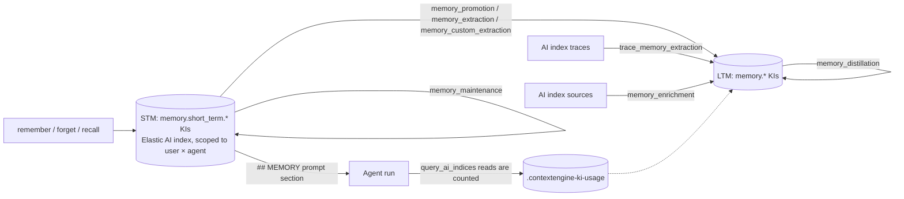

# Spec 001: Agent memory POC (PR [#300813](https://github.com/elastic/kibana/pull/300813))

This spec describes, end to end, what the agent memory POC builds and why. It is written so an implementer (human or agent) can rebuild it from `main`. Every requirement has an ID (`R-…`) and acceptance criteria; decisions and open questions are collected at the end.

- **Status:** implemented on branch `context-engine-memory-poc` (commits `8fa3d9103905`, `023483e67d16`). POC, not for merge.
- **Companion docs:**
  - `agent_memory_implementation.md` has the decision log (D1–D38), the verification record and the known gaps.
  - `agent_memory_research.md` has the research behind the design.
- **Rules that apply:** `AGENTS.md`. TypeScript only; no `any`, `@ts-ignore` or `eslint-disable`; snake_case file names; i18n for UI text; bounded input schemas; never skip tests.

---

## 1. Goal and non-goals

**Goal.** Give Agent Builder agents memory built on Context Engine AI indices, with no new index type or schema:

- **Short-term memory (STM):** private to one user × agent, written by the agent with `remember`, recalled by `recall` and injected into the prompt.
- **Long-term memory (LTM):** shared knowledge in an AI index, written only by automations ("dreaming") that promote, extract, distill, maintain and enrich memory on a schedule.

**Non-goals:**
- Elasticsearch changes. User scope is enforced by Kibana (R-SCOPE); Elasticsearch only hides user-scoped documents.
- Per-user LTM. LTM stays shared knowledge of an AI index.
- Production hardening: dedicated privileges, OAS, the Scout step-approval fixtures, release notes.

## 2. Glossary

| Term | Meaning |
| --- | --- |
| KI | Knowledge indicator: a document of an AI index (`ai-index@mappings`) |
| AI index | Context Engine registry entry with a `dest` (index or data stream), `sources`, `traces`, `automations` |
| Elastic AI index | The managed AI index `elastic`, dest `.ai-index-idx-elastic-index`; also holds SML data |
| Managed AI index | Dot-prefixed `.ai-index-*`; documents carry `permissions.kibana.privileges` and Elasticsearch applies document-level security |
| STM | `memory.short_term.session` / `memory.short_term.session_fact` KIs in the Elastic AI index |
| LTM | `memory.*` KIs (other than `memory.short_term.*`) in any AI index with `memory_enabled` |
| Principal | `user://<stable user id>`; the stable id is the profile uid, or `realm:["<type>","<name>","<username>"]` |
| Template | A workflow YAML installed by `platform.context_engine.install_automation_template` and attached to an AI index |

## 3. Architecture

| Package or plugin | Owns |
| --- | --- |
| `@kbn/agent-builder-common` (`memory/`) | `ShortTermMemory` types, limits, TTL |
| `@kbn/agent-builder-server` (`memory/`, `identity/`) | Memory client contracts, identity helpers, principal helpers |
| `agent_builder` | STM store and clients, runner binding, prompt injection, STM workflow steps, Memory page |
| `context_engine` | Managed AI index user scope, new workflow steps, KI usage, trace queries, AI index UI (graph, automation rows, Configure) |
| `context_engine_agent_builder` | `remember` / `forget` / `recall`, the `query_ai_indices` read counting, templates, install tool |
| `agent_builder_sml` | Excludes `memory.*` from SML |
| `agent_builder_platform` | `ai_index_automations` skill doc |

## 4. Requirements

### 4.1 Identity (R-ID)

- **R-ID-1.** `@kbn/agent-builder-server/identity` exports:
  - `toStableUserId({ authUser, request, resolveApiKeyProfileUid })`;
  - `resolveApiKeyOwnerProfileUid({ request, esClient })`, which parses the `ApiKey` header itself (no `@kbn/core-security-server` import, because a shared package can't import server-only code);
  - `isAdminFromRequest({ esClient })`: `_has_privileges` on the unregistered action `agent_builder:admin`, which only wildcard roles hold;
  - `USER_PRINCIPAL_PREFIX = 'user://'`, `toUserPrincipal`, `isUserPrincipal`.
- **R-ID-2.** `agent_builder` re-exports these from `server/services/utils.ts`, so existing imports keep working.
- **Acceptance:** Context Engine and Agent Builder derive the same id for the same request (unit tests in `utils.test.ts`; live: alice's principal matches the stamp on her memory).

### 4.2 STM storage (R-STM)

- **R-STM-1. Location.** STM are KIs in `.ai-index-idx-elastic-index`, written as the internal user. The index is created on first write when missing.
- **R-STM-2. Types.** `memory.short_term.session` and `memory.short_term.session_fact`. The model passes `memory.session` / `memory.session_fact`, and the server adds the prefix.
- **R-STM-3. Attributes** (flattened `attributes`, because the mapping is strict):
  - `memory.user_id`, `memory.user_name`, `memory.agent_id`, `memory.session_id`, `memory.space`, `memory.last_used_at`;
  - the summary `memory.promotion.{status,reason,ai_index_id,ki_id,updated_at}`;
  - one decision per deciding workflow, `memory.decisions.<workflow id>.{…same fields…}`. The workflow id is sanitized to `[A-Za-z0-9_-]`.
- **R-STM-4. Provenance and references.** `governance.provenance` is `user://<id>`, with the agent and session as metadata. `references: [{ uri: 'conversation://<session>', relation: 'derived_from' }]`.
- **R-STM-5. Permissions.** `[{ space, name: ['user://<stable user id>'], count: 1 }]` (R-SCOPE).
- **R-STM-6. Lifetime.**
  - The default TTL is 30 days after each write (`expires_at`).
  - A revision refreshes the TTL, resets the summary to `pending`, clears every workflow's decision, and re-stamps permissions.
  - Revisions use optimistic concurrency (`if_seq_no`/`if_primary_term`).
- **R-STM-7. Deletion.**
  - `forget`, maintenance and decay hard-delete.
  - A delete through the AI index KI API soft-deletes (`governance.lifecycle.status: deleted`). Every STM read excludes tombstones, and decay removes them.
- **R-STM-8. Usage.** Recall and prompt injection stamp `memory.last_used_at`: a bulk partial update, at most hourly per memory, fire-and-forget.
- **Acceptance:** `memory_client.test.ts` covers write shape, owner filtering, revision reset, tombstone exclusion, decisions and decay queries.

### 4.3 Memory clients (R-CLIENT)

- **R-CLIENT-1. Scoped client** (`ScopedShortTermMemoryClient`). `create`, `update`, `get`, `list`, `search`, `delete` and `deleteAll`, always filtered on type prefix, space, user and agent. `ShortTermMemoryIdentityError` when there's no stable id; `ShortTermMemoryNotFoundError` for another owner's memory.
- **R-CLIENT-2. System client** (`ShortTermMemorySystemClient`, cross-user):
  - `listForPromotion({ spaceId, agentIds?, decider?, statuses?, since?, limit? })`. With a `decider`, statuses are that workflow's own decisions; a memory with none counts as `pending`.
  - `setPromotion({ spaceId, ids, promotion, decider? })` writes the decider's decision and the summary. A promotion by any decider stays the summary over a later rejection.
  - `listByOwner`, `consolidate` (OCC merges and removals within one owner) and `decay` (expired or tombstoned, plus unused for N days).
- **R-CLIENT-3. Start contract.** `agentBuilder.memory.{getScopedClient({ request }), getSystemClient()}`. The service also has the internal `getScopedClientAsUser({ request, user })`.

### 4.4 Runner, tools and prompt (R-AGENT)

- **R-AGENT-1. Gating.** `ExperimentalFeatures.memory` = AI indices enabled ∧ global `contextEngine:memoryEnabled`. The memory tools are selected by this flag alone.
- **R-AGENT-2. Owner binding.** The runner builds one memory client per run, bound to `conversation.user` when the run has a conversation owner, and to the request identity otherwise. It's exposed as `AgentHandlerContext.getShortTermMemoryClient` and `ToolHandlerContext.getShortTermMemoryClient`. Reason: Task Manager runs authenticate with an API key.
- **R-AGENT-3. Tools** (ids `platform.context_engine.{remember,forget,recall}`):
  - `remember({ id?, type, title, description, content, tags?, expires_at? })`;
  - `forget({ id })`;
  - `recall({ query, limit? })`.

  No ids from the model; `sessionId` only over MCP. All three refuse memories of another agent.
- **R-AGENT-4. Prompt.** A `## MEMORY` section lists the 10 most recent STM of user × agent. Content is cut to 500 characters and marked untrusted. A missing identity or a failed read skips the section.
- **R-AGENT-5. Describe.** `describe_ai_index` presents memory as "Long-term memory": categories, entity lookup and relationship traversal queries (`MATCH(references.uri, ?uri)`), and that agents don't write it.
- **Acceptance:** `remember` in a Task Manager run as basic-auth `elastic` stores a memory, where `main` throws `ShortTermMemoryIdentityError`.

### 4.5 SML (R-SML)

- **R-SML-1.** SML search and autocomplete exclude `memory.*`: ES|QL `WHERE type IS NULL OR type NOT LIKE "memory.*"` right after `FROM`, and a DSL `must_not` prefix `memory.`.

### 4.6 User scope on managed AI indices (R-SCOPE)

- **R-SCOPE-1. Visibility rule** (`context_engine/server/ai_indices/user_scope.ts`, `buildManagedVisibilityFilter`). A document is visible when it has no privilege entries, or when one entry of the space:
  - is public (`count: 0`, no `name`); or
  - lists only names the caller holds (`terms_set` over the caller's authorized actions **plus their own principal**, `minimum_should_match_field: count`); or
  - for an administrator, names a `user://` principal, the other required actions being held (`count == 1`, or `terms_set` with `minimum_should_match_script: max(count - 1, 1)`).

  `minimum_should_match: 1` must stay on the top-level `should`.
- **R-SCOPE-2. Access resolution** (`resolveManagedAiIndexAccess`):
  - enumerate the distinct `permissions.kibana.privileges.name` values in the space (nested terms aggregation, `user://` excluded);
  - `checkPrivilegesDynamicallyWithRequest` for the caller, failing closed on error;
  - add the principal from R-ID-1 and `isAdmin` from `isAdminFromRequest`.
- **R-SCOPE-3. Filtered client** (`createVisibilityScopedClient`). It runs as the internal user:
  - `search` and `esql.query` get the visibility filter ANDed with the caller's own filter;
  - `index`, `update`, `delete` and `create` pass through, with methods bound to the real client;
  - any other property throws, and `then` reads as `undefined`.
- **R-SCOPE-4. KI routes** (list, get, update, delete, restore) use the filtered client when `dest` is managed (`isManagedDest`: every target starts with `.ai-index-`), and the caller's client otherwise. This comes in through the `registerAiIndexRoutes({ getKiClient })` dependency, which defaults to the caller's client.
- **R-SCOPE-5. Query path.** `AiIndexDataReadService.query` (the `_query` route and the `query_ai_indices` tool) runs as the internal user with the visibility filter only when `readsOnlyManagedAiIndices(query, managedTargets)` holds:
  - the query parses;
  - it uses only row commands (`from, where, eval, keep, drop, rename, sort, limit, stats, inline stats, mv_expand, dissect, grok, sample`);
  - every source is a managed dest exactly, with no cross-cluster prefix.

  Otherwise it runs as the caller, unchanged.
- **R-SCOPE-6. Memory page.** It uses only generic APIs (see R-UI-1). The routes `GET/DELETE /internal/agent_builder/memory` and `DELETE /internal/agent_builder/memory/{id}` are removed.
- **Acceptance (live)**, with non-admin users `alice` and `bob` (no index privileges) and superuser `elastic`:
  - Through `_query`: alice sees 1 memory (hers), bob 1, `elastic` all.
  - KI get of bob's memory: alice 404; bob and `elastic` 200.
  - Alice deletes bob's: 404. Alice deletes her own: 200, a tombstone, gone from her list.
  - Alice querying Elasticsearch directly: 0 memories.
  - A `_query` mixing a user index runs as the caller.

### 4.7 Context Engine workflow steps (R-CESTEP)

All have server and public definitions, check that Context Engine is enabled and the read or write privilege, and run in the workflow's space.

| Step | Input | Output | Behavior |
| --- | --- | --- | --- |
| `context-engine.getAiIndex` | `ai_index_id`, `traces_since_hours?` (1–8760) | `id, description?, managed, memory_enabled, dest, sources[{type: esql\|connector, value}], traces[{type, value, query}]` | With `traces_since_hours`, every trace query is windowed by R-TRACE-2 |
| `context-engine.queryAiIndex` | `query` (≤ max length), `params?` (bounded), `limit?` (≤ 1000) | `columns, values, rows` | The `_query` path: lifecycle filter, space filter, row cap, R-SCOPE-5 |
| `context-engine.purgeKis` | `ai_index_id`, `types?` (trailing `*`, default `memory.*`), `states?` (deleted, expired, verification_failed), `older_than_days?` (30), `dry_run?` | `ids, deleted, truncated` | Deletes every revision of matching KIs, space-filtered, at most 10,000 per run |
| `context-engine.getLastRun` | `default_hours?` (24), `max_hours?` | `first_run, since, hours_since, last_success?` | Latest completed, production (non-test) execution other than the current one. `since` is its *start*, never older than `max_hours`; `hours_since = max(1, ceil(...))` |
| `context-engine.getKiUsage` | `ki_ids` (≤ 1000), `min_new_accesses?`, `min_days_since_enrichment?`, `limit?` (≤ 100) | `kis[{ki_id, access_count, new_accesses, last_accessed_at, last_enriched_at?}]` | Due KIs, most-read first |
| `context-engine.recordKiEnrichment` | `ki_ids` | `recorded` | Sets `last_enriched_at`, and `access_count_at_enrichment = access_count` |
| `context-engine.updateKi` (extended) | adds `add_references?`, `add_attributes?` | unchanged | References are deduped by uri and relation; attributes are replaced key by key |

- **Acceptance:** one unit test file per step (`get_ai_index.test.ts`, `get_last_run.test.ts`, `ki_usage.test.ts`, `update_ki.test.ts`, …). `index.test.ts` asserts the registered ids.

### 4.8 Agent Builder STM steps (R-ABSTEP)

Admin only (`isAdminFromRequest` on the workflow's scoped client, otherwise a `PermissionError`). They decide as the workflow (`decider = workflow id`).

| Step | Input | Output |
| --- | --- | --- |
| `ai.memory.short_term.list` | `agent_ids?`, `statuses?` (default pending), `since?`, `limit?` (≤ 200) | `memories[]` |
| `ai.memory.short_term.set_promotion` | `ids`, `status` (promoted\|rejected), `ai_index_id?`, `ki_id?`, `reason?` | `updated` |
| `ai.memory.short_term.list_by_owner` | `agent_ids?`, `changed_within_hours?`, `max_owners?`, `max_memories?` | `owners[{user_id, agent_id, memories[]}]` |
| `ai.memory.short_term.consolidate` | `user_id`, `agent_id`, `merges[{keep_id, merged_ids, title, description, content}]`, `remove[{id, reason}]` | `merged, deleted, skipped` |
| `ai.memory.short_term.decay` | `unused_days`, `agent_ids?` | `expired, unused` |

### 4.9 KI read counting (R-USAGE)

- **R-USAGE-1. Index.** `.contextengine-ki-usage` through `StorageIndexAdapter`, holding `space, ki_id, access_count, first_accessed_at, last_accessed_at, last_enriched_at, access_count_at_enrichment`. The document id is `sha256(space + '\n' + ki_id)`.
- **R-USAGE-2. Recording.** `query_ai_indices` counts one read for every row with a string `id` column (`kiIdsOf`), fire-and-forget, logged at debug level on failure.
- **R-USAGE-3. Updates.** A read-modify-write that reads with `mget` (real-time; a search would miss just-written counts) and writes with optimistic concurrency, retrying a conflict twice.
- **R-USAGE-4. Contract.** Exposed as the start contract's `getKiUsageService()`.

### 4.10 Trace queries (R-TRACE)

- **R-TRACE-1. Whole traces.** An `elastic_agent` trace source resolves to
  `FROM traces-agent_builder.otel-<space> [| WHERE @timestamp >= NOW() - N hours] | INLINE STATS agent_runs = COUNT(*) WHERE attributes.gen_ai.agent.id IN (<id>, <exported id>) BY trace_id | WHERE agent_runs > 0 | DROP agent_runs`.
  On `main` it is `WHERE attributes.gen_ai.agent.id IN (…)`, which matches only the root span, and that span holds no content.
- **R-TRACE-2. Window placement.** `buildTraceQuery(trace, spaceId, sinceHours?)` puts the window right after `FROM` for `elastic_agent` and `index` sources, and last for `esql` sources.
- **R-TRACE-3. Content capture.** It needs the space settings `agentBuilder:tracing:includeUserPrompts`, `includeLlmResponses` and `includeToolDetails`, all off by default.

### 4.11 Templates (R-TPL)

Common rules for every memory template:
- **R-TPL-1.** Scheduled plus manual triggers, and `concurrency: { key: "<prefix>-{{ consts.ai_index_id }}", strategy: drop, max: 1 }` (maintenance uses the literal `elastic`).
- **R-TPL-2.** `consts.instructions` holds the prompt text. `consts.connector_id` is empty by default, with `connector-id: "{{ consts.connector_id }}"` and `connector-id-by-feature: "context_engine_prompt"`.
- **R-TPL-3. Only chosen values are stored.** Anything that follows from other values is computed at run time with existing steps (`data.set` + Liquid + `json_parse` + `${{ }}`). No install-time derived consts, no compile route.
- **R-TPL-4.** A `ce-template:<id>` tag. Reinstalling the same template under the same name replaces the workflow in place.
- **R-TPL-5.** Every rendered template passes `WorkflowSchema` and `convertToWorkflowGraph`, with Liquid rendering of key steps tested (`render.test.ts`, `memory_extraction.test.ts`).

| Template | Install params (defaults) | Steps |
| --- | --- | --- |
| `memory_promotion` | `agentIds` ([]), `batchSize` (50), `interval` (1h) | list pending STM → `ai.prompt` decide (promote, reject, wait) → `createKi` `memory.session_fact` → `set_promotion` |
| `memory_extraction` | `extraction` {instructions?, facts[], entities[], relationships[]} (required), `memorySources` ([short_term_memory]), `agentIds`, `batchSize` (50), `interval` (1h) | `getAiIndex` → `compile` and `compiled` (node kinds, relationship kinds and output schema from `extraction_config`) → existing nodes → per source: defaults and filters (`source_context`) → read (STM list or `queryAiIndex`) → `ai.prompt` (`schema: "${{ steps.compiled.output.schema }}"`) → write nodes (`memory/<category>/<kind>/<key>`) and allowed relationships (`memory/relationship/<kind>/<src>/<dst>`) → mark STM |
| `memory_custom_extraction` | `customExtraction` {instructions, types[] with JSON-schema attributes} | same template; `types` → `memory.<type>` |
| `trace_memory_extraction` | `lookbackHours` (24, first run), `maxRows` (50), `interval` (1d) | `getLastRun` (`max_hours` 168) → `getAiIndex` with `traces_since_hours` → existing memory → per trace source: read (agent sources as chat turns: the agent's own `chat *` spans, newest run first, turns in order) → `ai.prompt` (at most 10 facts; schema `memories[{key, title, description, content, tags?, trace_ids?}]`) → `createKi` `memory.session_fact` at `<automation>/<key>`. A failed extraction retries once, then fails the run |
| `memory_distillation` | `maxMemories` (200), `purgeAfterDays` (30), `interval` (1d) | `memory.session*` → `ai.prompt` syntheses and retire → `createKi` syntheses, soft-delete sources and stale memories → `purgeKis` |
| `memory_maintenance` | `agentIds`, `unusedDays` (14), `maxOwners` (20), `maxMemoriesPerOwner` (50), `interval` (1d); Elastic AI index only | `getLastRun` → `decay` → `list_by_owner` (changed since) → per owner `ai.prompt` merges and removals → `consolidate` |
| `memory_enrichment` | `memoryTypes` (`memory.entity.*`), `minNewAccesses` (3), `minDaysBetweenEnrichments` (7), `maxEnrichments` (5), `enrichmentAgentId` (`elastic-ai-agent`), `interval` (1d) | `getAiIndex` → candidates (`type LIKE ?memory_types`) → `getKiUsage` → per due memory: ephemeral `ai.agent` with `execute_esql`, `get_index_mapping` and `execute_connector_sub_action` and a structured result → `updateKi` (content, `add_attributes`, `add_references`) when enriched → `recordKiEnrichment` once the agent finished |

Fixes to existing templates:
- **R-TPL-6. Unit profile.**
  - Discovery adds `| WHERE \`key\` != ""` after `STATS`.
  - The per-unit filters use `MV_CONTAINS(\`key\`, "<unit>")`.
  - The prompt's example queries use `MV_CONTAINS(key, ?unit)`.
- **R-TPL-7. Field checks.** The document and unit-profile templates start with `check_fields`: `FROM <index> | KEEP <configured fields> | LIMIT 0`.

### 4.12 UI (R-UI)

- **R-UI-1. Agent Builder Memory page** (`/agents/:agentId/memory`, experimental).
  - **Data:** `MemoryService` lists through `POST /api/context_engine/ai_index/_query` (`FROM <elastic dest> | WHERE type LIKE ?type …`, `limit` 1000), filtering by agent in the browser (ES|QL can't filter flattened attributes). It deletes through `DELETE /internal/context_engine/ai_index/elastic/kis/{id}`, and "Forget all" deletes one by one.
  - **Admin view:** when more than one owner is listed, it shows an Owner column and disables "Forget all".
- **R-UI-2. AI index Overview layout.**
  - A KI graph on a canvas behind the panels: a custom 3D force layout with no new dependency, up to 1,000 KIs read with one `_query`, and `ki://` references as links. Other references become their own nodes.
  - Clicking a node opens a reader flyout and shifts the selection 200px left of the visible centre.
  - On a 3-column grid, panels take columns 1–2 and the graph 2–3, sticky, to the browser edge. Panels are transparent over the graph (`BackdropAwarePanel`).
- **R-UI-3. Automation rows:**
  - a Run button that becomes a spinner while an execution is running, linking to it;
  - a Configure button;
  - the last run, as a status icon with tooltip plus a relative time linking to the execution;
  - polling every 3 seconds while running and 30 seconds idle, test runs excluded;
  - a menu with View, Open in Workflows and Delete.
- **R-UI-4. Configure flyout:**
  - a form over the workflow's `consts` and schedule, preserving comments (`yaml` `parseDocument`);
  - `ai_index_id` and `automation_name` read-only;
  - a connector picker for `connector_id` (`/api/actions/connectors`, AI types);
  - save through the Workflows API.
- **R-UI-5.** The Traces panel shows on memory-enabled indices when `contextEngine:memoryEnabled` is on.

### 4.13 Docs (R-DOC)

- **R-DOC-1.** The `ai_index_automations` skill doc covers every memory template, its parameters, the new steps and per-workflow decisions.

## 5. Decisions

These are the load-bearing ones; the full log is in `agent_memory_implementation.md` §8.

| # | Decision | Why |
| --- | --- | --- |
| D1 | Memory is a KI type in the existing AI index | Reuses storage, query, lifecycle and automations |
| D4–D6 | Two tiers; `remember` takes no ids; only automations write LTM | Private capture, shared knowledge; one reviewed path across the privacy boundary |
| D8 | STM lives in the Elastic AI index (not `.chat-memory`) | Inspectable with the AI index tooling |
| D10 | Memory identity is the conversation owner | Task Manager API-key runs |
| D20 | Automations read their own run history for "last run" | No extra state to keep in sync; failed runs retry |
| D32–D34 | Whole agent traces, windowed before aggregation, read as chat turns; a failed extraction fails the run | `main`'s query hides all content; the window must not skip unread data |
| D35 | `MV_CONTAINS` in the unit profile | `==` is null on multi-valued keys |
| D36 | STM decisions per workflow | Two extraction automations starved each other |
| D37 | User scope as `user://` principals in the existing permission model, enforced by Kibana; admins see through | One model for the Elastic AI index; generic APIs serve owners; no Elasticsearch change |
| D38 | Templates store only chosen values; derived values are computed at run time with existing steps | Hand edits and Configure can't leave anything stale; no compile route |

## 6. Verification

Unit tests, run uncached (`node scripts/jest … --no-cache`):

| Plugin or package | Suites |
| --- | --- |
| `agent_builder` server | memory clients, STM steps, utils, runner |
| `agent_builder` public | memory service |
| `context_engine` | user scope, data read service, step types, trace queries, KI usage, graph and UI |
| `context_engine_agent_builder` | templates, render, extraction, tools |

Type check `context_engine_agent_builder`, which builds `agent_builder` and `context_engine` too, plus `agent-builder-server`, and run eslint and `i18n_check`.

Live scenarios (local stack; `/tmp/ce_verify`, `/tmp/orca` scripts):
1. User scope (R-SCOPE acceptance).
2. Each template on an AI index with synthetic sources and seeded memories:
   - extraction writes nodes and allowed relationships and marks STM;
   - distillation merges duplicates and retires contradictions;
   - enrichment writes exactly the seeded source values;
   - unit profile counts match ES|QL ground truth.
3. Trace extraction over content-bearing traces writes memories citing `trace_ids`.
4. Per-workflow decisions: two extraction workflows each process every STM once.

## 7. Open questions

1. **Elasticsearch-enforced user scope.** A `principals` field and `_user.profile_uid` in the document-level security filter (research §1.2.2). When, and owned by whom?
2. **Privileges.** A dedicated privilege for cross-user memory automations instead of admin-only.
3. **Consent.** Do users need to consent to, or opt out of, promotion and extraction of their STM?
4. **Trace content.** Content capture is off by default, and message fields stop at 1,024 characters for ES|QL (`traces-otel@template`). Mapping change or `_source` reads?
5. **Trace extraction batching.** At most 50 rows per source per run. Per-trace batching?
6. **Enrichment safety.** It rewrites `content` in place, and on index destinations there is no revision history.
7. **STM TTL.** A sliding TTL for memories that get used?

## 8. Out of scope and known gaps

OAS snapshot, Scout step-approval fixtures (11 steps), Scout/FTR runs, release notes, the root-level docs (review only), invalid `extraction_config` surfacing at run time rather than on save, and duplicate attribute names taking the last description in the run-time schema.
