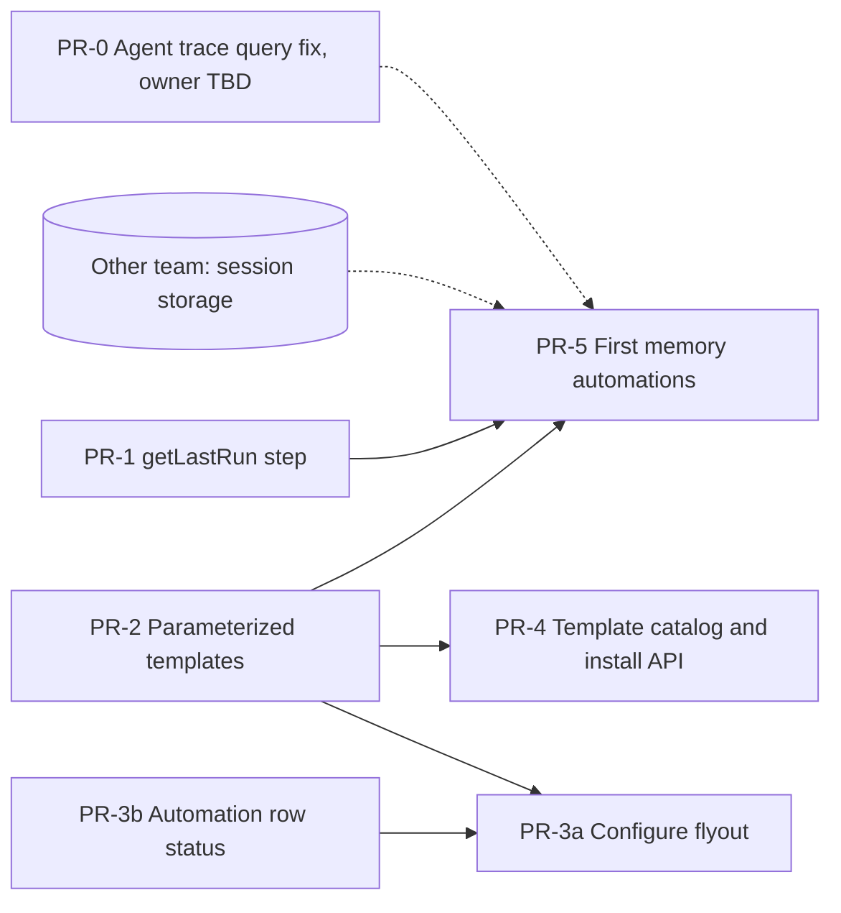

# Spec 002: Memory automation foundations ("dreaming")

The production work to make background memory automations possible, broken into PRs that an implementer (human or agent) can take end to end. It starts from `main`, not from the POC branch; the POC (spec 001, PR [#300813](https://github.com/elastic/kibana/pull/300813)) is the reference implementation for most pieces. Reuse its code where this spec says so.

- **Rules:** `AGENTS.md`. TypeScript only; no `any`, `@ts-ignore` or `eslint-disable`; snake_case file names; i18n for UI text; bound every HTTP input (`maxLength`, `maxSize`); never skip tests.
- **Validate each PR with:** `node scripts/check.js --scope=branch` (or Jest, `type_check --project` and eslint on the touched projects), `node scripts/i18n_check --fix`, and Jest with `--no-cache` when templates change: cached runs hid stale tests in the POC.

---

## 1. Context

On `main`:
- **Templates.** `context_engine_agent_builder` ships four automation templates (`document_orchestration`, `index_metadata`, `unit_profile`, `targeted_ki_writer`), installed only through the setup agent's tool `platform.context_engine.install_automation_template`.
  - Prompts are written inline in the YAML, and the model is fixed: `connector-id-by-feature: context_engine_prompt`.
  - The templates have no concurrency settings and run on manual triggers.
- **Automation rows.** The AI index page lists automations with an "…" menu that holds Run (`useRunAutomation`, with `RunWorkflowInputsModal` for manual inputs). There's no last-run display and no way to edit an installed workflow other than the Workflows editor.
- **Context Engine workflow steps:** `createKi`, `updateKi`, `deleteKi`, `verifyKi`, `feedbackContext`, `recordImprovements`.
- **Existing APIs a workflow can call through the generic `kibana.request` step:**
  - `GET /api/context_engine/ai_index/{id}` returns `dest`, `sources`, `traces[{type, value, query}]`, `memory_enabled`, `automations`.
  - `POST /api/context_engine/ai_index/_query` runs ES|QL with the lifecycle filter (drops deleted, expired and failed KIs, latest revision on data streams), the space filter and the row cap.
  - Workflow run history: `GET /api/workflows/workflow/{id}/executions`.

**The other team** owns session storage: user memories (STM) and traces, including how they're stored and scoped, and managed AI index concerns. Nothing in PR-1 to PR-4 depends on their schema. PR-5 does, and starts once their storage exists (§5).

## 2. Plan



| PR | Title | Size | Depends on |
| --- | --- | --- | --- |
| PR-0 | Agent trace query returns whole traces (owner to be agreed) | S | — |
| PR-1 | `getLastRun` workflow step | S | — |
| PR-2 | Parameterized automation templates | M | — |
| PR-3b | Automation rows: Run, running state, last run | S–M | — |
| PR-3a | Configure flyout for installed automations | M | PR-2; PR-3b for the button placement |
| PR-4 | Template catalog and install API over HTTP | M | PR-2 |
| PR-5 | First memory automations: trace extraction, STM extraction, distillation | L, split per template | PR-1, PR-2, session storage |

---

## 3. PRs

### PR-0: Agent trace query returns whole traces

**Problem.** `buildTraceQuery` (`context_engine/server/ai_indices/trace_queries.ts`) resolves an `elastic_agent` trace source to `FROM traces-agent_builder.otel-<space> | WHERE attributes.gen_ai.agent.id IN (…)`. Only the agent's root `invoke_agent` span carries `gen_ai.agent.id`. The chat and tool spans holding the conversation content are its descendants, so every consumer of this query (the setup agent through the AI index attachment, and future trace automations) sees metadata only.

**Change:**
```text
FROM traces-agent_builder.otel-<space>
| INLINE STATS agent_runs = COUNT(*) WHERE attributes.gen_ai.agent.id IN (<id>, <exported id>) BY trace_id
| WHERE agent_runs > 0
| DROP agent_runs
```
- Optional `sinceHours` parameter on `buildTraceQuery` / `buildTraceQueries`. It puts `| WHERE @timestamp >= NOW() - N hours` right after `FROM` for `elastic_agent` and `index` sources, and last for `esql` sources. Without the parameter, output is unchanged apart from the whole-trace shape.
- POC reference: `trace_queries.ts` and its test on the POC branch.

**Acceptance:**
- unit tests for both agent id forms, quoting, and window placement;
- a live query over real Agent Builder traces returns chat and tool spans.

**Open:** which team owns it (Context Engine or the session-storage team). `INLINE STATS` must be available in every Elasticsearch version this ships against.

### PR-1: `getLastRun` workflow step

**Goal.** Let a scheduled workflow process only what's new since its last successful run, without storing state.

**Contract** (POC reference: `context_engine/{common,server,public}/step_types/get_last_run.ts`):

| | Field | Notes |
| --- | --- | --- |
| Input | `default_hours?` | Window on the first run. Default 24, integer 1–8760 |
| Input | `max_hours?` | Never reach further back than this. Integer 1–8760 |
| Output | `first_run` | No earlier successful run |
| Output | `since` | ISO time: the *start* of the last successful run, or `now - default_hours`; never older than `now - max_hours` |
| Output | `hours_since` | `max(1, ceil((now - since) / 1h))`, for ES\|QL `NOW() - N hours` |
| Output | `last_success?` | `{ execution_id, started_at, finished_at? }` |

**Semantics:**
- "Successful" means status `completed` and execution type `production`. Test runs and the current execution are excluded; read the latest 3 sorted by `finishedAt desc` and skip the current one.
- The window starts at the last run's *start*, so records written during it aren't missed. Windows may overlap, so consumers must write idempotently (stable ids).
- A failed run doesn't move the window. Templates that must not lose data should fail the run when processing fails, not use `on-failure: continue`.

**Implementation:**
- Server definition through `createServerStepDefinition`, reading history with the workflows management API (`getWorkflowExecutions`), in the workflow's own space.
- Public definition for the editor: label, description, icon (clock), documentation, an example.
- Register both in Context Engine's step registry (`step_types/index.ts`, `public/step_types`), and add the id to the registry test.
- Step approval fixture under `workflows_extensions/test/scout/api/fixtures/approved_step_definitions/` (the suite is currently skipped; add the fixture anyway).

**Acceptance:** unit tests for first run, the normal case, the `max_hours` cap, and excluding test runs and the current execution. Live: two consecutive runs, where the second's `since` equals the first's start.

**Open:**
- Should this live in `workflows_extensions` as a generic step (`workflow.getLastRun`)? Nothing in it is Context Engine–specific.
- **Recommended:** generic if the workflows team agrees, otherwise Context Engine (`context-engine.getLastRun`, as in the POC).

### PR-2: Parameterized automation templates

**Goal.** Installed templates are configurable without reinstalling, and editing them can't leave anything inconsistent. One PR covering all four templates on `main`.

**Requirements:**
1. **Prompt as a const.** Each template's instruction prose moves into `consts.instructions` (a block scalar). The prompt keeps its data sections (records, mapping, aggregations) and inserts `{{ consts.instructions }}`. Wording is unchanged.
2. **Model as a const.** `consts.connector_id: ""` on every step that calls a model:
   ```yaml
   connector-id: "{{ consts.connector_id }}"
   connector-id-by-feature: "context_engine_prompt"
   ```
   `== blank` covers empty and missing; `ai.prompt` treats empty strings as unset. Verified in the POC.
3. **Store only chosen values.**
   - Consts hold what the installer or user chose. Anything that follows from other values is computed when the workflow runs, with existing steps: `data.set` with Liquid, `json_parse`, `${{ }}`.
   - No template may store a value derived from another const, and no install-time compile or recompile code may exist.
   - The four current templates comply; the rule goes into the template guidelines and the skill doc, so new templates follow it.
4. **Concurrency.** A template with a scheduled trigger gets `settings.concurrency: { key: "<template>-{{ consts.ai_index_id }}-{{ consts.automation_name }}", strategy: drop, max: 1 }`. The key is rendered from consts at run time; no install-time token. Manual-only templates may omit it.
5. **Field checks.** Templates that read fields the setup agent chose (`document_orchestration`: title and body; `unit_profile`: unit key, activity, breakdown and metric fields) start with:
   ```yaml
   - name: check_fields
     type: elasticsearch.esql.query
     with:
       query: |
         FROM {{ consts.source_index }}
         | KEEP `{{ consts.title_field }}`, `{{ consts.body_field }}`
         | LIMIT 0
   ```
   A renamed or removed field fails the run with "Unknown column [x]", instead of every item inside a continue-on-failure loop failing quietly. `index_metadata` already queries its category field first.
6. **Unit profile fix** (bug on `main`). Discovery adds `| WHERE \`<key>\` != ""` after `STATS`. The per-unit queries filter with `MV_CONTAINS(\`<key>\`, "<unit>")` instead of `==`, which is null on multi-valued keys. The prompt's example queries use `MV_CONTAINS(<key>, ?unit)`. Seen live: a manufacturer counted 250 orders instead of 1,370.
7. **Docs.** Template comments say which consts are user-editable. The `ai_index_automations` skill doc says the prompt and model live in `consts.instructions` and `consts.connector_id`.

**Tests** (`render.test.ts`), for every template:
- `consts.connector_id === ''`, the prompt contains `{{ consts.instructions }}`, and rendering the connector fields gives `['', 'context_engine_prompt']` and `['my-connector', '']`;
- the concurrency key renders from consts;
- `check_fields` renders the expected query;
- the unit-profile fixes render as described;
- every template still passes `WorkflowSchema` and `convertToWorkflowGraph`.

**Compatibility.** Installed workflows keep their old YAML and work as before; reinstalling with the same name upgrades in place. Reinstalling resets consts edited through Configure (see the open questions).

### PR-3b: Automation rows: Run, running state, last run

**Goal.** Operate automations from the AI index page.

**Requirements** (POC references: `automation_row.tsx`, `use_latest_workflow_execution.ts`, `use_run_automation.tsx`):
1. **Run** becomes an icon button on the row: `play`, tooltip "Run". While the latest production execution is running it shows a spinner, linking to that execution. It's disabled when the workflow is disabled or the user can't run it.
2. **Last run:**
   - a status icon (`checkCircleFill` for completed, `errorFill` for failed or timed out, `minusCircle` for cancelled), with an `EuiIconTip` naming the status and an aria label;
   - a relative time (`FormattedRelative`, exact time on hover) linking to the execution;
   - "Never run" when there's no execution.
3. **Polling:** `getWorkflowExecutions(workflowId, { executionTypes: [PRODUCTION], sortField: 'createdAt', sortOrder: 'desc', size: 1, omitStepRuns: true })`, every 3 seconds while running and 30 seconds otherwise. A successful Run invalidates the query.
4. **Menu:** the "…" menu keeps View, Open in Workflows and Delete.

**Tests:** the row with each status, the spinner while running, "Never run", and the menu items. Use EUI icon names that exist; invalid names render nothing.

### PR-3a: Configure flyout for installed automations

**Goal.** Edit an installed automation's parameters without the YAML editor.

**Requirements** (POC references: `automation_configure_flyout.tsx`, `utils/workflow_parameters.ts`, `hooks/use_ai_connectors.ts`):
1. **Entry point.** A Configure button (gear) on the automation row, or a menu item if PR-3b hasn't merged yet. It opens a flyout for that workflow.
2. **Reading.** `readWorkflowParameters(yaml)` returns every const as `{ key, kind: string|text|number|boolean|json, value, comment }`, using the comment above it as help text, plus the scheduled trigger's `every` when there is one. It uses `yaml` `parseDocument`, so comments survive.
3. **Form:**
   - `ai_index_id` and `automation_name` are read-only: they identify the automation;
   - `connector_id` is a picker of AI connectors (`GET /api/actions/connectors`, types `.gen-ai`, `.bedrock`, `.gemini`, `.inference`), with a "Context Engine default" option meaning empty;
   - multi-line strings are text areas, numbers are numeric fields, booleans are switches, and objects and arrays are JSON editors with parse validation;
   - the schedule is validated by `/^[1-9][0-9]{0,3}[mhd]$/`.
4. **Saving.** `applyWorkflowParameters(yaml, { values, schedule })` changes only the edited consts and the schedule, keeping comments and layout. The flyout saves with `updateWorkflow(id, { name, description, enabled, tags, yaml })`, shows the response's `validationErrors` in a danger callout, and closes on success.
5. **No recompile.** Saving never transforms anything else in the YAML (PR-2 rule 3).

**Tests:**
- `workflow_parameters.test.ts`: kinds, comments preserved, only edited keys changed, schedule replaced;
- flyout tests: read-only identity fields, connector picker, validation errors shown, save payload.

**Open:** Configure on managed AI indices, which the POC allows. Decide with the other team.

### PR-4: Template catalog and install API over HTTP

**Goal.** Install templates from the UI or any client without going through the setup agent.

**Requirements:**
1. **Per-template parameter schemas.** Split the install tool's single object schema (one `z.object` plus `superRefine`) into one zod schema per template, and build the tool schema as their discriminated union on `template`. This keeps the tool's validation and gives each template a clean schema.
2. **Catalog route.** `GET /internal/context_engine_agent_builder/automation_templates`, version `1`, returns `{ templates: [{ id, title, description, parameters }] }`. `parameters` is the template's JSON Schema (`z.toJSONSchema`), with descriptions taken from the zod `describe` texts. It requires Context Engine read.
3. **Install route.** `POST /internal/context_engine_agent_builder/ai_index/{aiIndexId}/automation_templates/{templateId}/_install`, version `1`, body `{ name, params }`. Validation:
   - `name`: 1–200 characters, no `/`, not blank;
   - `params` is validated by the template's schema; every string and array is bounded;
   - the body is at most 1 MB.

   It responds `200 { workflowId, replaced, status: 'saved_and_attached' }`, `400` for validation errors, `403` without Context Engine write or workflow create/update privileges, `404` for an unknown AI index or template, and `409` for a concurrent change to the AI index.
4. **One handler.** Refactor `installAutomationTemplateHandler` to take `aiIndexId` directly. The agent tool resolves it from the conversation's `ai_index` attachment and calls the same handler, so the HTTP API and the tool behave identically.
5. **Authorization.** `requiredPrivileges` covers Context Engine write. The workflow is saved through the workflows management API as the caller, so workflow privileges are enforced there; the route only needs to map the error to `403`.
6. **Audit and telemetry** match the tool's.

**Tests:**
- route tests: catalog shape; install with valid and invalid parameters; unknown AI index and template; replace on the same name;
- handler tests, now without attachments;
- the tool still passes its tests.

**Open:**
- Does the AI index page get an "Add automation" picker built on the catalog in this PR, or later?
- Should the install API also run the template's pilot?
- On reinstall, should consts the user edited through Configure be kept?

### PR-5: First memory automations

Starts when the other team's session storage exists. Split into one PR per template. All three follow PR-2's rules and reuse the POC templates as references (`trace_memory_extraction`, `memory_extraction` / `memory_custom_extraction`, `memory_distillation`).

**Reading the AI index without new steps:**
```yaml
- name: ai_index
  type: kibana.request
  with:
    method: GET
    path: "/s/{{ workflow.spaceId }}/api/context_engine/ai_index/{{ consts.ai_index_id }}"
- name: memories
  type: kibana.request
  with:
    method: POST
    path: "/s/{{ workflow.spaceId }}/api/context_engine/ai_index/_query"
    body:
      query: 'FROM {{ steps.ai_index.output.dest.value }} | WHERE type LIKE "memory.*" | KEEP id, title, description'
      limit: 300
```
- Read the AI index definition at run time, not from consts: sources and traces change after install.
- Query through `_query`, not `elasticsearch.esql.query`, so deleted and expired memories aren't read back. Distillation would otherwise resurrect retired facts.
- `kibana.request` runs as the workflow's identity. On a managed AI index, Elasticsearch's document-level security then applies to that identity. Verify both points in the first PR.
- Query user and managed AI indices separately; a mixed query loses the managed-index behavior.

**Trace extraction:**
- **Window.** `getLastRun` gives `hours_since`. For a trace source's resolved query, insert the window after its first line (`FROM …`) with Liquid, or use PR-0's `sinceHours` if it is exposed over the API.
- **Batching (new, required).** The POC reads at most 50 rows per source per run and loses the rest.
  1. List the trace ids in the window: `| STATS started = MIN(@timestamp) BY trace_id | SORT started ASC | LIMIT <max_traces>`.
  2. `chunk` them into groups of `traces_per_prompt` (for example 10).
  3. For each group, read that group's turns and make one `ai.prompt` call.
  4. If more traces exist than `max_traces`, the run processes the oldest and the next run continues. Its window starts at this run's start, so it must also read traces older than that which weren't processed. **Open:** a per-trace marker, or accept the loss with a warning?
- **Content.** For Agent Builder traces, read the agent's own `chat *` spans as conversation turns. The input on a run's first turn is the user's message; outputs are answers and tool calls.
- **Output.** Memories with stable keys (`<automation>/<key>`) citing `trace_ids`, at most N per call. A failed model call retries once, then fails the run.

**STM extraction:**
- Configured kinds (facts, entities, relationships; or custom types), with node kinds, relationship ends and the output schema built at run time from the config (POC `compile` and `compiled` steps; a test checks them against the TypeScript compiler).
- Needs from session storage, per workflow:
  - list the memories it hasn't processed yet;
  - record its decision (extracted, rejected or wait) without hiding the memory from other workflows;
  - a revision by the owner makes every workflow decide again.

  These operations are cross-user, so they need a privilege story (the POC used admin-only).

**Distillation:**
- Reads current session memories through `_query`, proposes syntheses and retirements with one `ai.prompt` call, writes syntheses with `createKi`, and soft-deletes sources and stale memories with `deleteKi`.
- No purge: soft-deleted memories accumulate until a purge step exists.

**Acceptance per template:** a live run on an AI index seeded with synthetic data, where outputs match what was seeded. Orca's `customer_support` dataset and its planted traces (`gs://agent-builder-data-science-datasets`, `context_engine_evals/v1.4`) are ready-made inputs; the POC loaders are in `/tmp/orca/`.

---

## 4. Decisions

| # | Decision | Alternatives | Why |
| --- | --- | --- | --- |
| F1 | No `purgeKis` step for now | Ship cleanup with distillation | Not needed for a first version; soft-deleted memories accumulate |
| F2 | No `queryAiIndex` or `getAiIndex` steps: templates call the existing AI index APIs with `kibana.request` | New Context Engine steps (POC) | The APIs exist and already apply the lifecycle and space filters |
| F3 | `getLastRun` is the only new step | Build it from `kibana.request` to the executions API | Skipping failed, test and current runs, and date math, are fragile in Liquid |
| F4 | Templates store only chosen values; no recompile route; one PR for all templates | Derived consts with recompilation (POC first attempt) | Hand edits and Configure can't leave anything stale |
| F5 | UI split in two: row status (3b), then Configure (3a) | One UI PR | Independent and reviewable |
| F6 | Template catalog and install over HTTP, sharing one handler with the agent tool | Agent-only installs | A UI and other clients can install with identical validation |
| F7 | Session storage (STM and traces) and managed AI index concerns belong to the other team | — | Ownership |
| F8 | Nothing in PR-0 to PR-4 depends on the memory schema | — | Work can start now |

## 5. What PR-5 needs from the session-storage team

Not needed before PR-5 starts. Raise it then:
1. **Per-workflow processing state for STM:** "not yet processed by this workflow", and "record this workflow's decision", so several automations can each process every memory. A revision by the owner resets it.
2. **Cross-user read privilege** for memory automations: a dedicated privilege, or admin-only.
3. **Trace content:**
   - Content capture is off by default (`agentBuilder:tracing:include*`), so trace extraction finds nothing in default deployments.
   - Message fields are `keyword` with `ignore_above: 1024` (`traces-otel@template`), so ES|QL reads long chat turns and tool results as null. A mapping override (`match_only_text`) or `_source` reads are needed for full content.
4. **The trace source shape** automations should read: today's Context Engine `traces[]` with a resolved query (PR-0), or something new.

## 6. Open questions

1. Where `getLastRun` lives: `workflows_extensions` (generic) or Context Engine.
2. Who owns PR-0 (the trace query fix).
3. How `kibana.request` authenticates in scheduled runs, and that `_query` called through it applies the same filters as from the UI.
4. Configure on managed AI indices.
5. Reinstalling a template: keep consts edited through Configure, or reset them?
6. An "Add automation" UI on the catalog: in PR-4 or later?
7. Trace extraction backlog when a window holds more traces than `max_traces`.
8. Cost controls: a per-run cap on model calls, shown in Configure?
9. Evals: run the orca-based scenarios in CI (kbn/evals), or keep them manual?

## 7. Out of scope

Session storage, STM tools and prompt injection; user scope on managed AI indices (POC D37); memory enrichment and read counting (POC templates exist for later); OAS documentation for internal routes; release notes.
