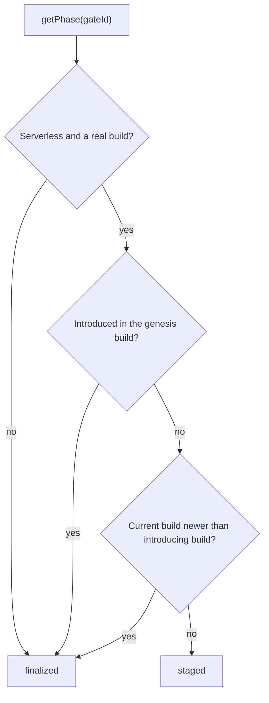

# Rollout gates

A generic, server-side answer to one question — *"is this build the one that introduced
capability X, or has a later build already shipped it?"* — for any plugin that ships a
capability in two phases so it stays rollback-safe on Serverless.

This is a **proof of concept**. There is no consumer wired up yet; see
[Out of scope](#out-of-scope) below.

## Why

Several Kibana subsystems (connector types, rule types, task types, ...) already follow an
informal "interim release, then final release" convention: ship a capability so it can run,
but keep it hidden from places that create new instances of it until a later build has also
shipped it, so a one-build rollback doesn't strand anything mid-flight. Today each subsystem
reimplements this by hand. `rolloutGates` makes the "which phase am I in?" question a
primitive any plugin can ask, instead of a convention every team reinvents.

## Terms

The closest prior art is Kafka's "supported vs finalized" features
([KIP-584](https://cwiki.apache.org/confluence/display/KAFKA/KIP-584%3A+Versioning+scheme+for+features)),
CockroachDB's [version gates and upgrade finalization](https://www.cockroachlabs.com/docs/stable/upgrade-finalization),
and MongoDB's
[feature compatibility version](https://www.mongodb.com/docs/manual/reference/command/setFeatureCompatibilityVersion/).
The general pattern these follow is sometimes called
["expand/contract"](https://martinfowler.com/bliki/ParallelChange.html), or "readers before
writers".

- **Rollout gate**: a string id for something a build newly knows how to handle, e.g.
  `actions.connectorType:.gitlab`. We avoided "capability" and "feature" because
  `core.capabilities`, the features plugin, and feature flags already use those words for
  other concepts.
- **Phase**: `staged` or `finalized`.
  - `staged`: this is the first build to ship the gate. Keep running existing things, but
    don't let consumers create new ones yet — a rollback to the previous build would not
    understand them.
  - `finalized`: an earlier build shipped this gate too, so rolling back one build is safe.
- **Introducing build**: the oldest build recorded for a gate in this project (i.e. this
  Elasticsearch cluster's ledger).
- **Genesis build**: the oldest build this project's ledger has ever seen, for any gate.

## How the phase is decided



- Builds are identified by `buildSha` and ordered by `buildNum` (a git commit count, see
  `src/dev/build/lib/get_build_number.ts`). Both come from
  `initializerContext.env.packageInfo`.
- The ordering logic lives in a single comparator function
  (`server/lib/build_comparator.ts`). If `buildNum` ever turns out to be unreliable as an
  ordering key, that is the only place that needs to change (e.g. to compare `buildDate`
  instead, which is stamped at build time and does not depend on git history).
  - **Known limitation:** `buildNum` is only a true, monotonically increasing commit count
    if the Serverless image build job checks out full git history. We could not confirm this
    from this repository alone — some other CI pipelines here use shallow checkouts, though
    we found no evidence the Serverless image-build job does. Before relying on this in
    production, verify `version.build_number` from `GET /api/status` is large and increasing
    across two real Serverless releases.
- On start, each Kibana node writes "introduced in my build" for every declared gate, using
  create-if-absent, and lowers the record if its own build is older than what's already
  there. The genesis record works the same way, keyed on a fixed id rather than a gate id.
- Example with builds 100, 101 (adds a new gate), 102:
  - 101: `staged`.
  - 102: `finalized`.
  - Rolled back to 101: `staged` again — and things created while on 102 still run, because
    build 101 already has the code for them.
- The genesis rule exists so that a brand-new project — or a test run against a fresh
  Elasticsearch cluster — doesn't see every gate as `staged` just because nothing has been
  recorded yet.
- **Outside Serverless, the service is a no-op.** ECH and on-prem deployments get every gate
  as `finalized` immediately:
  - `getPhase` resolves to `finalized` synchronously, without waiting on Elasticsearch.
  - Nothing is read from or written to the ledger.
  - The saved object type is still registered unconditionally (types must always be
    registered), but no documents are ever created for it outside Serverless.
- Running Kibana from source is also treated as a no-op by default (`buildNum` is a constant
  in that case), unless the `rolloutGates.dev.*` overrides below are set.

## API

```ts
// setup
plugins.rolloutGates.declare('actions.connectorType:.gitlab');

// start
await plugins.rolloutGates.getPhase('actions.connectorType:.gitlab'); // 'staged' | 'finalized'
await plugins.rolloutGates.isFinalized('actions.connectorType:.gitlab');
```

- `declare` is setup-only. Asking `getPhase`/`isFinalized` about an id that was never
  declared throws.
- `getPhase` waits for the ledger read, which retries with backoff until Elasticsearch is
  available. The result is cached for the life of the process.
- The service only reports the phase; each consumer decides what to do with it (e.g. hide a
  "create" action while `staged`).

## Debug route

`GET /internal/rollout_gates/{id}` (superuser only) returns the phase, the current build and
the introducing/genesis build identities for a declared gate id. It exists to make this PoC
demonstrable ("string in, phase out") and to help debug a gate's state without digging into
Elasticsearch directly.

## Dev-only config overrides

`rolloutGates.dev.buildNum` and `rolloutGates.dev.gates` only take effect when Kibana is
**not** running from a distributable (`packageInfo.dist === false`), so they can never affect
a real release. They let you simulate a sequence of builds and auto-declare gates from the
command line or in integration tests, without producing a real distributable for every build
number. See `server/integration_tests/rollout_gates.test.ts` for an example that boots
Kibana four times against one Elasticsearch cluster as builds 100, 101, 102, 101 and asserts
the resulting phases.

## Out of scope

- **No consumer wiring.** This PoC does not change the behavior of connectors, rule types, or
  task types. Today's informal convention isn't enforced by the server either — an interim
  connector can still be created through the API; it's only hidden from Workflows. A natural
  first hook, if this were adopted, is a create-only check beside `ensureActionTypeEnabled` in
  `x-pack/platform/plugins/shared/actions/server/application/connector/methods/create/create.ts`.
  The phase needs Elasticsearch, so consumers must check it at request time, not at
  registration time.
- **One build back only.** A rollback of two builds is not protected, same as today's
  informal convention.
- **New projects are unprotected during their first build.** Fixing that needs fleet-wide
  knowledge — for example, stamping the introducing build at build time, or having the
  release pipeline pass in the previous build.
- **Emergency releases.** These can be built off `main`
  (`.buildkite/scripts/serverless/emergency_release/trigger_container_build.ts`), so
  `buildNum` ordering is a strong heuristic here, not a guarantee.
- **Feature-flag-driven gates** are out of scope; this only covers build-driven rollout.
