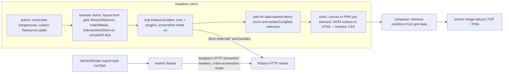

# @kbn/reporting-server-render

A Chromium-free render path for Kibana Reporting's PDF/PNG export: a Node worker boots the
**real Kibana client bundle** inside jsdom (navigated to the real `/app/reportingRedirect`
URL, in screenshot mode, over loopback HTTP) and lets every embeddable render itself, the
same way a navigated Chromium page does today — rather than hand-reconstructing each
renderer's headless service surface.

Behind `xpack.reporting.experimental.serverRender` (off everywhere, including serverless).
Prototype quality — see "Packaging" below.

**This README is the deliverable.** The goal was never "ship this"; it was to find out,
concretely, where a browser-free render path breaks for each of Reporting's panel types and
report whether the approach is viable at all.

## Architecture: jsdom as the browser

`render_dashboard_report.ts` is the orchestrator: resolve a dashboard's own `panelsJSON`
(`resolve_dashboard_panels.ts`) for pixel positions independent of any layout engine,
navigate the worker to the real redirect URL with the report's `locatorParams` injected as
screenshot context (`navigate_and_wait.ts`), wait for every panel's real `renderComplete`,
then sink each panel (canvas readback or DOM+Emotion-CSS — `element_sinks.ts`) into a
`ComposedPage` for `rasterize_page.ts`. Maps still boot the real client (it does the Maps client's work
against a stub WebGL context), but their pixels come from MapLibre Native — see the Tier 7 row below.

## Bottom line

**Viable for the generic client-boot mechanism across most panel types** (Tiers 1-5), with
one drawing exception (maps, Tier 7: the real client builds the map, MapLibre Native draws it) and one
fundamentally unsolvable limitation (pixel-identical DOM-heavy-panel parity — see "Fidelity
bar" below). The load-bearing findings:

1. **Booting the real client works, generically, for the panel types actually exercised
   live.** No per-renderer service reconstruction: a saved `lnsXY` dashboard, an
   `lnsDatatable` dashboard, and Canvas's flot renderer all render through the *same*
   mechanism (`createHeadlessDomEnvironment` + `navigate_and_wait.ts`), because the real
   plugin system boots itself inside jsdom exactly as it would in a browser tab. ML/SLO/APM
   embeddables are assumed, not proven, to work the same way — see the Tier 5 matrix row.
2. **The packaged V8 flag (`--disallow-code-generation-from-strings`) is solved, not a
   blocker.** `vm.runInContext` tolerates the flag; jsdom's selector engine (`nwsapi`) does
   not (it always compiles matchers with `new Function`). Fixed in
   `jsdom_selector_compat.ts` — a `require`-cache patch of jsdom's own `document-base-url.js`
   plus `css-select`-backed `querySelector`/`matches`/`closest` replacements — proven by
   `scripts/verify_selector_engine_under_flag.js` running the real `kibana.bundle.js` under
   the flag with no code-generation error.
3. **The fidelity bar is "visually equivalent", not "pixel-identical", and that is a real,
   permanent limitation, not a bug to fix.** jsdom has no CSS layout engine at all
   (`getBoundingClientRect` on a real DOM node always returns an all-zero rect — confirmed
   directly); every grid/flex/text-wrap decision a browser would make from the CSS cascade
   is simply absent. Canvas-backed panels (charts) are pixel-correct, because they draw via
   a real skia canvas (`@napi-rs/canvas`) exactly as Chromium's GPU rasterizer would. Every
   DOM-only panel still renders (its markup plus the page's live Emotion stylesheet), but
   layout-sensitive details (wrapped text, flex alignment, anything depending on a CSS
   cascade rule rather than an inline style — `getComputedStyle` here only ever returns
   inline styles, confirmed directly) will differ from a Chromium screenshot. There is no
   fix for this short of a real layout engine, i.e. a browser.
4. **Maps (Tier 7) need a different drawing path, not a different client.** `maplibre-gl` needs a
   working `WebGLRenderingContext`; `@napi-rs/canvas` has no GL backend and `headless-gl` cannot be
   built on any current platform (its `node-gyp` configure script uses Python 2 syntax). So the page's
   real map runs against a stub GL context to do the Maps client's work (EMS style sync, GeoJSON from
   `data.search`, joins, colour ramps), and `@maplibre/maplibre-gl-native` draws what it built. An
   earlier prototype rendered only the EMS basemap from the saved object and was blank in practice.

## Coverage matrix

Status legend: ✅ proven (real code, test, and/or a live-Kibana verify script) · 🔴 blocked,
concrete obstacle given · ⬜ not attempted (out of scope / deprecated).

| Tier | Panel types | Status | Mechanism | Notes |
|---|---|---|---|---|
| 1 | Lens `lnsXY` and every other expression-rendered chart type (`lnsMetric/lnsPie/lnsHeatmap/lnsGauge/...`), legacy vis charts, TSVB, Timelion | ✅ | Real client boot: the real `xyVis`/expression renderer registry wires its own services inside the booted bundle | No per-type service reconstruction needed once the generic boot mechanism works — this was the central architecture bet of Phases 1-3, and it paid off. Proven against a real saved `lnsXY` dashboard (`scripts/verify_real_dashboard_boot.js`) and `lnsDatatable` (Phase 4, below). |
| 2 | `markdown` (new embeddable), legacy `markdown_vis`, Canvas `markdown`, TSVB `markdown` | ✅ | DOM subtree sink (no canvas involved) | Part of the same generic DOM/canvas sink in `element_sinks.ts` — no special-casing needed. |
| 3 | `lnsDatatable`, legacy `table`, and virtualized-grid panels generally | ✅ | Real client boot + DOM sink | `EuiDataGrid` virtualizes by measuring its container (`getBoundingClientRect`), which this environment answers via `layout_shim.ts`'s grid/explicit-rect/`measureText` fallback chain rather than a real layout engine — verified live with a real `lnsDatatable` dashboard (Phase 4). |
| 4 | `image`, `links`, controls | ⬜ | Same generic DOM sink | Not specifically exercised by a proof dashboard, but no obstacle distinct from Tier 2/3 — expected to work via the same generic mechanism. |
| 5 | `lnsDatatable`-class React embeddables, generally (this is where Tier 3's entry is actually proven live) | ✅ | Real client boot — each embeddable's plugin start contract constructs itself exactly as in a browser | Proven live against a real `lnsDatatable` dashboard. Found and fixed two real, previously-undiscovered bugs surfaced only by this code path: (a) `BroadcastChannel` is absent from jsdom entirely, and the security plugin's `SessionTimeout` service constructs one unconditionally during `CoreSystem.start()` — an uncaught `ReferenceError` there silently aborted plugin start partway through (fixed: `NoopBroadcastChannel` shim in `headless_dom_environment.ts`); (b) `waitForRenderComplete` originally only checked for element *presence*, not each element's own `data-render-complete !== 'false'` attribute (the real Chromium pipeline's actual condition, in `wait_for_render.ts`) — a false positive for any embeddable whose wrapper mounts synchronously but renders asynchronously, confirmed live (fixed in `navigate_and_wait.ts`). |
| 5 | `ml_anomaly_swimlane`, `slo_overview/error_budget/burn_rate`, APM/aiops/synthetics React embeddables | ⬜ | Same generic boot mechanism, assumed to apply | **Not live-rendered** — this sandbox had no ML/SLO/APM sample data. Confirmed only via static source analysis that these are `@elastic/charts`-family components needing no new panel-type-specific shim, by the same reasoning as the generic mechanism above — a plausible extrapolation, not a proof. The two bugs above were found via the `lnsDatatable` live test, not an ML/SLO live test; it's possible (not disproven) that ML/SLO's specific plugin start contracts hit their own undiscovered gap the same way the security plugin did. |
| 6 | Canvas `plot`/`pie` (`@kbn/flot-charts`) | ✅ | Real client boot + `layout_shim.ts`'s `measureTextRect` fallback | `text.js`'s `valueLabel` divs (for centering data-point labels) read `offsetWidth`/`offsetHeight` on a DOM-only element jsdom can't lay out; fixed with a real skia (`@napi-rs/canvas`) `measureText()`-backed estimate for leaf, text-only, rect-less elements. |
| 6 | Canvas/Lens Vega (`vis_type_vega`) | ⬜ (not actually confirmed working live) | Real client boot; `vega`'s own `renderer: 'canvas'` draws through a plain `<canvas>` | **Reasoned, not proven.** No Vega-specific shim is believed needed — Vega draws through `getContext('2d')` like every other chart-family renderer, by the same static-source argument as Tier 5's ML/SLO row. The one live attempt actually errored (a live Vega-Lite panel showed a generic "Error"); that was *attributed* to the same basic-auth/`UnauthorizedResponseHttpInterceptor` finding below rather than a new Vega-specific gap, but this was never independently re-confirmed against a session-cookie-authenticated sandbox — so it is a plausible explanation for the failure, not a demonstrated success. |
| 6 | ML `anomaly_charts`/`single_metric_viewer` (d3 SVG), `apm_service_map` (cytoscape) | ⬜ | Same generic boot mechanism expected to apply | Not exercised live (no sample data in this environment); architecturally in the same bucket as Tier 5/6's other React embeddables, not a known-distinct obstacle. |
| 7 | `map`, Vega map view (`maplibre-gl`) | ✅ | The page's real MapLibre GL JS map does the Maps client's work (against a no-op WebGL stub, `webgl_stub.ts`); its style, images and feature state are exported (`capture_js_map.ts`, `export_map_style.ts`) and drawn by `@maplibre/maplibre-gl-native` (`render_map_panel.ts`) into the panel's canvas, so the generic sink keeps the panel's header, legend and attribution | Basemap, EMS_FILE polygons with joins, GeoJSON points/clusters (Logs, Flights, eCommerce sample maps) and Vega map views render. Fidelity gaps: mercator only (the samples ask for a globe at low zoom), label placement differs, vector-tile (MVT) layers only if the loopback tile route works end to end (not exercised: Flights' MVT layer is hidden at its saved zoom). EMS (`tiles.maps.elastic.co`, `vector.maps.elastic.co`) is the one allow-listed third-party origin. |
| — | `vislib`, `input_control_vis`, legacy `markdown_vis` output format | ⬜ | — | Out of scope (deprecated). |

## The packaged-V8-flag finding

`--disallow-code-generation-from-strings` was suspected to be a hard blocker (Kibana's
packaged distribution runs with it). It is not: `vm.runInContext` (how this package executes
every bundle) is unaffected by the flag. The actual trip hazard is jsdom's own internals —
its selector engine (`nwsapi`) always compiles CSS selectors via `new Function`, and jsdom
reaches it two ways that have nothing to do with application code: internal `<base href>`
resolution (`document.baseURI`, and every `<script src>`/``/`<link>`/`<a>` resolution
calls `document.querySelector("base[href]")` on jsdom's own implementation layer) and any
application-level `querySelector*`/`matches`/`closest` call. Fixed in
`jsdom_selector_compat.ts`: a `require`-cache patch of jsdom's single
`document-base-url.js` helper (Kibana never emits a `<base>` tag, so this is a safe no-op —
documented as a risk to revisit if that ever changes) plus `css-select`-backed
`Element.prototype` replacements for the application-level calls. Proven by
`scripts/verify_selector_engine_under_flag.js`, which runs the real `kibana.bundle.js`
under the flag with no code-generation error. This module must be `require`d before `jsdom`
anywhere in the process (jsdom binds the helper at require time) — enforced by plain
`require()` ordering in `headless_dom_environment.ts`.

## Fidelity bar: "visually equivalent", not "pixel-identical"

jsdom has no CSS layout engine. Every browser layout decision — flex/grid resolution, text
wrapping, cascade-derived (as opposed to inline) style values — simply does not happen here.
`getComputedStyle` in this environment (`headless_dom_environment.ts`) returns inline
styles only, never a stylesheet-cascade-resolved value; `getBoundingClientRect` on an
un-shimmed element returns an all-zero rect. The practical consequence:

- **Canvas-backed panels (every chart-family renderer: Lens/legacy vis, Flot, Vega,
  Elastic Charts directly) are pixel-correct.** They draw via a real skia canvas
  (`@napi-rs/canvas`), the same rasterization primitives a GPU-backed browser canvas would
  use, with no layout engine involved in the drawing itself.
- **Dashboard/Canvas grid *positions* are pixel-correct.** `dashboard_panel_layout.ts`
  computes each panel's pixel box directly from the saved object's own `{x,y,w,h,i}` grid
  data using `@kbn/grid-layout`'s own CSS Grid math (column count, row height, gutter —
  duplicated here as constants since that package isn't importable from a server-only
  worker; see that file's own drift-risk note), not by measuring the (unmeasurable) DOM.
- **DOM-only panel *content* (markdown, tables, any non-canvas panel) renders completely**
  (`element_sinks.ts`'s DOM+Emotion-CSS sink), but is not guaranteed pixel-identical to a
  Chromium screenshot for anything that depends on real layout: wrapped text, flex-aligned
  rows, cascade-derived typography. `layout_shim.ts` narrows this gap for the specific,
  common case of a leaf text-only element needing a size estimate (an explicit
  `data-*`-carried rect when the real renderer provides one, falling back to a real
  `measureText()`-backed estimate otherwise — found and fixed for Canvas Flot's `valueLabel`
  divs, Tier 6 above), but does not and cannot generalize to arbitrary CSS layout.

Closing this gap entirely requires a real layout engine, i.e. a browser — which is the
thing this package exists to avoid. The bar this package can honestly promise is "the right
content, correctly positioned at the panel level, pixel-correct wherever a canvas is
involved" — not "indistinguishable from a Chromium screenshot."

## Performance / memory (live Kibana dev server, this sandbox)

Measured with `scripts/verify_real_dashboard_boot.js` against two different real saved
dashboards on a running `node scripts/es snapshot` + `node scripts/kibana --dev` pair
(macOS arm64, Node 24), each run under `--disallow-code-generation-from-strings`:

| Dashboard | Panel type | Boot-to-`renderComplete` | Heap delta |
|---|---|---|---|
| `lnsXY` proof dashboard | Lens XY chart | 7498ms | 585.2MB |
| `lnsDatatable` proof dashboard (Phase 4) | Lens datatable | 6933ms | 571.5MB |

Both numbers include fetching and `vm.runInContext`-executing the full real optimizer
bundle graph for this Kibana build (core + every plugin that app route pulls in — the shim
usage log for each run shows 387-389 external bundle chunks fetched and executed), not just
the one panel type under test; a dashboard pulling in fewer plugin bundles would boot
faster. **Worker-thread reuse across report jobs (navigating within one already-booted
worker instead of re-booting per job) is the obvious mitigation for both numbers and was
not implemented or benchmarked in this pass** — this is the single highest-value next
measurement if this continues, since ~7s and ~580MB *per report* is not viable as-is for
any reasonable concurrent job throughput.

## Shim inventory (every faked/stubbed browser API)

From `headless_dom_environment.ts`'s window-global list, plus the dedicated shim modules:

- **Canvas/2D & geometry** (native skia via `@napi-rs/canvas`, not jsdom's own unimplemented
  versions): `Path2D`, `ImageData`, `Image`, `DOMMatrix`, `DOMPoint`, `DOMRect`.
- **No-op/stub globals**, each because the real API either doesn't exist in Node or has no
  meaningful single-worker equivalent: `ResizeObserver` (`FakeResizeObserver` — reports an
  explicit, grid/layout-shim-derived size, the one non-trivial shim in this group),
  `EventSource` (`NoopEventSource`), `Worker` (`NoopWorker` — real Web Worker threads are not
  replicated; code depending on one actually running will silently do nothing),
  `PerformanceObserver` (`NoopPerformanceObserver`), `BroadcastChannel`
  (`NoopBroadcastChannel` — the Phase 4 security-plugin finding above).
- **Fetch-family**, backed by the real `fetch`/`Request`/`Response`/`Headers`, but with a
  custom `Request` (`WindowRequest`) that resolves relative URLs against the navigated
  page's own location (Node's own `Request` does not).
- **`getComputedStyle`**: returns inline styles only (see "Fidelity bar" above).
- **`layout_shim.ts`**: `offsetWidth`/`offsetHeight`/`clientWidth`/`clientHeight`/
  `getBoundingClientRect`, answered via (in order) an explicit `data-*`-carried rect, a real
  `measureText()`-backed estimate for a leaf text-only element, or `0`/an empty rect
  otherwise — not a real layout engine.
- **`matchMedia`**: answers every real media-feature query Kibana's theme/EUI code probes
  (confirmed live: `(prefers-contrast: more)` is queried 64 times in one dashboard boot).
- **`IntersectionObserver`**: see Phase 1.
- **Resource loading** (`loopback_resource_loader.ts`, `loopback_xhr.ts`): every
  `<script src>`/`fetch`/`XMLHttpRequest` the bundle issues is routed over real HTTP to
  Kibana's own server, with the report's forwarded user headers attached — not a fake
  network layer; see "Security posture" below.
- **`jsdom_selector_compat.ts`**: see the V8-flag section above.
- **Scripting** (`navigate_and_wait.ts`): `runDocumentScripts`/`installDynamicScriptRunner`
  execute every `<script>` (including ones rspack's own chunk loader inserts at runtime) via
  `vm.runInContext`, in document order, with CSP-aware skipping of un-nonced inline scripts
  under a strict-CSP page — jsdom's `runScripts: 'outside-only'` parses but never
  auto-executes scripts, so this entire mechanism is this package's own replacement for
  that.
- **Maps (Tier 7)**: not a shim at all, by design — `render_map_panel.ts` bypasses the
  generic boot path entirely for `'map'` panels (see that file's doc comment and the Tier 7
  matrix row).

## Panel rendering pipeline (current)

Every dashboard panel -- canvas-backed or not -- goes through one path
(`src/worker/element_sinks.ts`): clone the live `[data-shared-item]`, swap each `<canvas>` for an
`` of its backing skia surface *in place* (so legends, annotation markers and the panel's own
header survive), lower inline styles, lower the page's stylesheets to what that markup can use
(`src/lowering/takumi_css.ts`), and rasterize the panel to its own PNG with Takumi. The page composer
only places PNGs. Findings that shaped it, all reproduced live against the "[Logs] Web Traffic" sample
dashboard:

- **jsdom has no layout, so panels must be told their size.** `src/worker/panel_rect_assigner.ts`
  assigns each panel the box its saved grid data implies, found by the grid item's stable
  `panel-<panelIndex>` id (never by DOM order). `ResizeObserver` and `offsetWidth`/`getBoundingClientRect`
  read the nearest ancestor rect, and an element's own inline pixel `width`/`height` counts as its size
  (react-window sizes every grid cell that way). Assigning a rect re-fires observers already watching
  beneath it. Without this, charts drew at a made-up 600x300 and `EuiDataGrid` rendered nothing.
- **A canvas's backing surface follows its `width`/`height`**, as a browser's bitmap does. It used to be
  frozen at the first `getContext`, which turned every Vega panel into a 1x1 image.
- **Kibana's Emotion caches are `speedy`**: rules go in via `insertRule` and the `<style>` text is
  empty. `src/worker/collect_page_css.ts` records the raw rule text as inserted, plus the raw `<link>`
  stylesheet bodies the resource loader fetched (~1.1MB on that dashboard).
- **Takumi tolerates bad values in stylesheets but fails the whole render on a bad inline `style`**
  (`overflow:auto`, `position:sticky`, `display:contents`, keyword grid tracks, `fit-content` min/max sizes).
  It has its own cascade (specificity, `!important`, `@media`, `@layer`, `var()`, `calc()`, `:hover` never
  matching), so none of that is reimplemented. Logical properties (`inline-size`, `border-inline-start`,
  ...) parse but are *not applied*, so they are mapped to physical ones. `scripts/probe_takumi_css.js`
  is the evidence; rerun it on every Takumi upgrade.
- **Pruning** keeps only rules whose class/id tokens exist in the panel (4435 rules / 1.1MB down to ~50-130
  rules / 7-18KB per panel).
- **`EuiDataGrid` rows are positioned below a header the client measured at 32px**; Takumi lays the header
  out itself (a three-line-clamped header is ~98px), so rows are shifted by the difference using Takumi's
  `measure` (`alignDataGridRows`).
- Fonts: Takumi never reads system fonts; Inter and Elastic UI Numeric are registered with it. (The
  skia font path was also one directory level off and registered nothing before.)

- **`getComputedStyle` is real** (`src/worker/computed_style.ts`): cascade, specificity, inheritance,
  `var()`, rem/em and unitless `line-height` to px, indexed incrementally as Emotion inserts rules.
  EUI reads `lineHeight`/`paddingTop` off a cell to compute row heights; with inline styles only that
  was `NaN`, react-window's row loop stopped at row 0, and a grid rendered two rows.
- **Maps**: the real MapLibre GL JS `Map` runs against a stub WebGL context and a stand-in worker that
  answers vector-tile requests as 404 (so MapLibre's `load` fires). Feature-state is baked into GeoJSON
  properties (`["feature-state", k]` becomes `["get", k]`) because Native did not apply
  `setFeatureState` before the first render. `` loading is shimmed (`image_loader_shim.ts`) because
  jsdom never fires `onload`, which the EMS sprite sheet needs.
- **Fonts**: Inter, Elastic UI Numeric and (as the last fallback) Noto Sans CJK TC, reused from the
  screenshotting plugin, are registered with both Takumi and skia.
- **Missing-paren values** (`repeat(1, minmax(0, 1fr)`, set that way by Elastic Charts) are valid per
  property but corrupt attribute text, so inline styles are lowered from the live element's style
  object, not from re-parsed attribute text.

Debugging: set `REPORTING_SERVER_RENDER_DUMP_DIR` to write every panel's lowered HTML and CSS there and to
print per-panel timings and the usage log.

Known gaps: Chromium-parity items (`forceNow`, `layout` screenshot context, `x-kbn-screenshot-mode`
header, PDF header/footer/logo/page numbers, `print` layout, multiple locators), rendering on a worker
thread instead of Kibana's main thread (the render mutates `globalThis` for its duration), DOM text in
the PDF is raster (one PNG per panel), MVT map layers are unproven, and a panel that never reports
render-complete degrades with a warning after the render timeout rather than failing the report.

### Visual comparison against Chromium

`scripts/compare_with_chromium.js` generates the same dashboard through `pngV2` (Chromium) and
`pngServer`, then writes a contact sheet (Chromium | server | pixel diff) and a per-panel table, and
exits non-zero if a panel is blank, or has under a quarter of the ink Chromium drew. Baseline on the
three sample dashboards (local, macOS arm64): no panel under threshold; per-panel pixel mismatch
mostly 2-10%, up to ~22% on the densest XY charts (anti-aliasing, label placement). Server render took
10-18s against Chromium's ~10s on a warm dev server.

## Export types

`ServerRenderPdfExportType` (`printablePdfServer`) and `ServerRenderPngExportType`
(`pngServer`) are real `ExportType` subclasses, registered in
`x-pack/platform/plugins/private/reporting/server/core.ts`'s `getExportTypes()` behind
`xpack.reporting.experimental.serverRender`. `ServerRenderJobParams` (`job_params.ts`)
carries a real `locatorParams: [LocatorParams]` (the same shape `JobParamsPNGV2`/
`JobParamsPDFV2` use for a single-panel/dashboard locator), not a hand-resolved panel list —
`runTask` builds a `LoopbackHttpClient` from the task's own server info and forwarded
request headers, then calls `renderDashboardReport` directly.

**Not yet wired:** the share-menu integration (`kbn-reporting/public/share/integrations/
{pdf,png}`) does not offer this export type from the UI. The mechanism is real and proven
end to end against a live Kibana server; what's missing is purely the UI gating, not a
rendering gap.

## Security posture

Unchanged from Chromium-based Reporting's model, by design: `LoopbackHttpClient`
(`src/services/loopback_http_client.ts`) forwards the report's already-decrypted user
headers over a real HTTP request to Kibana's own server — the same headers Chromium would
send when navigating, with the same `kbn-xsrf`/`x-elastic-internal-origin` Reporting
already attaches today (see `strip_unsafe_headers.ts` in the screenshotting plugin for the
equivalent browser-side allow-list). No service/router is called in-process, so
authorization, spaces, and feature privileges are enforced exactly as they are today.
Verified with a real local HTTP server in `loopback_http_client.test.ts`.

**Known environment finding, out of this package's scope:** a basic-auth
(`elastic:changeme`)-authenticated sandbox surfaced a genuine Kibana core bug —
`UnauthorizedResponseHttpInterceptor.responseError` throws
`TypeError: Cannot read properties of undefined (reading 'credentials')` handling a 403
from `/internal/content_management/favorites/dashboard` (a background call every dashboard
makes, unrelated to any specific panel). This can surface as if it were a panel render
error, since the exception propagates through the same `fetch` pipeline every panel's data
fetching uses. This is a Kibana core interceptor bug, not a reporting-server-render shim
gap; not fixed here.

## Packaging

Not a blocker for the generic mechanism: `src/dev/build/tasks/install_chromium.ts` already
establishes the precedent of fetching a native binary at Kibana build time, and this
package's own bundle-loading approach (fetching the real optimizer bundles Kibana already
serves, over loopback HTTP, rather than importing plugin `public/` source directly) sidesteps
the dist-packaging concern the original plan raised (`public/` source is not shipped in the
distributable, but the bundles are, and this package loads bundles, not source). Tier 7's
`@maplibre/maplibre-gl-native` needed exactly one `pnpm-workspace.yaml` `allowBuilds` entry
(see the Tier 7 matrix row) — "packaging task with precedent", not a distinct blocker.

## Serverless

Not evaluated in depth. `page_render_screenshotting` already exists as a precedent for a
pluggable `ScreenshottingStart` contract in a constrained environment; this package's export
types gate purely on `xpack.reporting.experimental.serverRender` today (no
serverless-specific check), which is the wrong default for anything beyond continued
prototyping — would need the same `offeringBasedSchema` treatment `png`/`pdf` already get in
`config_schema.ts` before this could ship anywhere.

## Viability recommendation

**Worth pursuing further.** The central architecture bet — boot the real client instead of
reconstructing each renderer's service surface by hand — paid off: it is what makes Tiers
1-6 a single generic mechanism instead of per-type engineering, and it is what surfaced (and
let this package fix) two real, previously-undiscovered Kibana bugs (`BroadcastChannel`,
the render-complete false positive) that a per-type reconstruction approach would never
have exercised. The two things standing between this and a real feature are not rendering
gaps: **worker-thread reuse** (boot cost is currently ~7s/~580MB *per report*, measured
live, and is the clear next bottleneck) and **the share-menu/UI wiring** (the rendering
mechanism itself is proven end to end; the UI simply doesn't offer it yet). Maps (Tier 7)
is its own smaller, bounded follow-up: the EMS-basemap case is done and proven; ES-backed
map data layers are real, scoped, additional work, not a new unknown.
