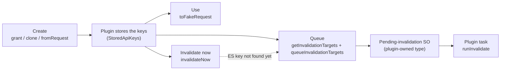

# @kbn/response-ops-api-keys

The API key lifecycle shared by Task Manager, alerting, alerting v2 and actions: create a key, use it for background work, then invalidate it. Each plugin still owns its saved objects, its task registration and its own rules for which key to use.

## Stored keys

Plugins persist keys in the alerting rule attribute shape, `StoredApiKeys`:

- `apiKey`: an Elasticsearch key, stored as `base64(id:secret)`.
- `uiamApiKey`: `base64(id:essu_…)` for keys Kibana granted, or a raw `essu_…` secret for user-created Cloud keys.
- `uiamApiKeyId`: only needed when `uiamApiKey` is a raw secret Kibana owns.
- `apiKeyCreatedByUser`: user-created keys are never invalidated.
- `uiamApiKeyExternal`: UIAM's verdict that the key is external. The fake request is then marked so Elasticsearch doesn't attach the UIAM shared secret.

## To change X, edit Y

| To change | Edit |
| --- | --- |
| How keys are granted or cloned, or which UIAM failures are fatal | `src/create.ts` |
| How a request's own key is parsed | `fromRequest` in `src/create.ts` |
| How stored keys are encoded, decoded, or turned into invalidation targets | `src/stored_keys.ts` |
| Which credential a background run uses, and external UIAM marking | `src/fake_request.ts` |
| Immediate invalidation | `src/invalidate_now.ts` |
| The pending-invalidation saved object written for each key | `src/queue.ts` |
| The background invalidation run, including the in-use checks | `src/task/` |
| The invalidation task's config or state schema | `src/task/config_schema.ts`, `src/task/state_schema.ts` |
| UIAM log tags | `src/log_tags.ts` |

The task state schema is versioned. Add a new version instead of editing an existing one.

## Where each plugin keeps its API key code

| Plugin | Location |
| --- | --- |
| Task Manager | `x-pack/platform/plugins/shared/task_manager/server/api_keys/` |
| Alerting | `x-pack/platform/plugins/shared/alerting/server/api_keys/` |
| Alerting v2 | `x-pack/platform/plugins/shared/alerting_v2/server/lib/services/api_key_service/` and `server/lib/tasks/invalidate_pending_api_keys/` |
| Actions | `x-pack/platform/plugins/shared/actions/server/api_keys/` |
