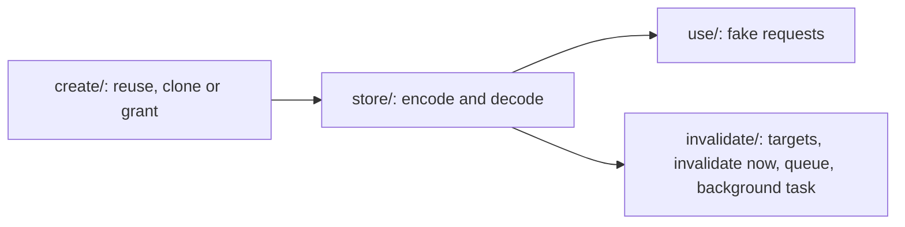

# @kbn/response-ops-scoped-api-keys

Shared server-side handling of the ES and UIAM API keys that Task Manager, alerting, alerting v2 and actions store and use on behalf of users. The reuse-or-grant decision and the invalidation ownership rules live here, so each consumer makes one call.

## Where things are

The folders follow an API key's lifecycle.

| Folder | What it does |
|---|---|
| `create/` | Decides whether to reuse the caller's key, clone it, or grant new ES and UIAM keys (`resolveScopedApiKeys`). |
| `store/` | Encodes keys into the stored `base64(id:secret)` envelope and decodes stored values, including raw `essu_` Cloud keys. |
| `use/` | Builds a fake request authenticated with a stored key (`buildApiKeyFakeRequest`). |
| `invalidate/` | Decides which keys may be invalidated (`getApiKeyInvalidationTargets`), invalidates them right away (`invalidateApiKeysNow`) or queues them (`queueApiKeysForInvalidation`), and runs the background task that invalidates queued keys (`runInvalidate`). |

To change:

- **How a caller's own key is reused, or when it is rejected:** `create/reuse_request_api_key.ts`.
- **When keys are cloned or granted, and in what order:** `create/resolve_scoped_api_keys.ts`.
- **The grant and clone calls to Elasticsearch and UIAM:** `create/grant.ts`.
- **How a stored key is decoded:** `store/stored_api_key.ts`.
- **How a stored key becomes an authenticated request:** `use/fake_request.ts`.
- **Which keys are never invalidated:** `invalidate/get_api_key_invalidation_targets.ts`.
- **Invalidating keys right away, on delete or rollback:** `invalidate/invalidate_api_keys_now.ts`.
- **Writing keys to the pending-invalidation queue:** `invalidate/queue_api_keys_for_invalidation.ts`.
- **How queued keys are invalidated, and the in-use check:** `invalidate/run_invalidate.ts`.

## Who uses what

| Consumer | Adapter |
|---|---|
| Task Manager | `server/api_key_strategy/` |
| Alerting v1 | `server/rules_client_factory.ts`, `server/invalidate_pending_api_keys/` |
| Alerting v2 | `server/lib/services/api_key_service/`, `server/lib/dispatcher/steps/dispatch_step.ts` |
| Actions | `server/lib/task_runner_factory.ts`, `server/inbound/` |

Each consumer keeps its own saved object fields and pending-invalidation saved object type.

## Getting credentials

`resolveScopedApiKeys(request, { security, logger }, opts)` returns `{ enabled: false }` when API keys are disabled, or a `credentials` map keyed by the names you pass in.

- `mode: 'reuse'` reuses the caller's API key when the request is authenticated with one; otherwise new keys are granted. `mode: 'grant'` always grants.
- `clone: true` always grants new keys, even for API key requests. Fake requests always clone.
- `storage: 'pair'` returns an ES key and, when UIAM is enabled, a UIAM key. `storage: 'single'` returns one key: UIAM when enabled, ES otherwise.
- Caller keys:
  - A `base64(id:essu_…)` key is treated as UIAM.
  - A raw `essu_` key is reused as UIAM-only with `uiamExternal: true`. Outside serverless it is rejected with a 400.
- UIAM keys are granted first. If a later grant fails, `onKeyCreated` has already been called for each created key so the caller can clean it up.
- Client mistakes (missing or unparsable authorization header, Cloud key outside serverless) throw a Boom 400. Server failures keep the original error.

`ScopedCredentials.createdByUser` is `true` when the caller's key was reused. Those keys belong to the user and must never be invalidated.
