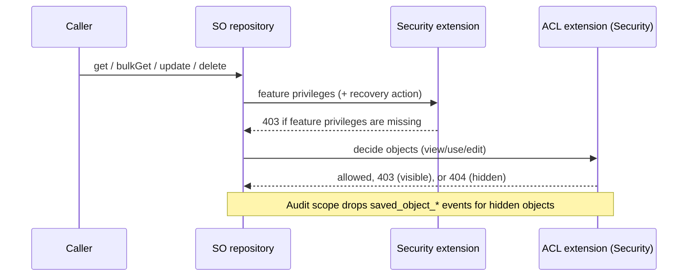

# Platform object-level security: connectors PoC (P0.2)

This branch is a proof of concept. It is not release evidence. Phase-1 tasks still own their coverage.

## 1. Summary

Connectors now have an owner and an ACL when `xpack.security.accessControl.enabled: true`. The ACL is stored in
the root `acl` field of the Saved Object. Levels are cumulative: `none < view < use < edit < manage`.

What works end to end:

- **Create.** A connector is public by default (`general_access: edit`). The creator is the owner. A private
  connector is created in one request with `access_control`. No interval exists in which it is public.
- **List and read.** The list, point reads, `bulkGet`, `resolve` and `find` apply the ACL. Elasticsearch filters
  `find`, so totals, aggregations and pages count only visible objects.
- **Execute.** HTTP execution, enqueue, task execution and connector auth paths need `use`. An object the caller
  cannot view returns 404. A visible object with insufficient access returns 403.
- **Execution logs and KPIs.** Events of connectors the caller cannot view add nothing to rows, totals or
  aggregations. The event log query excludes their IDs, which a system read of the connector index returns.
- **Rules.** Every path that creates or keeps a rule API key checks that the key can use the rule's restricted
  connectors: create, update, bulk edit, bulk create, enable, bulk enable, clone, bulk update and update API key.
  When the check fails, only the keys created in that attempt are invalidated.
- **Workflows.** The connector list hides restricted connectors the caller cannot view. A connector name that
  matches more than one connector, any of them restricted, fails the same way for every caller. A name that
  matches only a hidden connector reads as missing. A workflow bound to a service account runs its connector steps
  as that service account.
- **Edit and delete.** These need `edit`. Denied OAuth, token, rotation, update and delete requests change nothing.
- **Access management.** The generic API under `/internal/security/access_control/{type}` reads, replaces,
  claims and transfers access, with optimistic concurrency. The owner manages access. A recovery administrator
  (wildcard privileges) can view, manage access and transfer, but cannot run or edit.
- **Import and export.** Export never includes `acl`. Import makes the importer the owner of new objects and keeps
  the destination ACL on overwrite.
- **Audit.** Denials, grant-based access, recovery and access changes are audited without titles.
- **UI.** The connector flyout has an Access tab built on the shared `@kbn/access-control-ui` panel, and the
  create flyout has an Access section.
- **Hard disable.** With the setting off (the default), nothing changes for users, and stored ACLs are kept.



### Demo

1. Start the stack with OLS on:

   ```bash
   node scripts/scout start-server --arch stateful --domain classic --serverConfigSet ols_poc
   ```

2. Create two users with `actions: all` in the same space. Sign in as each one once, so they have profiles.
3. As user A, open **Stack Management > Connectors** and create a Server log connector. Open **Access**, select
   **Only people with access**, and save. User B no longer sees it.
4. As user A, add user B with **Can run** and save. User B sees the connector, can test it, but cannot edit it.
5. As `elastic`, open the connector. The Access tab shows the recovery banner. Transfer ownership to user B.
6. As user A, open the create flyout, expand **Access**, select **Only people with access**, and create.

## 2. D1 evidence

The PoC keeps the dedicated `acl` extension slot (PD4). It also adds a request-scoped **audit scope** in place of
a merge with the security extension.

| Criterion                           | Result                                                                                                                                                                                                                                      | Evidence                                                                               |
| ----------------------------------- | ------------------------------------------------------------------------------------------------------------------------------------------------------------------------------------------------------------------------------------------- | -------------------------------------------------------------------------------------- |
| Error ordering                      | Feature privileges are checked first, as today, so a missing feature privilege still gives 403. Then OLS gives 404 for hidden objects and 403 for visible objects with too little access.                                                   | `acl_enforcement.test.ts`, `connector_access.spec.ts`                                  |
| Audit ordering                      | Repository methods run in an audit scope (`AsyncLocalStorage`). Security wraps the logger it gives the security extension. When the scope ends, `saved_object_*` events about objects that OLS denied are dropped. Only the denial remains. | `audit.test.ts`, `audit.spec.ts` "logs a hidden object only as an object-level denial" |
| Exclusion                           | A scoped client that excludes `acl` throws.                                                                                                                                                                                                 | `scoped_client_provider.test.ts`                                                       |
| No provider, or no RBAC             | Core uses a fail-closed extension: general access only, restricted objects hidden, access changes rejected.                                                                                                                                 | `fail_closed_acl_extension.test.ts`, `saved_objects/index.test.ts`                     |
| Setting off                         | The extension allows every object. Core keeps stored ACLs on writes. Initial access requests return 400.                                                                                                                                    | `access_control_disabled.spec.ts`                                                      |
| Privilege requests, both extensions | Zero extra requests. The recovery action rides on the request the security extension already makes (`primeRecovery`).                                                                                                                       | `saved_objects_security_extension.test.ts`                                             |
| Privilege requests, Actions client  | Zero extra requests. `ActionsAuthorization` adds the recovery action to its own check. General access needs no recovery check at all.                                                                                                       | `actions_authorization.test.ts`                                                        |
| Principal lookups                   | At most one per request, and only for restricted objects. Sessions and Basic credentials use the profile ID. API keys read their own record (`with_profile_uid`). UIAM keys have no principal.                                              | `principal.test.ts`, `scoped_acl_service.test.ts`                                      |
| Read filter parity                  | The Elasticsearch filter and the evaluator agree on every fixture shape, also with `search.allow_expensive_queries: false`.                                                                                                                 | `acl_parity.test.ts` (real Elasticsearch, 7 tests)                                     |

**Recommendation:** keep the dedicated slot. The audit scope solves the ordering problem without changes to the
security extension beyond recovery priming. The fallback in `core.md#d1-fallback` is not needed.

Known cost: `resolve` decides visibility before the security extension runs, so it can cost a second privilege
request when recovery is not primed yet. A single Security-owned authorizer removes it.

## 3. Measurements

**Not measured.** PS0 (baseline) and PS18 (bench) were not done. No `ols_p02_poc_results/` files exist. The design
keeps general-access paths free of principal lookups, privilege requests and audit events. Only a bench proves the
cost.

## 4. Requirement coverage

Operation coverage, by the rows of the OLS validation plan:

| Surface                                          | Coverage                                                                                                        |
| ------------------------------------------------ | --------------------------------------------------------------------------------------------------------------- |
| `get`, `bulkGet`, `resolve`, `bulkResolve`       | Enforced. `acl_enforcement.test.ts`; `connector_access.spec.ts`.                                                |
| `find`, PIT finder, `openPointInTimeForType`     | Read filter per type and space. `acl_enforcement.test.ts`, `acl_parity.test.ts`. PIT pages use the same filter. |
| Create with caller ID                            | Hidden occupied ID gives 404. `connector_access.spec.ts` "reports a hidden caller-selected ID as missing".      |
| Create, bulk create with initial ACL             | Atomic. `connector_create.spec.ts`; `acl_enforcement.test.ts`.                                                  |
| Overwrite, update, bulk update, upsert, counters | Enforced and ACL kept. Counters on registered types are rejected (gap below).                                   |
| Delete and bulk delete                           | `edit` needed; write bound to the authorized `seq_no`. `acl_enforcement.test.ts`; `connector_access.spec.ts`.   |
| Access change, claim, transfer                   | `access_api.spec.ts` (including concurrent claims and stale versions); `acl_enforcement.test.ts` "#changeAcl".  |
| Import/copy                                      | `import_export.spec.ts`. A hidden ID is never reported as a conflict.                                           |
| Export by type or IDs                            | Hidden objects are skipped, also with SOM All. `import_export.spec.ts`.                                         |
| Reference collection and conflict checks         | `collectMultiNamespaceReferences` and `checkConflicts` mask hidden objects. `acl_enforcement.test.ts`.          |
| `updateObjectsSpaces`                            | Rejected for registered types.                                                                                  |
| Namespace deletion and reference cleanup         | System operations; unchanged. Not documented as a policy yet.                                                   |
| Raw Saved Objects `search`, `esql`               | Rejected for registered types. `acl_enforcement.test.ts`.                                                       |
| Internal repositories and decrypted reads        | Actions reads decrypted connectors only after an ACL check (`connector_access.ts`).                             |
| Mixed registered/unregistered types              | Only registered types are decided. `acl_enforcement.test.ts` "does not filter unregistered types".              |

Personas in the Scout API suites (all Basic-auth users): owner, `use` grantee, stranger, feature-read user, user
without Actions, SOM All user, recovery administrator, and an owner API key with read-only privileges. A Kibana
service account acts through a Workflow bound to it (`service_accounts.spec.ts`), and a UIAM API key acts on
serverless with local UIAM (`uiam_keys.spec.ts`).

Connector tests:

| Group         | Coverage                                                                                                                                                                              |
| ------------- | ------------------------------------------------------------------------------------------------------------------------------------------------------------------------------------- |
| Execution     | HTTP: `connector_access.spec.ts`. Enqueue: `create_execute_function.test.ts`. Task and missing-request paths: `action_executor.test.ts`. Service account: `service_accounts.spec.ts`. |
| Side effects  | `actions_client.test.ts` "object-level security"; `oauth_*.test.ts`.                                                                                                                  |
| Rules         | `validate_rule_key_connector_access.test.ts` and a permitted and a refused key per path in each method suite; `rule_keys.spec.ts`.                                                    |
| Logs and KPIs | `hidden_connectors.test.ts` (more than one page of hidden IDs, lookup failure, nothing hidden); `execution_logs.spec.ts`.                                                             |
| Workflows     | `resolve_connector_name.test.ts`, `workflow_connectors.test.ts`, `connector_executor.test.ts`; `service_accounts.spec.ts`.                                                            |
| Search copies | Out of scope (D3).                                                                                                                                                                    |
| UI            | `connector_access.spec.ts` (Scout UI, 6 tests); Jest tests for the panel, the editor and both flyouts.                                                                                |

Two choices in the rule paths need review:

- A key created in the same request may not be searchable yet, so its principal is the caller's. A granted key
  belongs to the caller, and a cloned key copies the caller's own key, so the two are the same by construction.
  Feature privileges still come from the key's own request.
- Bulk edit rebuilds a rule's references as the caller. A caller who cannot view a restricted connector on a rule
  cannot bulk edit that rule at all, whatever the key allows.

## 5. Defaults chosen for open decisions

| Decision   | Default                                                                                  | Effect                                                                                                        |
| ---------- | ---------------------------------------------------------------------------------------- | ------------------------------------------------------------------------------------------------------------- |
| D3         | None. Agent Builder connector search is not changed.                                     | The search copy index still holds names of restricted connectors.                                             |
| D5         | No admin adoption. Any editor can claim an object without an ACL; recovery can transfer. | An administrator cannot pick an initial owner for an unowned object.                                          |
| D7         | Export strips `acl`. Import ignores `acl` in the file.                                   | Moving objects between deployments loses their access settings.                                               |
| A2 history | The current ACL decides.                                                                 | Records of deleted connectors stay visible. A reused ID follows the new connector's ACL. Both are unresolved. |

## 6. Gaps and follow-ups

- **PS0, PS18:** baseline and bench. Needed before reviewers choose the integration on cost.
- **PS10:** system callers without a request cannot run restricted connectors. They need a reviewed allowlist.
- **PS15:** the connector list still shows the delete action for connectors the caller cannot delete. Deleting
  fails with 403. The list needs per-connector permissions to hide it.
- **PS13:** Workflow validation lists connectors on every request. With many restricted connectors, this adds an
  ACL decision per request.
- **PS5:** counters on registered types are rejected, because counters have no preflight read.
- **PS4:** excluding the `acl` extension always throws. Guardrail G2 needs a reviewed allowlist of system uses.
- **PS8:** UIAM API keys and UIAM service accounts get general access only ([kibana#271760](https://github.com/elastic/kibana/issues/271760)).
- **D2:** `acl` is a root field, so every read includes it. Its cost is part of the bench.
- **CI:** `.buildkite/scout_ci_config.yml` disables `actions` and excludes the UI config. Enable them when the draft PR
  wants CI runs. The `ols_poc` config set needs Apps DX review.
- **FTR:** the 34 Actions and Alerting API FTR configs run with OLS disabled. 30 pass locally.
  `spaces_only/tests/alerting/group4` ("should list all registered rule types") fails the same way on the base
  commit, and `spaces_only_legacy` does not load its tests. `spaces_only/tests/alerting/group3`, the email trimming
  tests in `security_and_spaces/group2/tests/actions`, and the connectors and rules UI FTRs are still to confirm.
  None of these suites run with OLS enabled yet.
