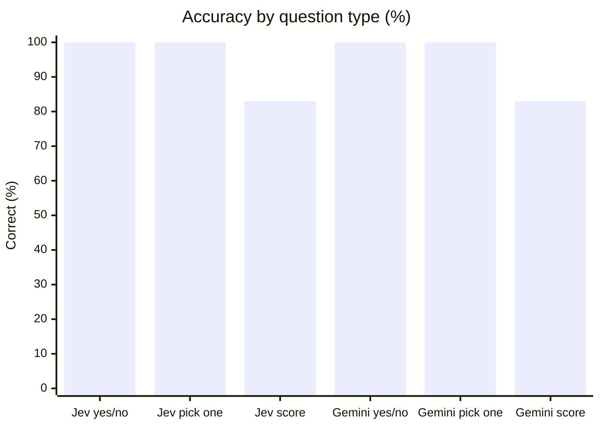
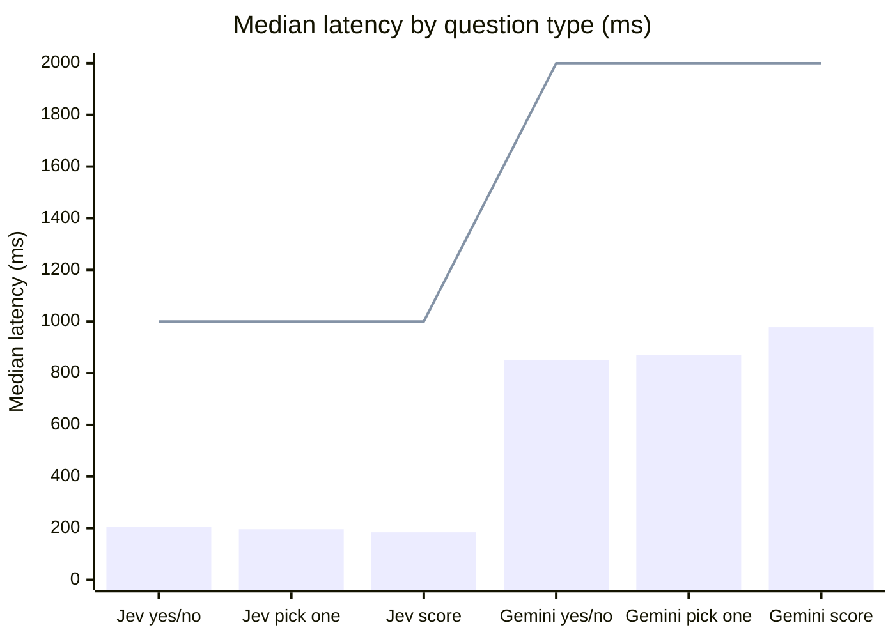
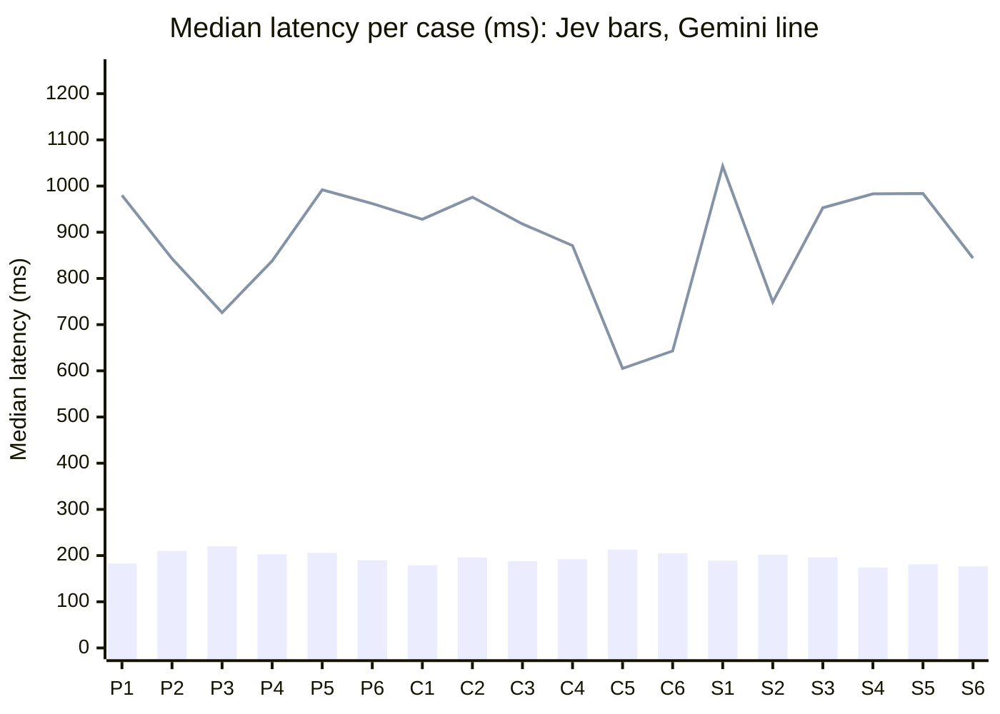

#### Summary

| Model | Correct | yes/no | pick one | score | Consistent across runs | Median latency | p95 latency | Budget | Over budget |
|---|---|---|---|---|---|---|---|---|---|
| Jev 1.13 | 51/54 (94%) | 100% | 100% | 83% | 100% | 196 ms | 270 ms | 1s | 0/54 |
| Gemini 3.5 Flash Lite | 51/54 (94%) | 100% | 100% | 83% | 100% | 918 ms | 1168 ms | 2s | 0/54 |

The line is each provider's budget: 1s for Jev, 2s for the fast model.

#### Confidence when right vs wrong (pick one and score)

| Model | Mean confidence when right | Mean confidence when wrong | Wrong calls |
|---|---|---|---|
| Jev 1.13 | 0.90 | 0.20 | 3 |
| Gemini 3.5 Flash Lite | 0.93 | 0.70 | 3 |

#### yes/no

| Case | Expected | Jev runs | Jev median | Gemini runs | Gemini median |
|---|---|---|---|---|---|
| **P1** Direct question to the agent | yes | ✅ yes 0.98 ✅ yes 0.98 ✅ yes 0.98 | 183 ms | ✅ yes 1.00 ✅ yes 1.00 ✅ yes 1.00 | 980 ms |
| **P2** "@agent do not reply to this" | no | ✅ no 0.15 ✅ no 0.14 ✅ no 0.14 | 210 ms | ✅ no 0.00 ✅ no 0.00 ✅ no 0.00 | 843 ms |
| **P3** Message for a person | no | ✅ no 0.06 ✅ no 0.07 ✅ no 0.07 | 220 ms | ✅ no 0.00 ✅ no 0.00 ✅ no 0.00 | 726 ms |
| **P4** Follow-up for the agent, no mention | yes | ✅ yes 0.93 ✅ yes 0.92 ✅ yes 0.92 | 203 ms | ✅ yes 1.00 ✅ yes 1.00 ✅ yes 1.00 | 838 ms |
| **P5** "thanks!" after the agent answered | no | ✅ no 0.08 ✅ no 0.09 ✅ no 0.09 | 206 ms | ✅ no 0.05 ✅ no 0.02 ✅ no 0.02 | 992 ms |
| **P6** Mentions the agent, but for later | no | ✅ no 0.11 ✅ no 0.10 ✅ no 0.09 | 190 ms | ✅ no 0.00 ✅ no 0.00 ✅ no 0.00 | 962 ms |

#### pick one

| Case | Expected | Jev runs | Jev median | Gemini runs | Gemini median |
|---|---|---|---|---|---|
| **C1** Latency spike | observability | ✅ observability 1.00 ✅ observability 1.00 ✅ observability 1.00 | 179 ms | ✅ observability 0.95 ✅ observability 0.95 ✅ observability 0.95 | 928 ms |
| **C2** Detection alerts | security | ✅ security 1.00 ✅ security 1.00 ✅ security 1.00 | 196 ms | ✅ security 0.90 ✅ security 0.95 ✅ security 0.95 | 976 ms |
| **C3** Find documents | search | ✅ search 1.00 ✅ search 1.00 ✅ search 1.00 | 188 ms | ✅ search 1.00 ✅ search 1.00 ✅ search 1.00 | 918 ms |
| **C4** Small talk | none | ✅ none 1.00 ✅ none 1.00 ✅ none 1.00 | 192 ms | ✅ none 0.95 ✅ none 1.00 ✅ none 1.00 | 871 ms |
| **C5** Failed logins (security or o11y?) | security | ✅ security 0.88 ✅ security 0.87 ✅ security 0.84 | 213 ms | ✅ security 0.90 ✅ security 0.90 ✅ security 0.90 | 605 ms |
| **C6** Slowest traces | observability | ✅ observability 1.00 ✅ observability 1.00 ✅ observability 1.00 | 205 ms | ✅ observability 1.00 ✅ observability 1.00 ✅ observability 1.00 | 643 ms |

#### score

| Case | Expected | Jev runs | Jev median | Gemini runs | Gemini median |
|---|---|---|---|---|---|
| **S1** Time in UTC | low | ✅ low 0.96 ✅ low 0.97 ✅ low 0.96 | 189 ms | ✅ low 0.95 ✅ low 0.95 ✅ low 0.90 | 1043 ms |
| **S2** Count errors | low | ✅ low 0.24 ✅ low 0.20 ✅ low 0.19 | 202 ms | ✅ low 0.85 ✅ low 0.70 ✅ low 0.85 | 749 ms |
| **S3** Compare two services | medium | ✅ medium 0.80 ✅ medium 0.82 ✅ medium 0.82 | 196 ms | ✅ medium 0.90 ✅ medium 0.90 ✅ medium 0.90 | 953 ms |
| **S4** Root-cause investigation | high | ✅ high 1.00 ✅ high 1.00 ✅ high 1.00 | 174 ms | ✅ high 0.95 ✅ high 0.90 ✅ high 0.90 | 983 ms |
| **S5** Summarize today's alerts | medium | ❌ low 0.19 ❌ low 0.17 ❌ low 0.24 | 181 ms | ❌ low 0.70 ❌ low 0.70 ❌ low 0.70 | 984 ms |
| **S6** "Thanks!" | low | ✅ low 1.00 ✅ low 1.00 ✅ low 1.00 | 177 ms | ✅ low 0.98 ✅ low 0.85 ✅ low 0.95 | 844 ms |
