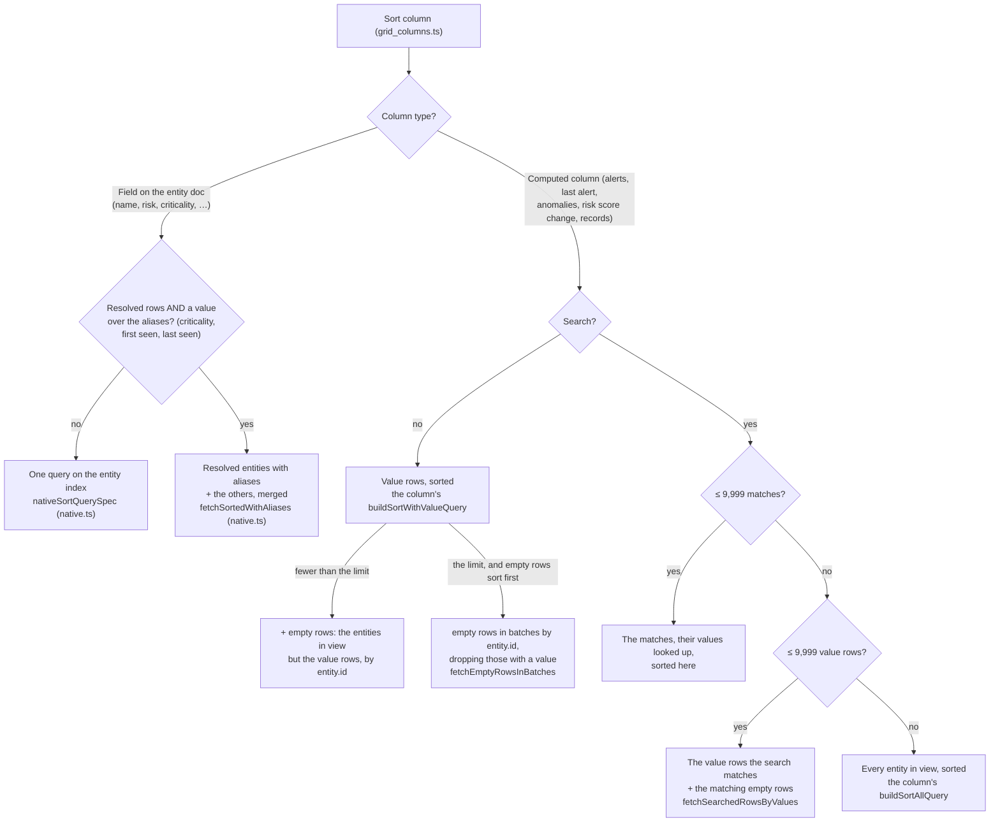

# Entities grid queries

This folder builds the ES|QL queries that fill the entities grid. This page explains which
query runs for each sort, and why. For how the grid loads a page (rows, count, extra columns),
see the comment on `useEntityGridData` in `../hooks/use_entity_grid_data.ts`.

## Which query runs

Each box names the function (and file) that builds the query.

On resolved rows, every plan adds the steps that give the rows of an alias to its resolved
entity; the plan itself doesn't change.

## Words used here

- **Entities in view**: the entities that are rows of the grid. That means the allowed entity
  types, only the main entity of each group when rows are resolved, and the current filters.
  See `entities_in_view.ts`.
- **Search** vs **entity filters**: the search is the search bar text and its filter pills.
  Entity filters are the filter dropdowns and the selected tile. Queries keep them apart
  because KQL (the search) can't run after a `LOOKUP JOIN`.
- **Native sort**: the sorted value is stored on the entity, like name or risk score. One query
  on the entity index does it.
- **Computed column sort**: the sorted value comes from somewhere else, like alert counts or anomaly
  counts, and has to be counted per entity first. The entity's own fields are then added with a
  `LOOKUP JOIN`.
- **Value rows** and **empty rows**: for a computed column sort, value rows are entities that have a
  value (for example, at least one alert). Empty rows are the rest. Empty rows all have the same
  value, so they sort among themselves by `entity.id`.
- **Group** and **Records**: a group is a main entity plus the entities resolved to it (its
  aliases). Records is the number of entities in the group.
- **EUID**: an entity id built from raw fields, like `host:<host.id>`. Alerts and anomalies are
  matched to entities by EUID (`euid_pipeline.ts`). Some alerts already carry the entity id in
  `kibana.alert.entity.id` ("stamped"); for the others the id is built from their user, host
  and service fields.
- **Prefilter**: a cheap filter that Elasticsearch can run on its index before an expensive
  exact filter. It keeps more docs than needed, so the exact filter after it stays correct
  while only checking a few docs.

## What every query has in common

- **Row limit**: each query returns the grid's rows (at most 1,000) plus one extra row. The extra
  row tells whether the view has more rows than the grid shows.
- **Time range**: always written as `buildLookback(range)`, which is `NOW() - N days`. The grid
  and the tiles use the same helper, so they agree on the window.
- **Count**: always the number of entities in view, shown as the total.
- **Extra columns**: after the rows load, each column with computed values (alerts, anomalies,
  cases, records, risk change) reads them for just those rows. If the sort query already read a
  column, it is skipped (an alert sort already has the alert counts).

## Resolved rows show their resolved entity's values

A resolved row is a resolved entity: the main entity that other entities, its aliases, resolve to. Its
columns show the value over the resolved entity and its aliases together, and the records of an
expanded group show their own.

- **Risk score**: the resolved entity's score, which the risk engine stores on the main entity
  (`entity.relationships.resolution.risk.*`), or the entity's own score when it has none. The
  sort and the risk level filter use it too (`buildRowRiskScoreSteps`).
- **Risk score change**: the resolved entity's score now minus the resolved entity's last score before the window,
  from the resolved entity's risk score docs (`score_type` is `resolution`). An entity without a resolved entity
  score compares its own scores. Individual rows read only the own scores.
- **Alerts, last alert and anomalies**: the aliases' alerts and anomalies added up, and the latest
  alert of the aliases. Each column is an `EntityAggregation` (`esql.ts`): how rows of other data
  aggregate per entity, and how a resolved entity's value comes from its aliases' (`SUM` or `MAX`).
  On resolved rows the queries give the rows of an alias to its resolved entity and aggregate them
  (`buildRollUpOverAliasesSteps`, `resolved_entities.ts`), in the sorts and in the enrichers alike.
  An enricher also reads the aliases of the page's rows (`withEntityAliases`), to look for their
  alerts and anomalies too.
- **Cases**: the distinct open and in-progress cases of the aliases, so a case attached to two
  aliases counts once. The page asks the case counts route to include the aliases, which it reads
  from the entity index, and the route counts the distinct cases of a resolved entity over its aliases.
- **Criticality**: the highest of the aliases. **Sources** and **watchlists**: the distinct
  values of the aliases. **First seen** and **last seen**: the earliest and the latest of the
  aliases (`resolved_entities.ts`).

Most entities have no aliases and keep their own values, so only the resolved entities with
aliases are read. `findSortPageFetcher` gives every page of resolved rows the values of its resolved
entities (`withResolvedEntityValues`), after the sort has picked the rows, so paging is not affected.

The entity filters test the resolved entity's value in these columns, but the entity docs hold only
the own value. When the filters test criticality, sources or watchlists on resolved rows
(`needsResolvedEntityFilterOverrides`), `fetchResolvedEntityFilterOverrides` runs first and lists
the resolved entities that pass the filters differently from their main entity: the ones the
filters add (the resolved entity passes, the main entity doesn't) and the ones they remove.
`buildEntityFilterConditions` then tests the main entities on their own values, corrected by those
two lists (`applyResolvedEntityFilterOverrides`), so the sorts, the count and the enrichers all
read the same rows without knowing about resolved entities. The risk level filter needs no
overrides: on resolved rows its text already tests the resolved entity's level.

Sorting by criticality, first seen or last seen reads the resolved entities with aliases and the other
entities apart (`fetchResolvedEntitiesWithAliases`, then `getMergedPage`): the resolved entities come from the alias docs and carry the
resolved entity's value, the other entities sort natively by their own value, with as many extra rows as
there are resolved entities, since an entity that is a resolved entity is dropped for its resolved entity row. The two
streams are merged in the order of the sort. A search can't run after the
join of the resolved entities, so its matches among the resolved entities are read separately.

Sorting resolved rows by alerts, last alert or anomalies needs no plan of its own: the computed
column plans run as they are, with the rows of an alias counted for its resolved entity
(`buildRollUpOverAliasesSteps`).

## The plans

**Native sorts** (`native.ts`): one query on the entity index, sorted and limited by Lucene. On
resolved rows, a sort by criticality, first seen or last seen reads the resolved entities with
aliases apart (with their values over the aliases) and merges them with the others.

**Computed columns** (`computed_column.ts`): alerts, last alert, anomalies, risk score change and
records. Each column writes its own queries, because each needs a different trick to be fast:
every entity in view, sorted (`buildSortAllQuery`, the slow last resort); only the entities with a
value, sorted (`buildSortWithValueQuery`); and the values of given rows (`fetchValues`, also the
grid's enricher). It also says what an entity without data shows (`emptyValues`). The engine only
picks which of them run, and `getComputedColumnQuerySpec` gives the grid the column's sort and
enricher. Reading every entity in view to sort them together is
too slow on a large view, so the rows come in two parts:
- Value rows: the source rows aggregated per entity, the entity docs joined, sorted.
- Empty rows: every other entity in view. They all show the empty value, so they sort among
  themselves by `entity.id`, natively on the entity index. The empty value sorts with the
  values: 0 (alerts) and 1 (records) first ascending, null (last alert, anomalies, risk score
  change) always last.

When the value rows are fewer than the limit, every entity with a value is known, so the empty
rows are one query that leaves them out. When they fill the limit and the empty rows sort first,
the empty rows come from batches of entities by `entity.id`, dropping those whose values show
one: the more entities have a value, the more batches.

A search can't run after the join of the value rows (KQL), so it reads its matches, looks up
their values, and sorts them here. A search with more matches reads every value row instead,
keeps those the search matches, and adds the matching empty rows. Only when both are too many
does it run one merged query of the column: the source index and the entities in view
(`buildEntitiesInViewBranch`) read side by side and merged by `entity.id`; alerts read both
indices in one `FROM`, as FORK can't run in a subquery.

Records counts the alias docs of each resolved entity, plus the entity itself; an entity without
aliases is a group of one (empty value 1). Risk score change reads the last score of each entity
before the window and subtracts it from the current score on the entity doc, before the page
joins its docs; an entity without either has no change.

## When a plan can't be used

ES|QL returns at most `ESQL_MAX_RESULT_ROWS` (10,000) rows whatever the `LIMIT`, so each limit
below is one less than what its query can return: the extra row tells that there are more.

| When | What happens |
|---|---|
| A search matches more than 9,999 entities, and more than 9,999 entities have a value | the column's merged query runs, which reads every searched entity |
| The value rows fill the limit and empty rows sort first, and most entities have a value | the empty rows take several batches |
| A list of ids is longer than `ID_LIST_CHUNK_SIZE` | it is split into several queries: an ES\|QL query can't be longer than 1MB, and ids can be about 100 characters long |
| A computed column fails | its cells stay empty, the other columns still load, and the grid shows an error toast |
| The resolved entities of a page have more than `ID_LIST_CHUNK_SIZE` aliases | the alert and anomaly cells stay empty and the grid shows an error toast: their aliases can't be listed in the query that totals them |
| More than `getMaxAliasGroups` resolved entities with aliases pass the filters, when sorting by criticality, first seen or last seen | the grid shows an error toast: a page from a partial list of resolved entities would be in the wrong order |
| More than `MAX_RESOLVED_ENTITY_FILTER_OVERRIDES` groups pass the filters on the resolved entity values differently from their main entity | the grid shows an error toast; the filter can't list them (an ES\|QL query can't be longer than 1MB) |

## Checking a change

`query_builders.test.ts` snapshots the text of every query on this page. The tiles have their own snapshots. A change that shouldn't change
results should leave the snapshots alone; one that should, should only change the lines it
means to. Query changes so far were also checked on a 10M-entity ECH, comparing the rows and
timings of the old and new queries.

The reasons behind each limit and plan (the measurement, its date and cluster, and the options
we rejected) are in comments next to the code they govern: `computed_column.ts`,
`ID_LIST_CHUNK_SIZE`, `buildReferenceScoreDocs`,
`buildLookback`, and the risk tile queries. Re-measure before changing them.
