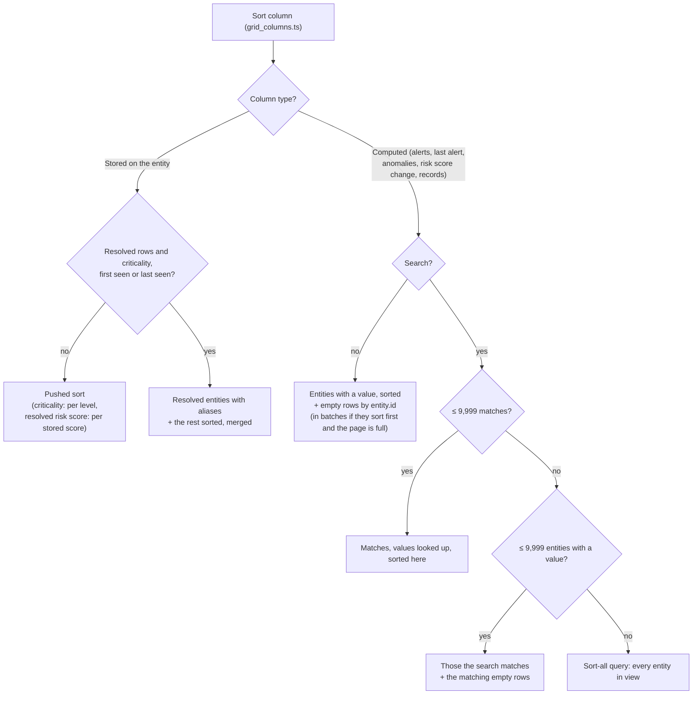

# Entities grid queries

This folder builds the ES|QL queries that fill the entities grid. For how the grid loads a page
(rows, count, extra columns), see `useEntityGridData` in `../hooks/use_entity_grid_data.ts`.

## Why the queries look like this

Elasticsearch runs part of an ES|QL query inside the index ("pushed down" to Lucene): it uses the
index to read only the matching docs, and stops sorting once it has enough. Everything else runs
afterwards, on every row the earlier steps produced. With millions of entities, that difference
decides whether the grid is fast, so most of the code here exists to keep work pushed down.
What gets pushed, from the Elasticsearch planner:

1. **Only steps right on the index.** Nothing is pushed after `STATS`, `LOOKUP JOIN`, `FORK`,
   `MV_EXPAND`, or an `EVAL` that computes a value. Filter and sort first.
2. **`WHERE` is split on `AND`**, and each part is pushed or not on its own. An `OR` with one
   part that can't be pushed is not pushed at all.
3. **Pushed filters:** `IN`, `==` / `!=` with a literal, `IS [NOT] NULL`,
   `MV_CONTAINS(field, literal)` and KQL. **Not pushed:** anything on a computed value, like
   `COALESCE(a, b) IN (…)`.
4. **`SORT` + `LIMIT`** is pushed when it sorts indexed fields right on the index, with a limit of
   at most 10,000. Then Lucene stops at the limit instead of sorting every entity.
5. **`COUNT`** with no `BY` is pushed.
6. **KQL can't run after `STATS` or `LOOKUP JOIN`**, so a search must run on the entity index.

A query that breaks these rules still returns the right rows, just by reading every entity.

## The tricks, and the rule each keeps

- **Sort before the row fields** (`buildSortedByFieldQuery`): the `EVAL`s that shape a row come
  after `SORT` and `LIMIT` (rule 4).
- **Criticality sorts one level at a time** (`fetchSortedByCriticality`): sorting by a computed
  rank isn't pushed, so each level is a pushed filter, read until the page is full (rules 3, 4).
- **Resolved risk score sorts each stored score apart** (`fetchSortedByResolvedRiskScore`): rows
  with a resolved score and rows without sort in two pushed queries, then merge (rule 4).
- **The resolved risk level filter is `IN … OR (IS NULL AND IN …)`**, not `COALESCE(…) IN (…)`
  (`entity_filters.ts`, rules 2, 3).
- **Computed columns sort only the entities with a value** (`computed_column.ts`): alerts,
  anomalies and the like need `STATS` and a `LOOKUP JOIN` (rule 1), so only entities that have a
  value go through them. The others all show the same empty value, so they come from a pushed
  query sorted by `entity.id`, leaving out the ones with a value.
- **Empty rows in batches**: when the empty rows sort first and the entities with a value fill the
  page, those can't all be listed to leave them out, so empty rows are read in batches by
  `entity.id` and the ones that have a value are dropped.
- **A search reads its matches first** (rule 6): up to 9,999 matches, their values are looked up
  and sorted here. With more matches, the entities with a value are read without the search and
  checked against it. When that's too many as well, the column's sort-all query runs: correct, but
  it reads every entity in view.
- **Resolved rows add values after the page is picked** (`withResolvedEntityValues`): most
  entities have no aliases, so the sort stays pushed and only the page's groups are read.
- **Criticality, first seen and last seen on resolved rows** (`fetchSortedWithAliases`): a group's
  value comes from its aliases, which no stored field holds. The resolved entities with aliases are
  read apart, the rest sort pushed, and the two are merged.
- **Filters over a group's values become id lists** (`applyResolvedEntityFilterOverrides`): the
  groups whose values pass the filters differently from their main entity are listed once, and
  added to or removed from the filter by id. Every other query keeps a plain, pushed filter.
- **Alerts and anomalies are found by entity id** (`euid_pipeline.ts`): stamped alerts carry
  `kibana.alert.entity.id`; for the others the id is built from their user, host and service
  fields, behind a cheap pushed prefilter that keeps the exact check on few docs.

## Which plan runs

## Words used here

- **Entities in view**: the grid's rows: the allowed entity types, the filters, and on resolved
  rows only the main entity of each group (`entities_in_view.ts`).
- **Search** vs **entity filters**: the search bar and its pills (KQL) vs the filter dropdowns and
  the selected tile.
- **Group**: a main entity and the entities resolved to it (its aliases). A resolved row shows the
  group's values: highest criticality, all sources and watchlists, earliest first seen, latest
  last seen, summed alerts and anomalies, distinct cases, and the group's risk score.

## Limits

ES|QL returns at most 10,000 rows (`ESQL_MAX_RESULT_ROWS`), so each limit is one less: the extra
row tells there are more. A query can't be longer than 1MB, so id lists are split in chunks.

| When | What happens |
|---|---|
| A computed column fails | its cells stay empty, the rest still loads, and the grid shows an error toast |
| A page's groups have more than `ID_LIST_CHUNK_SIZE` aliases | alert and anomaly cells stay empty, with an error toast |
| More than `getMaxAliasGroups` groups pass the filters when sorting resolved rows by criticality, first seen or last seen | error toast: a partial list would sort in the wrong order |
| More than `MAX_RESOLVED_ENTITY_FILTER_OVERRIDES` groups pass the filters differently from their main entity | error toast: the filter can't list them all |

## Checking a change

`query_builders.test.ts` snapshots every query. A change that shouldn't change results should
leave the snapshots alone. Before changing a trick, check the rule it keeps still holds, and
compare rows and timings on a large cluster.
