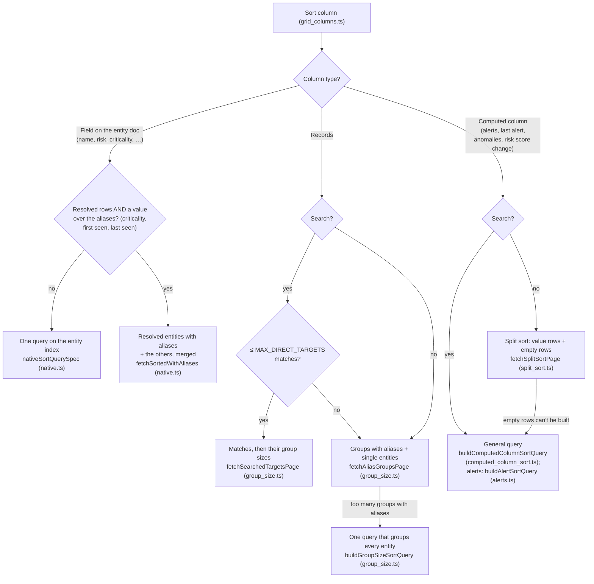

# Entities grid queries

This folder builds the ES|QL queries that fill the entities grid. This page explains which
query runs for each sort, and why. For how the grid loads a page (rows, count, extra columns),
see the comment on `useEntityGridData` in `../hooks/use_entity_grid_data.ts`.

## Which query runs

Each box names the function (and file) that builds the query.

On resolved rows, every plan adds the steps that give the rows of an alias to its resolved
entity; the plan itself doesn't change.

## Words used here

- **Entities in view**: the entities that are rows of the grid. That means the allowed entity
  types, only the main entity of each group when rows are resolved, and the current filters.
  See `entities_in_view.ts`.
- **Search** vs **entity filters**: the search is the search bar text and its filter pills.
  Entity filters are the filter dropdowns and the selected tile. Queries keep them apart
  because KQL (the search) can't run after a `LOOKUP JOIN`.
- **Native sort**: the sorted value is stored on the entity, like name or risk score. One query
  on the entity index does it.
- **Computed column sort**: the sorted value comes from somewhere else, like alert counts or anomaly
  counts, and has to be counted per entity first. The entity's own fields are then added with a
  `LOOKUP JOIN`.
- **Value rows** and **empty rows**: for a computed column sort, value rows are entities that have a
  value (for example, at least one alert). Empty rows are the rest. Empty rows all have the same
  value, so they sort among themselves by `entity.id`.
- **Group** and **Records**: a group is a main entity plus the entities resolved to it (its
  aliases). Records is the number of entities in the group.
- **EUID**: an entity id built from raw fields, like `host:<host.id>`. Alerts and anomalies are
  matched to entities by EUID (`euid_pipeline.ts`). Some alerts already carry the entity id in
  `kibana.alert.entity.id` ("stamped"); for the others the id is built from their user, host
  and service fields.
- **Prefilter**: a cheap filter that Elasticsearch can run on its index before an expensive
  exact filter. It keeps more docs than needed, so the exact filter after it stays correct
  while only checking a few docs.

## What every query has in common

- **Row limit**: each query returns the grid's rows (at most 1,000) plus one extra row. The extra
  row tells whether the view has more rows than the grid shows.
- **Time range**: always written as `buildLookback(range)`, which is `NOW() - N days`. The grid
  and the tiles use the same helper, so they agree on the window.
- **Count**: always the number of entities in view, shown as the total.
- **Extra columns**: after the rows load, each column with computed values (alerts, anomalies,
  cases, records, risk change) reads them for just those rows. If the sort query already read a
  column, it is skipped (an alert sort already has the alert counts).

## Resolved rows show their resolved entity's values

A resolved row is a resolved entity: the main entity that other entities, its aliases, resolve to. Its
columns show the value over the resolved entity and its aliases together, and the records of an
expanded group show their own.

- **Risk score**: the resolved entity's score, which the risk engine stores on the main entity
  (`entity.relationships.resolution.risk.*`), or the entity's own score when it has none. The
  sort and the risk level filter use it too (`buildRowRiskScoreSteps`).
- **Risk score change**: the resolved entity's score now minus the resolved entity's last score before the window,
  from the resolved entity's risk score docs (`score_type` is `resolution`). An entity without a resolved entity
  score compares its own scores. Individual rows read only the own scores.
- **Alerts, last alert and anomalies**: the aliases' alerts and anomalies added up, and the latest
  alert of the aliases. Each column is an `EntityAggregation` (`esql.ts`): how rows of other data
  aggregate per entity, and how a resolved entity's value comes from its aliases' (`SUM` or `MAX`).
  On resolved rows the queries give the rows of an alias to its resolved entity and aggregate them
  (`buildAliasesToResolvedEntitySteps`), in the sorts and in the enrichers alike. Each column's spec
  checks the rows mode once and builds its query from the same steps, with this one added for resolved rows. An enricher also reads the aliases of the page's rows
  (`withEntityAliases`), to look for their alerts and anomalies too.
- **Cases**: the distinct open and in-progress cases of the aliases, so a case attached to two
  aliases counts once. The page asks the case counts route to include the aliases, which it reads
  from the entity index, and the route counts the distinct cases of a resolved entity over its aliases.
- **Criticality**: the highest of the aliases. **Sources** and **watchlists**: the distinct
  values of the aliases. **First seen** and **last seen**: the earliest and the latest of the
  aliases (`resolved_entities.ts`).

Most entities have no aliases and keep their own values, so only the resolved entities with
aliases are read. `findSortPageFetcher` gives every page of resolved rows the values of its resolved
entities (`withResolvedEntityValues`), after the sort has picked the rows, so paging is not affected.

The entity filters test the resolved entity's value in these columns, but the entity docs hold only
the own value. When the filters test criticality, sources or watchlists on resolved rows
(`needsResolvedEntityFilterOverrides`), `fetchResolvedEntityFilterOverrides` runs first and lists
the resolved entities that pass the filters differently from their main entity: the ones the
filters add (the resolved entity passes, the main entity doesn't) and the ones they remove.
`buildEntityFilterConditions` then tests the main entities on their own values, corrected by those
two lists (`applyResolvedEntityFilterOverrides`), so the sorts, the count and the enrichers all
read the same rows without knowing about resolved entities. The risk level filter needs no
overrides: on resolved rows its text already tests the resolved entity's level.

Sorting by criticality, first seen or last seen reads the resolved entities with aliases and the other
entities apart (`fetchResolvedEntitiesWithAliases`, then `getMergedPage`): the resolved entities come from the alias docs and carry the
resolved entity's value, the other entities sort natively by their own value, with as many extra rows as
there are resolved entities, since an entity that is a resolved entity is dropped for its resolved entity row. The two
streams are merged in the order of the sort. A search can't run after the
join of the resolved entities, so its matches among the resolved entities are read separately.

Sorting by alerts, last alert or anomalies needs no plan of its own: the plans of individual rows
run as they are, with the rows of the aliases moved to their resolved entity before the merge
with the entities in view.

## The plans

| Sort | Search? | Plan |
|---|---|---|
| Name, type, risk score, criticality, first seen, last seen | any | one query on the entity index (`native.ts`) |
| Alerts, last alert, anomalies | no | split sort |
| Risk score change | no | split sort for scored entities |
| Alerts, last alert, anomalies, risk score change | yes | the general query: the source index merged with the entities in view (`computed_column_sort.ts`; alerts read both indices in one `FROM`, `alerts.ts`) |
| Records | no | groups and single entities |
| Records | yes | the matching entities, then their group sizes |

**Split sort** (alerts, last alert, anomalies; `buildEntityListSortPlan` in `split_sort.ts`).
It reads value rows and empty rows separately:
- Value rows: count the alerts (or anomalies) per entity, then add the entity fields.
- Empty rows: a plain query on the entity index for the entities in view that are not in the
  value rows.

The rows are the first part, then the second when the first is short. Entities with no alerts have
0, so they come first when sorting ascending. A missing last alert or anomaly count has no
value, so it always comes last.

**Split sort for scored entities** (risk score change). Only entities with a risk score can
have a change.
- Value rows: compare the old and current scores of the scored entities.
- Empty rows: the entities without a score (a plain query), plus the scored entities that had
  no old score.

**Groups and single entities** (Records, `fetchAliasGroupsPage`). Most entities are alone in their
group. So:
- the groups with aliases are built from the alias entities, which are few;
- the single entities are read in order from the entity index, up to the row limit;
- the browser merges both, and then reads the entity fields of the page's groups.

**Records with a search** (`fetchSearchedTargetsPage`). The search decides which rows show, but
not their values: a row keeps the size of its whole group, so it can still be expanded.
- Up to `MAX_DIRECT_TARGETS` matches: read the matching entities, then the size of just their
  groups. This is fast for narrow searches.
- More matches: use the groups and single entities plan, keeping only the groups whose main
  entity matches the search.

## When a plan can't be used

ES|QL returns at most `ESQL_MAX_RESULT_ROWS` (10,000) rows whatever the `LIMIT`, so each limit
below is one less than what its query can return: the extra row tells that there are more.

| When | What happens |
|---|---|
| More than `MAX_VALUE_ROWS` entities have a value | the split sort can't list them in one query, so the general query runs |
| More than `getMaxAliasGroups(pageSize)` groups have aliases | Records runs its single query, which groups every entity |
| More than `MAX_DIRECT_TARGETS` entities match a Records search | Records uses the groups and single entities plan |
| A list of ids is longer than `ID_LIST_CHUNK_SIZE` | it is split into several queries: an ES\|QL query can't be longer than 1MB, and ids can be about 100 characters long |
| A computed column fails | its cells stay empty, the other columns still load, and the grid shows an error toast |
| The resolved entities of a page have more than `ID_LIST_CHUNK_SIZE` aliases | the alert and anomaly cells stay empty and the grid shows an error toast: their aliases can't be listed in the query that totals them |
| More than `getMaxAliasGroups` resolved entities with aliases pass the filters, when sorting by criticality, first seen, last seen, alerts, last alert or anomalies | the grid shows an error toast: a page from a partial list of resolved entities would be in the wrong order |
| More than `MAX_RESOLVED_ENTITY_FILTER_OVERRIDES` groups pass the filters on the resolved entity values differently from their main entity | the grid shows an error toast; the filter can't list them (an ES\|QL query can't be longer than 1MB) |

## Checking a change

`query_builders.test.ts` snapshots the text of every query on this page. The tiles have their own snapshots. A change that shouldn't change
results should leave the snapshots alone; one that should, should only change the lines it
means to. Query changes so far were also checked on a 10M-entity ECH, comparing the rows and
timings of the old and new queries.

The reasons behind each limit and plan (the measurement, its date and cluster, and the options
we rejected) are in comments next to the code they govern: the split sort,
`MAX_DIRECT_TARGETS`, `ID_LIST_CHUNK_SIZE`, `fetchAliasGroupsPage`, `buildReferenceScoreDocs`,
`buildLookback`, and the risk tile queries. Re-measure before changing them.
