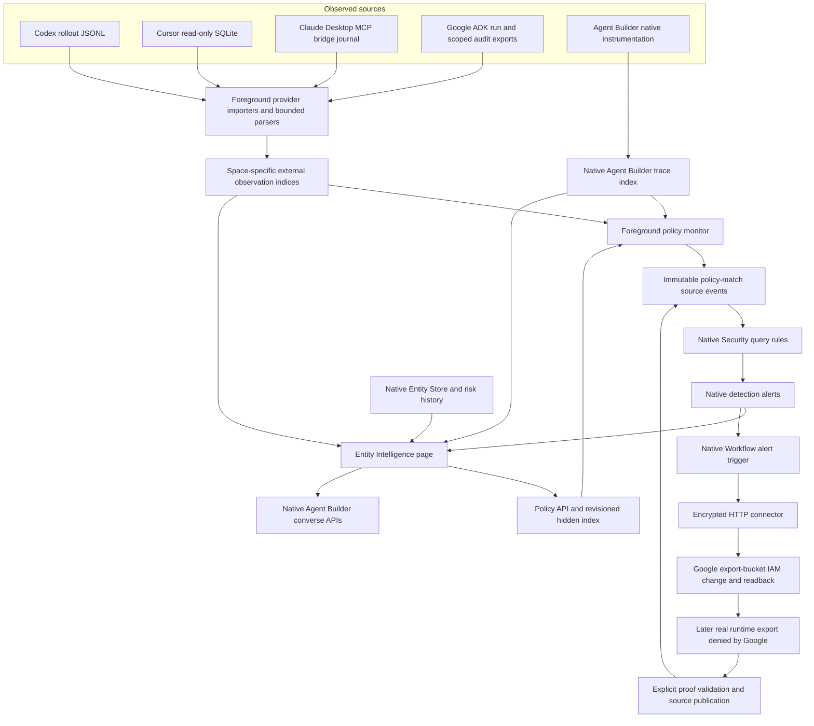

# Entity Intelligence / AI Security prototype — engineering reference

This draft branch preserves the working agent-focused prototype for engineering review. It is not a release-ready implementation or a proposal to ship AI Security inside Entity Analytics. The product direction is a dedicated AI Security experience; agents may also appear as identities in Entity Analytics. The original experimental page brings these concepts together so the data, attribution, detection and response flows can be inspected.

The code is embedded in `security_solution`, at `/app/security/entity_intelligence`. It is not a separately installable plugin. The newer EA-only `entity_experience` plugin is separate work and is not part of this review snapshot.

The source snapshot is based on upstream commit `9ba3addf71d08136b64634baa97d4af6fa1e00e8`, with repository-pinned Node **24.21.0**. This is a reproducible review base, not a claim that the prototype has been rebased, built or certified against today's main branch. Refer to the PR's validation section for checks actually run on the delivered branch; historical test totals in older notes are not current results.

## 1. What can be reviewed

- An all-identities inventory and overview alongside separate agent-provider views.
- Agent Builder definitions, configured tools and observed invocation/tool traces.
- Real local Codex and Cursor observations; ordinary Claude Desktop MCP-boundary observations; Google ADK run, audit and resource evidence.
- A session/run graph with prompts/titles where collected, exact tool-call input/output inspection and bounded behavior comparisons.
- A dedicated monitor-policy editor, revisioned policy state, collector health and native Security alert creation from exact source matches.
- Findings attached to exact tool invocations, retaining multiple policy/rule records for one action.
- Verified requester → runtime/service account → session → tool relationships in the hybrid entity graph, with native risk-input evidence where available.
- A native Workflow execution inspector and supporting Google IAM containment/restore demo code.
- AI Hunt, explain and executive-brief experiments using native Agent Builder conversations.

The snapshot contains source and tests, not the original laptop's Elasticsearch data, saved policies, rules, conversations, deployed cloud resources, tokens or source transcripts. A fresh checkout does not inherit that runtime state.

## 2. Architecture and execution boundaries



These are distinct systems:

1. **Collection:** the TypeScript importers are explicit foreground commands or optional watch loops. They are not Fleet integrations, Task Manager collectors or cloud-wide managed collection.
2. **Policy:** the internal policy API stores monitor definitions separately from detection-rule configuration. The monitor evaluates exact observed tool records against the active policy revision.
3. **Alerting:** native Security query rules turn published source matches into real alerts. The CLI does not fabricate alert documents. This is a prototype implementation using the Detection Engine; **Universal Alerting is not implemented by this branch**.
4. **Response:** the current Google example uses native Workflows HTTP steps to mutate cloud IAM directly. The page reads execution evidence; the page itself does not enforce a block.
5. **AI:** native Agent Builder converse endpoints generate explanations/hunts/briefs. Their tools, permissions, connector and conversation lifecycle remain relevant dependencies.

## 3. Source map

Paths below are relative to `x-pack/solutions/security/plugins/security_solution/` unless qualified.

| Area | Main source |
| --- | --- |
| Page and routing | `public/entity_analytics/pages/entity_intelligence/index.tsx`, `common.ts`, `entity_scope_selector.tsx`; EA `routes.tsx` / `links.ts`, common route constants and shared navigation/deep-link wiring |
| Overview / inventory | `overview_tab.tsx`, `overview_metrics.ts`, `overview_operations*`, `overview_findings*`, `unified_identity_inventory*`, `entities/` |
| Agent providers and graph | `ai_agents/`, especially `external_agent_provider.ts`, `queries.ts`, `model.ts`, `codex_queries.ts`, `codex_model.ts`, `agent_execution_graph*`, `session_graph*` |
| Behavior comparison | `ai_agents/behavior.ts`, `behavior_types.ts`, `codex_behavior.ts`, `behavior_panel.tsx` |
| Identity attribution | `ai_agents/agent_actor_identity.ts`, conversation/actor hooks, `google_requester_identity.ts`, `hooks/use_google_requester_entity.ts`, `relationship_graph_attribution.ts` |
| Findings / responses | `security_findings/`, including `queries.ts`, `evidence_model.ts`, `security_sequences.ts`, `response_evidence.ts`, `response_execution_model.ts`, `response_execution_flyout.tsx` |
| Entity/agent story | `entity_agent_activity*`, `relationship_graph_agents*`, `use_entity_agent_risk_inputs.ts`, `use_entity_agent_session_titles.ts` |
| Policy UI | `ai_policies/`; shared policy contract `common/entity_intelligence/ai_policies.ts` |
| Backend policy state | `server/lib/entity_analytics/ai_policies/`, registered from `register_entity_analytics_routes.ts` |
| Collection / monitor / exercises | This directory: `import_*`, provider parsers/index modules, `ai_policy_evaluator.ts`, `ai_policy_monitor.ts`, `security_detection_rules.ts`, gateway/binder/story setup |
| Shared evidence contracts | `common/entity_intelligence/security_events.ts`, `google_adk.ts`, `content_redaction.ts` |
| AI surfaces | `ai_hunt_tab.tsx`, `hunt_*`, `ai_explain*`, `executive_brief_*`, hooks for connector resolution/converse/streaming |
| Hunt persistence | `common/entity_analytics/ai_hunt_history/`, `server/lib/entity_analytics/ai_hunt_history/` |
| Supporting demos | [`demos/google_adk/`](demos/google_adk/) and [`demos/claude_desktop/`](demos/claude_desktop/) contain supporting application/bridge, setup and response source. They need the additional environment described there. |

The branch also retains necessary native Agent Builder execution/tracing attribution changes and a native Entity Store search integration fix that preserves existing asset fields while enriching criticality. Those shared changes require review from their owning teams; they are not isolated UI code.

## 4. Page and user journeys

The page has six tabs: **Overview, Entities, Explorer, AI Hunt, AI policies, Use Cases**. The default is Entities. Selection is carried in URL parameters: `tab`, `scope=all|entities|agents`, `agentSource`, `agentId`, `sessionId`, and `entityId`.

- **All identities** combines native entities with Agent Builder definitions and imported agent installations. It does not imply that all imported agents have been materialized as native Entity Store records.
- **Agent scope** selects Agent Builder, Codex, Cursor, Claude Desktop or Google ADK. Native invocations, local sessions, MCP connections and cloud runs are labeled differently rather than presented as equivalent units.
- **Explorer** supports both ordinary entity relationships and agent session/run investigation. The hybrid graph puts work performed by agents into a separate area linked to the same identity; ordinary shared-alert/event relationships do not automatically represent direct human actions.
- **Finding → exact action** opens the relevant session/invocation and tool, when exact evidence is available. Unattributed/session-only findings remain separate; the UI does not place a finding on the nearest prompt or tool by time alone.
- **Response** opens one recorded native Workflow execution in a flyout and offers the exact space-aware full execution link.

Classic entity views use Entity Store installation/data-view/read prerequisites. Agent/provider views and policy configuration have their own availability states. Missing one source does not manufacture activity in another.

## 5. Providers, data capture and normalization

| Provider | Input and normalized index | What it establishes / does not establish |
| --- | --- | --- |
| Codex | Actual local rollout JSONL; optional read-only title database. `logs-codex.entity_intelligence-<space>` | Installation/session/parent-role/tool observations and explicit outcome evidence. Default import is metadata-only; redacted prompts/tool input are opt-in. Local file ownership is not an authenticated human requester. Copied fork history and wrapper/native-completion observations require their specific parser semantics. |
| Cursor | Read-only transaction against referenced conversation/composer/bubble rows in local SQLite. `logs-cursor.entity_intelligence-<space>` | Captured titles/prompts/tool input and recorded outcomes. Mixed models are retained rather than forced into one model. A completed composer does not prove authenticated caller identity or permission delegation. |
| Claude Desktop | Explicit journal from the allowlisted customer-records MCP bridge. `logs-claude_desktop.entity_intelligence-<space>` | Actual MCP tool calls grouped by connection. **An MCP connection is not a chat session** and may span chats. Chat IDs, prompts, model and authenticated human requester are unobserved. Client identity is reported, not authenticated. This is ordinary desktop chat instrumentation, not Claude Code transcript ingestion. |
| Google ADK | Explicit run files, scoped cloud audits, ownership/change receipts and consumed resource versions/readback. `logs-google_adk.entity_intelligence-<space>` | Verified requester account, Cloud Run runtime principal, declared accountable owner and version/audit-backed editor context remain separate. Account attribution does not prove who physically typed or why the model acted. An application's source-policy matches are contextual records, not Elastic findings by themselves. |
| Agent Builder | Native agents/tools APIs and `traces-agent_builder.otel-<space>` | Native configured access, invocations and same-trace nearest-agent tool ancestry. Definitions/creator metadata are separate from actual runtime actors. Missing parent spans or conversation evidence leave attribution unresolved. |

External provider indices are separate normal indices with exact-name templates, currently priority 501. They use a shared observation envelope with provider-specific source identity. These imported documents are not native OpenTelemetry spans. Stable observation IDs/checkpoint state make replay idempotent; indexing does not imply automatic deletion or retention management.

The relevant source fields include agent/installation, session, optional parent/role, native tool-call ID, outcome, timestamp, source file/record hashes, capture/schema version and optional bounded content. Unknown outcome remains unknown if the original completion/result was not observed. Google additionally carries the strict `google_adk` context and runtime/resource/audit evidence.

### Collection bounds

| Collector | Default / hard source bounds to review |
| --- | --- |
| Codex | Newest 200 eligible files within 30 days; 64 MiB and 200,000 records per file; up to 50,000 tool observations per file. CLI supports bounded overrides. |
| Cursor | 100 conversations / 30 days; 10,000 bubbles per conversation; 256 MiB overall source bound. |
| Claude Desktop | Explicit audit file; 16 MiB / 20,000 records / 30 days. Only the supported bridge contract is imported. |
| Google ADK | 1–100 run files, 1 MiB each; 5,000 audit rows, 500 change receipts and 2,000 resource versions, each at most 32 KiB. Rejected/conflicting evidence fails before writes. |

The Google flow is **application/run export → scoped audit/resource verification → explicit Node importer → Elasticsearch**. There is no OTLP exporter in the sample application and no automatically provisioned Google-to-Elastic ingestion service in this branch.

## 6. Attribution and content privacy

### Human, agent and service-account roles

- **Local OS owner:** ownership of the source application/bridge files or process account. It must not be promoted into a verified user who requested an action.
- **Agent creator:** definition/configuration author. It is not the actor of every invocation.
- **Authenticated requester:** native recorded authentication or a Google identity token verified by the external application. A Google requester that is itself a service account is not relabeled as human.
- **Runtime principal:** the identity under which the agent/tool actually operates. It remains distinct from requester and owner.
- **Declared accountable owner:** an operator-managed, effective-dated relationship. It does not establish manipulation or delegation.
- **Document editor:** linked only when the consumed immutable object generation/hash, write receipt and successful audit correlation support it. Ownership alone is insufficient.

Native Agent Builder instrumentation captures attribution status/source/capture point, caller principal/API-key identity, initiating actor and delegation/downstream-credential status. The browser can resolve a privacy-normalized actor through an accessible conversation only for one exact matching conversation, agent, trace and ordinary user-authored round. It rejects API-key callers, ambiguous rounds and mismatched IDs/hashes. Missing names remain unavailable rather than being filled from the current viewer or creator.

Google requester-to-Entity Store navigation requires exactly one accessible native record matching the verified Google subject and email. It does not merge the Google account with a similarly named local account or transfer the service-account owner's identity to the requester.

### Optional captured content

`content_redaction.ts` implements bounded, pattern-based redaction, including explicitly observed secrets. It is not universal DLP. Content retention/access requires independent productization review.

- Codex excludes assistant messages, reasoning and tool results from optional exported content.
- Cursor does not export arbitrary application storage, output bodies or diffs.
- Claude captures only the supported bridge's bounded approved tool projection.
- Google retains its bounded run/tool/resource projection.
- Native Agent Builder content is read through current conversation ACLs, redacted/bounded and projected for the selected round/tool; reasoning and arbitrary attachments are excluded.

External content lives in `_source` with full-text indexing disabled. Inventory queries omit raw content. The exact observation is fetched only when its inspector opens, matching current space/provider/agent/session/index/document ID; detail cache is discarded on close. Native conversation detail uses zero retention and access revalidation. These controls reduce accidental disclosure but do not replace Elasticsearch source privileges or establish complete multitenant isolation.

Do not commit actual source databases, rollout logs, exported run/audit/resource evidence, importer state/salts, tokens, local credentials or personal configuration. Samples in this branch should be synthetic or code-only.

## 7. Policy APIs and persistence

Base route: `/internal/entity_analytics/ai_policies`, internal API version from the EA constants.

| Route | Behavior |
| --- | --- |
| `GET /internal/entity_analytics/ai_policies` | List up to 500; reject incomplete/overflow results rather than silently returning a full catalogue claim. |
| `POST /internal/entity_analytics/ai_policies` | Create policy revision 1 with server-derived author and effective time. |
| `PUT /internal/entity_analytics/ai_policies/{uuid}` | Full update using `expectedVersion` plus ES sequence/primary-term concurrency control; increments revision and resets effective time. |
| `GET /internal/entity_analytics/ai_policies/status` | Last detector heartbeat and staleness; stale after the greater of 60 seconds or three reported intervals. |
| `POST /internal/entity_analytics/ai_policies/status` | Save bounded source health/scan/match status with receiving user/time; reject invalid/far-future completion. |

Policies accept **monitor mode only**, enabled state, one to five providers, protected-file access / unapproved export / restricted tool use, severity, up to 20 exact tool names and an optional literal input substring up to 500 characters. Names/descriptions and every request collection are bounded. At least one tool-name or input condition is required. There is no delete route; disable through update. Existing findings retain their old policy definition/revision when a policy changes.

Read routes require Security Solution plus EA read; writes require EA manage. The backend uses `asCurrentUser` and `.entity-intelligence-ai-policies-<space>` derived from the current request space. This is a hidden index, not a Saved Object type with migrations/managed lifecycle. The 500-policy creation quota is a preflight count, not a transactional global reservation. API registration is currently part of EA route registration; a dedicated AI Security privilege/lifecycle boundary remains future work.

The UI loads policy configuration independently of detector health and polls status every 15 seconds. Opening the UI does not start a collector or monitor.

## 8. Policy evaluation and native alert creation

`ai_policy_monitor.ts` is an explicitly launched foreground process. Default scan interval is 10 seconds; use a longer interval for laptop demos. It installs/verifies its owned severity-specific rules and source template, reads active policy revisions, scans source observations and publishes source matches.

### Evaluation contract

- Scan the latest 24 hours, never earlier than the current policy revision's `effectiveFrom`.
- Tool-name matching is exact and case-sensitive. Input matching is case-insensitive **literal substring** matching over the visible redacted input. If both are configured, both must match the same call.
- This is deterministic tool/input matching, not semantic policy interpretation, a prompt classifier or a trained model.
- At most 5,000 source observations/provider/pass, 5,000 Agent Builder ancestry documents, 5,000 matches/provider/pass and 50 exact conversation lookups (bounded response size/round count).
- Missing ancestry/input, redaction/truncation, capped results, failed shards and errors make coverage partial/degraded. A tool-name-only policy can match without input.
- Revalidate policy state before publication so a disabled/edited policy does not publish a stale revision match after the scan.

The emitted source event retains exact provider/installation/session/tool/source references, immutable policy definition and matched clause, revision/effective time, input fingerprint and SHA-256. Stable create-only event IDs make polling idempotent.

The monitor source event is a **detection observation**; enforcement outcome remains unknown. A policy category such as unapproved export does not independently prove that bytes were exported. Neither a failed tool, behavior change nor closed alert workflow establishes a successful block.

### Native rules

Four owned rules `entity-intelligence-ai-policy-{severity}-v1` query monitor source matches. They run every minute with a 25-hour lookback and a 1,000-alert cap. The monitor requests `_run_soon`; actual alert generation remains asynchronous. Heartbeat `findingsCreated` counts newly created **source match events**, not confirmed detection alerts.

The separate controlled/generated story recipe installs five query rules for blocked protected read, blocked export, explicitly allowed prohibited export, privilege change and suspicious authentication. Those use a 30-minute lookback and a 100-alert cap. They are an install recipe for review/demo data, not shipped detection coverage.

All security source observations use `logs-entity_intelligence.security-<space>` and the shared `SecurityActivityEvent` contract. Native Detection Engine alerts are then read through the normal Security alert index/API paths.

## 9. Exact findings, graph grouping and risk linkage

### One action can have several policy records

Findings are read through native alerts and exact source ancestry. Session/policy scopes first resolve source IDs; matching alert ancestry then establishes the relationship. The graph does not infer a tool call from shared session IDs, similar commands or adjacent timestamps.

For exact external invocation evidence, the checks retain provider, installation, session, native tool-call ID, source index/document, input record hash, recorded turn where present and outcome/exit-code consistency. Agent Builder uses exact trace/span/invocation ancestry and native call identity. Incomplete evidence stays session-level or out-of-loaded-scope, with a reason.

The session/run graph groups monitor and response findings only when they represent the same immutable invocation. It shows one final action outcome while retaining every underlying alert/policy record for inspection. Different calls, contradictions, incomplete references or active/closed differences do not silently collapse into one action. Indexed alerts are not deleted or rewritten by grouping.

### Entity and risk story

The hybrid graph presents entity → attributed agent/runtime → titled session → exact tool action. Link labels distinguish verified requester, recorded runtime and weaker local/reported relationships. The execution identity is displayed separately, or explicitly absent; it is not replaced with the requester.

Native score, calculation time, eligible count and returned risk inputs remain native data. A **Risk contributor** badge needs an exact latest-risk input reference resolved into one current-space alert backing index/ID. Current-window alert count is not a historical score driver. Returned inputs are bounded; absence from that list does not prove zero contribution. Raw contribution values are not additive percentages of a normalized score.

Blocked operations may be investigation evidence without being native risk contributors; the native scoring eligibility rules apply. The UI does not synthesize a score or change criticality to make a story look stronger.

## 10. Google native response: containment, not a universal inline block

The current demonstration uses a real Google ADK agent on Cloud Run under a dedicated service account and an isolated export bucket. Supporting source in `demos/google_adk/` requires explicit cloud setup, authenticated invocation, evidence export and native Workflow/connector installation. The Kibana checkout alone cannot provision those systems.

```mermaid
sequenceDiagram
    participant Human as Authenticated requester
    participant ADK as ADK agent / runtime service account
    participant Elastic as Importer + policy monitor + native rule
    participant Workflow as Native Elastic Workflow
    participant Google as Google Storage IAM / data plane
    Human->>ADK: Request protected customer lookup
    ADK->>Google: Read requested source using runtime identity
    Note over ADK,Elastic: Explicit bounded export and evidence verification
    ADK-->>Elastic: Tool/run/audit evidence
    Elastic->>Workflow: Native alert trigger
    Workflow->>Google: GET export-bucket IAM
    Workflow->>Google: PUT remove only runtime export grant
    Workflow->>Google: GET readback
    Human->>ADK: Later export request
    ADK->>Google: Actual Storage object create
    Google-->>ADK: 403 after IAM propagation
    Note over ADK,Elastic: Validate denied call and absent target; publish exact block evidence
    ADK-->>Elastic: Denial / target-check / workflow proof
```

The Workflow uses an encrypted HTTP connector to call Google directly. It reads current IAM, removes only the runtime principal's `objectCreator` membership while preserving other bindings/etag, writes IAM and reads it back. A separate manual restore Workflow adds that one grant back. Restoring access does not erase findings, run history or existing objects.

This is **containment of subsequent actions**. The initial protected lookup already occurred. Detection, alert scheduling, evidence synchronization, Workflow execution and IAM propagation are asynchronous; a fast same-invocation read-and-export is not guaranteed to be interrupted. There is no universal inline gateway or model guardrail enforcement in this flow.

An IAM readback proves the control-plane change. An actual later export under the runtime principal returning 403, plus the target absence and exact evidence chain, establishes data-plane denial. It must not be claimed from a successful Workflow status alone. Reapplying containment when the grant is already absent is idempotent, not a new permission removal. A valid completed execution time must precede a blocked-call timestamp before the UI labels it an after-response denial. The sample does not assert an independent native denial-audit join where one is unavailable.

The UI inspector fetches the exact native execution only while open and validates space, workflow/execution IDs, non-test alert trigger, selected run/session and the three HTTP steps. It projects safe step statuses, durations and verified grant state; it does not display arbitrary headers/outputs.

Short-lived impersonation tokens are installed in encrypted connector secret headers, not Workflow YAML or inputs. No service-account key is required. The authorized operator refreshes those tokens; unattended production credential lifecycle is not implemented. The response principal's IAM authority must remain scoped to the isolated demo export bucket.

Some supporting source retains an older optional pre-operation wrapper/decision-object experiment. It is historical/optional and must not be described as the current direct-IAM response. That wrapper controls only instrumented tool paths; it is not a boundary against a compromised runtime holding its own credential.

## 11. Behavior comparisons

`behavior.ts` implements five deterministic observations: new tool, failure-rate increase, repeated failures, increased tool-call volume and increased duration. Defaults include five baseline units; 20 known baseline outcomes, 10 current known outcomes and three failures for failure-rate comparison; three repeated failures within five minutes; 3× volume/duration ratios and minimum activity/duration thresholds.

External baselines use earlier non-overlapping sessions with the same provider, installation, single recorded model and role, deduplicated and capped at ten. Missing/mixed models, incomplete tool summaries, redacted names and missing outcomes affect comparison eligibility. A first-seen tool is new **within the available comparison**, not necessarily new in the estate.

These are review signals, not trained anomaly detection, native alerts, risk-score changes or evidence of malicious intent. They do not enforce a block.

## 12. AI Hunt, explain and executive brief

The original prototype uses native `/api/agent_builder/converse` and `/converse/async` (API version `2023-10-31`) with existing connector resolution. Sync generation has a three-minute timeout; streaming SSE updates message, tool activity, artifacts, completion state and conversation ID, with cancellation.

- **AI Hunt:** scoped question/prompt, visible tool/activity transcript, validated structured result/artifacts and saved hunt history.
- **Explain:** summarize currently selected graph/timeline evidence, including available agent branches, with provenance/intent limitations.
- **Executive brief:** capture one source/coverage snapshot, generate structured narrative, retain supporting entity/agent metrics and navigation, regenerate explicitly and export printable/PDF presentation. Added agent context excludes raw captured external commands/prompts.

This is **not** the newer EA plugin's native `custom_content` report implementation. Do not claim that feature or its validation here.

AI-generated text is interpretation, not new source evidence. Tool instructions are prompt-level instructions, not an independently enforced read-only tool allowlist. Review the configured agent/tool privileges before testing with sensitive data.

### Hunt persistence boundary

`/internal/entity_analytics/ai_hunt_history` supports `GET` list and `POST` create; `/{id}` supports `GET`, `PATCH`, `DELETE`. It stores up to 100 returned history rows in `.entity-analytics-hunts-<space>`, with heavy result payload indexing disabled. Server-side author metadata is recorded.

The routes use EA read privilege and `asCurrentUser` to the per-space hidden index. They do not implement per-author ownership checks. This is space-scoped history, **not private per-user Agent Builder conversation storage**. Saved results can duplicate evidence from a native conversation, so authorization, sharing, retention, error logging, delete semantics and migrations need productization review.

## 13. Request/query catalogue and bounds

Most read paths use browser-side native Data search and current Kibana HTTP services. Their index naming, validation and access behavior are part of review scope; naming alone does not provide authorization.

| Read path | Query / bound |
| --- | --- |
| Agent Builder catalogue | Native `GET /api/agent_builder/agents` and `/tools`; aggregate activity limited to 500 definitions. Configured tools/connectors are shown separately from execution. |
| Agent Builder invocations | `invoke_agent` + `AGENT` over 30 days, latest 100 invocations, exact provider/agent trace aliases. |
| Tool ancestry | At most 20 selected traces / 2,000 spans, nearest recorded agent ancestor in the same trace. |
| Conversation discovery/detail | Latest 100 accessible conversations for the selected agent; exact conversation/trace/round/tool match for detail. Detail text cap 20,000 characters; list partial status is explicit. |
| External groups | Latest 200 session/run/MCP-connection documents seen in 30 days; explicit space/provider index and schema/source checks. |
| External tools | Up to 5,000 exact selected agent/session tool records; original content fetch is one exact document. |
| Finding scope | Latest 100 native alerts plus up to 1,000 matching security-source ancestors over 30 days; exact session/policy source-reference filtering. |
| Hybrid graph | Three sessions per page; four exact tools per session, with full session navigation; at most 24 exact title-metadata tuple lookups. |
| Risk-input resolution | Up to 100 relevant native input IDs, bounded current-space exact document resolution; ambiguous/incomplete searches do not earn contributor badges. |
| Legacy entity timeline | 40 alerts / 200 raw events; raw events query accessible `logs-*`. |
| Legacy entity relationships | Shared alert aggregation with per-kind neighbor caps; bounded raw `logs-*` event context (three detail records / up to 24 neighbors). |
| Resolution context | Legacy lookup index `.entity_analytics.risk_score.lookup-<space>`, at most 5,000 rows. This is not a new native resolution engine. |

Legacy ordinary entity relationship/timeline code includes broad accessible `logs-*` and name-based fallback correlation in places. It requires separate production source/space/identity review. Do not apply the later EA-only plugin's stronger qualified-identity claims to this whole snapshot.

Bounded payloads control browser work; they do not make scans, sorting or aggregation constant-cost. No production fleet/concurrency/storage envelope is established here. Million-identity/two-million-event results from the separate EA prototype are not validation of this branch.

## 14. Local setup and safe review

Use an isolated development checkout/test space, the repository-pinned Node runtime and your own authorized credentials. Do not copy another developer's `kibana.dev.yml`, cloud state or saved source data. No collector needs to run merely to read the code.

```sh
nvm install
nvm use
node scripts/kbn bootstrap
```

Configure compatible local Elasticsearch and Kibana through the normal development setup. The original entity views expect native Entity Store v2 and relevant EA experimental features; merge overrides with existing settings rather than replacing them:

```yaml
uiSettings:
  overrides:
    securitySolution:entityStoreEnableV2: true
xpack.securitySolution.enableExperimental:
  - entityAnalyticsNewHomePageEnabled
  - entityAnalyticsWatchlistEnabled
  - entityAnalyticsEntityStoreV2
  - leadGenerationEnabled
  - leadGenerationDetailsEnabled
```

Confirm supported flags against this pinned checkout. Install/start the native Entity Store through normal setup for entity views. Fresh AI generation needs Agent Builder and an accessible working model connector. Native agent activity needs trace collection; definition access alone does not create traces. Existing source indices and native alerts/risk history are optional evidence sources and can be empty/unavailable.

Start only one Kibana dev supervisor:

```sh
node scripts/kibana --dev --no-base-path
```

Open `http://localhost:5601/app/security/entity_intelligence?tab=overview&scope=all`; a non-default space uses the normal `/s/<space>/` prefix. Account privileges and source-index read access remain necessary.

### Parse before indexing

The examples below read only the reviewer's explicitly selected local sources and report counts without indexing. Replace all source paths. They do not create a collector service, policy or cloud resource.

```sh
node -r @kbn/setup-node-env x-pack/solutions/security/plugins/security_solution/scripts/entity_intelligence/import_codex_sessions.ts --sessions-dir /absolute/path/to/authorized/codex/sessions --content metadata-only --max-files 10 --dry-run

node -r @kbn/setup-node-env x-pack/solutions/security/plugins/security_solution/scripts/entity_intelligence/import_cursor_sessions.ts --state-db /absolute/path/to/authorized/state.vscdb --max-sessions 10 --dry-run

node -r @kbn/setup-node-env x-pack/solutions/security/plugins/security_solution/scripts/entity_intelligence/import_claude_desktop_sessions.ts --audit-file /absolute/path/to/authorized/bridge-audit.jsonl --dry-run

node -r @kbn/setup-node-env x-pack/solutions/security/plugins/security_solution/scripts/entity_intelligence/import_google_adk_runs.ts --export-dir /absolute/path/to/authorized/google-export --project YOUR_DEMO_PROJECT --dry-run
```

Use the shared environment conventions for actual local indexing: `ES_API_KEY` or authorized `ES_USERNAME`/`ES_PASSWORD` (and corresponding `KIBANA_*` variables for the monitor). Existing development fallback authentication is not a production credential strategy. Loopback is the default; external importers require explicit `--allow-remote` before exporting to non-loopback Elasticsearch. The policy monitor is restricted to loopback endpoints and rejects redirects on authenticated requests.

Removing `--dry-run` creates/updates source indices and local importer state. Optional `--watch` creates a foreground polling loop; run only one per source/state file and stop it with the owning terminal/process. Optional redacted content export needs explicit review of what will be retained. Keep state/salts private and stable for idempotent replay.

### Monitor and demo mutations are explicit

Save an enabled policy before a fresh tool call; do not backdate its effective time. This next command **mutates the local test environment**: it can create the source template/index, install/update its owned native rules, publish source matches, request rule execution and write detector status.

```sh
node -r @kbn/setup-node-env x-pack/solutions/security/plugins/security_solution/scripts/entity_intelligence/ai_policy_monitor.ts --space-id default --once
```

For an intentional watch demo, use `--watch --interval-seconds 60` instead of `--once`, then run a fresh actual tool call and import/synchronize its evidence. An alert is asynchronous; use the UI's source status and native rule execution state rather than assuming publication equals detection.

The local `security_policy_gateway.ts` creates only new inert fixtures and a local sink. It is a controlled exercise, not a native Codex/Cursor sandbox or endpoint prevention mechanism. For exact native-call examples, use one action per actual tool command, a fresh request UUID and verified executing session IDs, then the binder before source setup. See the [collector/exercise README](README.md) and [monitor policy guide](ai_policy_demo.md). Do not infer real sensitive access, network exfiltration or authenticated requester identity from caller-supplied correlation flags.

Google deployment, run synchronization, IAM containment and restore, and Claude connector installation are separate opt-in demo actions. Read the support-folder instructions first. They may create cloud resources, consume model tokens, access synthetic customer fixtures or change the isolated bucket's IAM. No such action runs automatically when Kibana starts.

## 15. Validation commands and reviewer checklist

See [the source validation record](validation_results.md) for fresh scoped results, the dependency-installation boundary and broader checks that remain unverified.

The following are focused commands, not a statement that they passed on this branch. Run from the Kibana root with bootstrapped pinned dependencies:

```sh
node scripts/jest --config x-pack/solutions/security/plugins/security_solution/scripts/jest.config.js --runInBand --coverage=false entity_intelligence
node scripts/jest --config x-pack/solutions/security/plugins/security_solution/common/jest.config.js --runInBand --coverage=false entity_intelligence
node scripts/jest --config x-pack/solutions/security/plugins/security_solution/server/lib/jest.config.js --runInBand --coverage=false 'ai_policies|ai_hunt_history'
node scripts/jest --config x-pack/solutions/security/plugins/security_solution/public/entity_analytics/jest.config.js --runInBand --coverage=false entity_intelligence
```

Run the relevant Agent Builder attribution/tracing suites for its changed native files, plus support-demo tests documented in their folders. Do not use live collectors or cloud actions as a substitute for source-only tests.

```sh
node scripts/type_check --project x-pack/solutions/security/plugins/security_solution/tsconfig.json
node scripts/check.js --scope=staged
```

Scope lint to the delivered changed files. The full Security Solution typecheck is materially broader and can be expensive; report actual checks, failures, warnings and unrun checks in the PR. A passing focused suite does not establish a production build, fresh tenant reproduction, deployment compatibility or end-to-end cloud enforcement.

Suggested review order:

1. Shared policy/security/Google evidence contracts and native Agent Builder attribution changes.
2. Provider parsers/importers: projection, redaction, deterministic IDs, bounds, outcomes and current source semantics.
3. Policy API persistence/authz and monitor revision/idempotency/health behavior.
4. Source events → native rules → alert ancestry → exact invocation/grouping logic.
5. Agent session/run graph, prompt/tool inspectors and provider/coverage labels.
6. Verified requester → native entity → runtime/agent branches → native risk inputs.
7. Google Workflow IAM mutation/readback, later physical denial and exact response-execution inspector.
8. AI Hunt/brief input grounding, saved-state access and tool execution boundaries.

Test adverse cases as well as a successful demo: no source, missing index, partial/capped results, different users/spaces, unavailable private conversations, ambiguous actor/round/tool references, multiple policy records per call, contradictory outcomes, stale policy revision, disabled policy, no model, large sessions and failed/late response evidence.

## 16. Productization work explicitly remaining

- Dedicated AI Security app/feature/privilege and policy architecture, including the planned Universal Alerting foundation. This draft is historical exploration, not that implementation.
- Managed collection/integration lifecycle, scheduling, source discovery, upgrades, retention and monitoring; current importers/monitor are manual foreground processes.
- Supported normalized telemetry/source contracts across providers; source completeness and storage/query cost evaluation before broad collection.
- Managed policy and hunt storage, migrations, per-user/space sharing semantics and fine-grained RBAC. Space-scoped hunt result persistence is especially important to review alongside native conversation ACLs.
- Enforced safe AI tool boundaries and retrieved-content instruction handling; prompt instructions alone are insufficient.
- Production credential/token refresh lifecycle for external response actions, least-privilege isolation and reliable propagation/denial verification.
- A clear prevention architecture for same-action enforcement where required; asynchronous IAM containment is useful but does not guarantee stopping an in-flight action.
- Current-main compatibility, full build/types/i18n/accessibility cleanup, representative non-superuser testing and source/space isolation review for legacy broad-log/name-fallback queries.
- Production scale, concurrency, resource budgets and representative sparse/large/noisy-source validation. Query caps are not a scalability certificate.

Use the prototype to inspect what was learned and which native primitives are reusable. Keep observed activity, inferred behavior, policy detection, response execution and independently verified enforcement separate throughout the review.
